# Rational quotient ranks from weak value oracles

**Abstract.** We replace a normalized monotone submodular function with a unit positive-marginal gap by an exact rational function having the same closure operator, the same unit gap, and only a constant-factor increase in total rank. The construction uses deterministic approximate values and canonical closure keys. A strictly concave transform creates enough submodularity slack to tolerate rounding. This gives polynomial-bit quotient sparsification for logarithmic finite-subgroup ranks without factoring their orders.

## 1. Statement

Let <code class="math">E</code> be a ground set of <code class="math">m</code> elements. Let
<!-- math-display: ea1c43c06676b81dc3cbab7e
f:2^E\longrightarrow\mathbb R_{\ge0}
-->
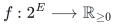
be normalized, monotone, and submodular, and assume
<!-- math-display: 89fad6646fda9a54e9fc545c
f(S+e)-f(S)\in\{0\}\cup[1,\infty)
 \qquad(S\subseteq E,\ e\in E).
 \tag{R1}
-->
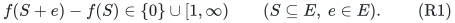
Suppose a deterministic weak value oracle returns rational approximations to <code class="math">f(S)</code> to any requested additive precision. Let <code class="math">R\ge1</code> be a known integer with <code class="math">f(E)\le R</code>.

**Theorem 1.** There is a deterministic exact rational value oracle for a function <code class="math">F:2^E\to\mathbb Q_{\ge0}</code> such that:

1. <code class="math">F</code> is normalized, monotone, and submodular.
2. <code class="math">F</code> has exactly the same zero marginals, and hence exactly the same closure operator and quotient family, as <code class="math">f</code>.
3. Every positive marginal of <code class="math">F</code> is at least one, and <code class="math">F(E)\le4R</code>.
4. All values of <code class="math">F</code> have a common denominator <code class="math">O(R)</code>.
5. One evaluation uses <code class="math">O(m)</code> weak calls at constant precision and one weak call at additive precision <code class="math">1/\mathrm{poly}(R)</code>, followed by polynomial-bit rational arithmetic.

Thus, if the weak oracle is polynomial time in the input length and the requested precision in bits, so is the exact rational oracle for <code class="math">F</code>. This is an exact oracle for a different function preserving the quotient structure; it is not an exact oracle for the original real-valued <code class="math">f</code>.

When <code class="math">f(S)=\log_2 \nu(S)</code> and <code class="math">\nu(S)</code> is an exactly computable positive integer, one may use the integer <code class="math">\nu(S)</code> directly as the canonical key. This avoids the <code class="math">O(m)</code> closure calls and gives the logarithmic subgroup-order specialization in Section 4.

## 2. Exact closure from approximate values

Define
<!-- math-display: 28107d8cb04fdb61453e5f72
\mathrm{cl}_f(S)
 =\{e\in E:f(S+e)=f(S)\}.
 \tag{R2}
-->
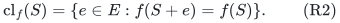
Approximate <code class="math">f(S)</code> and each <code class="math">f(S+e)</code> to additive error <code class="math">1/8</code>. The approximate marginal is in <code class="math">[-1/4,1/4]</code> if the true marginal is zero, and is at least <code class="math">3/4</code> if it is positive. Comparing it to <code class="math">1/2</code> therefore computes (R2) exactly.

We use two standard consequences of monotonicity and submodularity, included here to fix the exact cancellation requirement.

First,
<!-- math-display: 498a41f8592ee032c57e69bd
f(\mathrm{cl}_f(S))=f(S).
 \tag{R3}
-->
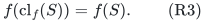
Indeed, every element added in the closure has marginal zero at <code class="math">S</code>, and diminishing returns keeps that marginal zero as the other closure elements are added.

Second, for nested sets <code class="math">S\subseteq T</code>,
<!-- math-display: 552c87286eaad56f4a3ddd68
f(S)=f(T)
 \quad\Longrightarrow\quad
 \mathrm{cl}_f(S)=\mathrm{cl}_f(T).
 \tag{R4}
-->
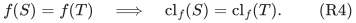
One inclusion follows from monotonicity of closure. For the other, if <code class="math">f(T+e)=f(T)=f(S)</code>, then monotonicity gives <code class="math">f(S+e)\le f(T+e)=f(S)</code>, so <code class="math">e\in\mathrm{cl}_f(S)</code>.

Represent every closure by its canonical bit vector in the original ground-set order. Repeated evaluations on the same closure will therefore use the identical input to the deterministic weak oracle.

## 3. A strict concave transform makes rounding safe

Set
<!-- math-display: 059faeb7cc59244c1ec5f38a
\phi(t)=t-\frac{t^2}{4R}.
 \tag{R5}
-->
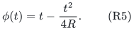
It is increasing on <code class="math">[0,2R]</code>, and its derivative lies in <code class="math">[1/2,1]</code> on <code class="math">[0,R]</code>.

For each closed set <code class="math">C</code>, deterministically choose a rational <code class="math">A(C)</code> satisfying
<!-- math-display: c7a66855c0b1ddd5c22acf90
|A(C)-\phi(f(C))|\le\delta,
 \qquad \delta=\frac1{64R}.
 \tag{R6}
-->
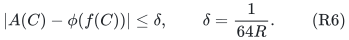
Use the same value on repeated occurrences of the same <code class="math">C</code>, and set
<!-- math-display: d2260c834edb46381f24e9d8
A(\mathrm{cl}_f(\varnothing))=0.
 \tag{R7}
-->
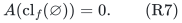
Define
<!-- math-display: 2d2d4c6dd328516850dcf68f
F(S)=4A(\mathrm{cl}_f(S)).
 \tag{R8}
-->
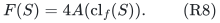

### Monotonicity and the marginal gap

For <code class="math">S\subseteq T</code>, if <code class="math">f(S)=f(T)</code>, equation (R4) makes their rounded values identical. If <code class="math">f(T)&gt;f(S)</code>, a chain of single-element additions and (R1) gives <code class="math">f(T)-f(S)\ge1</code>. Therefore
<!-- math-display: 6245629ac3135246503d0f0a
\phi(f(T))-\phi(f(S))\ge\frac12.
-->
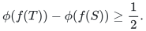
The two approximation errors yield
<!-- math-display: 81bcc73c5242feaf27d2032f
F(T)-F(S)
 \ge4\left(\frac12-2\delta\right)>1.
 \tag{R9}
-->
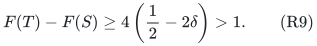
Thus <code class="math">F</code> is monotone, has precisely the same zero marginals, and has positive marginals greater than one. Equations (R3) and (R7) give <code class="math">F(\varnothing)=0</code>. Monotonicity then also gives nonnegativity.

Since <code class="math">\phi(t)\le3R/4</code> on <code class="math">[0,R]</code>,
<!-- math-display: 3f94664843735b253fc98d75
F(E)\le3R+4\delta\le4R.
 \tag{R10}
-->
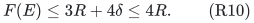

### Submodularity

For arbitrary sets <code class="math">S,T</code>, write
<!-- math-display: 05426bc5ce7e4b33dddbe274
I=S\cap T,\quad U=S\cup T,\quad
 c=f(I),\quad
 a=f(S)-c,\quad b=f(T)-c.
-->
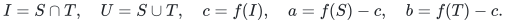
If <code class="math">a=0</code>, submodularity and monotonicity imply <code class="math">f(U)=f(T)</code>. Equation (R4) gives
<!-- math-display: 350269ea27fa6a55dceecfff
\mathrm{cl}_f(S)=\mathrm{cl}_f(I),
 \qquad
 \mathrm{cl}_f(U)=\mathrm{cl}_f(T).
-->
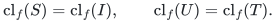
The rounded submodularity expression is exactly zero. The case <code class="math">b=0</code> is identical.

Otherwise <code class="math">a,b\ge1</code>, by (R1). Submodularity gives
<!-- math-display: 800ca1651bcbe29cc52f9624
f(U)\le c+a+b,
 \qquad c+a+b=f(S)+f(T)-f(I)\le2R.
-->
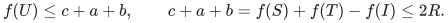
Because <code class="math">\phi</code> is increasing on this larger interval,
<!-- math-display: 1243301558fe2dd9aac89613
\begin{aligned}
 &\phi(f(S))+\phi(f(T))-\phi(f(U))-\phi(f(I))\\
 &\qquad\ge
 \phi(c+a)+\phi(c+b)-\phi(c+a+b)-\phi(c)\\
 &\qquad=\frac{ab}{2R}\ge\frac1{2R}.
\end{aligned}
 \tag{R11}
-->
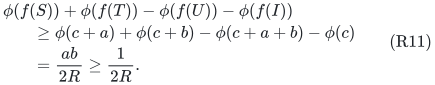
The four rounding errors cost at most <code class="math">4\delta=1/(16R)</code>, which is strictly smaller than this gap. Hence
<!-- math-display: afa26e4637fa9e379a1e178b
F(S)+F(T)\ge F(U)+F(I).
 \tag{R12}
-->
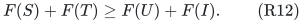
This proves exact submodularity. Arbitrarily close comparisons between unrelated real function values never need to be resolved.

### A common small dyadic denominator

Take a fixed power of two <code class="math">\Delta</code> with
<!-- math-display: aaa30a99e1bf4a7f2c4fa451
1024R\le\Delta<2048R.
-->
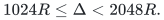
For a closure <code class="math">C</code>, obtain a deterministic rational approximation <code class="math">u_C</code> to <code class="math">f(C)</code> with error at most <code class="math">1/(1024R)</code>, and clip it to <code class="math">[0,R]</code>. Evaluate <code class="math">\phi(u_C)</code> exactly as a rational number, then round down to a multiple of <code class="math">1/\Delta</code>. Force the value in (R7) to zero.

Since <code class="math">\phi</code> is 1-Lipschitz on <code class="math">[0,R]</code>, the total error is at most <code class="math">2/(1024R)&lt;\delta</code>. Every resulting <code class="math">F(S)</code> is a multiple of <code class="math">4/\Delta</code>, has <code class="math">O(\log R)</code> bits apart from its bounded numerator, and is computed without deciding on which side of an exact transcendental rounding threshold the true value lies. The algorithm rounds a specified rational approximation; (R11) makes that choice safe.

If a suitable <code class="math">R</code> is not supplied, take a weak evaluation <code class="math">\widetilde f(E)</code> with additive error at most <code class="math">1/8</code>, and set <code class="math">R=\max\{1,\lceil\widetilde f(E)+1/8\rceil\}</code>. Then <code class="math">f(E)\le R\le f(E)+2</code>. This preserves the rank order whenever <code class="math">f(E)&gt;0</code>, because (R1) then implies <code class="math">f(E)\ge1</code>.

## 4. Logarithmic subgroup ranks without factoring

Let <code class="math">A</code> be a finite abelian group, and let each original item specify a subgroup <code class="math">J_e\le A</code>. Put
<!-- math-display: 5d6cc4640a2dd9a825582ab1
H_S=\sum_{e\in S}J_e,\qquad f(S)=\log_2|H_S|.
 \tag{R13}
-->
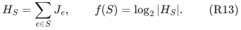
This is a normalized monotone submodular function. For subgroups <code class="math">B,C\le A</code>,
<!-- math-display: 218508b5e226e63f493d3103
|B+C|\,|B\cap C|=|B|\,|C|,
-->
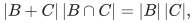
and <code class="math">H_{S\cap T}\subseteq H_S\cap H_T</code>, which proves the submodular inequality for (R13). Every positive marginal is at least one, because a proper subgroup inclusion has integer index at least two.

If <code class="math">&#124;H_S&#124;</code> can be computed exactly in polynomial time, evaluate a deterministic approximation to
<!-- math-display: c3bc2a319e2839f92c922819
\phi(\log_2|H_S|)
-->
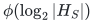
using the integer order as the canonical key. Equal orders receive identical approximate values. In the zero-gap cases of the submodularity proof, the needed orders are equal in pairs, so the proof above applies directly. No factorization of the subgroup order is required.

An explicit approximation procedure is elementary. Write <code class="math">N=2^k u</code>, with <code class="math">1\le u&lt;2</code> rational. For
<!-- math-display: bf8c848cd0674caae2b965fd
z=\frac{u-1}{u+1}\in[0,1/3],
-->
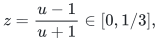
use
<!-- math-display: 7d5d3592ef62f1ea9b5387da
\log u=2\sum_{j\ge0}\frac{z^{2j+1}}{2j+1}.
-->
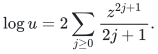
The same series at <code class="math">z=1/3</code> gives <code class="math">\log2</code>. <code class="math">O(\log R)</code> terms, with their geometric tail bounds, give a certified approximation to <code class="math">\log_2N=k+\log u/\log2</code> of the precision needed above. The rational arithmetic has polynomial bit complexity in <code class="math">\log N</code> and <code class="math">\log R</code>.

For modular row blocks in <code class="math">\mathbb Z_q^d</code>, the subgroup orders in (R13) are lattice indices computable by Hermite or Smith normal form. For commuting Weyl blocks, the order oracle additionally includes the scalar phase subgroup; the exact construction is given in [../../quantum-stabilizer/manuscripts/arbitrary-dimension-whole-stabilizer-blocks.md](../../quantum-stabilizer/manuscripts/arbitrary-dimension-whole-stabilizer-blocks.md).

There is another useful application that permits nonabelian groups: for arbitrary subgroups <code class="math">K_e\le G</code>,
<!-- math-display: 470c6419f7b6174928d61292
f(S)=\log_2\!\left[G:\bigcap_{e\in S}K_e\right]
 \tag{R14}
-->
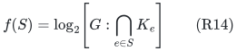
is the joint entropy of the coset variables <code class="math">gK_e</code> for uniform <code class="math">g</code>. It is submodular, and its positive marginals are at least one. Whenever the relevant indices have a compact polynomial-time exact oracle, the same rationalization applies. This does not claim that arbitrary nonabelian subgroup intersections are efficiently computable from arbitrary succinct presentations.

The qualification is necessary: <code class="math">\log&#124;\langle J_e:e\in S\rangle&#124;</code> need not be submodular for arbitrary noncommuting subgroups. The generated-subgroup form (R13) uses an abelian ambient group; the entropy form (R14) has a different proof and remains valid for nonabelian groups.

## 5. Consequence for polynomial-bit quotient sparsification

Quanrud's SODA 2024 Theorem 1.1 explicitly accepts normalized real-valued monotone submodular functions with every positive marginal at least one. It does not require integral ranks. Applying it to the exact rational <code class="math">F</code> above preserves exactly the quotient family of <code class="math">f</code> and gives
<!-- math-display: c50bc56b3fa238c7dc25b149
O\!\left(\frac{R\log(2mR)}{\epsilon^2}\right)
-->
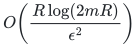
retained original items. The adaptive resparsification argument in [../../label-block-cut/manuscripts/adaptive-quotient-resparsification.md](../../label-block-cut/manuscripts/adaptive-quotient-resparsification.md) improves this to
<!-- math-display: 040e52579aa5f56e8e1174b6
O\!\left(\min\left\{m,
       \frac{R\log(2R/\epsilon)}{\epsilon^2}\right\}\right).
 \tag{R15}
-->
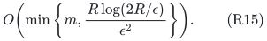
Both constructions now have an exact rational value oracle, with polynomial-bit submodular minimization and strength arithmetic, rather than a symbolic logarithmic oracle.

The fixed denominator must **not** be multiplied into the rank parameter of the support bound. The theorem already permits rational values with the stated marginal gap. Internally, rational submodular minimization can of course clear denominators as an arithmetic operation; this does not change the rank used in the sparsification analysis.

Use the same original function <code class="math">F</code>, the same upper bound <code class="math">R</code>, and the same denominator <code class="math">\Delta</code> throughout all restrictions and repeated calls. In the closure-key implementation, the canonical closure is always computed in the original ground set; this defines one fixed function whose restrictions are passed to the backend.

For completeness, the repeated weight-update ledger remains polynomial. A positive rank difference is a rational number with the fixed denominator <code class="math">\Delta</code> and numerator <code class="math">O(R\Delta)</code>. Thresholds in Quanrud's strength decomposition have the form
<!-- math-display: a243d26cd36b0840a7b6d12f
\tau=\theta\,
 \frac{w(U)-w(V)}{F(U)-F(V)},
-->
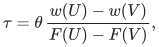
with <code class="math">\theta</code> chosen dyadic within a fixed constant factor of the analytic threshold multiplier. Writing the rank difference as <code class="math">a/\Delta</code>, the threshold is <code class="math">\theta\Delta(w(U)-w(V))/a</code>: the common rank denominator enters only the numerator. If current weights have a common denominator, one pass enlarges it by a product of at most <code class="math">m_i</code> integers of size <code class="math">O(R\Delta)</code>, and the dyadic parameter denominator. The increase in bit length is polynomial. The adaptive sequence uses only polynomially many such operations and calls. Exact rational sampling, or finite-bit sampling with an allocated constant failure budget, therefore preserves the stated compact polynomial-time contract.

## 6. References and scope

The public input is Kent Quanrud, *Quotient Sparsification for Submodular Functions*, SODA 2024, Theorem 1.1 and Section 3. Its real-valued hypothesis and the entropy application are already explicit in the paper. [Primary source](https://kentq.s3.amazonaws.com/submodular-sparsification.pdf).

Closure theory, concave composition of monotone submodular functions, and polynomial-time integer normal forms are standard. The contribution is the quantitative concave transform, canonical-key rounding, and resulting exact rational quotient surrogate, which closes the finite-precision gap for logarithmic subgroup ranks. The support improvement obtained by adaptive repeated calls is recorded separately and is a standard resparsification consequence, not a new public theorem attributed to Quanrud.

The construction preserves zero marginals and quotient queries. It need not preserve the exact numerical rank values, optimal bases of an unrelated optimization problem, or every property of the original real-valued submodular function.
