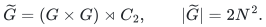
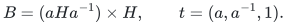
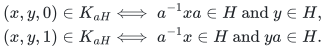
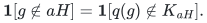
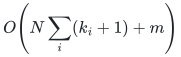

# Exact realization of whole-coset compilation

[Reference API](../reference/README.md) · [Independent finite verification](../verify/check_coset_compiler.py)

This realizes Section 2 of the [affine constraint manuscript](affine-constraints-over-arbitrary-finite-groups.md).
The wreath subgroup is established algebra: Dinh, Moore and Russell,
[*McEliece and Niederreiter Cryptosystems That Resist Quantum Fourier Sampling Attacks*, Proposition 3](https://sfi-edu.s3.amazonaws.com/sfi-edu/production/uploads/sfi-com/dev/uploads/filer/aa/25/aa2531de-e04e-4fea-8772-6f9341ddb6b7/11-06-021.pdf),
give the same subgroup after conjugating the original subgroup and renaming
the shift. The source was checked at the stated proposition. The new local
code supplies an exact explicit-table interface; no quantum operation or
third-party source code is involved.

## Validated original group and subgroup input

The original group is given by a full multiplication table on integer IDs.
The constructor checks the supplied identity, a two-sided inverse for every
element and all associativity identities. Thus a successfully constructed
object satisfies the group axioms, including when the identity is not index
zero. The table and inverse list are immutable copies.

For a generator list, breadth-first closure under right multiplication by
the generators and their inverses terminates after visiting at most the
group order many elements. Every visited element lies in the generated
subgroup. Conversely every word in the generators and inverses is visited
by induction on word length. The returned set is therefore exactly the
requested subgroup, with no normality assumption.

## Common ambient group and exact predicate identity

Write <code class="math">e</code> for the original identity and <code class="math">N</code> for the group order. Every item
uses the same group

<!-- math-display: fa03d0efb22c64e29ca20395
\widetilde G=(G\times G)\rtimes C_2,\qquad |\widetilde G|=2N^2.
-->

The action of the nonidentity element of <code class="math">C_2</code> swaps the coordinates. Triples
store the two original IDs and one parity bit. In multiplying two triples,
swap the right operand's two coordinates precisely when the left operand
has odd parity, multiply in the original table and add parities modulo two.
Associativity follows from the coordinate-swap automorphism, or directly
by splitting the two possible left parities. This supplies the ambient
operations without constructing its full multiplication table.

For one original item <code class="math">aH</code>, put

<!-- math-display: 08137058d8e4993416c10eaa
B=(aHa^{-1})\times H,\qquad t=(a,a^{-1},1).
-->

The element <code class="math">t</code> squares to the identity. Conjugation by it sends <code class="math">(x,y,0)</code>
to <code class="math">(aya^{-1},a^{-1}xa,0)</code>, which preserves <code class="math">B</code>. Hence <code class="math">B\cup Bt</code> is a
subgroup. The returned generators contain each original member of <code class="math">aHa^{-1}</code>
in the first coordinate, each member of <code class="math">H</code> in the second, and <code class="math">t</code>. They
therefore generate exactly that subgroup; retaining redundant generators
changes neither its identity nor its semantics.

The membership implementation checks the following explicit alternatives:

<!-- math-display: 0c03767b1f14f8b5c4cd8fd0
\begin{aligned}
(x,y,0)\in K_{aH}&\iff a^{-1}xa\in H\ \text{and}\ y\in H,\\
(x,y,1)\in K_{aH}&\iff a^{-1}x\in H\ \text{and}\ ya\in H.
\end{aligned}
-->

Set the item-independent query map to <code class="math">q(g)=(g,g^{-1},1)</code>. If <code class="math">g=ah</code>, the
two odd-membership tests become <code class="math">h\in H</code> and <code class="math">h^{-1}\in H</code>; conversely the
first test already implies <code class="math">g\in aH</code>. Thus

<!-- math-display: 2de3b9da650d08319ea63381
\mathbf1[g\notin aH]=\mathbf1[q(g)\notin K_{aH}].
-->

The query map need not preserve multiplication. In fact two query images
have even product parity, whereas every query image is odd. Only the exact
membership identity is used in the reduction.

An empty original accepting set is encoded by the trivial even subgroup.
Every query is odd, so its complement predicate is constantly one, as
required. A whole-group accepting set gives the entire wreath group and a
constantly zero complement. Both retain their original item ID. No item is
split into separately weighted tests or merged with a parallel predicate.

## Whole-item weights and exact verification

Multiplying the identity above by arbitrary original nonnegative weights
and arbitrary proposed nonnegative coefficients proves exact preservation
of both the original and proposed weighted objectives, pointwise on every
original query. There is no common-solution assumption: inconsistent cosets
are handled by the same identity.

The verifier recompiles the original descriptors, validates exact rational
numbers and checks both relative-error inequalities at every original group
element. Acceptance therefore certifies the stated approximation for the
entire explicit query universe. An optional total-weight comparison includes
all original items, even those with identically zero complement predicates.
No existence or sparse-support assertion is inferred from verification.

A hypothetical whole-subgroup sparsifier on the compiled group transfers
back with the very same item coefficients by this identity. Any support,
randomness, numerical-precision or construction-time theorem for that
sparsifier is a separate dependency. The local compiler neither invokes nor
implements the Gaussian partial-coloring machinery.

## Explicit work and representation bounds

Group-table validation uses <code class="math">O(N^3)</code> integer-ID operations and stores
<code class="math">O(N^2)</code> entries. Let <code class="math">m</code> count original item descriptors and <code class="math">k_i</code> count the
supplied subgroup generators of item <code class="math">i</code>, including repetitions. Closure and
compilation use

<!-- math-display: 1fc691f59981c2d51d0726e0
O\!\left(N\sum_i(k_i+1)+m\right)
-->

additional table/hash operations and <code class="math">O(mN)</code> subgroup-ID storage. Listing the
sorted wreath generators costs <code class="math">O(mN\log(N+2))</code> comparisons and outputs at
most <code class="math">2N+1</code> triples per nonempty item. Query membership uses a constant
number of table and hash operations. The common ambient group has quadratic
order, but no quartic-size multiplication table is allocated.

After compilation, checking supplied weights against every query takes
<code class="math">O(mN)</code> exact rational operations and linear temporary numeric storage in
the item count. The public verifier recompiles from original descriptors,
so its total cost includes that compilation. Integer IDs require
<code class="math">O(\log(N+2))</code> bits. Rational products and sums are charged at their actual
bit lengths; a conservative bound for sums over <code class="math">m</code> input rationals with
at most <code class="math">L</code> numerator/denominator bits is <code class="math">O(m(L+\log(m+2)))</code>. Hash operations
use Python's expected-operation contract. A compact group presentation is
not expanded under any uncharged polynomial-time promise: the full original
table is an explicit input to this interface.

## Independent evidence and review boundary

The checker enumerates native subgroups independently and realizes wreath
elements as permutations on two copies of the original regular group set.
It generates the returned subgroup using permutation composition, then
compares all ambient membership answers and every original predicate. This
avoids using the compiler's wreath multiplication or membership formula as
the correctness oracle. Separate direct native coset tables check rational
coefficient acceptance and rejection.

The bounded review covers the exact algebraic compiler, original-item
transfer and explicit verifier. The Gaussian support theorem, Cayley
spectral construction, compact modular rounding and metric extensions keep
their separate mathematical statements and are not certified by these finite
algebraic tests.

**Attribution:** Yilin Liu and GPT-6 Astra Pro.
