# Sparsifying sums of transitive Hilbert metrics and finite-group alignment losses

**Abstract.** A family of Hilbertian pseudometrics on an <code class="math">N</code>-point space has a whole-item relative-error sparsifier of size <code class="math">O(\log(2N)/\epsilon^2)</code> whenever one transitive action preserves each item individually. Centered Gram matrices yield the required stationary Gaussian process. A wreath representation extends the result to two-anchor finite-group alignment losses, and Bernstein transforms give bounded nonlinear examples. The construction is polynomial in an explicit query table under its stated numerical access contract.

## 1. The <code class="math">N</code>-point theorem

Let <code class="math">X</code> be a finite set, <code class="math">N=&#124;X&#124;\ge2</code>. Each original item <code class="math">e\in[m]</code> is a Hilbertian pseudometric
<!-- math-display: a9160555a35fc3445f05095b
d_e(x,y)=\|\phi_e(x)-\phi_e(y)\|_2
 \qquad(x,y\in X),
 \tag{T1}
-->
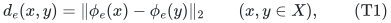
with an arbitrary finite-dimensional real embedding <code class="math">\phi_e</code>. The item dimensions can differ. Complex Hilbert embeddings can be regarded as real embeddings.

Assume that a common group <code class="math">\Gamma</code> acts transitively on <code class="math">X</code> and preserves **every item individually**:
<!-- math-display: 3b82ddb50d04a850099c2ad9
d_e(gx,gy)=d_e(x,y)
 \qquad(e\in[m],\,g\in\Gamma,\,x,y\in X).
 \tag{T2}
-->
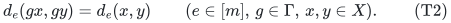
For positive weights <code class="math">w_e</code>, define
<!-- math-display: 25e365da5fa4e9116913b706
D(x,y)=\sum_e w_e d_e(x,y).
 \tag{T3}
-->
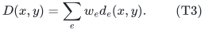

**Theorem 1.** For <code class="math">0&lt;\epsilon&lt;1</code>, there are coefficients <code class="math">\omega_e\ge0</code>, supported on
<!-- math-display: b3457f231a67ae34e167525d
O\!\left(\min\left\{m,\frac{\log(2N)}{\epsilon^2}\right\}\right)
 \tag{T4}
-->
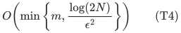
original indices, such that
<!-- math-display: 33b59ff4ff3e157c39641b20
(1-\epsilon)D(x,y)
 \le \sum_e\omega_e w_e d_e(x,y)
 \le (1+\epsilon)D(x,y)
 \qquad(x,y\in X).
 \tag{T5}
-->
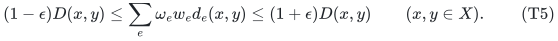
No embedding coordinate inside an item is reweighted separately. The group may be represented by a much larger permutation group; its order does not appear in (T4).

For <code class="math">N=1</code>, every item vanishes and the empty output suffices. Identically zero items and zero-weight items may always be discarded.

**Optional exact total weight.** The same support order can preserve
<code class="math">\sum_e\omega_ew_e=\sum_e w_e</code> exactly as well as (T5). In this variant, identically zero original items remain available, and their weights count toward this total. If <code class="math">N=1</code>, one original index with the total weight suffices. The normalization argument is at the end of Section 3 and also applies to the group-loss corollaries below.

## 2. A centered stationary Gaussian process

Fix an anchor <code class="math">o\in X</code>. Center each embedding:
<!-- math-display: 80909762fada6b739ec2cf7e
u_e(x)=\phi_e(x)-\frac1N\sum_{z\in X}\phi_e(z).
 \tag{T6}
-->
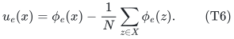
Its Gram matrix is determined entirely by the squared distances:
<!-- math-display: 2e3a5d93d983267aed0f4a1d
\begin{aligned}
 \langle u_e(x),u_e(y)\rangle
 ={}&-\frac12d_e(x,y)^2
 +\frac1{2N}\sum_z d_e(x,z)^2\\
 &+\frac1{2N}\sum_z d_e(y,z)^2
 -\frac1{2N^2}\sum_{z,z'}d_e(z,z')^2.
\end{aligned}
 \tag{T7}
-->
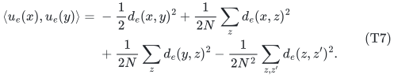
This follows by expanding the squared distances and canceling their common mean terms. Equation (T2), together with the fact that <code class="math">g</code> permutes <code class="math">X</code>, shows that (T7) is invariant when both arguments are acted on by <code class="math">g</code>.

Independently for each item, sample a standard Gaussian vector <code class="math">T_e</code> in the span of its centered embedding, and put
<!-- math-display: 380b9da1746efa2fa61afb34
F_x=\sum_e w_e\langle T_e,u_e(x)\rangle.
 \tag{T8}
-->
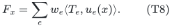
The process is centered Gaussian. Its covariance is
<!-- math-display: 236b5b9566a96ba620d21d3b
\mathrm{Cov}(F_x,F_y)
   =\sum_e w_e^2\langle u_e(x),u_e(y)\rangle,
-->
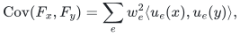
which is invariant under the common transitive action. Thus the entire joint law is invariant. Every sample has a minimum, and every point has the same probability of being a minimum. Consequently
<!-- math-display: 494abf2ee0137e4ce487f0bf
\Pr[F_o\le F_x\text{ for every }x]\ge\frac1N.
 \tag{T9}
-->
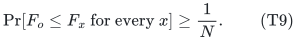
Ties only increase this probability; no nondegeneracy assumption is needed.

Now let the <code class="math">\xi_e</code> be independent scalar standard Gaussians and define
<!-- math-display: 10136b793e641fb3eb7cb321
Y_x=F_o-F_x,\qquad
 Z_x=\sum_e w_e\xi_e d_e(o,x).
 \tag{T10}
-->
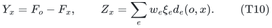
For every coordinate,
<!-- math-display: 285d394d3f027206253b729f
\mathrm{Var}(Y_x)
 =\sum_e w_e^2d_e(o,x)^2
 =\mathrm{Var}(Z_x).
 \tag{T11}
-->
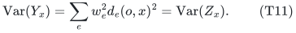
For two coordinates, Cauchy--Schwarz gives
<!-- math-display: 5b854e5aed8499a09de8b4b7
\begin{aligned}
 \mathrm{Cov}(Y_x,Y_y)
 &=\sum_e w_e^2
   \langle u_e(o)-u_e(x),u_e(o)-u_e(y)\rangle\\
 &\le\sum_e w_e^2 d_e(o,x)d_e(o,y)
 =\mathrm{Cov}(Z_x,Z_y).
\end{aligned}
 \tag{T12}
-->
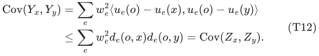
Discard the coordinates with zero variance and normalize the other coordinates to variance one. The event that every coordinate is at most zero is unchanged. Slepian's Gaussian comparison theorem and (T9) imply
<!-- math-display: 2be053da7e34633dad93a91f
\Pr_{\xi}\!\left[
   \sum_e w_e\xi_e d_e(o,x)\le0
   \text{ for every }x\in X
 \right]\ge\frac1N.
 \tag{T13}
-->
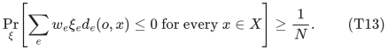

The proof applies after any positive rescaling and any restriction to a subfamily of items: stationarity, the variance identity, and the covariance comparison all remain valid. This hereditary guarantee is the ingredient needed for sparsification.

## 3. From the cone bound to whole-item support

The companion manuscript [optimal-whole-subgroup-constraints.md](optimal-whole-subgroup-constraints.md) proves the following Gaussian-section principle.

**Gaussian-section principle.** Suppose nonnegative functions <code class="math">f_e:Q\to\mathbb R_{\ge0}</code> have the property that, for every positive weighting and every restricted subfamily,
<!-- math-display: ef3d2a49bd8f2a9b6eb60a84
\Pr_\xi\!\left[
 \sum_e w_e\xi_e f_e(q)\le0\quad\forall q\in Q
 \right]\ge p.
 \tag{T14}
-->
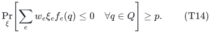
Then their weighted sum has a relative-error sparsifier on
<!-- math-display: e8816a703181001da3035e0d
O\bigl(\min\{m,\log(2/p)/\epsilon^2\}\bigr)
 \tag{T15}
-->
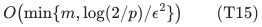
whole original functions.

Here is the support mechanism. For a current positive weighting and <code class="math">0&lt;a\le1/2</code>, define
<!-- math-display: 3f415fab56e86524a6903668
K_a=\left\{z:
 \sum_e w_ez_e f_e(q)
 \le a\sum_e w_ef_e(q)\quad\forall q
 \right\}.
 \tag{T16}
-->
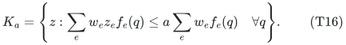
It contains <code class="math">a[-1,1]^m</code>, and each coordinate section contains a cone of Gaussian mass at least <code class="math">p</code>. The companion Gaussian symmetrization lemma implies that
<!-- math-display: 16dfc05e3c39414a4b60f6be
Q_a=K_a\cap(-K_a)\cap[-1,1]^m
-->
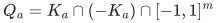
has volume at least <code class="math">c^m</code> when
<code class="math">m\ge C\log(2/p)/a^2</code>. Its proof uses hereditary Gaussian sections, a midpoint reflection identity, log-concavity, and Gaussian correlation.

The large-volume partial-coloring theorem of Reis--Rothvoss gives a vector in <code class="math">sQ_a\cap[-1,1]^m</code>, for constant <code class="math">s</code>, with at least <code class="math">m/2</code> coordinates equal to <code class="math">1</code> or <code class="math">-1</code>. Choose its sign to make at least <code class="math">m/4</code> coordinates equal to <code class="math">-1</code>, and update <code class="math">w_e</code> to <code class="math">w_e(1+z_e)</code>. This deletes at least a quarter of the items while changing every query by a multiplicative factor in <code class="math">[1-sa,1+sa]</code>.

At support size <code class="math">m_t</code>, choose <code class="math">a_t=\sqrt{C\log(2/p)/m_t}</code> and stop at <code class="math">M=C'\log(2/p)/\epsilon^2</code>. The sum of the stage errors is bounded by a geometric series:
<!-- math-display: 663fe9a01260b1577872b703
\sum_{t:m_t>M}sa_t
 \le
 \frac{s\sqrt{C/C'}}{1-\sqrt{3/4}}\epsilon.
 \tag{T17}
-->
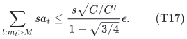
A sufficiently large <code class="math">C'</code> makes this at most <code class="math">\epsilon/4</code>, which yields (T15) on multiplying the one-stage guarantees.

Apply the principle to <code class="math">f_e(x)=d_e(o,x)</code> and <code class="math">p=1/N</code> from (T13). This preserves every anchor distance. For any pair <code class="math">x,y</code>, choose <code class="math">g</code> with <code class="math">go=x</code>. By the itemwise invariance,
<!-- math-display: bece2288f3549bd092f445ca
d_e(x,y)=d_e(o,g^{-1}y)
 \qquad\text{for every }e.
 \tag{T18}
-->
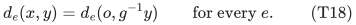
The same weights therefore preserve the pair <code class="math">(x,y)</code>. This proves Theorem 1.

The theorem consequently also preserves every nonnegative weighted sum of pair distances. Objectives formed by minimizing over a specified set of such candidates inherit the usual multiplicative approximation implication. This observation does not supply an efficient algorithm for finding the minimizing candidate.

### Exact total-weight normalization

Replace <code class="math">X</code> by <code class="math">X\times C_2</code> and each item by
<!-- math-display: 88c0b156354b7c5f0e5e0632
\widetilde d_e((x,b),(y,c))
 =\sqrt{d_e(x,y)^2+\mathbf1[b\ne c]}.
 \tag{TN1}
-->
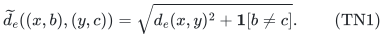
This is a Hilbertian pseudometric, using the direct sum of the original embedding with the scalar embedding <code class="math">b\mapsto b\in\{0,1\}</code>. The common action <code class="math">\Gamma\times C_2</code> is transitive and preserves every augmented item. On equal-bit pairs the distances are the original ones, whereas
<code class="math">\widetilde d_e((o,0),(o,1))=1</code> for every item.

Apply Theorem 1 to these <code class="math">2N</code> points with error <code class="math">\eta=\epsilon/4</code>. Its bit-changing anchor query approximates the total input weight within <code class="math">1\pm\eta</code>. Globally rescale the output weights to make that total exact. The factors on each original pair then lie in
<!-- math-display: bf04f24f4bd5faf325a85908
\left[\frac{1-\eta}{1+\eta},
       \frac{1+\eta}{1-\eta}\right]
 \subseteq[1-\epsilon,1+\epsilon].
 \tag{TN2}
-->
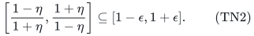
No item is added to the output list: (TN1) is only an auxiliary construction of the coefficients. Original zero-loss items have nonzero augmented distances and are kept available if needed for the total-weight requirement. The same augmentation can be applied to the wreath-orbit metrics used below, giving the exact-total-weight variant for arbitrary anchored and Bernstein-transformed losses as well.

### Computational model

Only an anchor-distance table with <code class="math">N</code> rows is needed to specify the error body. If it is explicitly supplied and the distance values admit the separation and precision access required by the partial-coloring backend, its randomized construction is polynomial in that table size. For rational distance tables this is an ordinary rational-input model.

An embedding with rational coordinates can produce irrational square-root distances. The support theorem is exact over the reals; an additional evaluation/weak-separation precision contract is needed for a bit-complexity implementation in that representation. No polynomial bit-complexity conclusion for arbitrary real embeddings is silently included.

The method may enumerate all <code class="math">N</code> group elements or orbit points. It is not, in general, polynomial in <code class="math">\log N</code> or in a compact presentation of the action.

## 4. Arbitrary two-anchor losses over a finite group

Let <code class="math">G</code> be a finite group. For every item <code class="math">e</code>, let
<code class="math">\rho_e:G\to O(V_e)</code> be an orthogonal representation and choose arbitrary vectors <code class="math">u_e,v_e\in V_e</code>. Consider
<!-- math-display: 525e39da1e33fdb238f8c0aa
\ell_e(g)=\|u_e-\rho_e(g)v_e\|_2,\qquad
 L(g)=\sum_e w_e\ell_e(g).
 \tag{T19}
-->
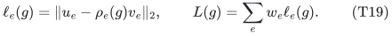
The two vectors need not have equal norms, lie on the same orbit, or be consistently aligned by any one group element.

**Corollary 2.** There is a nonnegative reweighting of
<!-- math-display: d06d6ce4399e507008577a2f
O\!\left(\min\left\{m,
 \frac{\log(2|G|)}{\epsilon^2}\right\}\right)
 \tag{T20}
-->
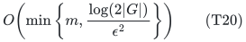
whole original pairs preserving <code class="math">L(g)</code> within <code class="math">1\pm\epsilon</code> simultaneously for every <code class="math">g\in G</code>.

**Proof.** On <code class="math">\widetilde G=(G\times G)\rtimes C_2</code>, define an orthogonal representation on <code class="math">V_e\oplus V_e</code>:
<!-- math-display: b08f9cb16ad47218a3d6446c
\widetilde\rho_e(a,b)
   =\mathrm{diag}(\rho_e(a),\rho_e(b)),
 \qquad
 \widetilde\rho_e(\tau)(x,y)=(y,x).
 \tag{T21}
-->
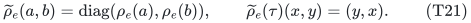
Take <code class="math">z_e=(u_e,v_e)/\sqrt2</code>. For the same embedded query
<code class="math">q(g)=(g,g^{-1})\tau</code> as in the affine-group note,
<!-- math-display: 05fed6bee989cb06f3152e1b
\begin{aligned}
 \|z_e-\widetilde\rho_e(q(g))z_e\|_2^2
 &=\frac12\left(
   \|u_e-\rho_e(g)v_e\|_2^2
   +\|v_e-\rho_e(g^{-1})u_e\|_2^2
 \right)\\
 &=\|u_e-\rho_e(g)v_e\|_2^2.
\end{aligned}
 \tag{T22}
-->
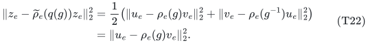
The second equality uses orthogonality. Thus the original two-anchor loss is exactly a one-anchor orbit distance in the doubled representation.

On the point set <code class="math">\widetilde G</code>, the pseudometrics
<!-- math-display: 6712fb91dc0234d953ecc770
d_e(a,b)=
 \|\widetilde\rho_e(a)z_e-\widetilde\rho_e(b)z_e\|_2
-->
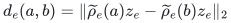
are preserved by common left translation. Apply Theorem 1 to this <code class="math">2&#124;G&#124;^2</code>-point space and restrict to the pairs <code class="math">(1,q(g))</code>. Since
<code class="math">\log(4&#124;G&#124;^2)=O(\log(2&#124;G&#124;))</code>, this gives (T20). <code class="math">\square</code>

This representation identity is also a useful bridge between the metric theorem and coset constraints. Taking the permutation representation on <code class="math">G/H</code>, <code class="math">v</code> the identity-coset vector, and <code class="math">u</code> the <code class="math">aH</code>-coset vector, scaled by <code class="math">1/\sqrt2</code>, makes <code class="math">\ell(g)=\mathbf1[g\notin aH]</code>. The separate affine-group manuscript supplies the exact subgroup compiler and the group-CSP consequences directly.

### 4.1 Bernstein transforms, including bounded nonlinear losses

There is a useful closure consequence of the classical Schoenberg--Bernstein theorem. Let each item have its own Bernstein function <code class="math">\varphi_e</code> with <code class="math">\varphi_e(0)=0</code>. Equivalently, it has a representation
<!-- math-display: dde24a0c888f86b299a92acc
\varphi_e(t)=\beta_e t+
 \int_{(0,\infty)}(1-e^{-st})\,\mu_e(ds),
 \quad
 \beta_e\ge0,\quad
 \int\min\{1,s\}\,\mu_e(ds)<\infty.
 \tag{TB1}
-->
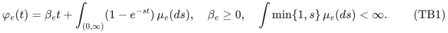
Then
<!-- math-display: bc274ad4008a7bb19c4dc139
d'_e(x,y)=\sqrt{\varphi_e(d_e(x,y)^2)}
 \tag{TB2}
-->
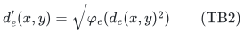
is another Hilbertian pseudometric, preserved by the same itemwise action. Theorem 1 therefore applies with exactly the same support order.

For completeness, this closure statement can be checked on any finite point set without constructing the possibly infinite-dimensional feature space. If <code class="math">K_{ij}=\&#124;\phi_i-\phi_j\&#124;_2^2</code> and <code class="math">\sum_i c_i=0</code>, then
<!-- math-display: 85caa35b8904f0f753957692
\sum_{i,j}c_ic_jK_{ij}
 =-2\left\|\sum_i c_i\phi_i\right\|_2^2\le0.
-->
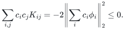
The Gaussian matrix <code class="math">(e^{-sK_{ij}})_{ij}</code> is positive semidefinite. One direct proof expands
<!-- math-display: c6887730f6cb0a3a5a87a86a
e^{-s\|\phi_i-\phi_j\|^2}
 =e^{-s\|\phi_i\|^2}e^{-s\|\phi_j\|^2}
 \sum_{k\ge0}\frac{(2s)^k}{k!}
 \langle\phi_i,\phi_j\rangle^k,
-->
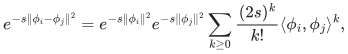
whose summands are positive semidefinite Gram matrices. Thus, by (TB1),
<!-- math-display: 9c3848897a9219e7742ef0b9
\sum_{i,j}c_ic_j\varphi_e(K_{ij})
 =\beta_e\sum_{i,j}c_ic_jK_{ij}
 -\int\sum_{i,j}c_ic_j e^{-sK_{ij}}\,\mu_e(ds)
 \le0.
 \tag{TB3}
-->
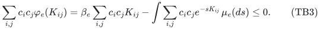
The entries are finite, and the integrability condition justifies the finite sum under the integral. The transformed kernel is nonnegative and has zero diagonal. Double-centering it gives a positive semidefinite Gram matrix, so it is the squared-distance matrix of a Hilbert embedding. This proves (TB2); invariance is immediate from its scalar form.

Applying this transformation on the wreath orbit in the proof of Corollary 2 yields the following stronger version:
<!-- math-display: 78dc3253b09fcf73b0f089cc
\sum_e w_e
 \sqrt{\varphi_e\!\left(\|u_e-\rho_e(g)v_e\|_2^2\right)}
 \tag{TB4}
-->
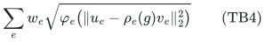
has an <code class="math">O(\log(2&#124;G&#124;)/\epsilon^2)</code>-item relative-error coreset, simultaneously for every <code class="math">g</code>. Every item may use a different function and scale.

Concrete choices, with <code class="math">r\ge0</code> and <code class="math">\sigma&gt;0</code>, are:

| Original-item loss | Bernstein function applied to <code class="math">r^2</code> |
|---|---|
| <code class="math">r^\alpha</code>, <code class="math">0&lt;\alpha\le1</code> | <code class="math">\varphi(t)=t^\alpha</code> |
| <code class="math">\sqrt{1-\exp(-r^2/\sigma^2)}</code> | <code class="math">\varphi(t)=1-\exp(-t/\sigma^2)</code> |
| <code class="math">r/\sqrt{\sigma^2+r^2}</code> | <code class="math">\varphi(t)=t/(\sigma^2+t)</code> |

The last two losses are bounded and generally are not seminorms of the transformation parameters. They inherit the whole-item support theorem through Hilbert metric composition. This is a closure corollary, not a new theorem about Bernstein functions. It does not cover a loss merely because that loss is concave, robust, or bounded.

The classical result and representation are stated, for example, in Kühn--Schilling, *A Probabilistic Proof of Schoenberg's Theorem*, Theorem 3.1 and Section 2, JMAA 2019. [Primary source](https://arxiv.org/pdf/1808.00190). The transform <code class="math">\varphi(t)=t^2</code>, which would give ordinary squared Euclidean loss in (TB4), is not in this Bernstein class.

## 5. Concrete whole-item applications

### 5.1 Whole blocks of affine XOR residuals

Let a block <code class="math">e</code> contain arbitrary rows <code class="math">a_{ej}\in\mathbb F_2^n</code>, targets <code class="math">b_{ej}\in\mathbb F_2</code>, and coefficients <code class="math">c_{ej}\ge0</code>. Define
<!-- math-display: af8eec1aa9a3dcf2d5bc7701
\ell_e(x)=
 \left(\sum_j c_{ej}
   \mathbf1[\langle a_{ej},x\rangle\ne b_{ej}]
 \right)^{1/2},
 \qquad x\in\mathbb F_2^n.
 \tag{T23}
-->
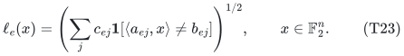
This is a group-alignment loss. Use the diagonal representation
<!-- math-display: 055b70b04d4e3be32db3e945
\rho_e(x)=
 \mathrm{diag}\bigl((-1)^{\langle a_{ej},x\rangle}\bigr),
 \quad
 (v_e)_j=\frac{\sqrt{c_{ej}}}{2},
 \quad
 (u_e)_j=(-1)^{b_{ej}}\frac{\sqrt{c_{ej}}}{2}.
 \tag{T24}
-->
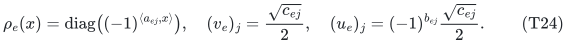
Then <code class="math">\&#124;u_e-\rho_e(x)v_e\&#124;_2^2</code> is exactly the sum inside (T23).

Corollary 2 gives <code class="math">O(\min\{m,(n+1)/\epsilon^2\})</code> retained whole blocks preserving
<code class="math">\sum_e w_e\ell_e(x)</code> for every Boolean assignment. There is no dependence on the number of parity rows inside a block. Each retained block has one scalar coefficient; its internal coefficients <code class="math">c_{ej}</code> are not separately changed.

This is a square-root loss on each block, not the block's squared loss. Ordinary individual-parity code sparsification does not by itself preserve such a grouping, because it may assign different coefficients to rows within the same block.

### 5.2 Robust coordinate-permutation alignment

For arbitrary pairs <code class="math">u_e,v_e\in\mathbb R^d</code>, consider a common permutation of the coordinate axes:
<!-- math-display: c224f3e39bb3e83ac7d0d3b4
L(\pi)=\sum_e w_e\|u_e-P_\pi v_e\|_2,
 \qquad \pi\in S_d.
 \tag{T25}
-->
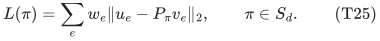
Corollary 2 retains
<!-- math-display: bc3bd659b6bcd3cd01d0cfdf
O\!\left(\min\left\{m,
 \frac{d\log(d+1)}{\epsilon^2}\right\}\right)
 \tag{T26}
-->
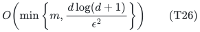
whole paired observations and preserves every permutation objective.

The finite query group acts on the coordinates inside each paired observation. The pairing between <code class="math">u_e</code> and <code class="math">v_e</code> is part of the input and is not independently optimized. The loss is a sum of Euclidean norms, rather than a sum of their squares.

For a concrete ordinary-seminorm comparison, regard
<!-- math-display: 6d186d8a142af83723264bc1
f_e(M,t)=\|t u_e-Mv_e\|_2
 \tag{T27}
-->
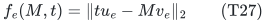
as a seminorm on <code class="math">\mathbb R^{d\times d}\times\mathbb R</code>, and restrict to <code class="math">(M,t)=(P_\pi,1)</code>. The optimal general sums-of-seminorms theorem supplies <code class="math">O(d^2/\epsilon^2)</code> support through this direct lifting. Equation (T26) is smaller for this finite-group query family. This comparison is a precise consequence of that checked general theorem, not a claim that every specialized permutation-alignment coreset in the literature has been excluded.

Signed coordinate permutations are also covered, because their finite group has order <code class="math">2^d d!</code>, giving the same asymptotic support. More generally, any explicitly specified finite subgroup of orthogonal transformations gives the bound in terms of its own <code class="math">\log&#124;G&#124;</code>. Continuous rotations or arbitrary translations are not included by replacing an infinite group order with a finite number.

### 5.3 Common relabeling of matrix-valued observations

The same reasoning applies to matrix pairs <code class="math">A_e,B_e\in\mathbb R^{d\times d}</code> with the orthogonal conjugation representation
<!-- math-display: 3c053fbdba9f41f44443da03
\rho(\pi)B=P_\pi B P_\pi^{\mathsf T}.
-->
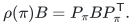
Thus <code class="math">O(d\log(d+1)/\epsilon^2)</code> whole matrix pairs preserve
<!-- math-display: 17501a9e3d2e3a7bd29d3d83
\sum_e w_e
 \|A_e-P_\pi B_eP_\pi^{\mathsf T}\|_F
 \qquad\text{for every }\pi\in S_d.
 \tag{T28}
-->
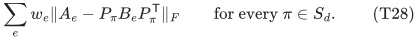
This is a coreset for the family of complete relabeling losses. It neither finds an optimal relabeling nor changes a retained matrix pair internally.

## 6. The logarithmic bound is jointly sharp

Let <code class="math">K_{s,B}</code> be a connected complete bipartite graph on <code class="math">n=s+B</code> vertices, where
<!-- math-display: a7c6816246290c0ac08adb1a
s=\lceil\epsilon^{-2}\rceil,\qquad
 B\ge s,\qquad 0<\epsilon\le1/2.
-->
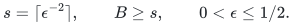
Take
<!-- math-display: 2e4949f312f4dff5981f0b9b
X=\mathbb F_2^n/\langle\mathbf1\rangle,
 \qquad N=2^{n-1}.
 \tag{T29}
-->
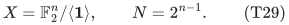
For each graph edge <code class="math">uv</code>, define the scalar two-cluster pseudometric
<!-- math-display: f9cf5dfccc5c8ca1ddebe4b1
d_{uv}(x,y)=
 \mathbf1[(x_u+x_v)\ne(y_u+y_v)].
 \tag{T30}
-->
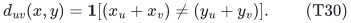
It is the Euclidean distance between the scalar embeddings
<code class="math">\phi_{uv}(x)=x_u+x_v\in\{0,1\}</code>, where the addition in the embedding is modulo two. It is well-defined on the quotient and invariant under the common transitive translation action.

The sum of these edge metrics is a genuine metric on the quotient, because the underlying graph is connected. Its distance from zero to <code class="math">x</code> is the graph cut value. Therefore every whole-item relative-error sparsifier must preserve every cut of <code class="math">K_{s,B}</code>.

The standard complete-bipartite cut obstruction, derived in (EC15) of the companion exact-label-cut manuscript, forces at least
<!-- math-display: d3dc26dedd432b5e1da08c81
\frac{(1-\epsilon)^2sB}
 {(1+3\sqrt2\,\epsilon\sqrt s)^2}
 =\Omega(n/\epsilon^2)
 =\Omega(\log N/\epsilon^2)
 \tag{T31}
-->
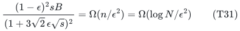
retained items. This lower bound allows arbitrary nonnegative output weights. It is an inherited classical cut lower bound, used here to show that the logarithmic parameter in Theorem 1 cannot generally be improved.

The stated joint regime is
<code class="math">\log_2N+1\ge2\lceil\epsilon^{-2}\rceil</code>. The natural support cap by <code class="math">m</code> remains in force.

## 7. Two essential boundaries

### Transitivity of the total metric is insufficient

Let <code class="math">X=[N]</code>, and for each <code class="math">e\in[N]</code> define
<!-- math-display: 8f6d7fa2a0798f4c1771e47a
d_e(x,y)=
 |\mathbf1[x=e]-\mathbf1[y=e]|.
 \tag{T32}
-->
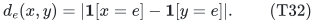
Every item is a scalar Euclidean pseudometric. Their sum is the fully symmetric discrete metric:
<!-- math-display: 838fabe51ff40b00d50af650
\sum_{e=1}^N d_e(x,y)=2
 \qquad(x\ne y).
 \tag{T33}
-->
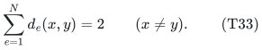
Yet if a reweighting omits two indices <code class="math">a,b</code>, every retained item assigns distance zero to the pair <code class="math">(a,b)</code>. Consequently any relative-error summary with <code class="math">\epsilon&lt;1</code> must retain at least <code class="math">N-1</code> items.

The full permutation group preserves the total metric and permutes the item list, but it does not preserve each item individually. Thus neither total transitivity nor transitivity up to an item permutation can replace (T2).

### Squared negative-type kernels are a different object

The assumption is that each <code class="math">d_e</code> is a Hilbert distance, equivalently that <code class="math">d_e^2</code> is conditionally negative definite. If a convention calls a kernel <code class="math">\psi_e</code> “of negative type” when <code class="math">\psi_e</code> itself is conditionally negative definite, the theorem applies to <code class="math">\sqrt{\psi_e}</code>. It does not automatically apply to <code class="math">\psi_e</code>.

The covariance identity (T11) is the reason: the scalar comparison process has variance proportional to <code class="math">d_e^2</code>. Replacing an orbit norm by its square changes that identity.

For a small illustration of the distinction, Hamming distance on the four-point Boolean square is conditionally negative definite. Its square is not: for the four coefficients <code class="math">(1,-1,-1,1)</code>, which sum to zero, the corresponding quadratic form in the squared Hamming-distance matrix is <code class="math">8&gt;0</code>. This example distinguishes the assumptions; it is not claimed as a sparsification lower bound.

In particular, this note does not prove an optimal original-generator spectral sparsifier for an arbitrary nonabelian Cayley graph. Squared displacement energies require a different argument.

## 8. Related work

**Optimal ordinary sums of seminorms.** Basu--Brakensiek--Chen--Putterman--Reis--Zhang, *Optimal Sparsifiers for Minkowski Sums and Sums of Seminorms* (September 2026), Theorem 1.2, already gives <code class="math">O(R/\epsilon^2)</code> whole-item support for seminorms on an <code class="math">R</code>-dimensional real query space. A generic linear realization of arbitrary <code class="math">N</code>-point Hilbert metrics uses the zero-sum subspace of <code class="math">\mathbb R^X</code>, of dimension <code class="math">N-1</code>: extend each embedding linearly and query vectors <code class="math">e_x-e_y</code>. The new statement replaces this general ambient parameter by <code class="math">\log N</code> under the common itemwise transitivity hypothesis. Equation (T27) gives the more concrete <code class="math">d^2</code>-versus-<code class="math">d\log d</code> alignment comparison. [Primary source](https://arxiv.org/pdf/2609.20238).

**Constructive norm sparsification.** Jambulapati--Lee--Liu--Sidford, *Sparsifying Sums of Norms* (FOCS 2023), provides polynomial-time constructions with additional logarithmic factors under its evaluation and roundedness contract. The new existence bound does not supersede those compact construction guarantees. [Primary source](https://homes.cs.washington.edu/~jrl/papers/pdf/norm-sparsify.pdf).

**Codes and abelian Cayley graphs.** Khanna--Putterman--Sudan's weighted code theorem sparsifies individual parity coordinates; Basu--Kothari--Meka--Tudose's July 2026 theorem achieves optimal support for individual abelian Cayley generators. These are important special-purpose antecedents, but independently reweighting the rows inside a block need not preserve the whole-block loss (T23). The present argument keeps that shared coefficient throughout. [Weighted codes](https://arxiv.org/html/2404.06327v2); [abelian Cayley graphs](https://arxiv.org/html/2607.08261v1).

**Robust alignment.** Amir--Kovalsky--Dym, *Symmetrized Robust Procrustes: Constant-Factor Approximation and Exact Recovery* (2022), studies the sum-of-Euclidean-norms alignment objective and gives a <code class="math">\sqrt2</code>-approximation using a convex relaxation for rigid motions. Its objective establishes the relevance of the unsquared loss, while its optimization guarantee and continuous transformation family differ from the finite-group original-item coreset theorem here. No improvement over its optimization factor is asserted. [Primary source](https://arxiv.org/abs/2207.08592).

**Analytic ingredients.** Slepian's Gaussian comparison and the Reis--Rothvoss partial-coloring theorem are existing results. The hereditary Gaussian-section symmetrizer is proved in the companion subgroup manuscript. Centering the Hilbert embeddings supplies the stationary process needed to apply that backend to <code class="math">N</code> orbit points; the wreath representation supplies the exact two-anchor loss identity. [Slepian](https://doi.org/10.1002/j.1538-7305.1962.tb02419.x); [Reis--Rothvoss](https://arxiv.org/html/2606.28147v2).

Theorems (T4) and (T20) preserve whole metric items under their common symmetry hypothesis. Their field, group-size, embedding, and numerical-access assumptions are part of the stated contracts.
