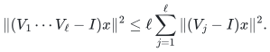
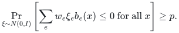
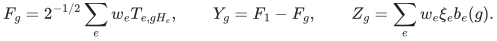
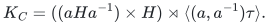
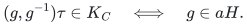

# Proofs for finite-group, affine, and metric sparsification

This manuscript records the theorem composition used by the family. Full analytic and arithmetic arguments are linked at the lemma that supplies them. The retained objects are always original items, with one nonnegative coefficient each.

## Randomness and confidence

The constructions have different algorithmic types. Section 1's Cayley
algorithm and the exact rational-rank conversion in Section 4 are
deterministic. The optional group-operations bundle sampler in [Section 5.1 of the Cayley manuscript](manuscripts/arbitrary-group-cayley-sparsification.md) is instead Monte Carlo, with failure at most <code class="math">\delta</code> for its spectral approximation and stated size bound. The compact modular-block construction is Monte Carlo with
success at least <code class="math">2/3</code>, by the quoted adaptive quotient theorem. The sharper
compact-input support bound is an existence theorem, rather than that
algorithm's support guarantee.

The explicit-table constructions in Sections 2 and 3 use randomized partial
coloring. We use a bounded-attempt Monte Carlo implementation with success at
least <code class="math">2/3</code>, under the supplied separation and numerical-precision contract.
[Reis--Rothvoss, Theorem 7 (July 2026)](https://arxiv.org/html/2606.28147v2)
supplies randomized polynomial-time partial coloring with a separation
oracle. Its constructive Gaussian backend is
[Reis--Rothvoss, Theorems 6 and 21](https://arxiv.org/html/2007.05634v2);
the latter bounds a trial's failure by an exponential in the negative
active dimension, for fixed absolute parameters.

Here is the confidence bookkeeping. There are at most
<code class="math">T=1+\lceil\log_{4/3}(m+1)\rceil</code> coloring phases. In the explicit rational
table model, cube membership, all query inequalities for the candidate
coloring, and its number of saturated coordinates are polynomial-time
checks. Choose the sign with at least one quarter of the coordinates equal
to <code class="math">-1</code>. Use a bounded number <code class="math">O(\log(T+2))</code> of fresh trials in each phase,
accepting only a verified coloring and otherwise returning a failure flag.
The backend's constant success probability makes the conditional probability
of exhausting a phase's trials at most <code class="math">1/(3T)</code>, after fixing the absolute
constant in that trial budget. The finitely many small active dimensions
can instead be handled directly. Union over phases gives total failure at
most <code class="math">1/3</code>. Every accepted coloring obeys the deterministic error and support
ledger below. Fixed additional confidence slack, when needed in a composition,
changes only constants. No unbounded restart or Las Vegas runtime is asserted.

For indirectly represented metric values, those tests require the stated
certified separation/precision access and sufficient slack for their
numerical error; the explicit-table statement does not supply that access
for arbitrary real numbers. One successful output preserves the entire
specified query family, so a later query can depend on the output. Gaussian
orthant and volume probabilities used to prove existence are not algorithm
failure probabilities.

## 1. Arbitrarily weighted Cayley generators

**Theorem 1.** For a finite group of order <code class="math">N\ge2</code>, every nonnegative weighted sum of regular-representation generator Laplacians has a <code class="math">(1\pm\epsilon)</code> spectral approximation on <code class="math">O(\epsilon^{-2}\log^3(2N))</code> original generator items. A deterministic construction has polynomial bit complexity in the explicit rational permutation-matrix input and <code class="math">\epsilon^{-1}</code>.

**Proof.** Write <code class="math">L_g=(I-U_g)^*(I-U_g)/2</code> and <code class="math">q=\lceil\log_2N\rceil</code>. In any <code class="math">q+1</code> selected items, order their positive weights increasingly. Two of the <code class="math">2^{q+1}</code> ordered subset products coincide. Cancel their common prefix and take their first differing index <code class="math">i</code>. The resulting word expresses <code class="math">g_i</code> using later, at least as heavy, generators; its length is at most <code class="math">2q</code>, and each later generator appears at most twice. For unitary matrices,

<!-- math-display: 97c8cf44ac14536621a63b48
\|(V_1\cdots V_\ell-I)x\|^2
\le\ell\sum_{j=1}^{\ell}\|(V_j-I)x\|^2.
-->

Hence the weighted item <code class="math">A_i</code> satisfies <code class="math">A_i\preceq4q\sum_{j\ne i}A_j</code>. This conclusion holds under every positive rescaling and every restriction.

For completeness, if a PSD family has the property that every positively rescaled subfamily of size at least <code class="math">k</code> contains an <code class="math">\alpha</code>-dominated item, its total operator importance is at most <code class="math">4(k-1)/\alpha</code>. To prove this, whiten the total matrix so that <code class="math">\sum_iC_i=I</code>, put <code class="math">\tau_i=\&#124;C_i\&#124;</code>, and set <code class="math">D_i=C_i/\tau_i</code>. Choose a unit vector <code class="math">x_i</code> with <code class="math">x_i^*D_ix_i=1</code>. Independently include <code class="math">i</code> with probability <code class="math">\alpha\tau_i/2</code>. Conditional on inclusion, the expected competing quadratic mass at <code class="math">x_i</code> is at most <code class="math">\alpha/2</code>. With probability at least <code class="math">1/2</code>, it is strictly less than <code class="math">\alpha</code>. In every outcome the set of such good items has size at most <code class="math">k-1</code>, since none is dominated by the others. Taking expectations gives the importance bound.

Use <code class="math">k=q+1</code>, <code class="math">\alpha=1/(4q)</code>, obtaining total importance at most <code class="math">16q^2</code>. Matrix Chernoff sampling then needs <code class="math">O(q^2\log(2N)/\epsilon^2)</code> items. The two-sided trace-exponential estimator derandomizes the experiment. Rational upper estimates of the importance scores and a fixed estimator slack suffice; the complete polynomial-bit argument and the explicit estimator are in [Sections 3–5 of the Cayley manuscript](manuscripts/arbitrary-group-cayley-sparsification.md). The zero-range case is trivial, and all other calculations take place on the range of the PSD sum. <code class="math">\square</code>

The same importance proof in an action of dimension <code class="math">d</code> replaces the final concentration logarithm by <code class="math">\log(2d)</code>. The regular representation also intertwines with every unitary representation, so its weights give a simultaneous representation-independent output. This does not turn an arbitrary implicitly supplied unitary action into a rational-input computational model.

## 2. Whole subgroups and arbitrary cosets

**Lemma 2 (Gaussian-section sparsification).** Suppose nonnegative functions <code class="math">b_e</code> on a finite query set satisfy, after every item restriction and every positive reweighting,

<!-- math-display: f7cfa7f29bccbf663f6f51ec
\Pr_{\xi\sim N(0,I)}
\left[\sum_e w_e\xi_eb_e(x)\le0\text{ for all }x\right]\ge p.
-->

Then one nonnegative reweighting on <code class="math">O(\log(2/p)/\epsilon^2)</code> original functions preserves their weighted sum for every query.

**Proof.** The [Gaussian hereditary-section lemma](manuscripts/optimal-whole-subgroup-constraints.md), Lemma 3, gives constant-exponential volume for the symmetric relative-error body when the current item count is at least <code class="math">C\log(2/p)/a^2</code>. The Reis–Rothvoss large-volume theorem produces a partial coloring in a fixed dilation of this body. Choose its sign to remove at least one quarter of the items and update each weight to <code class="math">w_e(1+z_e)</code>. At current support size <code class="math">m_t</code>, take <code class="math">a_t=\sqrt{C\log(2/p)/m_t}</code>. Because support decreases geometrically, the errors sum to at most a constant times <code class="math">\sqrt{\log(2/p)/M}</code> before the stopping threshold <code class="math">M</code>. Set <code class="math">M=C'\log(2/p)/\epsilon^2</code> and choose the constant so this sum is at most <code class="math">\epsilon/4</code>. Multiplying the one-stage bounds proves the claim. The internal Gaussian lemma supplies the complete section, midpoint-reflection, and correlation proof; the external partial-coloring theorem is explicitly identified there. <code class="math">\square</code>

**Theorem 3.** Weighted complements of arbitrary subgroups or cosets of a finite group <code class="math">G</code> admit support <code class="math">O(\log(2&#124;G&#124;)/\epsilon^2)</code>. The same coefficients preserve every original query.

**Proof for subgroups.** For subgroups <code class="math">H_e</code>, let <code class="math">b_e(g)=\mathbf1[g\notin H_e]</code>. Independently assign a standard Gaussian <code class="math">T_{e,C}</code> to every left coset and put

<!-- math-display: d70b3ab3dcda8a79b81df7de
F_g=2^{-1/2}\sum_e w_eT_{e,gH_e},\qquad
Y_g=F_1-F_g,\qquad Z_g=\sum_e w_e\xi_eb_e(g).
-->

Left translation preserves the law of <code class="math">F</code>; hence the identity is a global minimum with probability at least <code class="math">1/&#124;G&#124;</code>. The coordinates of <code class="math">Y</code> and <code class="math">Z</code> have equal variances. For each item their off-diagonal covariance contribution is zero if either query belongs to <code class="math">H_e</code>, and otherwise is <code class="math">w_e^2(1+\mathbf1[gH_e=hH_e])/2</code> for <code class="math">Y</code>, at most the contribution <code class="math">w_e^2</code> for <code class="math">Z</code>. Slepian comparison at threshold zero gives the event in Lemma 2 with <code class="math">p=1/&#124;G&#124;</code>. Restriction and reweighting do not affect the argument. Lemma 2 proves the support bound. The number of distinct coset tuples is <code class="math">[G:\bigcap_eH_e]</code>, giving the sharper parameter. <code class="math">\square</code>

**Proof for cosets.** For <code class="math">C=aH</code>, work in the common group <code class="math">\widetilde G=(G\times G)\rtimes C_2</code>. Let <code class="math">\tau</code> swap the factors and define

<!-- math-display: bd5e627551f6462dae57d3e4
K_C=((aHa^{-1})\times H)\rtimes\langle(a,a^{-1})\tau\rangle.
-->

The displayed involution normalizes the product subgroup, so this is a subgroup. Its odd elements are <code class="math">(ah_1,h_2a^{-1})\tau</code>, with <code class="math">h_1,h_2\in H</code>. Consequently

<!-- math-display: aa35f927c47a56a9e3fe1ae1
(g,g^{-1})\tau\in K_C\quad\Longleftrightarrow\quad g\in aH.
-->

Apply the subgroup theorem in <code class="math">\widetilde G</code>, whose order is <code class="math">2&#124;G&#124;^2</code>, and restrict to these embedded queries. The support remains <code class="math">O(\log(2&#124;G&#124;)/\epsilon^2)</code>. Empty accepting sets are constant penalties and can be combined into one original item. No common accepting query, normality, or commutativity is needed. <code class="math">\square</code>

[The affine manuscript](manuscripts/affine-constraints-over-arbitrary-finite-groups.md) proves the exact-total-weight variant, group-derived Mal'tsev characterization, group-code corollary, and the joint graph-cut lower bound.

## 3. Hilbert metric sums

**Theorem 4.** If one transitive action on an <code class="math">N</code>-point space preserves each Hilbertian pseudometric <code class="math">d_e</code> individually, their weighted sum has a whole-item relative-error sparsifier of size <code class="math">O(\log(2N)/\epsilon^2)</code>.

**Proof.** Center an embedding of each item to obtain vectors <code class="math">u_e(x)</code>. Its Gram matrix is determined by the squared distances and is invariant under the action. Thus <code class="math">F_x=\sum_e w_e\langle T_e,u_e(x)\rangle</code>, for independent standard Gaussian vectors <code class="math">T_e</code>, is stationary. For an anchor <code class="math">o</code>, the event <code class="math">F_o\le F_x</code> for all <code class="math">x</code> has probability at least <code class="math">1/N</code>. Put <code class="math">Y_x=F_o-F_x</code> and <code class="math">Z_x=\sum_e w_e\xi_ed_e(o,x)</code>. Variances coincide, and Cauchy–Schwarz gives <code class="math">\mathrm{Cov}(Y_x,Y_y)\le\mathrm{Cov}(Z_x,Z_y)</code>. Slepian comparison proves Lemma 2's hereditary hypothesis with <code class="math">p=1/N</code>. The resulting weights preserve every anchor distance. Any pair can be translated to an anchor pair without changing any individual metric, proving all-pairs preservation. <code class="math">\square</code>

For two-anchor losses <code class="math">\&#124;u_e-\rho_e(g)v_e\&#124;</code>, the swap representation on <code class="math">V_e\oplus V_e</code> sends the vector <code class="math">(u_e,v_e)/\sqrt2</code> through <code class="math">(g,g^{-1})\tau</code> by exactly that orbit distance. This gives the finite-group alignment corollary. If there are <code class="math">k</code> action orbits, transitive ordered tuples with one point from each orbit have size <code class="math">k!\prod_jN_j</code>; direct-sum Euclidean embeddings encode every original pair up to the same scalar for every item. These arguments and the Bernstein-transform closure are proved in [the transitive](manuscripts/transitive-metrics-and-group-alignment.md) and [few-orbit](manuscripts/hilbert-metric-sums-with-few-orbits.md) manuscripts.

## 4. Affine modular blocks and exact rational rank access

**Theorem 5.** Let <code class="math">H</code> be the subgroup generated by all augmented block rows over <code class="math">\mathbb Z_q</code>, and let <code class="math">r=\log_2&#124;H&#124;&gt;0</code>. Whole affine blocks admit support <code class="math">O(r/\epsilon^2)</code> existentially and <code class="math">O(r\log(2r/\epsilon)/\epsilon^2)</code> by a factorization-free compact randomized algorithm.

**Proof.** A block's row subgroup <code class="math">J_e\le H</code> annihilates exactly a subgroup of <code class="math">\widehat H</code>. Every augmented query <code class="math">(x,1)</code> defines a character, so Theorem 3 on <code class="math">\widehat H</code> proves the existential bound.

For construction, define <code class="math">f(S)=\log_2&#124;\sum_{e\in S}J_e&#124;</code>. The finite-abelian subgroup order identity proves submodularity, and every positive marginal is at least one. The blocks annihilating any query form a closed set. Integer Hermite normal form computes the subgroup orders exactly without factoring <code class="math">q</code>.

Choose an integer <code class="math">R\in[r,r+1]</code> and transform by <code class="math">\phi(t)=t-t^2/(4R)</code>. Use identical rounded values for identical integer-order keys, with error at most <code class="math">1/(64R)</code>, then multiply by four. A nonzero nested rank increase changes <code class="math">\phi</code> by at least <code class="math">1/2</code>. In a submodularity comparison with both increments positive, the transformed slack is at least <code class="math">1/(2R)</code>; four rounding errors cost at most <code class="math">1/(16R)</code>. If an increment is zero, equality of the corresponding nested orders makes the rounded terms cancel exactly. The result is an exact rational monotone submodular rank with the same closures, positive marginals at least one, total value at most <code class="math">4R</code>, and one denominator <code class="math">O(R)</code>.

Quanrud's theorem and adaptive quotient resparsification now apply to an exact polynomial-bit oracle. They preserve every original active-block query with the claimed support. The same function and denominator are retained under every restriction. Full rounding, bit-length, and lower-bound proofs appear in [the rational-rank theorem](manuscripts/rational-quotient-ranks-from-weak-oracles.md) and [the modular-block theorem](manuscripts/affine-modular-blocks-and-sharp-modulus-dependence.md). <code class="math">\square</code>

**Attribution:** Yilin Liu and GPT-6 Astra Pro.

## Executable algebraic realization

The [whole-coset compiler](reference/README.md) realizes the Section 3 common
ambient subgroup reduction with original item IDs and exact query membership.
The [realization proof](manuscripts/reference-coset-compilation.md) separately
charges finite-table validation, generated-subgroup work and whole-item
coefficient verification. It does not substitute for the analytic support
theorems or their sampling implementations.
