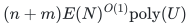
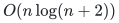
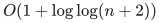

# Incremental strongly connected components

**Guarantee**

Exact strongly connected component labels after every settled directed-edge insertion.

**Objective and output**

Maintain one explicit component label per original vertex. The record does not include a topological ordering of the quotient or a path witness.

**Randomness**

Deterministic exact SCC maintenance and label-history construction. The source map connects the detector, flow-maintenance and edge-retirement operations to their local realizations and named published prerequisites.

**Time**

Total work

<!-- math-display: cd4c314d370494ef84ef0db7
(n+m)E(N)^{O(1)}\mathrm{poly}(U)
-->

Under the raw minimum-ratio-cycle interface, with <code class="math">U=\log(N+4)</code> and <code class="math">E(N)=\exp(O(U^{4/5}(\log U)^{1/5}))</code>; this is total incremental work, not a worst-case per-insertion claim.

**Space**

Polynomial in the maintained graph, label inventory, and raw-backend state; the client does not expand binary caps into unit arrays.

**Parameters**

<code class="math">n</code> is the original vertex count; <code class="math">m</code> bounds inserted edge records; <code class="math">N</code> is the power-of-two master cap; <code class="math">U</code> is its logarithmic scale. Parallel edges and self-loops are allowed.

**Model and representation**

Incremental directed graph construction using the raw minimum-ratio-cycle engine, exact base registers, atomic endpoint retargeting, edge retirement and explicit component-label updates. The source map identifies each constructed interface and its published inputs.

**Lower-bound scope**

No lower bound is claimed.

**Review status**

**Ready for review.** The complete incremental SCC label theorem with the raw-cycle-to-frozen-detector realization, nonzero-base handling and retirement rules. The label-history extension proves historical equality and `O(1+log log(n+2))` first-coalescence queries using permanently retired identities.

**Dependencies and scope.** The theorem gives exact component labels under the stated insertion model and adaptive-history bounds. It does not include dynamic topological-order maintenance or within-component path output. The executable history checks cover that layer separately.

The [verification note](verify/README.md) identifies executable coverage. This status does not claim external peer review or proof-assistant verification.

**Source**

[Complete theorem and proof](proof.md), [dependencies and primary sources](sources.md).

## Historical component queries

The same small-to-large labels store

<!-- math-display: e428e7670593a88f1506f1db
O(n\log(n+2))
-->

 historical records.
They answer SCC equality at a past settled update in
<!-- math-display: f11830ebe3dac2ffab24edf4
O(1+\log\log(n+2))
-->

 time and first coalescence in
<!-- math-display: f11830ebe3dac2ffab24edf4
O(1+\log\log(n+2))
-->

 time. The latter binary-searches their common
label suffix, as proved in Corollary 9.1. These representation
bounds are unconditional once the exact merge sequence is supplied.

**Attribution.** Yilin Liu · GPT-6 Astra Pro
