# Incremental SCCs with a one-sided logarithmic flow barrier

**Theorem and proof.** All algorithmic conclusions use the explicitly stated interfaces and computational models.

This note gives a particularly simple client of the deterministic raw
minimum-ratio-cycle interface. It maintains exact strongly connected
components in an incremental directed graph. The client uses a
one-sided logarithmic barrier, contracts endpoints once an edge carries
enough positive circulation, and returns only when the contracted graph
is acyclic.

The contraction idea is public: Chen--Kyng--Liu--Meierhans--Probst
Gutenberg, *Almost-Linear Time Algorithms for Incremental Graphs: Cycle
Detection, SCCs, s-t Shortest Path, and Minimum-Cost Flow*,
arXiv:2311.18295v1, Section 8.3 and Theorem 1.8,
<https://arxiv.org/html/2311.18295v1>.
The proposed simplification removes their objective-gap logarithm and
upper-capacity barrier. It also implements contractions by explicitly
paid endpoint retargeting, using the exact nonzero-base and retirement
interface developed in this research round.

This is not a new first almost-linear SCC algorithm. Its quantitative
consequence is conditional on the current raw backend and exact
flow-maintenance bridge. In particular, a threshold-flow headline alone
does not imply this white-box client.

## 1. Claimed interface and bound

Let the original vertex set have size <code class="math">n</code>, and let at most <code class="math">m</code>
directed edge records be inserted. Parallel edges and self-loops are
permitted. A known upper bound on <code class="math">m</code> is used initially. Let
<code class="math">N=2^U</code> be a power-of-two master bound of the same polynomial scale
as <code class="math">n+m+2</code>; polynomially enlarging this master to cover all label
magnitudes and event horizons changes the expressions below only by
absolute constants.

Assume a fully dynamic raw-cycle interface with the following
properties. Its time, inverse approximation quality, explicit raw-answer
size, flat occurrence multiplicity, and actual notification factors are
bounded by fixed powers of <code class="math">E(N)=N^{o(1)}</code>. It supports logical edge
insertion at an explicit nonzero base value, exact point reads, edge
retirement with complete signed and absolute transfers, and the
ordinary degree-three port lift. These operations preserve every
surviving logical flow value. No oracle query occurs inside a structural
transaction.

Then the algorithm below maintains an explicit component label at every
original vertex, with total time

<!-- math-display: 16584e7ef9e6317c7b431d7f
(n+m)E(N)^{O(1)}\mathrm{poly}(U).
\tag{1}
-->
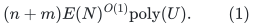

Two component labels can be compared in constant time. The maintained
partition is exactly the current SCC partition after every settled
external insertion. This assertion does not include a topological
ordering of the quotient, or a fast path witness between vertices in
one component.

For the stated raw engine
<code class="math">E(N)=\exp O(U^{4/5}(\log U)^{1/5})</code>, (1) has the same
four-fifths exponent. The <code class="math">O(\log n)</code> endpoint-retargeting and
label-write factors below are explicit polynomial logarithmic factors,
not an extra oracle loss at every recursive level.

## 2. Quotient graph, circulation, and slack offsets

Maintain a partition <code class="math">\mathcal P</code> of original vertices. Initially
every vertex is a singleton. Its blocks will always lie inside true
SCCs. An active logical edge is an inserted original edge whose
endpoints currently belong to different blocks. Its current endpoints
are the representatives of those blocks. Edges within a block need no
optimization coordinate.

On the quotient graph maintain an exact signed circulation <code class="math">f</code>:
the total inflow and outflow balance at each current block. An ordinary
edge insertion between distinct blocks is born at flow zero, preserving
this condition. The lower bound on each coordinate is

<!-- math-display: b90b2e7d3876e7dc084b3a12
f_e> -\delta_e.
\tag{2}
-->
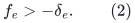

Initially <code class="math">\delta_e=\delta_0=N^{-B}</code>, with one sufficiently large
fixed <code class="math">B</code>. Rearm an ordinary slack by adding <code class="math">\delta_0</code> to its
offset when necessary, using separated thresholds. For example, a slack
below <code class="math">5\delta_0/4</code> is reset above <code class="math">2\delta_0</code>. The first rearm
is paid by the edge's original birth; later rearms are charged to
weighted motion. Choose the fixed event horizon and then <code class="math">B</code> so
that throughout the entire lifetime

<!-- math-display: a0a7f66e93f1ff01c5dba841
\Delta:=\sum_{e\text{ ever born}}\delta_e\leq N^{-20}.
\tag{3}
-->
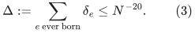

An offset stays with its original logical coordinate through endpoint
retargeting. Such a representation change is not a fresh barrier birth
or a fresh uncharged slack allowance. Removed coordinates may be left
in the sum (3), making it only more conservative.

Choose a dyadic contraction threshold

<!-- math-display: d742716199969f10af106232
\frac1{200(m+1)}\leq\theta\leq\frac1{100(m+1)}.
\tag{4}
-->
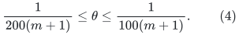

The numerical and notification rules will ensure that every active
coordinate has <code class="math">f_e&lt;2\theta</code> after settlement. Constants in (4)
leave ample room for one numerical step and notification settlement.
In particular every active slack stays below one. No upper-capacity
constraint is imposed on the optimization problem.

## 3. Positive flow certifies a true SCC edge

**Lemma.** If <code class="math">f</code> is a circulation in a directed graph and
<code class="math">f_e\geq-\delta_e</code>, an edge joining different true SCCs has

<!-- math-display: 0ac1eae7e6e060f241611a69
f_e\leq\sum_a\delta_a.
\tag{5}
-->
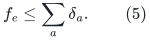

**Proof.** Contract the true SCCs conceptually, retaining each
cross-component edge and its flow. The projected vector is still a
circulation because internal divergences cancel. The resulting graph is
a DAG. For an edge <code class="math">e=(C,D)</code>, take a topological prefix containing
<code class="math">C</code> but not <code class="math">D</code>. Every edge crossing this cut points out of the
prefix; there are no incoming edges. Circulation conservation gives
<code class="math">\sum_{a\text{ crossing}}f_a=0</code>, and hence
<code class="math">f_e=-\sum_{a\ne e\text{ crossing}}f_a\leq\sum_a\delta_a</code>.
This topological order is used only in the proof; the algorithm does
not compute it. <code class="math">\square</code>

Thus <code class="math">f_e\geq\theta&gt;\Delta</code> proves that the edge's endpoints lie
in one true SCC. This strengthens the form needed here of CKLMP24
Lemma 8.13: no upper bound <code class="math">f_e\leq1</code> is necessary, and the
offsets can differ by edge.

If each current block is already inside a true SCC, contracting two
blocks linked by such an edge preserves that invariant. Contracting
all their internal edges and projecting every surviving flow preserves
the exact quotient circulation. Removing an internal edge does not
require its flow to be zero: its contribution cancels inside the merged
block's divergence.

## 4. Potential and the min-ratio query

Use only

<!-- math-display: 9dbdcb4343f23a56306f8e3b
\Phi(f)=-\sum_{e\text{ active}}\log(f_e+\delta_e),
\qquad
w_e=(f_e+\delta_e)^{-1},\qquad g_e=-w_e.
\tag{6}
-->
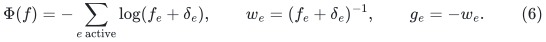

Every logarithm has positive argument. A settled min-ratio query must
do one of the following:

* return LOW, certifying that every circulation has true ratio greater
  than <code class="math">-1/4</code>; or
* return an exact circulation <code class="math">z</code> with an explicit raw representation
  of weighted length <code class="math">R&gt;0</code>, where
  <code class="math">\&#124;Wz\&#124;_1\leq R</code> and <code class="math">g^Tz\leq-\beta R</code>, for
  <code class="math">\beta=E(N)^{-O(1)}</code>.

Approximate prices and integer rounding use fixed margin in these
constants. A directed cycle has incidence vector <code class="math">z\geq0</code>, so

<!-- math-display: 509f1b6648e9c8af445fd981
\frac{g^Tz}{\|Wz\|_1}=-1.
\tag{7}
-->
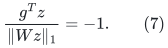

Consequently a sound LOW certificate proves that the current quotient
contains no directed cycle. This is the reason no objective target,
comparison min-cost flow, upper barrier, or global cost-gap term is
needed for this client.

If the oracle returns a direction, take a dyadic step with

<!-- math-display: e1b084b0147c128b084af1b4
\eta R\in[\beta/C,2\beta/C]
\tag{8}
-->
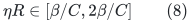

for one sufficiently large fixed constant <code class="math">C</code>. Raw absolute motion
keeps every coordinate slack positive even during the individual path
pieces. The Taylor remainder for the logarithmic barriers is
<code class="math">O((\eta R)^2)</code>, whereas the linear decrease is at least
<code class="math">\beta\eta R</code>. Thus

<!-- math-display: b8b84999d35f6ac10c2f8627
\Phi(f+\eta z)-\Phi(f)\leq-\Omega(\beta^2).
\tag{9}
-->
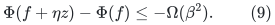

Only the complete proposed circulation is the numerical update.
Internal path pieces need not individually preserve divergence. Settle
all signed transfers, absolute-motion reports, price changes, rearms,
and resulting contractions before asking the next ratio query.

## 5. Detecting a threshold crossing before flow becomes large

Use the raw flow-maintenance interface to retain a recent exact value
<code class="math">\widehat f_e</code>, with weighted drift at most <code class="math">\tau</code>, where
<code class="math">\tau\leq\min\{1/100,\beta/C'\}</code>. For the current ordinary
logarithmic weight this gives

<!-- math-display: b1afe4999f7ed44d39e4b98a
|f_e-\widehat f_e|\leq\tau(f_e+\delta_e).
\tag{10}
-->
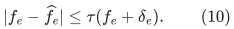

Every edge at a point read with <code class="math">f_e\geq\theta</code> is queued for
contraction. All such queued contractions finish before a new query.
If its last settled read had <code class="math">\widehat f_e&lt;\theta</code>, (10) implies

<!-- math-display: fd9413974932d9d4961f413b
f_e\leq\frac{\theta+\tau\delta_e}{1-\tau}
 <1.02\theta
\tag{11}
-->
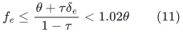

after harmless constant choices and the slack separation (3).
An accepted step changes an individual slack by at most the small
relative amount in (8). Even before new reports settle, the flow is
therefore below, say, <code class="math">1.1\theta</code>. The bound <code class="math">2\theta</code> is a
conservative envelope for every state used in the potential account.

The same notifications reprice <code class="math">w</code> often enough for the true
gradient guarantee. Since <code class="math">g=-w</code>, there is no independently moving
global coefficient and no global gradient-repricing pass. Exact point
reads performed during endpoint retargeting reset the corresponding
price/drift anchors only after that read and its paid callbacks.

In the direct small-local branch, all coordinates may simply be read
after every step. The main backend branch uses the paid notifications;
an uncharged full edge scan per numerical step is not part of (1).

## 6. Every non-numerical operation is paid by the potential

Since <code class="math">f_e+\delta_e&lt;1</code>, every term in (6) is nonnegative. Hence

<!-- math-display: 16544db437c4610b4af7ad81
\Phi\geq0.
\tag{12}
-->
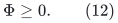

An original edge birth at zero injects
<code class="math">-\log\delta_0=O(U)</code>. Ordinary slack rearming lowers the
potential. Contracting vertices deletes every newly internal
coordinate; each such deletion removes a nonnegative barrier.
Surviving coordinates keep the same value and offset while their
endpoints move, so their barrier contributions are unchanged.

Retarget a coordinate atomically, with only one logical barrier term
throughout. A temporary backend deletion followed by insertion at the
same exact nonzero value is a change of representation. Counting both
copies as independent barriers, resetting the flow to zero, or granting
a fresh slack allowance would describe a different and unjustified
algorithm.

There are at most <code class="math">m</code> original edge births. Equations (9)--(12)
therefore give

<!-- math-display: ec5cb895912aa167f8adc85a
T=O(mU\beta^{-2})=(n+m)E(N)^{O(1)}\mathrm{poly}(U)
\tag{13}
-->
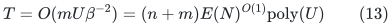

accepted numerical steps. In particular, contractions need no positive
potential charge at all in this simplified client. CKLMP24 Section 8.3
instead has to pay the increase of its remaining objective-gap term.

The total raw weighted motion is <code class="math">O(T\beta)</code>. It pays later
ordinary rearms and, after division by the detection tolerance, all
flow notifications. Together with <code class="math">O(m)</code> initial rearm credits,
this gives a fixed polynomial event horizon in the global master size.
Choosing <code class="math">B</code> in (3) after that horizon proves the slack budget;
the choice is not circular.

## 7. Explicitly paid contraction implementation

Merge blocks by number of original vertices, keeping the larger
block's representative. Maintain each block's membership list and
incident edge records. When the smaller block is absorbed:

1. Scan its members and incident records, and update their component
   labels to the larger representative.
2. For each surviving incident logical edge, read its exact flow and
   retain its slack offset and logical identity.
3. Complete deletion of its old backend endpoint representation,
   preserving all old correspondence metadata until every callback
   finishes.
4. Insert its new endpoint representation at that same exact flow,
   or remove the coordinate if it has become internal.
5. Finish all affected-coordinate notifications and any newly queued
   valid contractions before the next oracle query.

The batch projects a circulation onto a vertex quotient, so it
preserves conservation after completion. There is no conservation
claim for the temporary intermediate graph. Component-label queries
are also delayed until the external insertion has fully settled.

Each time an original vertex is in the smaller merged block, its block
size at least doubles. It participates in at most <code class="math">O(\log n)</code>
such scans and explicit label writes. Each original edge endpoint is
retargeted at most <code class="math">O(\log n)</code> times after its birth. Thus total
logical backend edge lifetimes and endpoint changes are

<!-- math-display: d134617ef9cb440c6ae5204f
O(m\log(n+2)),
\tag{14}
-->
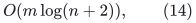

and membership/label work is <code class="math">O(n\log(n+2))</code>. An edge may remain
in a historical incidence list after becoming internal, provided its
dead flag prevents duplicate physical updates; even these incidence
scans obey the same doubling count.

The raw degree-three port lift and its flat representation pay the
actual (14) lifetime records and callbacks. Their <code class="math">E^{O(1)}</code>
copies are a runtime factor, never new logical barriers or new
contraction certificates. This implementation avoids relying on a
zero-length connector. It is an alternative to the public source's
simulation of contracted edges by gradient zero and negligible length.

## 8. Finite precision and uniform parameters

The active slack lies between a fixed polynomial lower bound in
<code class="math">N</code>, supplied by rearming, and <code class="math">2\theta+\Delta&lt;1</code>. Thus
<code class="math">w</code> and <code class="math">g=-w</code> have polynomially bounded magnitudes. Round
them on one fixed common integer price scale with error at most
<code class="math">O(\beta w)</code>. The raw backend uses the same polynomial-master
label extension as in the frozen-distance detector bridge.

A raw answer has polynomially bounded integer denominator after
including every occurrence and connector. Choosing (8) by a dyadic
step therefore gives a fixed polynomial lower bound on step size.
A sufficiently fine common dyadic grid contains every initial value,
slack offset, and accepted flow increment. All conservation and
threshold tests are exact. In particular no flow is rounded
coordinatewise during a contraction.

When local graph size makes a growing-depth hierarchy inconvenient,
[small local detector exact solver](../../manuscripts/graph-backends/small-local-detector-exact-solver.md) supplies a direct alternative.
Its same bidirected negative-cycle test works for <code class="math">g=-w</code>, and the
absence of high-power barriers only simplifies its arithmetic. The
direct branch takes <code class="math">M^3\mathrm{poly}(U)</code> time, within
<code class="math">M E(N)^{O(1)}</code> below a fixed-power cutoff in <code class="math">E(N)</code>.

An announced final edge bound is enough for the theorem. If it is
unknown, restart the numerical structure when a geometric edge-count
guess is exhausted, retaining the already certified component
partition and initializing the current quotient flow to zero. The
sum of restart graph sizes is geometric, and their construction and
initial barrier budgets are included in the same bound. No future
edge identities or insertion order are used.

## 9. Completion and exact partition correctness

After an external insertion, alternate descent and valid contractions
until LOW is returned. Potential descent and the finite budget imply
termination. Every merged block lies inside a true SCC by Section 3.
At LOW the quotient has no directed cycle by (7).

If a true SCC still met two distinct quotient blocks, strong
connectivity would project to a directed closed walk visiting at least
two blocks, which contains a directed quotient cycle. This contradicts
LOW. Hence every true SCC is exactly one maintained block. The labels
therefore give the exact SCC partition after every insertion.

An edge inserted inside an already certified block is ignored by the
numerical instance. It cannot split an SCC or change the partition.
Original self-loops are handled by the same rule. Vertices untouched
by any edge retain singleton labels.

### 9.1 Optional historical component queries

The explicit small-to-large labeling also permits a modest persistent
interface at no new graph-algorithm cost. At each original vertex,
store the list of pairs consisting of an external update index and its
new representative label. If several internal merges change the same
vertex during one external insertion, retain only its last label for
that index. Each vertex has at most <code class="math">O(\log n)</code> entries because
every relabeling at least doubles its block size.

For any past settled update index <code class="math">t</code>, binary-search the two
vertices' lists for their last labels at or before <code class="math">t</code>. Equality
is exactly the SCC relation at that time. This costs
<code class="math">O(\log\log(n+2))</code> per historical query and uses
<code class="math">O(n\log(n+2))</code> label-history space and writes, already within
the explicit labeling account.

**Corollary 9.1 (first coalescence from a common label suffix).** The first
settled update at which two vertices belonged to one SCC, or the fact
that they have not yet coalesced, can be returned in
<code class="math">O(1+\log\log(n+2))</code> time. The query uses direct array comparisons,
with no search through all update times or nested historical lookups.

**Proof.** If the vertices are equal, return time zero. If their current
labels differ, they have never coalesced. Otherwise write their stored
histories as <code class="math">(t_i,a_i)</code> and <code class="math">(s_j,b_j)</code> in increasing time.

A representative label belongs to exactly one current block. When that
block loses its label in a merge, the label is retired permanently; it
is never assigned to a later block. Consequently, if both histories
contain a label <code class="math">x</code>, their time intervals carrying <code class="math">x</code> overlap. At the
later of the two starting times they are in the same block. They remain
together thereafter and have exactly the same subsequent settled label
changes. It follows that the shared labels form one identical suffix
of the two history lists. Coalescing several internal merges into one
settled record does not alter this fact: once together, both vertices
have the same final label at each future external update.

Let <code class="math">q</code> be the length of that common suffix. The predicate
<code class="math">a_{p-1-k}=b_{r-1-k}</code>, for offsets <code class="math">k=0,\ldots,\min\{p,r\}-1</code>
from the two final entries, is true exactly for <code class="math">k&lt;q</code>. Binary-search
the largest matching offset using constant-time label comparisons.
The first common label starts at times <code class="math">t_{p-q}</code> and <code class="math">s_{r-q}</code>,
so the first coalescence time is

<!-- math-display: 9a2f5efd25085a5a1960b82e
\max\{t_{p-q},s_{r-q}\},
-->
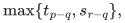

where <code class="math">p,r</code> are the list lengths and indices start at zero.
Each list has <code class="math">O(\log(n+2))</code> entries, so the binary search takes
<code class="math">O(1+\log\log(n+2))</code> comparisons. A final maximum takes constant
time. The same proof covers initial nonsingleton blocks when their
initial labels have time zero. ∎

This is an unconditional consequence of any exact merge-only partition
maintained by the specified small-to-large labels. The fast SCC update
bound still has its raw-backend premises. A topological order and
within-component path reporting are separate output contracts.

## 10. Novelty comparison and the topological-order boundary

CKLMP24 Theorem 1.8 already gives deterministic almost-linear
incremental SCC maintenance with printed exponent <code class="math">167/168</code>.
Its Section 8.3 uses high-flow contraction in a cycle-detection IPM.
Replacing its raw engine by the later public KMGS26 construction
(arXiv:2609.23852v1) yields the relevant <code class="math">20/21</code> public-engine
comparison, after the same white-box and contraction interface checks.
The newer predictions-based SCC paper arXiv:2604.26062v1 has a
prediction-dependent guarantee, not an unrestricted worst-case
improvement of this comparison.

The simplification here is that the objective-gap and upper barriers
are unnecessary: <code class="math">g=-w</code> makes every directed cycle have ratio
exactly minus one, while the contraction threshold supplies the needed
upper state bound. The current backend then yields exponent
<code class="math">4/5</code>. This should be credited as a simpler, fully charged client
of a quantitative backend improvement, not a new discovery of the
high-flow SCC contraction principle.

Finally, LOW implies existentially that a potential <code class="math">\pi</code> satisfies
<code class="math">&#124;-w-B\pi&#124;\leq w/4</code>. Under the head-minus-tail convention,
<code class="math">-\pi</code> strictly increases along every quotient edge and therefore
defines a topological ordering. But the raw ratio interface returns
LOW, not such a maintained vertex potential. Recomputing one explicitly
after every insertion would exceed the claimed bound. An implicit or
explicit topological-order data structure therefore remains a separate
unproved interface; it is not included in (1).

---

**Attribution:** Yilin Liu and GPT-6 Astra Pro.

The proofs use their named external interfaces. Finite checks are separate from proof-assistant verification.
