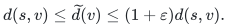
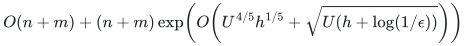

# Incremental directed SSSP with simple-path reporting

The construction maintains incremental directed shortest paths with explicit simple-path output.

**Guarantee**

Maintains one-source approximate distances under arbitrary online edge insertions and returns a simple directed path with original edge identifiers.

**Objective and output**

For every reachable vertex <code class="math">v</code>, the maintained estimate satisfies:

<!-- math-display: 8b83ee9124a1c3564128b6f3
d(s,v)\leq\widetilde d(v)\leq(1+\varepsilon)d(s,v).
-->

Unreachable vertices return infinity. A reported path with `k` edges costs linear output work times a polynomial in log of the global size.

**Randomness**

Deterministic distance maintenance and simple-path reporting, using the realized detector and edge-retirement constructions. Zero-length handling and the exact numerical range are part of the proved reduction.

**Time**

The total work after substituting the constructed raw-backend factor is:

<!-- math-display: 288349a9ca474e4672ab134a
O(n+m)+(n+m)\exp\!\left(O\!\left(
U^{4/5}h^{1/5}+\sqrt{U(h+\log(1/\epsilon))}
\right)\right)
-->

Here <code class="math">U=\log_2N</code> and <code class="math">h=\log(\log_2N+4)</code>. These logarithmic scales keep the accuracy-dependent sum legible; the backend itself is no longer an unexpanded factor. The bound comes from the constructed detector and retirement interface.

**Space**

Actual root vertices, inserted edges, and auxiliary copies over their lifetimes, with no graph padded to the master cap.

**Parameters**

`N` is the power-of-two cap; `U=log_2 N`; `h=log(U+4)`; <code class="math">0&lt;\epsilon\le1/2</code> with <code class="math">\log(1/\epsilon)\le c_*U</code>; `k` is the number of returned path edges.

**Model and representation**

Nonnegative integer root lengths in a polynomial range and parallel edges are allowed. The positive-length theorem extends to zero lengths by the fixed perturbation and exact flooring in Section 10.1. Arbitrary real or negative lengths are outside this statement. The frozen-detector raw interface must support exact retirement and callback accounting.

**Lower-bound scope**

This is a research upper bound with the explicitly identified local constructions and published theorem dependencies. No lower bound is claimed.

**Review status**

**Ready for review.** The complete frozen-detector incremental SSSP construction, its realized numerical interface, the simple-path reporting argument and nonnegative-integer perturbation adapter. Includes exact zero distances, clipped-tree intersections, loop removal and accuracy/bit accounting.

**Dependencies and scope.** The input, accuracy and polynomial numerical-range promises remain explicit. Reporting a path with `k` edges costs `(k+1) poly(U)`. Finite path tests support the reporting lemmas and do not measure the asymptotic detector update time.

The [verification note](verify/README.md) identifies executable coverage. This status does not claim external peer review or proof-assistant verification.

**Source**

[Complete theorem and proof](proof.md), [dependencies and primary sources](sources.md).

Read the [proof](proof.md), [source map](sources.md), and [complexity guide](../../docs/COMPLEXITY.md) for the accuracy range, constructed interfaces and public dependencies.

**Attribution.** Yilin Liu · GPT-6 Astra Pro
