# Incremental directed SSSP from the frozen-barrier detector

**Theorem and proof.** All algorithmic conclusions use the explicitly stated interfaces and computational models.

This note gives the outer reduction for
[frozen barrier distance detector](../../manuscripts/graph-backends/frozen-barrier-distance-detector.md). Its main purpose is to keep the
detector's cumulative reporting bound separate from its computational
cost. The former is polynomial in the logarithm of the global input
size; the latter still contains the raw minimum-ratio-cycle overhead.
That separation is what can preserve a four-fifths exponent through
the shortest-path recursion.

The generic reduction uses the exact raw interface and numerical
settlement rules stated in the detector note. The
[raw-cycle bridge](../../manuscripts/graph-backends/raw-cycle-to-frozen-detector-bridge.md),
Sections 2–8, constructs those operations: retiring an edge retains its
exact flow, fixed cost and divergence, and every representation change
pays its callbacks and inventory. Section 1 instantiates the reduction
with that bridge and the constructed four-fifths raw engine. The
[source map](sources.md) distinguishes these local proofs from the
published algorithms they use.

The public starting point is Yang P. Liu, *Incremental Shortest Paths in
Almost Linear Time via a Modified Interior Point Method*,
arXiv:2506.19207v1, Sections 3--4:
<https://arxiv.org/html/2506.19207v1>.

## 1. Quantitative statement

Let <code class="math">N=2^U</code> be a power-of-two upper bound on the total number of root
vertices and inserted edge records, increased by a fixed constant
factor. Root edge lengths are positive integers in <code class="math">[1,N^{c_0}]</code>,
where <code class="math">c_0</code> is fixed. Parallel edges are allowed. Positive self-loops
may be discarded. Set <code class="math">h=\log(U+4)</code>.

Assume that the raw-cycle and retirement interface of the detector
note is deterministic, supports adaptive updates, and has time, inverse
quality, raw-answer size, flat-copy inventory, and callback factors
bounded by fixed powers of <code class="math">E(N)=N^{o(1)}</code>. The loss is small enough
that its reciprocal numerical progress parameter is eventually at
least <code class="math">N^{-1/100}</code>. Assume also that all raw root labels have the
common polynomial-bit representation proved in that note.

Then the reduction maintains explicit distance estimates
<code class="math">\widetilde d(v)</code> from one fixed source under arbitrary online edge
insertions, with

<!-- math-display: 2c7c761b680996982155b2a8
d(s,v)\leq\widetilde d(v)\leq(1+\varepsilon)d(s,v),
\tag{1}
-->
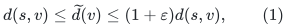

in total time

<!-- math-display: ac105772d1b7e119ba5644f2
O(n+m)+(n+m)\exp O\!\left(
 \log E(N)+\sqrt{U\bigl(h+\log(1/\varepsilon)\bigr)}
\right).
\tag{2}
-->
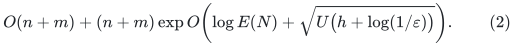

For definiteness, (2) is asserted for <code class="math">0&lt;\varepsilon\leq1/2</code> with
<code class="math">\log(1/\varepsilon)\leq c_*U</code>, where <code class="math">c_*&gt;0</code> is a sufficiently
small absolute constant. The main application is constant or inverse
polylogarithmic accuracy; no limiting issue with this restriction then
arises. Root vertices that are unreachable have estimate <code class="math">+\infty</code>.
The estimates are explicit, so their lookup time is constant.

**Instantiated theorem.** The
[quantitative backend construction, Sections 1–7](../../manuscripts/graph-backends/quantitative-matching-4-5-composition.md),
together with the exact raw-cycle bridge, supplies

<!-- math-display: 7992e5bca2ced37be9c69a64
\log E(N)=O\!\left(U^{4/5}h^{1/5}\right),
\tag{3}
-->
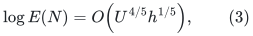

the bound is

<!-- math-display: 9da2e53c22db1a2d14337633
(n+m)\exp O\!\left(U^{4/5}h^{1/5}
 +\sqrt{U\bigl(h+\log(1/\varepsilon)\bigr)}\right).
\tag{4}
-->
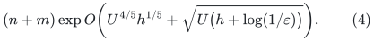

In particular, the four-fifths exponent remains unchanged whenever
<code class="math">\log(1/\varepsilon)=O(U^{3/5}h^{2/5})</code>. This includes every fixed
positive accuracy and every inverse polylogarithmic accuracy.

The structure also returns an explicit simple directed path with
original edge identities in `O((k+1) poly(log N))` time, where `k` is
the number of edges actually returned. Section 10 and the constructive
tree-segment reporting note prove this output bound without enumerating
a longer walk first. This is an output bound up to polynomial
logarithmic factors, rather than the literal linear path-query bound
in the published source theorem.

Section 10.1 extends the same bound to **nonnegative integer** root
lengths. It uses a fixed positive perturbation and exact flooring;
the assertion does not extend to arbitrary real or negative lengths.

## 2. The single-lifetime detector interface

Here is precisely the interface imported from the companion note.
The master precision is <code class="math">U=\log_2N</code> at every recursive level, while
<code class="math">M\leq N</code> bounds the actual local vertex, edge, and auxiliary-copy
inventory over one lifetime. No dummy graph of size <code class="math">N</code> is created.

The ordinary detector graph has all source distances in <code class="math">[1,2]</code>.
Every auxiliary unit has a fixed anchor <code class="math">a_j\in[1,2]</code> which is the
cost of an available walk in that graph. Units and ordinary edges may
be inserted. Let <code class="math">b_v</code> be the number of units at a vertex and
<code class="math">F=\sum_j a_j</code>. For detector parameters <code class="math">\alpha,\sigma</code>, it
eventually does one of the following after each batch of changes:

1. **Sound stop.** It certifies
   <code class="math">\sum_vb_vd(s,v)\leq(1-\alpha/2)F</code>.
2. **Settled return.** It maintains a permanent reported set. Every
   unreported vertex whose units have the common anchor <code class="math">a_v</code>
   satisfies <code class="math">d(s,v)\geq(1-\sigma)a_v</code>.

Across the whole lifetime the number of frozen auxiliary copies is

<!-- math-display: 27a51520fd1a96da09295586
O(\alpha M U^2/\sigma).
\tag{5}
-->
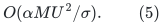

For a vertex reported through the detector, all of its current
auxiliary copies have been frozen. New copies may still be inserted
at a previously reported vertex without a second report. The total
work, including initialization, numerical steps, births, price
refreshes, and exact edge retirements, is

<!-- math-display: e97cb5ff76375717c59e62bd
M E(N)^{O(1)}\mathrm{poly}(U).
\tag{6}
-->
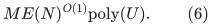

The detector is not required to stop as soon as its sound-stop
inequality first becomes true. The reduction below needs only the
soundness of a stop, the correctness of a settled return, and the
cumulative bound (5). This distinction matters because frozen
auxiliary flow can delay a stop.

All constants and all calls in (5)--(6) use the global master size.
For example, <code class="math">p=\Theta(U)</code>, slack offsets are <code class="math">N^{-B}</code>, and the
accepted flow increments use a common grid of polynomial precision
in <code class="math">N</code>. A small recursive graph need not satisfy a condition of the
form <code class="math">\alpha\geq M^{-1/100}</code>.

## 3. Root reachability and the meaning of a local graph

An ordinary incremental reachability search activates each root
vertex the first time it becomes reachable from <code class="math">s</code>. When a vertex
is activated, scan its outgoing adjacency list; an edge inserted from
an already reached tail is processed immediately. Every vertex and
edge is scanned a constant number of times over the root sequence.
Buffered edges are passed to the SSSP structure when both endpoints
are activated. An entire newly reachable closure is processed as one
batch before answering a query. This costs <code class="math">O(n+m)</code>.

Consequently the root SSSP structure works only with its currently
reachable graph. Vertices may be born, but its settled graph always
has finite source distances. A recursively projected graph has the
same original source and a subset of the parent's vertices. Its
settled vertices are also reachable, by the projection lemma below.
Intermediate pieces of a birth batch need not individually have this
property; no SSSP answer or rebuilding Dijkstra call is taken in the
middle of such a batch.

A *local owner* has an inventory allowance <code class="math">M</code>. It receives at
most <code class="math">M</code> actual vertex and edge records during its lifetime,
including records present at its initialization. A fixed constant
factor in <code class="math">M</code> pays the normalized stars and auxiliary copies in
any one scale in Section 4. The <code class="math">O(U)</code> distinct scale instances are
paid separately in running time. Internal raw-forest copies never
enlarge <code class="math">M</code>. The owner repeatedly starts *phases*. A phase stores exact
distances <code class="math">D(v)</code> in its current local graph, computed by Dijkstra
at the phase start. These anchors remain immutable for the phase.

Vertices present at the phase start are called old. A vertex born
during the phase is called new and is immediately put into the
recursive exceptional set <code class="math">S</code>. A new vertex is never assigned a
purported exact phase-start distance. This avoids a circular request
for the very distance that the child is meant to compute.

## 4. Normalized detectors, degree weights, and births

Run one detector for each dyadic length scale <code class="math">L=2^k</code> in a global
range containing every possible finite phase anchor. The number of
scales is <code class="math">O(U)</code>; Section 9 proves that all local graph lengths and
anchors remain polynomially bounded in the root master size.

For the detector at scale <code class="math">L</code>, introduce a fresh source <code class="math">r_L</code>,
an edge <code class="math">(r_L,s)</code> of cost 1, and an edge <code class="math">(r_L,v)</code> of cost 2
for every other vertex. Divide the parent ordinary edge costs by
<code class="math">L</code>, and omit ordinary edges of normalized cost greater than 2.
The normalized distance is exactly

<!-- math-display: 9afd77ba63201416e2b5bbf7
d_L(v)=\min\{2,1+d(s,v)/L\}.
\tag{7}
-->
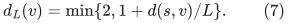

It lies in <code class="math">[1,2]</code>. An old vertex has the common auxiliary anchor

<!-- math-display: 14f6c98bb1d7a0ef29846a9b
a_{L,v}=\min\{2,1+D(v)/L\}.
\tag{8}
-->
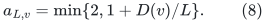

This anchor is witnessed either by the cost-two star edge or by the
phase-start shortest path preceded by <code class="math">(r_L,s)</code>. A new vertex uses
anchor 2. It is already in <code class="math">S</code>, so no old-distance certificate is
needed for it. The cost-two star is its valid witness. The original
source can receive one harmless unit of anchor 1; it is always in
<code class="math">S</code> and is never charged as a promoted target.

At each target <code class="math">v\ne s</code>, create separate unit copies so that

<!-- math-display: a724008d7136c809e8ef9b1a
b_v=1+\deg_{\rm in}(v)+\deg_{\rm out}(v)
\tag{9}
-->
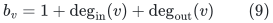

in the *parent* graph. Count all parent edge records, including an
edge that was too long for this normalized scale. An edge insertion
creates at most two new unit copies at each scale; a vertex birth
creates its base copy and its star edge. Old-vertex copies keep (8),
and new-vertex copies keep anchor 2 until the next phase. Thus all
units of a vertex within one detector lifetime have the same anchor.

Let <code class="math">S</code> be the union of vertices reported by any scale and all
vertices born during this phase, with <code class="math">s</code> included. Equation (5)
and the disjoint unit ownership imply that reports of old vertices
cost, cumulatively over all scales,

<!-- math-display: d42bc961bfd41760c38b4f5c
\sum_{v\text{ newly promoted old vertex}}
 \bigl(1+\deg_{\rm in}^{\rm promotion}(v)
          +\deg_{\rm out}^{\rm promotion}(v)\bigr)
 =O(\alpha M U^3/\sigma).
\tag{10}
-->
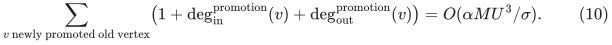

This counts both incoming and pending outgoing records. It uses no
bounded-degree assumption. A parent edge born after a vertex was
promoted is charged separately to its actual external insertion.
Similarly, immediately promoting a new vertex and forwarding its
records is charged to actual external births and insertions.

When all detectors return without stopping, every old vertex outside
<code class="math">S</code> satisfies

<!-- math-display: 173a5799c962c35788372fec
d(s,v)\geq(1-3\sigma)D(v).
\tag{11}
-->
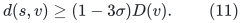

Indeed, choose <code class="math">L</code> with <code class="math">D(v)\in[L/2,L]</code>. Both the old and
current normalized distances then use the uncapped part of (7), and
the detector's certificate gives
<code class="math">d(s,v)\geq D(v)-\sigma(L+D(v))\geq(1-3\sigma)D(v)</code>.

## 5. The projected child and its accuracy

During a phase build an incremental child graph on <code class="math">S</code>. Its source
is still <code class="math">s</code>. Use these records:

* For each old vertex <code class="math">v\in S\setminus\{s\}</code>, add a source edge of length
  <code class="math">D(v)</code>.
* For each parent edge <code class="math">(u,v)</code> with both endpoints in <code class="math">S</code>,
  retain that native edge with its original cost.
* For each parent edge <code class="math">(u,v)</code> with <code class="math">v\in S</code> and old
  <code class="math">u\notin S</code>, add a source proxy to <code class="math">v</code> of length
  <code class="math">D(u)+\ell(u,v)</code>.

When an old tail subsequently enters <code class="math">S</code>, its old source proxy may
remain; add the native edge. Retaining the proxy preserves an
incremental graph. A new tail is already in <code class="math">S</code> and needs no phase
anchor or proxy. Each distinct parent record produces at most a
constant number of child records during a phase.

At a promotion, scan the parent's incoming and outgoing adjacency
lists. The outgoing scan installs previously missing native edges to
heads already in <code class="math">S</code>; the incoming scan installs the needed native
edges or proxies. Edge identities suppress duplicate installations.
Equation (10) pays scans caused by old-vertex promotions. Actual
external edits pay scans and forwarding caused by new vertices and
later parent-edge insertions. No graph contraction, deletion, or
changing proxy weight is hidden in this definition.

**Projection lemma.** At a settled parent state, for each <code class="math">v\in S</code>,

<!-- math-display: 648f00867843ef6b55198b22
d_G(s,v)\leq d_{G'}(s,v)
 \leq(1-3\sigma)^{-1}d_G(s,v).
\tag{12}
-->
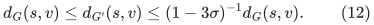

Every proxy and anchor is a valid walk in the parent, so the first
inequality is immediate. For the second, take a current shortest
parent path. If it stays in <code class="math">S</code>, all its edges are retained. If
not, let <code class="math">u</code> be its last vertex outside <code class="math">S</code>, and let <code class="math">(u,w)</code>
be the next edge. Such <code class="math">u</code> is old, because all new vertices are in
<code class="math">S</code>. Use the proxy <code class="math">(s,w)</code> of length <code class="math">D(u)+\ell(u,w)</code>,
then retain the suffix from <code class="math">w</code> to <code class="math">v</code>. Equation (11) bounds
the proxy's prefix by <code class="math">(1-3\sigma)^{-1}d_G(s,u)</code>. This proves
(12), including reachability of all child vertices after the batch.

Use

<!-- math-display: f920e6d4569ccb29da9acccf
\sigma=\frac{\varepsilon}{C_\sigma U},
\tag{13}
-->
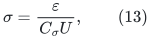

with a sufficiently large absolute constant. There are at most
<code class="math">U+O(1)</code> nontrivial recursive levels. Applying (11)--(12) along
the recursion therefore gives total approximation at most
<code class="math">(1-3\sigma)^{-O(U)}\leq1+\varepsilon</code>.

## 6. A child-size quota pays edges inserted after promotions

Choose a shrink factor <code class="math">\theta=2^{-s}</code>, where <code class="math">s\geq1</code> is an
integer fixed globally. Define

<!-- math-display: a3c7d0a32be503345862a7f3
K_0=\frac{C_0 U^{q}}{\varepsilon},\qquad
\alpha=\frac{\theta}{K_0},
\tag{14}
-->
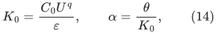

where the fixed exponent <code class="math">q</code>, for example <code class="math">q=12</code>, and constant
<code class="math">C_0</code> dominate all polynomial factors in (10), the scale count,
and the constant edge-installation multiplicity. Round parameters
down dyadically with constant-factor slack. Then all old-vertex
promotions together create at most <code class="math">\theta M/16</code> child records in
one phase.

The numerical application also imposes the explicit parameter check
<!-- math-display: 5e2d936ec9b569b7d643639a
s+\log_2 K_0+2\leq U/100.
\tag{14a}
-->
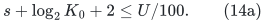
The additive 2 pays dyadic rounding. This ensures the detector's
global-master condition <code class="math">\alpha\geq N^{-1/100}</code>. The main
four-fifths accuracy range in Section 1 satisfies (14a) eventually;
for the broader statement (2), choose <code class="math">c_*</code> sufficiently small and
handle the finitely many smaller master sizes directly.

Give the child an inventory allowance <code class="math">\theta M</code>, adjusting fixed
constants in the definition of an owner allowance. Before processing
a batch that would overflow this quota, rebuild the parent instead
and begin a new phase. The parent has already received the complete
batch; no answer is issued before the rebuild. Do not partially
initialize an oversized child.

More explicitly, if one child graph record expands to at most
<code class="math">C_d</code> logical unit/port records per scale, set the graph-record
quota to <code class="math">\theta M/C_d</code> and choose the constant in (14) so that
promotion-created graph records use at most one sixteenth of this
quota. The child allowance after that fixed expansion is then at
most <code class="math">\theta M</code>, exactly as used in the recurrence. This fixed
factor does not contain <code class="math">E</code>.

If this quota causes a restart, at least <code class="math">\Omega(\theta M)</code>
actual external parent records have arrived since that phase began.
The old-vertex promotion contribution is at most <code class="math">\theta M/16</code>,
and every external record creates only a constant number of child
records. The number of quota restarts during one owner lifetime is
therefore <code class="math">O(1/\theta)</code>.

This quota is necessary: a small cumulative set of promoted vertices
alone does not bound all future edges incident to them. The quota
also pays the immediate promotion of new vertices. A bounded-degree
claim at the root would not by itself justify omitting this charge.

## 7. Sound-stop phase counts with changing degree demands

There are <code class="math">O(U^2/\alpha)</code> sound-stop phases in one owner lifetime.
Here the degree weights and the vertex set can grow, so a fixed-demand
monotonicity argument is insufficient. The following accounting pays
the changes explicitly.

Fix a scale. Give each auxiliary unit a persistent identity throughout
the owner lifetime; resetting a detector changes its anchor, not the
underlying unit identity. Let <code class="math">W_t</code> be the number of units born so
far. It is nondecreasing and at most <code class="math">O(M)</code>. Its weighted true
objective is

<!-- math-display: 863d867480e373b8d658d77a
H_t=\sum_{j\text{ born by }t}d_{L,t}(v(j)),
\qquad W_t\leq H_t\leq2W_t.
\tag{15}
-->
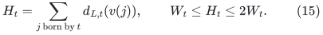

During a phase, <code class="math">F-H_t</code> starts at zero. Existing units contribute
only through decreases of their distances. A newly born unit injects
at most 2 into this gap, because its anchor is at most 2. Any reset
sets all current anchors to the exact current normalized distances
and discards the gap.

Consider an interval in which <code class="math">2^j\leq W_t&lt;2^{j+1}</code>. The total
decrease in distances of units already present, plus all gap injected
by new units, is <code class="math">O(2^j)</code>: initially <code class="math">H_t\leq2^{j+2}</code>, and
new units inject total objective at most <code class="math">O(2^j)</code>. Every completed
sound-stop phase lying within this interval discards at least
<code class="math">\alpha F/2\geq\alpha2^{j-1}</code> of that gap. There can be
<code class="math">O(1/\alpha)</code> such phases. At most a constant number of phases
cross each endpoint of a doubling interval. Summing over <code class="math">O(U)</code>
intervals gives <code class="math">O(U/\alpha)</code> stops attributable to this scale.

There are <code class="math">O(U)</code> scales. A reset triggered by another scale, or by
the child quota, merely discards some uncharged gap and cannot
increase this accounting. Charge each sound stop to one scale that
certifies it. Including quota restarts and initialization, the phase
count is

<!-- math-display: 2c524a1130abc6338930c438
P\leq\mathrm{poly}(U)/\alpha
   \leq K_1/\theta,
\qquad
\log K_1=O\bigl(h+\log(1/\varepsilon)\bigr).
\tag{16}
-->
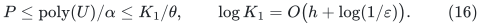

The same argument applies to a child owner with births and parallel
source proxies. It depends only on positive lengths, the unit-count
bound, and the normalized interval <code class="math">[1,2]</code>, not on root degrees.

## 8. Total recursion cost

Initialize at most one child per parent phase. Each child has
inventory allowance at most <code class="math">\theta M</code>, and there are at most
<code class="math">P\leq K_1/\theta</code> phases per owner. Thus the sum of child
allowances generated by an owner of allowance <code class="math">M</code> is at most

<!-- math-display: ef179d30901ffd5595d3f88d
P\theta M\leq K_1M.
\tag{17}
-->
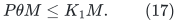

The sum of owner allowances at depth <code class="math">b</code> is consequently at most
<code class="math">(n+m)K_1^b</code>. Each phase costs
<code class="math">M E(N)^{O(1)}\mathrm{poly}(U)</code> outside its child, by
(6), the <code class="math">O(U)</code> scale count, Dijkstra rebuilding, and ordinary
record forwarding. Multiplying by the phase count gives at most
<code class="math">M E(N)^{O(1)}K_1\theta^{-1}\mathrm{poly}(U)</code> for one
owner outside its descendants.

Stop recursing when <code class="math">M\leq C/\theta</code>. At such a leaf, recompute
exact distances by Dijkstra after every complete external batch.
Even charging each record as a separate batch costs at most
<code class="math">M^2\mathrm{poly}(U)\leq M\exp O(s)\mathrm{poly}(U)</code>.
The recursive depth is <code class="math">B\leq U/s+O(1)</code>. Summing all levels and
leaves gives

<!-- math-display: 8ac5b1e8987b9428e75cd22b
(n+m)\exp O\!\left(
 \log E(N)+s+\left(\frac Us+1\right)
       \bigl(h+\log(1/\varepsilon)\bigr)
\right).
\tag{18}
-->
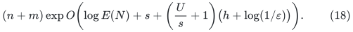

Taking
<code class="math">s=\left\lceil\sqrt{U(h+\log(1/\varepsilon))}\right\rceil</code>,
with fixed constants and harmless integer rounding, proves (2).
For the stated accuracy range the constant in this choice can be
selected so that <code class="math">\alpha\geq N^{-1/100}</code> and
<code class="math">\alpha\leq\sigma/10^6</code> eventually. Finite smaller sizes can use
the direct leaf algorithm with a fixed larger constant.

The key placement of factors is explicit in (18): <code class="math">\log E</code> is
added once to the work exponent. It is not multiplied by the outer
depth. It would be multiplied by that depth if the reporting bound
had an <code class="math">E^{\Omega(1)}</code> factor; freezing and retiring the auxiliary
barrier removes exactly that occurrence.

Distance-change notifications can be propagated through the at most
<code class="math">O(U)</code> ancestors, so the root array of estimates is explicit.
An owner emits a notification when a locally stored distance changes;
each Dijkstra rebuild, leaf computation, or child notification has
already paid for its changed records. This additional ancestor factor
is polynomial in <code class="math">U</code> and is covered by (18). There is one active
child per phase and hence one active ancestor chain for a label;
notifications do not branch into all historical children. A label
notification updates the parent's answer array only. It does not
change a phase anchor <code class="math">D</code>, reprice an old source proxy, or generate
a new parent graph update.

## 9. Uniform numeric range and atomic batches

All recursive graphs use the original root source and original root
vertex identities. Every edge whose tail is not the source is a copy
of a root edge. The only new edges are source proxies or source
anchors. By (12) and (13), every settled local distance is at most
<code class="math">(1-3\sigma)^{-B}\leq1+\varepsilon</code> times the corresponding
root distance, and hence at most <code class="math">2nN^{c_0}</code>.

A new source proxy formed from a non-source tail has length at most
<code class="math">2nN^{c_0}+N^{c_0}</code>. A source edge copied from a parent keeps its
existing length. A phase anchor is an exact local distance and has
the same bound. Consequently every local length is an integer in
<code class="math">[1,3nN^{c_0}]</code>, uniformly in recursion depth. There is no repeated
factor of <code class="math">n</code> in the cost range at successive levels. The global
normalized scales and all normalized edge lengths therefore use
<code class="math">O(U)</code> bits and a common dyadic grid.

A complete incoming batch is first inserted in the parent's ordinary
record store. Process its normalized detector changes and settle the
detectors. If a detector stops, rebuild on the complete graph. If
reporting or forwarding would overflow the child quota, again rebuild
the parent on the complete graph. Otherwise form the complete child
batch and recurse. In particular, a Dijkstra rebuild is never run on
a partly materialized reachability closure or a partly installed
child projection.

The numerical transactions *inside* a detector obey the separate
atomicity rule in its Section 7.1: the full proposed flow increment
is a circulation, coordinate barriers stay positive under every raw
piece, and the global affine cost gap is queried only at settlement.
Exact frozen values and their costs survive all non-reset structural
changes. A phase reset discards the old detector, initializes a new
one, and pays its full local construction cost in (18).

## 10. Update semantics and simple-path reporting

The theorem supports insertions of positive-length directed edges,
including parallel edges, and vertex births. It is online and has no
oblivious-adversary restriction. A weight decrease can be represented
by inserting a new parallel edge with the decreased length; the old
edge remains. In this interpretation, the number of update records,
including all decreased versions, is counted in <code class="math">m</code>. Weight
increases and edge deletions are not included in the assertion.

Retain each current phase's exact shortest-path tree and each leaf's
current exact tree. An old exceptional vertex uses the smaller of its
phase anchor and its current child's estimate; a new vertex uses its
child's estimate. This preserves all previous distance guarantees.
Phase restarts overwrite records with exact values no larger than
their old available-walk values. Therefore witness pointers need refer
only to current phase trees and current child records, without keeping
arbitrary historical best witnesses.

Every source proxy stores its immutable ancestor phase-tree witness
and its native connector edge, if any. Native edges store original
root edge identities. Because every non-native edge leaves the common
source, recursively expanding one selected estimate produces at most
<code class="math">B+1</code> native tree-path segments and <code class="math">B</code> single native edges,
where <code class="math">B=O(U)</code> is the recursion depth. The individual segments may
be long, but the representation has only <code class="math">O(B)</code> pieces.

The complete construction is in
[simple path reporting from tree segments](../../manuscripts/graph-backends/simple-path-reporting-from-tree-segments.md). On creation of a new
shortest-path tree, index its intersections with the active ancestor
phase trees. A shared vertex is represented by the four Euler-interval
coordinates of the two trees. A static sparse dyadic range index finds
the last intersection along either of two clipped ancestor paths in
polynomial logarithmic time. Constructing all these indices costs
<code class="math">O(BM\mathrm{poly}(U))</code> per new tree, absorbed by the
already charged Dijkstra and leaf computations.

Process the <code class="math">O(B)</code> native pieces while maintaining a simple path.
For a new piece, find its last vertex lying on the current path,
truncate the current path there, and append the new piece's suffix.
Initialize this search with their common endpoint, including when
the current path is only the source. The operation removes a closed
directed walk of nonnegative cost and leaves a simple path. There are
<code class="math">O(B^2)</code> intersection queries. Only after all these deletions are
complete are the retained edges enumerated, giving

<!-- math-display: 9abd05474424451971971289
O((k+B^2)\mathrm{poly}(U))
   =O((k+1)\mathrm{poly}(\log N))
-->
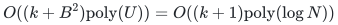

query time for <code class="math">k</code> returned edges. The path's cost is at most the
selected estimate and at least the true distance, so it has the same
approximation guarantee. No edge present only in a deleted long
segment is enumerated. The source query returns the empty path, and
an unreachable query returns the exact unreachable indication.

### 10.1 Nonnegative integer lengths

**Corollary 10.1.** Under the same deterministic raw interface and
accuracy range, the maintained integer estimates and output-sensitive
simple-path guarantee extend to root lengths in <code class="math">[0,N^{c_0}]</code>.

The distance and simple-path bounds also extend to root weights in
<code class="math">[0,N^{c_0}]</code>, with no dynamic SCC or zero-length degree gadget.
Choose a fixed dyadic number
<!-- math-display: 55a63e7ebe50835aa347a610
\frac{\varepsilon}{128N}<\delta
 \leq\frac{\varepsilon}{64N},
-->
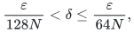
add <code class="math">\delta</code> to every original edge length, and multiply all
lengths by <code class="math">\delta^{-1}</code>. The resulting root lengths are positive
integers, and their range is still polynomial in <code class="math">N</code> in the
accuracy regime stated in Section 1. Run the main algorithm on these
lengths with internal accuracy <code class="math">\varepsilon/8</code>.
The unspecified sufficiently small constant <code class="math">c_*</code> is chosen with
slack for this fixed accuracy factor: the internal bound on
<code class="math">\log(1/\varepsilon)</code> increases by only an additive constant.
Finitely many smaller master sizes use the direct exact solver.
The choice of <code class="math">\delta</code> and the final flooring are exact dyadic
operations; the perturbation is fixed for the whole insertion stream.

An originally finite positive distance is an integer at least one.
It has a simple shortest path with fewer than <code class="math">n</code> edges, so its
perturbed distance <code class="math">d_\delta</code> satisfies
<!-- math-display: da504550dcb958c0eda36df1
d\leq d_\delta\leq d+n\delta
 \leq (1+\varepsilon/64)d.
-->
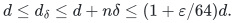
Rescaling the maintained estimate therefore gives an upper estimate
within <code class="math">(1+\varepsilon/8)(1+\varepsilon/64)&lt;1+\varepsilon</code> when
<code class="math">d\geq1</code>. Output the floor of this rescaled upper estimate. Since
the true finite distance is an integer, flooring an upper estimate
cannot make it smaller than the true distance. If <code class="math">d=0</code>, a simple
zero-cost path has perturbed cost at most <code class="math">n\delta</code>, so the
rescaled approximate estimate is less than one and its floor is
exactly zero. The unreachable set is unchanged by the perturbation.
Thus the same algorithm maintains an explicit integer array for
nonnegative integer weights without a separate zero-edge instance.

If a path is requested, dropping the added <code class="math">\delta</code> from every
edge of the reported perturbed simple path only decreases its cost. Its
original cost is an integer, and is therefore at most the floor of
the rescaled upper estimate. In particular, when that estimate is
zero the reported path has original cost zero.

## 11. What changes relative to public compositions

Liu25's printed exponent is <code class="math">335/336</code>, using the earlier
<code class="math">167/168</code> raw-cycle engine. Its original cumulative reporting
bound contains a fixed power of the inverse raw-oracle quality. With
a raw engine of exponent <code class="math">a</code>, the same outer balance has exponent
<code class="math">(1+a)/2</code>, ignoring secondary logarithms.

The September 2026 public raw-cycle framework in Kyng--Meierhans--
Probst Gutenberg--Sulser, arXiv:2609.23852v1, gives a <code class="math">20/21</code>
engine: <https://arxiv.org/html/2609.23852v1>. Subject to the ordinary
raw-interface composition check, it yields a stronger public
composition of exponent <code class="math">41/42</code> for incremental SSSP. Thus the
comparison should not use <code class="math">335/336</code> as though it were the strongest
available public composition.

Simply plugging the candidate four-fifths engine into the original
detector would give exponent <code class="math">9/10</code>. The frozen-barrier detector
instead gives (4), because its reporting budget is independent of
the engine loss. Even with the public <code class="math">20/21</code> engine alone, this
new detector would preserve <code class="math">20/21</code>, rather than passing through
<code class="math">41/42</code>, for fixed accuracy. That observation separates the
potential-retirement technique from the candidate router improvement.

The separate audited public dual tree-cut reparameterization found in
this round gives a derived exponent <code class="math">4/5</code> for static min-cost flow and
decremental SCCs. It does not directly provide the active-flow
raw-cycle interface used here. The present claim is an incremental
all-target distance result with a different client and a newly
proved reporting bound, using the exact interface constructed in the
raw-cycle bridge.

## 12. Complete proof and verification scope

The substantive new mathematical assertion is that deleting each
frozen auxiliary barrier is both a paid potential decrease and a
sound restriction of future flow directions. The companion detector
note proves the residual-demand, comparison-flow, and LOW-certificate
statements needed for that assertion. The
[raw-cycle bridge](../../manuscripts/graph-backends/raw-cycle-to-frozen-detector-bridge.md)
supplies its numerical instantiation, including sound LOW thresholds,
exact retirement, refresh costs and finite arithmetic. The generic
detector and outer reduction therefore compose with the four-fifths
engine; they do not leave a further retirement hypothesis unconstructed.

The complete detector, outer reduction, tree-intersection index,
segment-level loop removal and integer perturbation form the theorem
ready for review. Executable coverage is narrower:
The [independent checker](verify/check_path_reporting.py) compares the
index with explicit path intersections on every labeled tree rooted at vertex zero on
subsets of four vertices, tests short walk segmentations, and includes a
long discarded path whose output enumeration visits only its two
surviving edges. These finite checks neither execute nor certify the
frozen detector or its raw backend.

The outer proof here explicitly pays births, changing degree demands,
edges inserted after promotion, all reset constructions, all scale
copies, finite precision at small local sizes, and global distance
notification. It does not assume bounded degree, free contractions,
zero-cost length gadgets, exact distances at vertex birth, or a
root-sized allocation for every recursive instance.

---

**Attribution:** icekylinx and GPT-6 Astra Pro.

The proofs use their named external interfaces. Finite checks are separate from proof-assistant verification.
