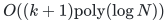

# Verification and proof scope

## Ready for review: local reporting and integer extension

The [tree-segment construction](../../../manuscripts/graph-backends/simple-path-reporting-from-tree-segments.md)
gives a self-contained deterministic intersection index and removes
cycles before enumerating the returned path. Its query bound is
<!-- math-display: c65e6c80511ede5ff0563337
O((k+1)\mathrm{poly}(\log N))
-->

 for **`k` returned edges**. It does
not charge a possibly much longer expanded witness as the output.

Run the independent standard-library checker from the repository root:

```bash
python3 -B problems/incremental-sssp/verify/check_path_reporting.py
```

The fixed finite scope is:

- 29 labeled tree versions rooted at vertex zero on subsets of four vertices,
  including unequal vertex sets;
- 41,209 clipped-path intersection queries, checked against explicit
  vertex sets and all four requested depth extrema;
- 1,107 walk/segmentation cases with nonnegative edge costs;
- one 10,002-edge represented walk that returns and enumerates exactly
  two edges after deleting the long loop.

The checker refuses optimized Python execution with assertions disabled.
Its finite results support the local constructions; the manuscript
proofs establish the general statements.

Section 10.1 also proves the extension from positive to **nonnegative
polynomial-range integer lengths** by a fixed dyadic perturbation,
constant-factor accuracy reserve, and exact flooring. A zero-distance
vertex receives estimate zero and an original zero-cost path.
Arbitrary real and negative lengths are not included.

## Ready for review: the complete dynamic theorem

The [raw-cycle bridge](../../../manuscripts/graph-backends/raw-cycle-to-frozen-detector-bridge.md),
Sections 2–8, constructs deterministic adaptive queries, finite-precision
settlement, exact nonzero-flow retirement, retained costs and divergences,
and charged callbacks. The
[quantitative construction, Sections 1–7](../../../manuscripts/graph-backends/quantitative-matching-4-5-composition.md)
supplies its four-fifths engine using the named deterministic public
primitives. The outer proof pays reachability activation, changing
degree demands, child quotas, phase initialization and tree indices.
These proofs establish the complete composition. The executable tests
above cover its reporting layer; there is no runnable implementation
of the complete fast dynamic structure.

Read the [main proof](../proof.md) with its [source map](../sources.md).
Repository syntax checks do not certify the asymptotic theorem. No
proof-assistant verification or external peer review is claimed.
