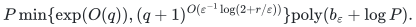

# Independent transversals with explicit obstruction certificates

**Guarantee**

Returns an independent transversal, or a class set <code class="math">S</code>, a total dominating set <code class="math">D</code>, and a constellation <code class="math">K</code> with <code class="math">V(K)\subseteq D</code>, <code class="math">\lvert D\rvert&lt;(2+\varepsilon)(\lvert S\rvert-1)</code>, and <code class="math">\lvert D\setminus V(K)\rvert&lt;\varepsilon(\lvert S\rvert-1)</code>.

**Objective and output**

Select one vertex from each class with no selected edge, or output the stated directly checkable domination and constellation objects.

**Randomness**

Deterministic certifying construction, including the elementary exponential fallback; arbitrary choices use fixed tie rules.

**Time**

<!-- math-display: f11f263ea859ef2e2a4540e1
P\min\{\exp(O(q)),(q+1)^{O(\varepsilon^{-1}\log(2+r/\varepsilon))}\}\mathrm{poly}(b_\varepsilon+\log P).
-->

**Space**

Polynomial in the explicit graph, partition, and current blocker state.

**Parameters**

<code class="math">q</code> is the number of nonempty classes; <code class="math">r\ge2</code> bounds independent neighbours in distinct classes; <code class="math">0&lt;\varepsilon&lt;1</code> is rational; <code class="math">P=\lvert V\rvert+\lvert E\rvert+q+2</code>; <code class="math">b_\varepsilon=\mathrm{size}(\varepsilon)</code>.

**Model and representation**

A finite loopless graph with a given vertex partition and no vertex having <code class="math">r</code> independent neighbours in distinct classes. The constellation is induced after deleting edges within classes.

**Lower-bound scope**

No complexity lower bound is claimed. A returned certificate refutes the stated domination condition; it need not rule out every independent transversal.

**Review status**

**Ready for review in the stated scope.** The complete elementary certifying fallback: induced-star current-blocker invariants, strict earlier-star zero-blocker cascades, positive-composition signature bound, exact total-domination/constellation output and independent original-input verification. The derived public procedure has a new local executable realization and separately charged exponential-in-class-count work.

**Dependencies and scope.** The elementary procedure is credited to Graf and Haxell, arXiv:1811.02687v2, Definition 3 and Section 2. It requires no claw or slack promise. Within-class edges are removed exactly as in the source convention. A domination constellation is not a certificate that no independent transversal exists. The verifier checks the precise elementary alternative and no stronger infeasibility claim. The faster current-blocker layer theorem and its input-linear layer primitives remain outside this bounded review scope. Python hash-table operations and optional observer costs are separately charged; no fast-layer implementation or formal verification is claimed.

The [verification note](verify/README.md) identifies executable coverage. This status does not claim external peer review or proof-assistant verification.

**Source**

[Manuscript and proof](proof.md), with [dependencies and verification sources](sources.md).

The qualitative certifying theorem and operations are due to [Graf and Haxell](https://arxiv.org/html/1811.02687v2). The proof gives the uniform parameter analysis and its certified stopping test.

**Attribution.** icekylinx · GPT-6 Astra Pro

## Executable certifying fallback

The [reference backend](reference/README.md) returns either an independent
transversal or the full induced-star total-domination witness, with an
independent original-input validator. Its positive-signature bound is
exponential in the number of classes. The faster layer construction retains
its separate theoretical bound.
