# Current blocker growth for independent transversals

This is a separate transfer of the current-blocker argument to the
Graf--Haxell independent-transversal algorithm. Its full certificate
and arbitrary-partition specialization have their own completed
source, mathematical, and implementation audits.

The source is [Graf--Haxell, *Finding Independent Transversals Efficiently*,
arXiv:1811.02687v2](https://arxiv.org/html/1811.02687v2), especially
Definitions 3 and 7--12, Algorithms BuildLayer / SuperposedBuild /
GrowTransversal, Lemmas 13--20, and Theorem 4. The qualitative certifying
theorem is public. The contribution here is its sharper uniform
parameter bound, obtained by adding an explicitly certified stopping
test to that public algorithm.

## 1. Statement and exact domination convention

Let `G` be a finite loopless graph, with its vertex set partitioned into
`q` nonempty classes. Parallel edges may be discarded. Assume that
no vertex has `r` independent neighbours in distinct classes, where
`r>=2`; this is the source's partition-relative `r`-claw-free condition.
Let `0<epsilon<1` be rational. Put

<!-- math-display: dc9ec7409b57683c08ae5b80
P=|V(G)|+|E(G)|+q+2,
-->
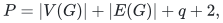

and let `b_epsilon` be its rational input bit length.

The deterministic algorithm returns either an independent
transversal or all of the following explicit objects:

* a nonempty set `S` of vertex classes;
* a vertex set `D` that **totally dominates** every vertex of the
  union of `S` in `G`: every such vertex has a neighbour in `D`,
  including vertices that themselves belong to `D`;
* a constellation `K` for a class set `S_0` containing `S`, induced
  in the graph `G_(S_0)` defined below.

As in the source's Definition 3, `G_(S_0)` is obtained by restricting
to the vertices in the classes `S_0` and deleting all edges within a
class. The word **induced** refers to this graph, not necessarily to
the original graph before within-class edges are deleted.
Here a constellation is a disjoint union of nontrivial stars whose
leaves form a partial independent transversal of all but one class of
`S_0`. These objects satisfy

<!-- math-display: d9fe5747c991d64c8d4e6885
|D|<(2+\epsilon)(|S|-1),\qquad
 V(K)\subseteq D,\qquad
 |D\setminus V(K)|<\epsilon(|S|-1).                   \tag{I1}
-->
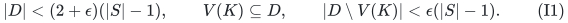

The uniform running-time bound, using the adjacency-list implementation
proved in
[Input-linear scans for the independent-transversal layer primitives](../../manuscripts/matching-and-routing/independent-transversal-input-linear-iteration-implementation.md), is

<!-- math-display: f1b8fc158f42aae561724616
\boxed{\quad
 P(q+1)^{\,O(\epsilon^{-1}\log(2+r/\epsilon))}
       \mathrm{poly}(b_\epsilon+\log P).
 \quad}                                               \tag{I2}
-->
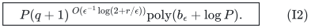

The source uses a safe `O(|V|^4)` per-iteration implementation bound.
The accompanying implementation note instead uses a single monotone
adjacency-list scan per BuildLayer call and absorbs fixed polynomial
factors in `q` into the displayed exponent. The same implementation
improves the named public comparator's input multiplier. The principal
parameter improvement is that the exponent on the number of classes
has only a logarithmic, rather than linear, dependence on the claw
parameter.

If no certificate (I1) exists, the algorithm therefore returns an
independent transversal. No test of a universal domination promise is
performed. A certificate need not prove that an independent transversal
does not exist.

One may replace `r` by `min(r,q+1)`: neighbours in distinct classes
can occupy at most `q` classes. Thus for fixed `epsilon` the construction
also gives a certifying algorithm for arbitrary vertex-partitioned
graphs in time polynomial in the explicit graph input and
quasipolynomial in the number of classes. This consequence concerns the full
domination/constellation certificate, not a claim that algorithms for
more restrictive maximum-degree and class-size promises were unknown.
The integer claw bound may be supplied already clipped to
`2<=r<=q+1`; if an arbitrarily long unbounded integer encoding is
supplied instead, add the time to read that encoding before clipping.

There is also a useful parameter-independent public fallback. The
elementary single-vertex procedure in the source's Section 2 has
positive blocker-count signatures of total sum at most `q-1`.
Counting their compositions gives `P exp(O(q))` time and the
stronger failure output `D=V(K)`, `|D|<=2(|S|-1)`. The complete
operation and zero-blocker cascade accounting is proved in
[An elementary exponential fallback for the full transversal certificate](../../manuscripts/matching-and-routing/independent-transversal-elementary-exponential-fallback.md).
Taking the better of the two algorithms yields the combined bound

<!-- math-display: ddca49961939523fb1193602
P\min\left\{\exp(O(q)),\,
      (q+1)^{O(\epsilon^{-1}\log(2+r/\epsilon))}\right\}
      \mathrm{poly}(b_\epsilon+\log P).
-->
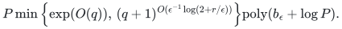

The fallback is particularly relevant for small `q` or very small
slack. For fixed positive slack and unrestricted `r<=q+1`, the
current-blocker term remains quasipolynomial in the number of classes.

## 2. Preprocessing and public operations

Delete edges within a class. They cannot affect an independent
transversal, and the source's graph `G_S` already omits them. The
partition-relative claw condition is preserved: independence among
neighbours in distinct classes is unaffected by deleting same-class
edges.

Whenever a vertex is isolated in the remaining graph, choose it for its
class, delete that entire class, and continue. The chosen vertices are
independent of every remaining vertex and can be restored to a returned
transversal. A certificate using only remaining classes and vertices
is also a certificate in the original graph: total domination still
uses actual original edges, and its constellation is interpreted in
the required interclass graph `G_(S_0)`. This standard source
preprocessing leaves no isolated vertex, so an arbitrary neighbour of
every selected vertex is available when needed below. It can be
implemented by a degree queue in input-linear work. Empty remaining
instances are solved directly.

Use the source's public operations with the following feasible values:

<!-- math-display: 6c7072a30036e7bf0145872c
\mu=\rho=\frac{\epsilon}{100r},\qquad
 Q=\lceil1/\mu\rceil.                                \tag{I3}
-->
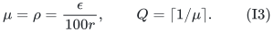

`Q` is the source's degree-cap parameter `U`; it is renamed to avoid
confusion with other logarithmic parameters in this manuscript. All
comparisons are rational comparisons and no array of size `Q` is
allocated.

These values satisfy Definition 10. To see this directly, use
`1/Q<=mu`, `mu<=1/200`, and `rho=mu`. After multiplying the first
two feasibility inequalities by `1-mu`, their left-hand bracket is
at least `1-3mu-mu^2`, whereas their right-hand error terms are
at most `mu(2r+3)` and `mu(2r+6)`, respectively. The first
inequality has margin at least

<!-- math-display: 9f50769dcfb465553686d6a2
\epsilon-(2+\epsilon)(3\mu+\mu^2)-\mu(2r+3)>0,
-->
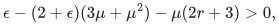

and the second follows from
`epsilon(1-3mu-mu^2)>mu(2r+6)`. The third condition
`Q-mu rho>rho` is immediate. The large fixed constant 100 is only
for transparent numerical slack.

Each augmenting call starts with one unmatched root class and a partial
independent transversal `M`. Positive layers have independent selected
sets `X_i` and their blockers `Y_i` in `M`; every blocker is adjacent
to exactly one selected vertex. Different layers are anticomplete.
The source's dummy `Y_0` is empty, but its active class is the root.

BuildLayer greedily fills active classes up to `Q`, avoiding the lower
prefix and the current candidate. Collapse the last layer when more
than a `mu` fraction of its selected vertices have no neighbour in
`M`. Swap at most one of these vertices per active class and discard
that last layer. SuperposedBuild then checks earlier layers in order;
an adopted extension increases its selected count by `1+mu` and
discards all later layers. These are the actual source operations.

Retain the source's birth stopping check
`|X_new|<=rho |Y_old|`. Its Lemma 15 returns (I1) if this check
fires, since (I3) is feasible. Otherwise every born layer satisfies
the source's original birth-selected growth. The new stopping check
below is additional; it is not silently attributed to the printed
algorithm.

## 3. Current candidates after a matching change

At a main-loop boundary all surviving layers are noncollapsible by
Lemma 13. Hence

<!-- math-display: 08e60770e5b93e79bb68a809
|X_j|\le |Y_j|/(1-\mu).              \tag{I4}
-->
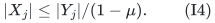

For every surviving `j`, retain its latest **actual** candidate
`(Xhat_j,Yhat_j)` from its birth or a SuperposedBuild attempt.
It has

<!-- math-display: d5e66f25fe7fe508486c837e
Xhat_j=X_j\mathbin{\dot\cup}E_j,
                 |E_j|\le\mu|X_j|.                   \tag{I5}
-->
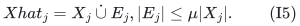

After an adopted attempt `E_j` is empty; after rejection the bound
is strict. This is a fact about an executed computation.

There is an especially simple freshness property here. Every change to
`M` is followed by SuperposedBuild, which visits every layer that
survives that call. If it adopts at layer `j`, all layers above `j`
are discarded. Therefore every surviving candidate was computed with
the current matching `M`, or `M` has not changed since it was
computed. Its lower prefix has likewise not changed. If a lower
layer were adopted or collapsed, this layer would have been discarded.

Thus greedy maximality of every stored candidate can be used directly
at the current boundary. In particular, no stale hypothetical rerun
of a greedy routine is needed. New candidate blockers satisfy

<!-- math-display: b54de326c3f2b178dec6d0e3
|Yhat_j\setminus Y_j|\le(r-1)|E_j|.                  \tag{I6}
-->
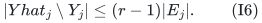

Indeed `M` is independent and meets each class at most once, so a
selected vertex has at most `r-1` neighbours in `M` by the claw
condition. The existing blockers of `X_j` are precisely `Y_j`.

## 4. A certificate from any prefix with few current blockers

Fix any surviving positive layer `i` at a main-loop boundary. Set

<!-- math-display: f7425fba9c295d27adf038d0
W=1+\sum_{j<i}|Y_j|,\qquad Y=|Y_i|,
 T=W-1+Y=\sum_{j\le i}|Y_j|.                          \tag{I7}
-->
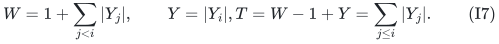

The `W` active classes for the prefix through `i` are the root
class and the classes represented by `Y_1,...,Y_(i-1)`.

From them remove every class that is full in one of the corresponding
recorded candidates, and every class containing a vertex of any
`E_j`, `j<=i`. Call the remaining class set `S`. Define

<!-- math-display: 702150554707d2ef6d5bcd58
D_0=\bigcup_{j\le i}(Xhat_j\cup Yhat_j).
-->
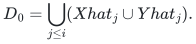

For each currently unblocked vertex of `X_1 union ... union X_i`,
add one arbitrary neighbour to `D_0`; such a neighbour exists by
preprocessing. Call the resulting set `D`.

### 4.1 Why this totally dominates every remaining class

Let `v` belong to a class in `S`.

If `v` is a selected candidate-extra vertex, its class would have
been removed, so this case does not occur. If `v` is a current
selected vertex, it has a blocker in `D_0` or its chosen neighbour
has just been added. If `v` is a candidate blocker, it has a
neighbour in that candidate's selected set in `D_0`. This includes
the current matching representative of a non-root active class,
which belongs to the lower prefix.

Otherwise `v` lies outside the candidate sets and its appropriate
lower prefix. Its class is not full in the actual completed candidate.
If it had no neighbour in that lower prefix or candidate, it would
still be addable and the greedy attempt could not have terminated.
It therefore has a neighbour in `D_0`. This accounts for every
vertex in every class of `S`; domination is total, not closed-
neighbourhood domination.

### 4.2 Cardinality and constellation bounds

Let

<!-- math-display: 0630cdeb87c2761226a70f2f
\eta=\frac{\mu(r+2)}{1-\mu},\qquad
 f=\frac{\mu+(1+\mu)/Q}{1-\mu}.                       \tag{I8}
-->
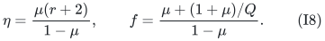

The candidate extras and their blockers use at most
`r sum|E_j|` vertices. The neighbour completion adds at most
`mu sum|X_j|` vertices. Equations (I4)--(I6) give

<!-- math-display: 5f79b1589503a74e65e3dbbc
|D|\le(2+\eta)T.                    \tag{I9}
-->
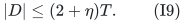

Full classes number at most `sum|Xhat_j|/Q`; extra-selected
classes number at most `sum|E_j|`. Hence

<!-- math-display: d35d643144a5799401a2d5dd
|S|\ge W-fT.                 \tag{I10}
-->
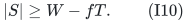

Let `K` be the subgraph of the working interclass graph induced by
the current prefix's selected
vertices that have blockers, together with all of `Y_1,...,Y_i`.
The actual algorithm maintains a slightly stronger invariant than the
disjoint-support requirement stated in the source's alternating-tree
definition. A newly selected vertex avoids all earlier selected
vertices and blockers. If one of its new matching blockers were
adjacent to an earlier selected vertex, that blocker would already
belong to the earlier blocker set, which the new selection avoids.
All matching blockers are mutually nonadjacent because they belong
to the partial independent transversal. This proves inductively that
the induced graph on the current selected vertices and blockers is
a disjoint union of stars; an adopted extension discards all higher
layers, so the same induction survives adoption. In `K` the centres
are precisely the selected vertices having a blocker, and every star
is nontrivial. The leaves form an independent transversal
of the `T` matching-representative classes. Thus `K` is a
constellation for

<!-- math-display: 36094634e7b22981246d3389
S_0=\{\text{root class}\}\cup A(Y_1\cup\cdots\cup Y_i),
-->
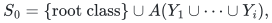

and `S_0` contains `S`. It is contained in `D`. Beyond `K`,
the current unblocked selected vertices, candidate extras and their
new blockers, and the neighbour completion give

<!-- math-display: cdc9f975dadd9f53e17aa35f
|D\setminus V(K)|\le\eta T.        \tag{I11}
-->
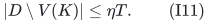

No factor proportional to the size of a whole class occurs in these
bounds. The extra-selected **classes** are excluded, whereas the
certificate itself stores only the selected vertices, blockers, and
one neighbour per unblocked selected vertex.

## 5. Current blocker growth independent of the claw parameter

With (I3), the following convenient bounds hold:

<!-- math-display: fae3fdf653b7d3fc54810048
\eta<\epsilon/40,\qquad f<\epsilon/90,
 \qquad \eta+(2+\epsilon)f<\epsilon/10.                \tag{I12}
-->
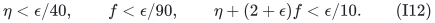

Suppose `W>=2` and

<!-- math-display: 5c5156b683a0ddf5d7949e8d
Y\le\epsilon W/10.            \tag{I13}
-->
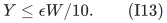

Then `T<=(1+epsilon/5)(W-1)`. From (I9)--(I12),

<!-- math-display: 51358d4593491ee0dbc96e92
\begin{split}
 |D|+(2+\epsilon)fT
  &\le[2+\eta+(2+\epsilon)f]T\\
  &<(2+\epsilon/10)(1+\epsilon/5)(W-1)\\
  &\le(2+13\epsilon/25)(W-1)\\
  &<(2+\epsilon)(W-1).
\end{split}                                             \tag{I14}
-->
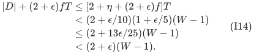

Since `|S|-1>=W-1-fT`, this proves the first inequality in
(I1). Moreover,

<!-- math-display: 2bd9f20a94ead7d1882b66e3
|S|-1\ge(1-\epsilon/75)(W-1)>0,
-->
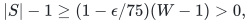

so `S` is nonempty. The additional constellation requirement follows
from

<!-- math-display: 59cb42aca389031d5821d17d
|D\setminus V(K)|
    \le\frac{3\epsilon}{100}(W-1)
    <\epsilon(|S|-1).                                 \tag{I15}
-->
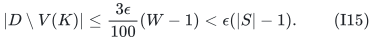

If `W=1`, the original birth check ensures `X_i` is nonempty.
Current noncollapsibility then forces `Y>=1`, which is larger than
`epsilon W/10`. Thus the first layer needs no exceptional
certificate construction.

We have proved the following explicit alternative at every main-loop
boundary: either output (I1), or every surviving positive layer has

<!-- math-display: 03e14e1ed5942644c345d946
|Y_i|>\frac{\epsilon}{10}
                       \left(1+\sum_{j<i}|Y_j|\right).
                                                               \tag{I16}
-->
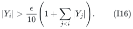

The algorithm can check (I16) for all live layers using prefix counts,
and build the certificate only on failure. Checking just the newly
affected final survivor also suffices with the public discard rule,
but that optimization is not required for (I2).

## 6. Preserve the public signature proof; shorten its allowed length

The source's birth check, collapse operations, and adopted-extension
rule are unchanged. Hence Lemmas 18 and 19 still give a strictly
decreasing lexicographic signature with nondecreasing absolute
coordinates whenever the algorithm continues. An additional certified
stop cannot invalidate those assertions.

Equation (I16) bounds the number of positive layers by

<!-- math-display: 82c8b3eec2ec404cdb7ec0e8
L=O(\epsilon^{-1}\log(q+1)).        \tag{I17}
-->
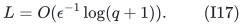

Use the source's original base

<!-- math-display: 23373fb405ce4257c18128f2
b=Q/(Q-\mu\rho).
-->
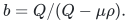

Because `Q=ceil(1/mu)` and `rho=mu`, its logarithm has order
`mu^3`, with uniform constants. Definition 17 therefore bounds the
largest finite signature coordinate by

<!-- math-display: d9115414c28e59d69ed86e39
H=O\!\left(\mu^{-3}
       [L\log(1/\rho)+L\mu+\log(q+1)]\right).        \tag{I18}
-->
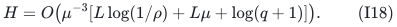

There are at most `2L` coordinates, their signs are fixed, and their
absolute values are nonnegative nondecreasing integers. Counting
lists by both their height and their length, rather than using every
subset of the height range, gives

<!-- math-display: b302b1f1a7ca6e3db1e18cf4
\begin{split}
 \log\#\mathrm{signatures}
   &\le O\bigl(L\log(2+H/L)\bigr)\\
   &=O\!\left(\epsilon^{-1}\log(2+r/\epsilon)
                         \log(q+1)\right).
\end{split}
\tag{I19}
-->
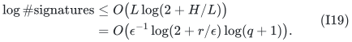

This is valid also when the stated upper bound `L` exceeds `q`;
it then overcounts signatures. Instances with at most one remaining
class are solved directly.

The strictly decreasing signature bounds every finite continuing
execution prefix, so it proves termination without first assuming
termination. At most `q` augmenting calls are needed. In the
accompanying implementation note, one BuildLayer call takes `O(P)`
work: with matching and prefix fixed, every obstruction to addability
is monotone during the call, so a fixed ID scan visits each vertex
once, and every activated support vertex's adjacency list is scanned
once. One SuperposedBuild makes at most `q+1` such calls. Each
collapse first removes the last layer and SuperposedBuild can only
truncate further, so one main iteration has at most `q+1` collapses
and costs `O(P(q+1)^2)`. Both certificate exits fit this bound.
These implementation claims were independently checked in Section 8
of [Current blocker growth for independent transversals](proof.md).
The fixed polynomial factors in `q+1`, including the augmenting calls,
are absorbed by the displayed exponent. This proves (I2). The input-dependent
cap is only used in comparisons; all loops range over actual vertices,
edges, layers, or classes. Rational comparisons add the displayed
bit-operation factor.

This proof does not transplant the simpler weak-Haxell lifetime tree
unchanged. Graf--Haxell can discard later layers when an earlier layer
adopts an extension, even without collapsing each discarded layer.
The retained public signature proof already accounts for that event.

## 7. Public comparison and limits

For the source's displayed feasible parameters and its original
birth-growth depth bound, a length-aware signature count gives

<!-- math-display: 1e88ca88b646fafbf8d06e46
P(q+1)^{
                   O((r/\epsilon)\log(2+r/\epsilon))}.
-->
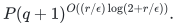

The same input implementation is used in both bounds; the source's
original coarse `P^4` implementation is not used to disadvantage
the comparator. The current-blocker certificate replaces its depth factor
`r/epsilon` by `1/epsilon`. It retains the claw dependence inside
the logarithm of the coordinate-height ratio. This is a quantitative
strengthening of a named public construction with a new stopping
certificate, rather than an exclusively new operation sequence on
inputs satisfying the no-small-domination promise.

Both algorithms can also use the elementary fallback above. Thus the
named derived-public baseline should be read as

<!-- math-display: ac15b18fb8f31c1f29f3cd38
P\min\left\{\exp(O(q)),\,
      (q+1)^{O((r/\epsilon)\log(2+r/\epsilon))}\right\}
      \mathrm{poly}(b_\epsilon+\log P).
-->
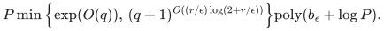

The full version and later-source comparison are recorded in
[Public uniform baselines for the full independent-transversal certificate](../../manuscripts/matching-and-routing/independent-transversal-public-uniform-baseline-audit.md).

Applying the source's hypergraph intersection-graph reduction with
slack `epsilon/(r-1)` recovers the rank-linear weak-Haxell exponent.
The direct hypergraph note has better explicit-input accounting and
does not need the intersection graph to be built. The two results
should therefore not be counted as independent algorithmic
breakthroughs.

Algorithms for independent transversals under maximum-degree,
class-size, local-sparsity, or random-input conditions may be much
faster. Those conditions and output contracts must be matched before
making any comparison. No globally fastest claim, polynomial
dependence on `1/epsilon`, or improved general-graph maximum-matching
bound is asserted here. The completed audits are
[Current blocker growth for independent transversals](proof.md) and
[Current blocker growth for independent transversals](proof.md), including
the source hookup, input-linear implementation, and shared elementary
fallback. These are internal mathematical reviews, not formal
verification, external review, or implementation benchmarks.

---

**Attribution:** icekylinx and GPT-6 Astra Pro.

## Executable elementary fallback

The [reference implementation and independent verifier](reference/README.md)
realize the exact elementary alternative above. Its
[local proof](reference-realization.md) supplies zero-blocker cascade handling,
positive-signature termination and explicit input/output accounting. The
faster current-blocker layer procedure remains a separate implementation
interface.
