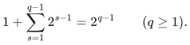
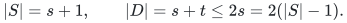
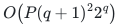

# Constructive elementary transversal certificates

[Reference API](reference/README.md) · [Independent checks](verify/check_elementary.py)

The mathematical fallback is proved in the
[positive-signature companion](../../manuscripts/matching-and-routing/independent-transversal-elementary-exponential-fallback.md).
It instantiates the elementary procedure in Graf and Haxell,
[*Finding Independent Transversals Efficiently*, arXiv:1811.02687v2, Section 2](https://arxiv.org/html/1811.02687v2#S2).
The source's Definition 3 fixes the induced interclass constellation convention.
This note proves the precise executable boundary, including the zero-blocker
cascade, input normalization and independent output verifier.

## State and preservation

Remove within-class edges and merge repeated undirected records. Let <code class="math">M</code> be
the current partial independent transversal, and fix an unmatched root class.
At a stable boundary the ordered stars have distinct centers and pairwise
disjoint nonempty leaf sets. Each leaf set equals all current neighbors of
its center in <code class="math">M</code>. The stars are induced together. The active classes are
exactly the root and the distinct classes of their leaves. Every center was
chosen from the active classes existing before its own star was appended.

The initial empty star sequence satisfies these conditions. Select the least
original vertex in an active class with no neighbor in the whole current
forest. If it has blockers in <code class="math">M</code>, append the vertex and all those blockers.
None of its blockers is an old leaf: the selected vertex avoids the old
forest. No new blocker is adjacent to an old center, because every matching
neighbor of an old center was already one of its leaves. Matching vertices
are mutually independent. Thus the new star is induced, disjoint from every
old star, and adds precisely its blocker classes to the active classes.

If the selected vertex has no matching neighbor, insert it into <code class="math">M</code>. Its
class is either the unmatched root, completing an augmentation, or the class
of one unique old leaf. In the latter case remove that leaf from <code class="math">M</code> and
truncate after its unique star. The new matching vertex has no neighbor in
the retained forest. Consequently all retained centers keep exactly their
old matching neighbors except for the removed leaf. If the affected last
star still has a leaf, the new state is stable.

If that star has no leaf, remove the star and immediately insert its free
center using the same rule. Its original class was active before that star
was appended, so it is either the root or a leaf class of a strictly earlier
star. Each cascade therefore moves strictly earlier or augments at the root.
It takes at most the number of classes many swaps. It never creates a new
matching neighbor for a retained center. This proves preservation and
termination of the cascade, rather than assuming an intermediate empty star
is a valid constellation.

## Termination and exact output

Write the positive leaf counts of a stable state as a finite list followed
by an infinity sentinel. Appending a nontrivial star replaces infinity by a
positive integer. A nonaugmenting swap/cascade strictly decreases one earlier
positive count and truncates after it. Thus every continuing stable step
strictly decreases the lexicographic signature. The disjoint leaves belong
to <code class="math">M</code>, whose size is at most <code class="math">q-1</code> for <code class="math">q</code> classes. The number of possible
positive lists, including the empty list, is

<!-- math-display: 82cbade4ebfedd63dc246374
1+\sum_{s=1}^{q-1}2^{s-1}=2^{q-1}\qquad(q\ge1).
-->

This bounds the stable states of every finite execution prefix and therefore
proves termination without presupposing it. At most <code class="math">q</code> augmentations yield
a full transversal.

If no undominated active vertex exists instead, return all active classes
and the existing stars. Each star is nontrivial and the whole forest is
induced in the interclass graph. Its leaves represent every active class
except the root. Writing <code class="math">s</code> for the total leaves and <code class="math">t</code> for the stars gives

<!-- math-display: 638a01f01023d69e90a4acb7
|S|=s+1,\qquad |D|=s+t\le2s=2(|S|-1).
-->

The stopping test gives total domination of the entire union of those
classes, including vertices in <code class="math">D</code>. As every working edge is original,
total domination also holds in the original graph. This supplies the full
exact fallback alternative and hence the approximate certificate for every
positive slack. It does not assert that no independent transversal exists.
The empty partition has the explicit empty-transversal outcome.

## Independent verification and resource bounds

The verifier reconstructs the interclass adjacency lists directly from the
original input. A transversal is accepted exactly after checking one vertex
per class and independence. A constellation is accepted only after checking
unique IDs, nonempty stars, the exact induced adjacencies, leaf-class
coverage, the size inequality and total domination. These conditions imply
the claimed alternative without trusting any search history or signature.
The verifier imports neither the constructor nor a graph-search optimizer.
It accepts any valid witness, not only the constructor's tie-breaking choice.

Put <code class="math">P=&#124;V&#124;+&#124;E&#124;+q+2</code>, counting original records before duplicate removal.
Constructing the adjacency sets takes linear hash-table work. Each stable
step scans vertices and adjacency sets once and updates at most <code class="math">q</code> stars.
A cascade has at most <code class="math">q</code> swaps, each with at most linear work in <code class="math">q</code>.
Since <code class="math">q\le P</code>, a conservative complete-construction bound is

<!-- math-display: 47e282c52f6dfe33d177cdee
O\!\left(P(q+1)^2 2^q\right)
-->

arithmetic and hash-table operations, with <code class="math">O(P)</code> stored words when the
optional observer does not retain snapshots. Verification takes <code class="math">O(P)</code> such
operations: every adjacency intersection is charged to the scanned original
adjacency lists, and the witness itself has at most twice the class count
many vertices. Sorting immutable output/snapshot IDs contributes at most a
polynomial factor already covered by the construction bound.

All IDs and counters use their actual bit lengths, bounded by a logarithm
of the explicit input size for well-formed normalized IDs. Python hash tables
have their ordinary expected-operation contract, not a worst-case
constant-time guarantee. The faster layer algorithm, its claw-sensitive
bound and its input-linear layer primitives are separate mathematical
results; this reference implements only the elementary fallback.

**Attribution:** Yilin Liu and GPT-6 Astra Pro.
