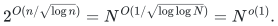
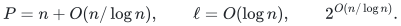
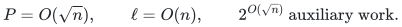
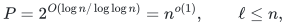
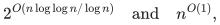

# Conditional deterministic integer factorization

Assuming the cited Boolean tensor-contraction theorem, a uniform classical
deterministic algorithm completely factors every positive integer with
subpolynomial dependence on its numerical value. The new recovery constructions
need at most one contraction and provide distinct precision/auxiliary-work
tradeoffs. The assumption is visible in the theorem and every headline.

[Complete proof](proof.md) · [Exact dependency interface](sources.md) · [Finite verification](verify/README.md) · [Separate research branches](../../manuscripts/integer-factoring-research/)

**Objective and output**

Return the complete list of prime factors and multiplicities of an arbitrary
positive binary integer. Powers of two, prime powers, unbalanced semiprimes
and inputs with many factors are included. The trivial input returns the
empty factorization. At most one nontrivial contraction is needed.

**Randomness**

Conditional uniform deterministic classical bit algorithm. Exact transform-field construction, root recovery and factor extraction use no randomness. Correctness of the cited external tensor-contraction theorem is assumed; local finite verification does not establish it.

**Time**

With `n=bit_length(N)`, for sufficiently large inputs,

<!-- math-display: bac4eedf94766c2ee7bb8e83
2^{O(n/\sqrt{\log n})}
=N^{O(1/\sqrt{\log\log N})}
=N^{o(1)}.
-->

The proof includes all preprocessing and complete-factor recovery. Bounded
inputs are handled directly. This is subexponential in input bit length and
remains superpolynomial; it is not a practical running-time estimate.

Three one-contraction choices retain this leading bound. The basic moment
construction uses linear precision, logarithmic truncation and auxiliary work

<!-- math-display: e9f449c93e40adb2b6b13512
P=n+O(n/\log n),\qquad \ell=O(\log n),\qquad
2^{O(n/\log n)}.
-->

The Sidon second-moment construction instead uses

<!-- math-display: fe68a0a7efa0fc7641a7a9bf
P=O(\sqrt n),\qquad \ell=O(n),\qquad
2^{O(\sqrt n)}\ \text{auxiliary work}.
-->

The packed square-zero construction uses

<!-- math-display: dc845552410a38db95af5cb3
P=2^{O(\log n/\log\log n)}=n^{o(1)},\qquad \ell\le n,
-->

with preprocessing and recovery costs

<!-- math-display: b988fd762f2ad14e8de01f3b
2^{O(n\log\log n/\log n)}
\quad\text{and}\quad n^{O(1)},
-->

respectively. These options optimize different resources. The later
constructions improve contraction count and coefficient precision, not the
leading total-time exponent.

**Space**

Polynomial writable bits in the original input bit length, including
preprocessing, the assumed contraction algorithm and complete recovery.
All large gcd candidate families and trial-division candidates are streamed.
No root list or local tensor truth table is expanded in the basic moment route.
The packed route recovers only a polynomially bounded rough-residual root set.

**Parameters**

`N>=1` is the numerical input and `n=bit_length(N)` its binary length.
`P` is integer coefficient precision; `ell` is polynomial truncation length
in `(Z/2^P Z)[V]/(V^ell)`. The network has `O(n)` Boolean edges and polynomial
succinct description length. Local transform-field arithmetic has polynomial
bit cost and is part of the Boolean entry predicates.

**Model and representation**

The exact external theorem accepts bipartite Boolean multigraphs with ordered
ports, at most linearly many edges, degree bounded by `ceil(s^(9/10))`, and
uniform succinct entries in its literal truncated-integer ring, with precision
and truncation at most a fixed constant times `s`. The construction meets this
interface with `s=Theta(n)`. The external theorem is assumed correct; it is
not re-proved or implemented by this repository's finite verification programs.
The full local reduction and extraction arguments are provided.

**Lower-bound scope**

No general factoring lower bound or optimality claim is made. The accompanying
obstructions concern the specified retuning and interpolation templates.
The asymptotic conditional result is significant relative to the cited general
deterministic positive-exponent bounds. It remains asymptotically slower than
the cited rigorous randomized subexponential algorithm. Publication-wide
priority and practical cryptanalytic performance are not certified.

**Review status**

**Ready for review.** The complete conditional classical deterministic factoring reduction and one-contraction recovery family: the original linear-edge Fourier multiplication/prefix reduction; three-forward-transform unique-extension root verifier; signed digit-moment separation and saturated unitary gcd refinement; basic, Sidon square-root-precision and packed subpolynomial-precision resource choices; deterministic characteristic-two field construction, monotone regular-representation paths, literal-ring guarded output and Hankel/trace root recovery. The actual external theorem interface and the scoped template limitations were checked.

**Dependencies and scope.** The cited OpenAI October 25, 2026 succinct Boolean tensor-contraction theorem is an explicit accepted premise. This review checks its literal applicability and proves the local reduction conditional on it; it neither re-proves the external theorem nor validates its implementation. The result is deterministically subpolynomial in numerical input and subexponential, still superpolynomial, in binary input length. The exact theorem counts Boolean edges, has a fixed linear precision/truncation allowance and supports uniform succinct entry procedures. Internal transform-field and auxiliary square-zero algebra computations are compiled into Boolean predicates and literal-ring outputs; no broader coefficient-ring theorem is assumed. Original inputs need no balance or squarefreeness promise. The later increment improves contraction count and precision/recovery tradeoffs without improving the leading time exponent. Full-grid and full-packet qualifications limit the characteristic-two obstruction; no optimality or general factoring lower bound is claimed. The separate direct one-fifth-exponent candidate remains outside this selected theorem scope. Finite arithmetic programs check small instances and provenance; no complete fast contraction backend is shipped. Publication-wide priority, external peer review, practical cryptanalytic speed and proof-assistant verification are not certified.

The [verification note](verify/README.md) identifies executable coverage. This status does not claim external peer review or proof-assistant verification.

**Source**

[Canonical manuscripts and external dependencies](sources.md). The two supplied
source increments are mapped in the [import record](../../provenance/imports/integer-factorization.json).
All curated output is English. Source-derived mathematics is preserved; no
intermediate checkpoints or stronger exponent improvement are inferred.

**Attribution:** Yilin Liu and GPT-6 Astra Pro.
