# Conditional deterministic complete integer factorization

**Attribution:** Yilin Liu and GPT-6 Astra Pro.

## 1. Theorem and accepted external premise

Let `N` be a positive integer and `n=bit_length(N)`. Bounded inputs are handled
directly. Assume the Boolean tensor-contraction theorem identified in
[sources.md](sources.md), with its actual succinct-entry and coefficient-ring
interface. There is a uniform deterministic classical algorithm returning the
complete prime factorization of every input, in

<!-- math-display: 0c4200e1797a1fb716eddb51
2^{O(n/\sqrt{\log n})}
=N^{O(1/\sqrt{\log\log N})}
=N^{o(1)}
-->
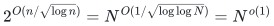

bit operations and polynomial space in `n`. No balance, squarefreeness, smoothness,
or random-input promise is imposed. The reduction needs at most one nontrivial
tensor contraction; powers of two and fully removed small-factor inputs need
none. Three resource choices are proved below. The external contraction theorem
is an accepted premise, not a conclusion of the local tests or this review.

The literal external interface takes a bipartite Boolean multigraph with
`O(s)` edges, polynomially many vertices, polynomial description length and
maximum degree at most `ceil(s^(9/10))`. Tensor entries are computed uniformly
from their ordered Boolean ports. Polynomial-time, polynomial-space local
procedures suffice for its allowed entry-computation budget. Its ring is

<!-- math-display: 09977713d199889d2bc8e942
(\mathbb Z/2^P\mathbb Z)[V]/(V^\ell),
\qquad 1\le P,\ell\le Cs,
-->
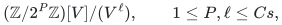

for a fixed constant `C`. It returns the exact contraction in the displayed
subexponential time and polynomial space. The reduction checks this specific
interface. It does not use a theorem for arbitrary field-valued tensor entries.

## 2. A unique-extension verifier with linearly many Boolean edges

Remove the power of two and write `M` for the remaining odd integer. A root
witness consists of an even integer `x` satisfying `0<x<M-1` and

<!-- math-display: 5c9f9e56e57a595c9c72065f
x^2=1+yM.
-->
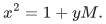

For every admitted root, the nonnegative quotient `y<M` is unique. Choose a
radix with `Theta(log n)` bits per digit and pad the digit vectors to a square
power-of-two transform length `m=Theta(n/log n)` exceeding twice their length.
Let `H=sqrt(m)`. Linnik's established least-prime bound permits deterministic
polynomial-bit preprocessing of a prime `pi=n^{O(1)}` with a suitable primitive
`m`-th root of unity and magnitude larger than all coefficient/carry bounds.
This is a search over polynomially sized integers, not an unproved prime-gap
promise. The source-derived [root verifier](manuscripts/one-contraction-complete-factoring.md)
gives the exact constants and signed carry bound.

Compute three grouped forward transforms: the digits of `x`, the digits of
`y`, and the signed carries. The transform of the known digit vector of `M`
is precomputed. The frequency equations are

<!-- math-display: 6429907d959a258832555e6a
X_k^2-Y_k\widehat M_k
=1+(\beta\omega^{-k}-1)E_k.
-->
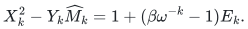

The inverse transform is invertible, so these equations enforce the local
carry identities modulo `pi`. Each integer expression is smaller in absolute
value than `pi`; the congruences are exact integer identities. Their weighted
sum telescopes to the original root equation. Canonical field residues,
bounded signed carries, and binary comparators remove encoding ambiguity.
The carries and all transform words are uniquely determined by `x`.

Each transform is split into two layers of `H`-input, `H`-output gates. A gate
has `O(H*log n)` Boolean ports; its truth predicate is exact polynomial-time
field arithmetic. A whole layer uses `O(m*log n)=O(n)` Boolean edges. The three
transforms, pointwise tests, comparators and constant-degree copying therefore
use linearly many edges, with maximum degree

<!-- math-display: af51b1538046096754ff1a9d
O(\sqrt{n\log n})<n^{9/10}
-->
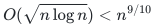

for sufficiently large inputs. Equality subdivision makes the graph bipartite
and changes the edge count only by a constant. Truth tables are succinct
procedures and are never expanded. Accepting assignments are in bijection
with the selected roots; the verifier is constructible without knowing any
prime factor. Internal field arithmetic occurs inside Boolean predicates.

## 3. A separating root-moment family

For analysis only, write `M` as a product of pairwise coprime odd prime powers
`q_i=p_i^(e_i)`, with `k` distinct primes. At each prime power a square root of
one is either plus or minus one. Negation exchanges the parity of representatives
modulo odd `M`. Selecting the even member of each sign pair and removing `M-1`
therefore leaves the root set `R` with

<!-- math-display: cb1e2b20873cfceca1ed18e8
T=|R|=2^{k-1}-1.
-->
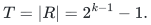

The algorithm does not know the prime powers. A computable bound is provided
by the largest `K` for which `(K+1)!<=M`: distinct prime factors imply `k<=K`,
and elementary factorial growth gives `K=O(n/log n)`.

Choose `m` digit blocks, `b=ceil(n/m)` and radix `B=2^b`. For each block form
an ordinary integer moment and its unknown signed analogues:

<!-- math-display: 915cfa7266950eaa3f3baa4c
S_j=\sum_{x\in R}d_j(x)x,
\qquad
A_{i,j}=\sum_{x\in R}d_j(x)\epsilon_i(x),
\qquad |A_{i,j}|\le (B-1)T.
-->
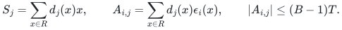

Here `epsilon_i(x)` is the sign of `x` modulo `q_i`. Thus `S_j` is congruent to
`A_(i,j)` modulo the full prime power.

For distinct components `i,h`, assume all digit-sum differences vanish modulo
`p_i`. Reassemble the digits and reduce modulo this prime. Exactly half the
sign vectors have unequal signs at these two components, and this property is
invariant under global sign reversal. The removed trivial sign pair has equal
signs. Consequently

<!-- math-display: 6dd0e168cdf60d8094efaa32
\sum_j B^j(A_{i,j}-A_{h,j})
=\sum_{x\in R}x(\epsilon_i(x)-\epsilon_h(x))
\equiv 2^{k-1}\not\equiv0\pmod{p_i},
-->
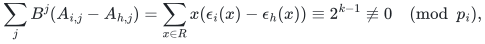

a contradiction. Some digit index separates each ordered pair. Taking
`c=A_(h,j)` shows that a member of the explicit family `gcd(M,S_j-c)`, with
`|c|<=(B-1)T`, contains all of `q_h` and none of `p_i`.

Replace every such divisor `d` by `gcd(M,d^n mod M)`. Since each exponent is
at most `n`, this saturates its prime support: every prime-power component is
included in full or not at all. Streaming gcd refinement by these unitary
divisors separates every pair, so the final blocks are precisely the prime
powers. Exact integer-root tests recover each prime and multiplicity. If
`T=0`, the residual is already a prime power and the same root tests suffice.
The number of candidates costs `2^{O(b+K)}` time; the list of blocks and loop
counters have polynomial size. No prime-factor-size assumption is hidden in
the separation lemma.

## 4. One literal-ring contraction for all moments

For block count `m`, use truncation `ell=2m+1`. At the Boolean input bit `x_i`
in block `j`, attach

<!-- math-display: e0660e18376e8ec0922fe5b1
1+2^{i-jb}x_iV^{m+1+j}.
-->
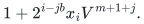

Products of two markers vanish. A two-state chain supplies the weight
`x+V^m` by a single possible transition whose bit weight is `2^i*x_i`.
The contraction returns

<!-- math-display: 36a944f1481348e7e84dd106
F(V)=\sum_{x\in R}x+TV^m
 +\sum_{j=0}^{m-1}S_jV^{m+1+j}.
-->
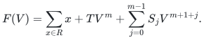

Taking `P=n+b+K+2` prevents wraparound in every coefficient. All required
moments and `T` are read as exact nonnegative integers. Unary markers and the
constant-state chain add linearly many edges; no gate must inspect a whole
large digit block. With `m=ceil(log_2 n)`, the parameters and recovery work are

<!-- math-display: 19fcb2672d56a1dfb97c08df
P=n+O(n/\log n),\qquad \ell=O(\log n),\qquad
T_{\mathrm{aux}}=2^{O(n/\log n)}.
-->
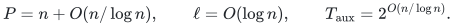

They fit the external theorem with `s=Theta(n)` and a fixed `C`. Auxiliary work
has smaller exponential order than the contraction. Complete recovery needs
one call, rather than adaptive factor-prefix queries or recursive contractions.
The earlier [multiplication/prefix reduction](manuscripts/conditional-tensor-fft-factoring.md)
is retained as an independently useful, weaker call-count construction.

## 5. Square-root precision from Sidon second moments

First trial-divide through `2^ceil(sqrt(n))`, removing every encountered factor
to full multiplicity. For the residual of bit length `n'`, its number of prime
factors is at most `K=ceil(n'/ceil(sqrt(n)))`. Choose `m=ceil(sqrt(n'))` blocks
and `b=ceil(n'/m)`. Both are of square-root size.

The [Sidon construction](manuscripts/sidon-second-moment-factoring.md) assigns
shifted exponents `a_j=O(m^2)` with distinct unordered pair sums, no single/pair
collision, and all triple products above the truncation degree. The bit weight
is the exact quadratic polynomial

<!-- math-display: a2f44e3d177c1bad0fea8feb
1+2wx_iV^{a_j}+2w^2x_iV^{2a_j},
\qquad w=2^{i-jb}.
-->
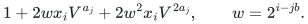

Writing `G_x(V)=sum_j d_j(x)V^(a_j)`, multiplication gives
`1+2G_x+2G_x^2` after truncation. The ordinary integer coefficients give twice
the diagonal and four times the off-diagonal digit second moments. Precision
`P=2b+K+3` prevents wraparound; division by two or four happens only after
reading the exact integer coefficient. Recombining these second moments gives
the previous `S_j`, hence the same complete separation algorithm. Resources are

<!-- math-display: e28e880c86e26db9491f82ac
P=O(\sqrt n),\qquad \ell=O(n),\qquad
T_{\mathrm{aux}}=2^{O(\sqrt n)}.
-->
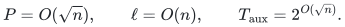

One literal-ring contraction suffices. The leading overall time class is
unchanged.

## 6. Subpolynomial precision and polynomial recovery

The [packed square-zero proof](manuscripts/packed-square-zero-prony-factoring.md)
uses trial division through an exponent of order `n*loglog(n)/log(n)`.
The rough residual has at most `K=2^{O(log n/loglog n)}=n^{o(1)}` selected roots.
Encode roots injectively in an explicitly constructed characteristic-two field
of degree `r=Theta(n')`. A deterministic Artin–Schreier tower constructs it in
polynomial time, with no random irreducible-polynomial search.

In the auxiliary square-zero algebra, the elements

<!-- math-display: 4241a4741f8f5481023c4161
E_a=\prod_{j=0}^{q-1}(1+a^{2^j}z_j),\qquad z_j^2=0,
\qquad E_aE_b=E_{a+b},
-->
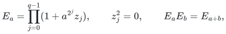

contain the first `2K` powers as coordinates. Group the input bits and compile
multiplication by these elements into succinct **binary** regular-representation
matrices of dimension `D=2rK`. Monomial masks only increase along a nonzero path;
when a mask stays fixed, the field-coordinate block is the identity. Every
integer path has at most `q=O(log K)` strict transitions. Its counts therefore
fit guarded lanes of width `W=O(log K*log n)`.

An output tensor packs `Q=ceil(D/n)` lanes per polynomial coefficient. With
`ell=ceil(D/Q)<=n` and `P=QW`, every coefficient is below its modulus and is
recovered exactly before reducing its lanes modulo two. The external theorem
is still called over its literal integer/truncated-polynomial ring. The
auxiliary field algebra defines binary tensor predicates and is not an added
coefficient-ring assumption.

The first `2K` field power sums determine all distinct roots. The `K`-by-`K`
Hankel matrix factors as `VV^T`; the Vandermonde matrix is injective and its
transpose is surjective, so its rank is exactly the number of roots, including
in characteristic two. The leading square block determines their monic root
polynomial. Deterministic trace splitting recovers all linear factors, and
gcds with `x-1` separate every prime-power component. Postprocessing is
polynomial. The resulting resources are

<!-- math-display: 5c2732c047425b97a83557ac
P=O(K\log K\log n)
 =2^{O(\log n/\log\log n)}=n^{o(1)},\qquad \ell\le n,
-->
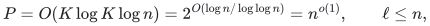

<!-- math-display: f76026438de0f9c58bb17ebb
T_{\mathrm{pre}}=2^{O(n\log\log n/\log n)},\qquad
T_{\mathrm{post}}=n^{O(1)}.
-->
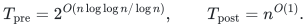

Added matrix-state edges are `O(n^(1/10)*log D)=o(n)` and grouped degree stays
below the allowed threshold. Polynomially described truth predicates, linear
edge count and legal precision/truncation parameters complete the theorem's
applicability check. This option and the Sidon option improve different
resources; neither improves the displayed leading exponent.

## 7. Significance and exact review boundary

The result is a conditional classical deterministic subexponential algorithm
in the input bit length. It improves the positive constant exponent in the
cited general deterministic factoring bound to a vanishing exponent in the
numerical input. It remains superpolynomial in bit length, and the displayed
rate is asymptotically slower than the established randomized subexponential
factoring bound. The current construction is not a practical performance claim.

The source-derived [parameter limitations](manuscripts/tensor-parameter-and-char2-obstructions.md)
restrict specified contraction templates. They prove neither optimality of
the leading exponent nor a lower bound for general factoring. Separate direct
one-fifth-exponent research is retained in the
[research-branch overview](../../manuscripts/integer-factoring-research/).
It is outside this conditional theorem's review.

Independent internal reviews checked the root verifier, both moment extraction
methods, literal-ring packing, characteristic-two recovery, actual external
interface and resource accounting. The [finite checks](verify/README.md)
supplement these arguments. They do not implement or establish the assumed
contraction theorem, prove the asymptotic bound mechanically, certify priority,
or constitute external peer review or proof-assistant verification.
