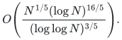

# Sources and dependencies for deterministic integer factorization

[Statement](README.md) · [Complete conditional proof](proof.md) · [Verification](verify/README.md)

## Accepted external theorem and exact interface

The selected theorem assumes correctness of the Boolean tensor-contraction
result in OpenAI's *The Exponential Time Hypothesis is False*, dated October
25, 2026. This is an explicit premise of the present conditional result.
The theorem statement is in
[quantitative-reduction.tex](https://github.com/openai/math/blob/main/preprints/The-Exponential-Time-Hypothesis-is-False-October-25-2026/build/quantitative-reduction.tex),
subsection `tensor-interface`, theorem `thm:tensor-contraction`.
Its construction is in
[quantitative-contraction.tex](https://github.com/openai/math/blob/main/preprints/The-Exponential-Time-Hypothesis-is-False-October-25-2026/build/quantitative-contraction.tex).

The retrieved statement was checked on October 28, 2026. It counts Boolean
edges, supports succinct uniform tensor-entry algorithms, and allows the
literal ring `(Z/2^P Z)[V]/(V^ell)` with `1<=P,ell<=C*s`, including `ell=1`.
The graph has a fixed linear edge budget, polynomially many vertices and
maximum degree at most `ceil(s^(9/10))`. Polynomial local arithmetic fits its
entry-computation allowance. The verified reduction supplies every one of
these requirements; it invokes no arbitrary coefficient-field extension.

The [import metadata](../../provenance/imports/integer-factorization.json)
records the retrieved theorem text's normalized-content digest. This is a
content snapshot, not a pinned Git revision or evidence of theorem correctness.
The exact premise is the stated theorem, rather than any future modification
of the moving branch URL. No external contraction source code is redistributed.

Linnik's established least-prime result provides deterministic polynomial-bit
construction of the exact transform field. A primary source is
[Xylouris, *On the least prime in an arithmetic progression*](https://arxiv.org/abs/0906.2749).
The progression modulus is polynomially bounded in bit length. Searching its
polynomial-sized candidates and checking primality by trial division is
therefore polynomial in that parameter; no short-interval prime hypothesis
or random prime-selection oracle is required.

## Local conditional constructions

| Manuscript | Role and review scope |
|---|---|
| [Succinct FFT multiplication reduction](manuscripts/conditional-tensor-fft-factoring.md) | Initial linear-edge arithmetic verifier and adaptive prefix recovery; full external-interface composition. |
| [One-contraction complete recovery](manuscripts/one-contraction-complete-factoring.md) | Three-forward-transform root verifier, unique extensions, signed digit-moment separation, saturated gcd refinement and basic literal-ring extraction. |
| [Sidon second moments](manuscripts/sidon-second-moment-factoring.md) | One contraction at square-root precision and square-root-exponential auxiliary work. |
| [Packed square-zero recovery](manuscripts/packed-square-zero-prony-factoring.md) | Characteristic-two algebra, binary regular representation, monotone path bound, guarded literal-ring output, Hankel recovery and deterministic trace splitting. |
| [Scoped parameter obstructions](manuscripts/tensor-parameter-and-char2-obstructions.md) | Limitations of the stated precision retuning, full-grid interpolation and recursive-template arguments; no general factorization lower bound. |

Independent internal reviewers checked the actual external statement, local
network/extraction arguments and exact finite evidence. The source-derived
obstruction note additionally states its complete Hermite precision formula
and the full-grid/full-packet hypothesis explicitly. Those clarifications do
not alter the selected factoring theorem.

## General deterministic baselines and significance

[Harvey and Hittmeir, *A log-log speedup for exponent one-fifth deterministic
integer factorisation*](https://doi.org/10.1090/mcom/3708),
[primary preprint](https://arxiv.org/abs/2105.11105), proves the general bound

<!-- math-display: 4cf947d503ff71b8a98e8c01
O\!\left(\frac{N^{1/5}(\log N)^{16/5}}
{(\log\log N)^{3/5}}\right).
-->

Their [June 2026 revision on large-order elements](https://arxiv.org/html/2601.11131v2),
Section 1.2, still identifies the positive one-fifth deterministic factoring
frontier; its new large-order result is an auxiliary theorem.
[Gao, Feng, Hu and Pan](https://arxiv.org/abs/2512.19076) improve logarithmic
factors for balanced semiprimes. That hypothesis cannot be removed when
comparing their result with a general-input algorithm.

Under the accepted external premise, the reviewed result replaces a fixed
positive numerical-input exponent by a vanishing exponent. This is a substantial
classical deterministic asymptotic improvement and motivates its fourth
homepage position. This significance assessment is an inference from the
stated models and bounds; it is not a literature-wide novelty certification.
It is also not a polynomial-time factoring result.

For comparison, the rigorous randomized algorithm of
[Lenstra and Pomerance, *A rigorous time bound for factoring integers*](https://community.ams.org/journals/jams/1992-05-03/S0894-0347-1992-1137100-0/S0894-0347-1992-1137100-0.pdf)
has a smaller asymptotic exponent in input bit length. The conditional
deterministic reduction does not improve that randomized bound or establish
a practical performance claim.

## Preserved separate branches and import policy

The [English research overview](../../manuscripts/integer-factoring-research/)
retains the direct one-fifth-exponent candidate, lattice/conic lemmas and
scoped direct-template restrictions from the earlier archive. They are not
added as prerequisites of the selected conditional proof.

The later archive contributes only its four new manuscripts. There are no
fabricated intermediate versions. Every supplied member has its original byte length and SHA-256 identity
recorded. Retained members map to canonical text or the integrated English
overview; excluded members have no retained text. Formatting and attribution were normalized without
silently changing mathematical arguments. The original Chinese summary is
integrated into the English overview rather than redistributed as a result.

**Attribution:** Yilin Liu and GPT-6 Astra Pro.
