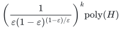

# Intrinsic-value allocation near factor two

**Guarantee**

For a supplied budget <code class="math">k</code>, if <code class="math">\gamma(\theta_\star)\le k</code> at <code class="math">\theta_\star=(1-\varepsilon)\mathrm{OPT}/2</code>, returns minimum value at least <code class="math">(1-\varepsilon)\mathrm{OPT}/2</code>. Choosing <code class="math">\varepsilon=\eta/(2+\eta)</code> gives factor <code class="math">2+\eta</code>.

**Objective and output**

Allocate integral counts to every compulsory player. Enumerate heavy-value splits and retain the best legal allocation.

**Randomness**

Deterministic split enumeration, omission branching and integral recovery, including optional-player, exact-two and constructive local-search fallback variants.

**Time**

The running time is:

<!-- math-display: 01f9fb8be7120cdd933f0994
\left(\frac{1}{\varepsilon(1-\varepsilon)^{(1-\varepsilon)/\varepsilon}}\right)^k\mathrm{poly}(H)
-->

Here <code class="math">\Gamma(R)=R^R/(R-1)^{R-1}</code>. The simpler sufficient promise is <code class="math">\nu(\theta_\star)\le k</code>.

**Space**

Polynomial in the complete binary input and paid oracle workspace; numerical resource multiplicities are not expanded into individual units.

**Parameters**

<code class="math">N_\theta</code> is the Boolean-cap matroid of the sum of resource ranks with unit value at least <code class="math">\theta</code>; <code class="math">\nu(\theta)=\mathrm{rank}(N_\theta)</code>; <code class="math">\gamma(\theta)=\nu(\theta)-\#\{\text{coloops of }N_\theta\}</code>. <code class="math">0&lt;\varepsilon&lt;1</code> is rational. <code class="math">H</code> includes the explicit ground, all rational and integer encodings, and paid rank, submodular-minimization, LP, intersection, and decomposition work.

**Model and representation**

Compulsory players, common intrinsic resource values, arbitrary integral recipient polymatroids, and unused resources allowed. This manuscript has no setup or assignment budget.

**Lower-bound scope**

No upper bound strictly below factor two is inferred. The refined-parameter-zero oracle barrier is proved in the [lower-bound record](../allocation-lower-bounds/refined-parameter-barrier.md).

**Review status**

The [verification note](verify/README.md) records the proof scope, executable evidence and remaining conditions. No proof-assistant verification or external peer review is claimed.

**Source**

[Manuscript and proof](proof.md), with [dependencies and verification sources](sources.md).

The algorithm does not interpret a skipped split as infeasibility. A separate polynomial <code class="math">8+\zeta</code> fallback, for fixed <code class="math">\zeta&gt;0</code>, remains valid when the heavy-parameter promise fails. Optional player selection and exact costs have their own [joint-role proof](../unrelated-values-joint-role/README.md).

## Optional player selection through a derived light matroid

The [player-selection theorem](player-selection.md) extends the intrinsic,
unbudgeted model to a basis of any original player matroid <code class="math">M</code>.
At threshold <code class="math">\theta</code> define

<code class="math">N_\theta=\mathrm{Boolean}\left(\sum_{j:v_j\ge\theta}f_j\right)</code>,
<code class="math">K_\theta=(M^*\vee N_\theta)^*</code>,

and delete the loops of <code class="math">K_\theta</code>. If its remaining ground is <code class="math">Q_\theta</code>,
put <code class="math">c(\theta)=\lvert Q_\theta\rvert-\mathrm{rank}(K_\theta)</code>.

**Factor <code class="math">2+\eta</code> on an actual original basis**

If <code class="math">c(\mathrm{OPT}/(2+\eta))\le k</code>, time is <code class="math">\Gamma((2+\eta)/\eta)^k\mathrm{poly}(H)</code> for rational <code class="math">\eta&gt;0</code>

**Polynomial fallback**

Factor <code class="math">8+\zeta</code> for any fixed <code class="math">\zeta&gt;0</code>, whether or not the derived-corank condition holds

**Rank and corank identities**

<code class="math">\mathrm{rank}(K_\theta)=\mathrm{rank}(M)-\nu(M,N_\theta)</code> and <code class="math">c(\theta)\le q-\mathrm{rank}(M)+\nu(M,N_\theta)</code>, where <code class="math">\nu</code> is maximum common-independent-set size

Every output uses an actual original basis and integral recipient counts.
The derived parameter need not be monotone in the threshold; all value
splits are enumerated. This extension has no assignment or setup budget,
and its exponent is not asserted to depend on original player corank
alone. The compulsory-player statement above is its free-matroid
specialization.

## Exact-factor-two endpoints

The [half-optimum corank manuscript](exact-two-boundaries.md) uses the
same original player matroid and resource model as player-selection.md,
but evaluates <code class="math">c(\theta)</code> at the exact threshold <code class="math">\theta=\mathrm{OPT}/2</code>.

**Exact factor two, XP time**

If <code class="math">c(\mathrm{OPT}/2)\le k</code>, time is <code class="math">(q+1)^k\mathrm{poly}(H)</code>, with polynomial workspace

**Exact factor two, polynomial endpoint**

<code class="math">c(\mathrm{OPT}/2)=0</code>; the loopless derived light matroid has a unique basis

**Exact factor two, quantified light-value separation**

If <code class="math">c(\mathrm{OPT}/2)\le k</code> and <code class="math">u_L\le(1/2-\sigma)\mathrm{OPT}</code> for supplied rational <code class="math">0&lt;\sigma\le1/2</code>, time is <code class="math">\Gamma(1/\sigma)^k\mathrm{poly}(H)</code>

The separated-value endpoint needs the stated separation: strict inequality <code class="math">u_L&lt;\mathrm{OPT}/2</code>
alone can have exponentially small relative slack in the binary input.
An exact-factor-two <code class="math">F(k)\mathrm{poly}(H)</code> theorem for unrestricted intrinsic
values is not established. The companion also proves a two-unit
coverage counterexample to matroid augmentation, explaining why a
second heavy-cover layer cannot be imported automatically.

**Attribution.** Yilin Liu · GPT-6 Astra Pro
