# General-value allocation approaching factor two in the heavy-cover parameter

For compulsory-player allocation with arbitrary integral recipient
polymatroids and arbitrarily many intrinsic resource values, the
corank gap algorithm gives a factor `2/(1-epsilon)` in a suitable
heavy-cover parameter. Its running time is
`Gamma(1/epsilon)^k poly(H)`, where
`Gamma(R)=R^R/(R-1)^(R-1)<=eR`.

The [original-table reference realization](reference-realization.md) supplies
actual derived-matroid completion, prefix selection, original light recovery
and the exact-half candidate endpoint. Its streamed LP vertex cost is
separate from the mathematical fast bound; the public fallback remains a
named external algorithm rather than an implemented default.

Thus factor `2+eta` is obtained with parameter dependence
`(O(1+eta^{-1}))^k`. This is a general-value theorem, not a claim
that the original resources have only two values. It keeps an
explicit condition on the number of players coverable by resources
above the comparator's heavy threshold. A polynomial fallback
supplies a valid constant guarantee when that condition fails.

The algorithm enumerates all distinct heavy/light splits. Skipping
a split that exceeds the parameter budget is never treated as
infeasibility of the original allocation problem.

## 1. Model, heavy-cover ranks and statement

Let P be q>=1 compulsory players. Resource type j has a positive
rational intrinsic unit value v_j and an integral normalized monotone
submodular rank f_j on P. Counts are integer and resource-independent;
unused capacity may be assigned after the guarantee is obtained.
No additional local constraints or optional player-selection matroid
are assumed in the original instance.

Let OPT be the integer maximum possible minimum player value. For
a threshold theta>0, define

<!-- math-display: 82e9ea603969d9af6cae6ead
\mathcal H_\theta=\{j:v_j\ge\theta\},\qquad
 \mathcal L_\theta=\{j:v_j<\theta\},\qquad
 f^b_\theta=\sum_{j\in\mathcal H_\theta}f_j.
 \tag{A1}
-->
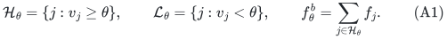

Let N_theta be the Boolean-cap matroid of f^b_theta, and put
nu(theta)=rank(N_theta). It is the number of distinct players that
can each receive one heavy unit. Every such unit has value at least
theta, even though their values can differ. For the empty heavy set,
N_theta is the zero matroid and nu(theta)=0.

Fix rational 0<epsilon<1 and an integer budget k>=0. The relevant
comparison threshold is

<!-- math-display: a1a996d29bc66e133a527dce
\theta^*={(1-\epsilon)\mathrm{OPT}\over2}.
 \tag{A2}
-->
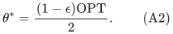

**Theorem A.** There is a deterministic algorithm with running time

<!-- math-display: 801777a93e69c94894874b6d
\Gamma(1/\epsilon)^k
                                \mathrm{poly}(H)
 \tag{A3}
-->
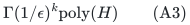

and polynomial workspace which, whenever OPT>0 and
nu(theta*)<=k, returns an allocation with minimum value at least

<!-- math-display: 5f14d53cfcf7b634aa5ef1e0
{(1-\epsilon)\mathrm{OPT}\over2}.
 \tag{A4}
-->
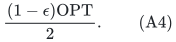

H includes the input and accuracy encoding lengths and the paid
oracle, submodular-minimization, rational-LP and decomposition work.
The polynomial degree is independent of k and epsilon. The base
Gamma need not be evaluated by the algorithm; it is a runtime
bound. The zero-optimum case requires only a legal allocation.

Without the displayed parameter condition, the algorithm still
returns a valid allocation and retains the public factor 8+zeta
guarantee for any fixed positive constant zeta, by taking the better
of its candidates and that polynomial fallback. Keeping zeta fixed
preserves the parameter-independent polynomial degree in (A3).

An optional stronger implementation replaces nu(theta) by

`gamma(theta)=nu(theta)-number_of_coloops(N_theta)`.

This is the loop-deleted corank of the derived player matroid.
The same theorem then requires only gamma(theta*)<=k. The simpler
nu condition in the headline is sufficient without this refinement.

## 2. Enumerating splits without guessing the optimum

Discard zero-value and zero-rank types. If none remains, return the
zero-value allocation. Sort the distinct positive values. There are
only one more than this many distinct partitions into a prefix of
light types and a suffix of heavy types, including either empty side.
Enumerate all of them.

For a fixed split write N for its heavy Boolean matroid,

<!-- math-display: f21741ad1f6d7cf537c62493
a_H=\min_{j\text{ heavy}}v_j,\qquad
 u_L=\max_{j\text{ light}}v_j,
 \tag{A5}
-->
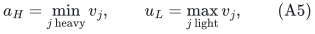

with a_H=infinity for no heavy type and u_L=0 for no light type.
Let M=N*, of rank r=q-rank(N). If r=0, give every player one
heavy unit, decompose it among the heavy types, and record the
resulting allocation. This is a polynomial pure-heavy branch and
does not invoke a unit problem of empty selected rank.

Otherwise delete the loops of M, restrict the light-workload
resource to that player ground, and let c be its corank. One has
c=nu minus the number of coloops of N. Process this split only
if c<=k. An implementation using the simpler nu budget may instead
require nu<=k; either implementation can always keep the pure-heavy
branch. No rejected split is declared infeasible.

Each rank computation and dual-matroid query has polynomial oracle
cost. The number of splits is polynomial in the explicit number
of resource types. In particular, enumeration is over value
classes, not over which players should receive heavy resources.

## 3. Engineering the quota exactly on the original value grid

Choose a positive rational g of polynomial bit length such that
every original value v_j is an integer multiple of g. Consequently
every integer player value, and OPT, lies on the g-grid.

Write epsilon=e/d with integers 0<e<d and choose the workload
quantum

<!-- math-display: 70018fc2e6e8a868e4baa967
\Delta=g/d.
 \tag{A6}
-->
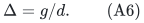

For the current light set define its integral workload polymatroid

<!-- math-display: e4259da0e06afd87dfb45647
F(S)=\sum_{j\text{ light}}{v_j\over\Delta}f_j(S).
 \tag{A7}
-->
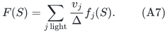

All scaling coefficients are integers. Ranks and scaling factors
stay binary encoded; F is queried by summing the original oracle
values times these factors. No numerical unit copies are created.

At a positive grid target T=m g, use the unit quotas

<!-- math-display: 1186f4a181f1c8fa25c4424b
t=T/\Delta=md,
        \qquad b=(1-\epsilon)t=m(d-e).
 \tag{A8}
-->
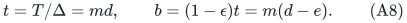

Both are positive integers and t>b. Their branch ratio is exactly

<!-- math-display: 24847e582280b4fdd5da0bf0
{t\over t-b}=1/\epsilon.
 \tag{A9}
-->
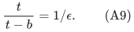

Thus the batched corank theorem returns an M-basis with b units
in P(F), or certifies that no t-unit M-basis exists, in
Gamma(1/epsilon)^c poly(H) time. There is no floor loss, no
small-optimum exception, and no large-numerical-quota assumption:
the artificial workload grid gives (A8) exactly even when T=g.

Loop deletion restricts F, not contracts it. A returned vector
is extended by zero to all original players before completion.

## 4. Optimizing the workload quota for one split

For the fixed nonempty-rank player matroid M, consider the largest
g-grid target X for which `(X/Delta) 1_I` is feasible in P(F) for
some M-basis I. This is an auxiliary integer workload benchmark.
It may be larger than what can be allocated integrally using the
original light resources, which will later be rounded explicitly.

Write V_L=sum_light v_j f_j(P). The auxiliary target is bounded
by V_L. Start at grid target zero, with an arbitrary M-basis and
zero workload. Use an upper grid target strictly exceeding
V_L/(1-epsilon); its prescribed output workload b Delta would
already exceed the total light value, so the gap routine cannot
succeed there. For V_L=0 the first positive grid point suffices.

Use a successful lower and a soundly failed upper grid index,
querying midpoints. A success saves its actual b-quota basis;
a failure certifies infeasibility of its full auxiliary workload
target. At adjacent endpoints the successful lower target is at
least X, so its retained workload is at least (1-epsilon)X.
Success need not be monotone or certify the full target itself.

All target indices have polynomial bit length, including the
factor 1/(1-epsilon). There are polynomially many calls. The
entire search for a split is therefore within the bound (A3).

## 5. Converting workload units into actual light resources

Extend the returned independent workload vector to an integer
F-base on the full original player set. Decompose that base into
integer bases w_j of the scaled ranks `(v_j/Delta) f_j`. Dividing
the j-th vector by v_j/Delta gives a fractional base x_j of the
original light polymatroid f_j.

Every selected member of the returned M-basis then has fractional
light value at least b Delta. The per-player largest-unit lower
rounding lemma returns integer original light bases with value at
least

<!-- math-display: abb0fad2be301ccc4149d96b
b\Delta-u_L
 \tag{A10}
-->
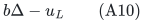

at each such selected player. This lemma is proved via complement
duality and upper rounding in Section 3 of
[Factor two for two-value polymatroid allocation in the large-cover parameter](../../manuscripts/allocation-and-scheduling/two-value-allocation-large-cover-two-transfer.md); it applies to
arbitrarily many original light values. Only their maximum enters
the loss.

The complement of the selected M-basis is an N-basis. Give it one
heavy unit per player, decompose that indicator among original
heavy resource polymatroids, and extend counts to bases if needed.
Every complementary player has value at least a_H. Extra units
assigned during completion can only help. The actual candidate
allocation thus has minimum value at least

<!-- math-display: a3c154a51ee82ceff98d9f94
\min\{a_H,b\Delta-u_L\}.
 \tag{A11}
-->
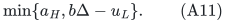

When the displayed lower bound is negative, the allocation is
still legal and has nonnegative actual value. The final algorithm
compares actual achieved values, so no negative guarantee is used
as an objective value. If the heavy set is empty, (A11) simply
uses the light term. If the light set is empty and r>0, the best
auxiliary target is zero and such a split need not improve the
fallback.

## 6. The split selected by the integer optimum has the needed promise

Assume OPT>0 and take the split at theta* from (A2), with heavy
types satisfying v_j>=theta*. This split is among those enumerated,
including the possibilities of an empty heavy or light side.

Fix an integer optimal original allocation, and let R be the
players receiving at least one heavy unit in it. Dropping to one
heavy unit per such player proves R independent in N_theta*.
Extend R to an N_theta*-basis B. Its complementary M-basis

`I*=P\B`

contains only players with no heavy unit in the fixed optimum.
All their optimum value comes from light resources and is at
least OPT.

After the integer scaling (A7), the original light counts therefore
give an independent workload vector with at least OPT/Delta units
on I*. Restrict it and prune excess units. This proves that the
auxiliary integer workload target X for this split is at least OPT,
because OPT itself lies on the g-grid. The claim remains true
after deleting player loops: I* is a basis and avoids them.

If its player rank is zero, the pure-heavy candidate already gives
value a_H>=theta*. Otherwise, if its corank is within budget, the
optimized workload output and (A10) give light value at least

<!-- math-display: 141d2eb8f94fda2d309f8896
(1-\epsilon)\mathrm{OPT}-u_L
              =2\theta^*-u_L>\theta^*.
 \tag{A12}
-->
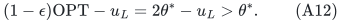

The strict inequality holds because every light type has value
strictly below theta*. Every heavy type has value at least theta*.
Hence (A11) is at least theta*, proving (A4). Values exactly equal
to theta* are placed on the heavy side; this convention is part
of the proof.

The hypothesis nu(theta*)<=k guarantees this split is processed,
since its loop-deleted corank is no greater than nu(theta*).
Using the optional corank budget gives the stronger hypothesis
gamma(theta*)<=k directly.

## 7. Complete algorithm and fallback semantics

Run the split procedures sequentially and retain the best actual
integer allocation. Also run the public polynomial (8+zeta)
algorithm for a fixed zeta>0. Return whichever allocation has
larger achieved minimum value.

This is a complete algorithm on every input. If the comparator
split exceeds the parameter budget, it is merely skipped; the
fallback remains valid. The algorithm does not infer that OPT is
small or infeasible from such a skip. It also does not binary
search across a target-dependent cap predicate. All one-sided
searches occur inside fixed split and fixed player-matroid
instances, where their gap-failure certificates are sound.

The final guarantee always includes OPT/(8+zeta). If the budget
condition at theta* holds, it also includes (A4). The stronger of
these lower bounds is obtained by comparing actual allocations.

If both runtime and comparator are to be reported without a
promise, the precise statement is: for each supplied budget k,
the algorithm has cost (A3), retains the public fallback, and has
the improved factor for every instance satisfying the explicit
computed-rank condition at its optimum threshold. The theorem
does not assert a uniform better-than-eight polynomial algorithm
for unrestricted heavy-cover rank.

## 8. Factor 2+eta and the oracle boundary

For a requested rational eta>0, choose

<!-- math-display: 7d20ce8b0c7cb6a958c53d15
\epsilon={\eta\over2+\eta},\qquad
       \theta^*={\mathrm{OPT}\over2+\eta}.
 \tag{A13}
-->
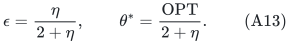

Then (A4) is the factor-2+eta guarantee, and (A3) becomes

<!-- math-display: 0e4ea4557e8c9051937ad8b9
\Gamma\!\left({2+\eta\over\eta}\right)^k
               \mathrm{poly}(H)
          \le\left({e(2+\eta)\over\eta}\right)^k
               \mathrm{poly}(H).
 \tag{A14}
-->
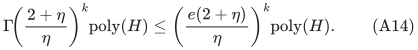

Thus the dependence is single exponential in k for fixed positive
accuracy, and `(O(1+eta^{-1}))^k` jointly in k and accuracy. The
positive accuracy is material: the proof does not set epsilon to
zero or claim exact factor two for arbitrary resource values.
Making the workload quantum finer is harmless in bit complexity;
it does not remove the need for a positive quota gap.

The separate two-value theorem does attain exact factor two and
has a matching oracle lower bound below two in its large-cover
parameter. It supplies a useful boundary for the present broader
class, but one must align the threshold parameter before stating
a lower bound for a particular theta convention. No claim here
changes the ordinary explicit restricted-assignment complexity
threshold or proves optimal exponential bases.

## 9. Relation to prior work

The primary public comparison is Bamas et al.,
[arXiv:2307.08453v1, Theorem 4](https://arxiv.org/html/2307.08453v1):
polynomial factor 8+zeta for general values, and factor 4+zeta for
two values in this recipient-polymatroid model. Theorem 21 provides
the additive allocation rounding also rederived in the preceding
two-value note. Current-version and narrower-model distinctions
are recorded in [Current public versions and the allocation/scheduling proof dependencies](../../manuscripts/allocation-and-scheduling/current-public-version-and-dependency-recheck.md).

The present improvement is the use of a near-exact integer workload
gap with exact engineered quotas, followed by one paid original-unit
rounding loss, and a split enumeration that keeps all cap failures
out of the feasibility logic. The corank batch algorithm itself is
proved in [Single-exponential corank time by branching on a required omission batch](../../manuscripts/allocation-and-scheduling/unit-quota-corank-batch-branching-improvement.md).

This is an integer-OPT result, not a comparison with the weak
aggregate configuration LP. It remains restricted to compulsory
players in this manuscript. A general original player matroid
requires a separately proved residual-player/fat-completion adapter.
No unproved easy all-player LP step is being imported into that
broader model.

Root and independent mathematical review are requested. No formal
verification, external peer review, or exhaustive publication-
priority claim is made.

---

**Attribution:** Yilin Liu and GPT-6 Astra Pro.
