# Configuration-LP comparison for the player-matroid union reduction

The proof below upgrades that reduction's comparison
from integral optimum to a natural configuration LP on the same
arbitrary player matroid. It does not require a fractional solution
as input, enumeration of configurations, or solution of that LP.

## 1. The relaxation and the fixed-target statement

Let the original player matroid M have rank r>=1. For each player p
and target T>=0, let

<!-- math-display: 6df6b46e7ffee7f25dcb118c
\mathcal C_p(T)=\{C\subseteq L_p:\ v(C)\ge T\}.
-->
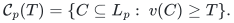

The player-matroid configuration LP has nonnegative variables
`z_pC`, for C in this finite but possibly exponential family, and
player variables

<!-- math-display: e4edac412e577dff7dbaea72
\begin{split}
 x_p&=\sum_{C\in\mathcal C_p(T)}z_{pC},\\
 x&\in P_{\mathcal B(M)},\\
 \sum_{p,C:\ j\in C}z_{pC}&\le1\qquad(j\text{ a resource}).
 \end{split}
 \tag{C1}
-->
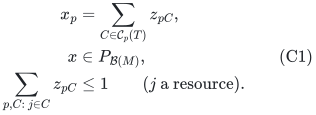

For the threshold and algorithm of the union note, put

<!-- math-display: 4ef51915aac01a695419c731
d_r=4-3/r,\qquad\theta=1/d_r.
-->
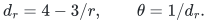

The fixed-target algorithm returns either a basis allocation worth
at least T/d_r, or a certificate that (C1) is infeasible. Its time
is `poly(input) 2^{O(r)}`. With any positive rational eta, the
same statement holds at value T/(d_r+eta) with the established
minimum of the rank-exponential and rank-quasipolynomial times.

The new point is the soundness of the second outcome relative to
(C1). The allocation construction and its running time are unchanged.
This is not a guarantee against the original unconditioned compact
`Q_M(T)` for arbitrarily large items; that LP can have an unbounded
integrality gap, as the sharp-star endpoint example shows.

## 2. Split the configurations into fat and all-small cases

Classify a resource as fat when its value is at least theta T, and
let N be the transversal matroid of players matchable to distinct
liked fat resources. Set

<!-- math-display: 292e0e8a1f30d09051ce0b84
U=M^*\vee N.
-->
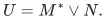

Assume (C1) is feasible, only for the following existence proof.
For each player define its fat-configuration mass and small mass by

<!-- math-display: 5e041830b6e8559dbc89675d
f_p=\sum_{C:\ C\text{ contains a fat resource}}z_{pC},
 \qquad h_p=x_p-f_p.
 \tag{C2}
-->
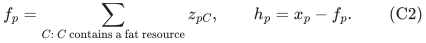

From every fat configuration select one contained fat resource,
using any fixed rule. Assign its whole configuration weight to that
player-resource edge. The resulting fractional bipartite matching
has player degrees f_p<=x_p<=1 and resource degrees at most one:
selecting one item from a configuration cannot increase any resource
load beyond (C1). By the integral bipartite matching polytope, its
player degree vector satisfies

<!-- math-display: 51f75e571ec7a599c15335ee
f\in P_{\mathcal I(N)}.
 \tag{C3}
-->
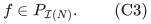

For a small resource j let

<!-- math-display: bd248ee6c9283af45f295105
a_{pj}=\sum_{C:\ C\text{ has no fat resource},\ j\in C}z_{pC}.
-->
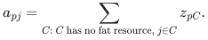

Then

<!-- math-display: 67ce763c5edc511bf5abae7e
0\le a_{pj}\le h_p,\qquad
 \sum_p a_{pj}\le1,\qquad
 \sum_jv_ja_{pj}\ge T h_p.
 \tag{C4}
-->
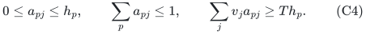

The individual bound by h_p is essential. It follows because these
resource marginals use only the all-small configurations of p.
An arbitrary assignment marginal bounded only by x_p would not
justify this step after the split.

## 3. From fractional union independence to a dual basis

The complementary player vector

<!-- math-display: 0611cf2b73883b81a13f4306
d=\mathbf1-x
-->
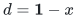

lies in the base polytope of M*. Let `z=d+f`. Coordinatewise,
`0<=z<=1`, because f<=x. Moreover z lies in the independent-set
polytope of the union U.

For completeness, the last implication follows directly from the
matroid-union rank formula. For every player set A and every Y
contained in A,

<!-- math-display: c3bb12dc99b8393c71a25841
\begin{split}
 z(A)&=z(A\setminus Y)+d(Y)+f(Y)\\
     &\le |A\setminus Y|+r_{M^*}(Y)+r_N(Y).
 \end{split}
-->
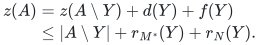

Minimizing over Y gives `z(A)<=r_U(A)`. Together with
nonnegativity, these are the independent-set polytope constraints.
Equivalently, the same fact follows by the integral intersection of
the direct sum M* plus N with the partition matroid allowing at
most one copy of each player.

Every point of a matroid independent-set polytope has a dominating
base-polytope point. One existence proof writes it as a convex
combination of independent-set indicators, extends each independent
set to a basis, and keeps the same coefficients. Thus there is

<!-- math-display: d39106cff49456ea2fa5e353
z'\in P_{\mathcal B(U)},\qquad z'\ge z.
-->
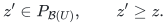

Its complement satisfies

<!-- math-display: b034b7cd9367f257280da85d
x'=\mathbf1-z'\in P_{\mathcal B(U^*)},\qquad
                   0\le x'\le\mathbf1-z=x-f=h.
 \tag{C5}
-->
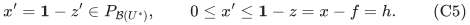

No such fractional point has to be computed by the allocation
algorithm. The public base-domination fact is also stated in
[DRZ v4, Lemma 14](https://arxiv.org/html/1807.07189v4).
Polynomial implementation of union and decomposition is already
paid in the main union note; see also
[Terao, ICALP 2023](https://drops.dagstuhl.de/entities/document/10.4230/LIPIcs.ICALP.2023.104).

## 4. Scale the small marginals to the derived player basis

For h_p>0 set

<!-- math-display: 062aa03145404e7dafcf63f5
y'_{pj}=(x'_p/h_p)a_{pj},
-->
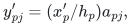

and set all these coordinates to zero when h_p=0. This latter case
also has x'_p=0. Equations (C4)--(C5) give

<!-- math-display: d58c041b06114be7e2c25940
0\le y'_{pj}\le x'_p,\qquad
 \sum_p y'_{pj}\le1,\qquad
 \sum_jv_jy'_{pj}\ge T x'_p.
-->
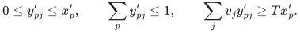

Therefore

<!-- math-display: d84fe7db17d994f5bcf9f533
\boxed{\quad
 \text{configuration LP (C1) feasible}
       \quad\Longrightarrow\quad Q_{U^*}(T)\ne\varnothing.
 \quad}
 \tag{C6}
-->
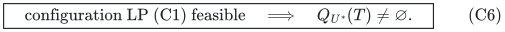

The inner algorithm's explicit certificate that the right side is
infeasible consequently certifies infeasibility of (C1). A verifier
checks the derived matroid queries and the inner current-resource
certificate, then uses the fixed reduction above. This is a
polynomially checkable logical certificate; the claim does not
require printing an exponential configuration-LP dual solution.

When the inner algorithm succeeds, the original union decomposition
and dual-basis extension recover an original M basis with the
claimed allocations. The existence proof here is the only addition.
In particular, rank(U*)<=r and the paid oracle overhead are unchanged.

## 5. The unknown configuration target also lies on the rational grid

Let `T_conf` be the largest feasible target of (C1), using value
zero if no positive target is feasible. Its feasibility is monotone
in T: decreasing T only adds allowed configurations.

Let Delta=1/D be the common rational grid of the input item values.
Every configuration value is on that grid. If any positive T is
feasible, choose a feasible point and let c be the minimum value
among its configurations with positive weight. There are finitely
many such configurations, c>=T, and the same point is feasible at
c. The configuration system changes only at this finite set of
bundle values. Hence its maximum feasible target is attained and
belongs to `Delta Z`.

Also

<!-- math-display: 2abad9eca7d859a5f054a0e4
rT_{\rm conf}\le V,
-->
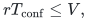

where V is the sum of all resource values: sum the configuration
values against their weights and then apply the resource capacities.
This gives a finite polynomial-encoding upper bound.

The main note's grid search now works relative to T_conf. A failed
target implies `T>T_conf` by (C6) and monotonicity of (C1). A
successful target need not be at most T_conf, but returns value at
least aT, where a is the chosen inverse approximation ratio. With
a failed upper point and a successful lower point, termination at
adjacent grid points implies lower>=T_conf. The saved allocation
therefore has value at least a T_conf.

This remains an algorithm that calls only the explicit bundle and
matroid oracles. Neither the configurations, the feasible witness
used in this proof, nor T_conf are computed separately. The number
of target trials is polynomial in the encoding length of the common
grid and upper bound.

## 6. Public comparison and limits

The same implication (C6) also applies when the inner solver is the
latest displayed public DRZ one-fifth theorem. With a fat threshold
T/6 it gives a derived polynomial `6+eta` guarantee relative to
this same player-matroid configuration LP. As in the main comparison
note, this is a consequence of the displayed public theorem, with
its separately documented literal-pseudocode qualification; it is
not a newly repaired proof of that theorem.

The older DRZ v2 one-third claim would similarly imply `4+eta`,
but the historical version correction must be retained. For the
ordinary all-player special case, polynomial `4+eta` relative to
the configuration LP is already public through Cheng--Mao. The new
general-player-matroid construction and its rank parameter are the
objects of comparison here, not an ordinary Santa Claus breakthrough.

The accepted exact ratio d_r approaches four as rank grows. The
configuration-LP upgrade changes the comparison target; it does not
turn this finite-rank ratio into a uniform constant below four, and
it makes no change to the general-graph maximum-matching exponent.

---

**Attribution:** icekylinx and GPT-6 Astra Pro.
