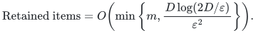
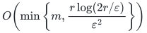
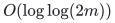
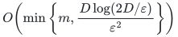

# Exact correlated-failure cuts and whole-block quotients

A polynomial label decoder turns every permitted failure and query into an ordinary quotient query. One nonnegative coefficient per original item then works simultaneously for all queries, including those chosen after the summary is revealed.

## Results

The common support envelope is

<!-- math-display: 2ef5c2ebdea230dcc9d9e577
\text{Retained items}=O\!\left(\min\left\{m,\frac{D\log(2D/\varepsilon)}{\varepsilon^2}\right\}\right).
-->

All constructions below are Monte Carlo randomized polynomial time in the explicit compact matrix/graph input and inverse accuracy. One event of probability at least <code class="math">2/3</code> covers every allowed failure and the entire query family, including queries selected after the output. The exact polynomial decoder and field-extension steps are deterministic; a failed sampling event can silently violate an approximation guarantee.

**Ordinary normalized monotone submodular quotients of rank <code class="math">r</code>, positive marginals at least one**

**Lifted rank parameter <code class="math">D</code>.** <code class="math">r</code>

**Retained support and output.** Original items:

<!-- math-display: 178bc41854aa772fff8b44dc
O\!\left(\min\left\{m,\frac{r\log(2r/\varepsilon)}{\varepsilon^2}\right\}\right)
-->

Backend calls:

<!-- math-display: 9bd553d56797a32a14b94d9d
O(\log\log(2m))
-->

**Proof.** [Adaptive resparsification theorem](manuscripts/adaptive-quotient-resparsification.md)

**Represented columns or whole represented subspaces with incidence label deficit at most <code class="math">k</code>**

**Lifted rank parameter <code class="math">D</code>.** <code class="math">r\binom{h+k}{k}</code>

**Retained support and output.** Original columns or whole blocks preserve all subspace-complement queries. Their support bound is:

<!-- math-display: eefbc6e79c77e55fcdb016fa
O\!\left(\min\left\{m,\frac{D\log(2D/\varepsilon)}{\varepsilon^2}\right\}\right)
-->

**Proof.** [Column theorem](manuscripts/exact-label-cut-and-matroid-quotient-sparsification.md), [Theorem B1](manuscripts/exact-label-whole-blocks-and-hyperedges.md)

**Undirected graph: at most <code class="math">a</code> labels per vertex and <code class="math">b</code> additional labels per edge**

**Lifted rank parameter <code class="math">D</code>.** <code class="math">(n-c)\binom{h+a+b}{a+b}</code>

**Retained support and output.** Retained edges preserve every cut after every allowed failure. Their support bound is:

<!-- math-display: eefbc6e79c77e55fcdb016fa
O\!\left(\min\left\{m,\frac{D\log(2D/\varepsilon)}{\varepsilon^2}\right\}\right)
-->

**Proof.** [Equation EC1](manuscripts/exact-label-cut-and-matroid-quotient-sparsification.md)

**One vertex color per graph vertex, no additional edge labels**

**Lifted rank parameter <code class="math">D</code>.** <code class="math">(n-c)(h+1)</code>

**Retained support and output.** Retain original edges with one fixed coefficient each, with support bound:

<!-- math-display: eefbc6e79c77e55fcdb016fa
O\!\left(\min\left\{m,\frac{D\log(2D/\varepsilon)}{\varepsilon^2}\right\}\right)
-->

**Proof.** [Equation EC2](manuscripts/exact-label-cut-and-matroid-quotient-sparsification.md)

**Hyperedges of size at most <code class="math">t</code>, with at most <code class="math">a</code> vertex labels and <code class="math">b</code> additional item labels**

**Lifted rank parameter <code class="math">D</code>.** <code class="math">(n-c)\binom{h+a(t-1)+b}{a(t-1)+b}</code>

**Retained support and output.** Whole hyperedges preserve cuts and partition-crossing objectives, with support bound:

<!-- math-display: eefbc6e79c77e55fcdb016fa
O\!\left(\min\left\{m,\frac{D\log(2D/\varepsilon)}{\varepsilon^2}\right\}\right)
-->

**Proof.** [Equation B6](manuscripts/exact-label-whole-blocks-and-hyperedges.md)

**Whole hedges, with at most <code class="math">d</code> labels per hedge**

**Lifted rank parameter <code class="math">D</code>.** At most <code class="math">(n-c)\binom{h+d}{d}</code>

**Retained support and output.** Whole hedges have the following support bound, with no factor for the number of constituent edges:

<!-- math-display: eefbc6e79c77e55fcdb016fa
O\!\left(\min\left\{m,\frac{D\log(2D/\varepsilon)}{\varepsilon^2}\right\}\right)
-->

**Proof.** [Equation B9](manuscripts/exact-label-whole-blocks-and-hyperedges.md)

**Globally commuting prime-dimensional stabilizer blocks, at most <code class="math">d</code> labels per block**

**Lifted rank parameter <code class="math">D</code>.** <code class="math">(n+1)\binom{h+d}{d}</code>

**Retained support and output.** Whole blocks simultaneously preserve all-state energy and the kernel, with support bound:

<!-- math-display: eefbc6e79c77e55fcdb016fa
O\!\left(\min\left\{m,\frac{D\log(2D/\varepsilon)}{\varepsilon^2}\right\}\right)
-->

**Proof.** [Equations B10–B11](manuscripts/exact-label-whole-blocks-and-hyperedges.md)

## Contract

**Objective and output**

One original-item reweighting preserving every stated cut, partition, represented quotient, or commuting-block energy after all sets of at most <code class="math">h</code> failed labels.

**Randomness**

Monte Carlo randomized preprocessing, with success probability at least <code class="math">2/3</code> for one event covering every allowed failure and quotient/cut query. Queries and failed labels may be chosen after the summary is revealed. The exact label decoder and field-extension arithmetic are deterministic.

**Time**

Polynomial in explicit compact input length and <code class="math">\varepsilon^{-1}</code>; the construction returns the whole input before materializing a lift whose dimension exceeds the item count. No failure set is enumerated.

**Space**

Lifted rank bounds and retained support are separate from workspace. Only the polynomial-sized capped lift is materialized; no independent optimized space bound is claimed.

**Parameters**

<code class="math">m</code> counts original items, <code class="math">r</code> is original concatenated-column rank, <code class="math">c</code> counts positive-input components including isolated vertices, <code class="math">h</code> is the failure budget, and <code class="math">k</code> bounds item labels absent from an incident row.

**Model and representation**

Explicit rational or finite-field matrices and rational item weights. A failed vertex deletes every incident hyperedge as a whole. A partition charges a crossing hyperedge once. Stabilizer failure results require global commutation.

**Lower-bound scope**

Simple unweighted graph and hypergraph families require <code class="math">\Omega\!\left(\frac{n\binom{h+k}{k}}{\varepsilon^2}\right)</code> original items in the stated large-<code class="math">n</code> regimes. Repeated labeled commuting-check families require <code class="math">\Omega\!\left(\frac{n\binom{h+d}{d}}{\varepsilon^2}\right)</code> when <code class="math">n\ge2\left\lceil\varepsilon^{-2}\right\rceil</code>. These are support lower bounds allowing arbitrary nonnegative output weights.

**Review status**

**Ready for review in the stated scope.** The exact rational whole-block incidence-label compiler and decoder, original-row rank compression, common item scalar, original-ID whole-block rank and subspace-query interfaces, uniform full-input dimension gate, and mathematical composition with Quanrud quotient sparsification and the integer-rank adaptive restriction/error/probability/bit ledger.

**Dependencies and scope.** The deterministic reference retains the original input and, in `LIFT` mode, its complete compiled blocks. It is not a sampled sparse summary and implements neither the published quotient sampler nor adaptive resparsification. Those remain completed mathematical constructions through the identified published backend. This review does not cover finite-field extension software, the rational subgroup-rank client, quantum stabilizer algebra or support lower-bound reductions. Their mathematical statements and primary dependencies remain separately recorded. Exact rational bit work is charged; `FULL_INPUT` returns before monomial enumeration or polynomial multiplication when positive-rank formal dimension is at least item count. Finite executable checks are not proof-assistant verification or external peer review.

The [verification note](verify/README.md) identifies executable coverage. This status does not claim external peer review or proof-assistant verification.

**Source**

[Proofs](proof.md), [manuscript and reference map](sources.md), [decoder review](verify/README.md), [finite evidence](verify/README.md).

The graph theorem concerns cuts; [spectral and seminorm summaries](../correlated-spectral-regression/) have separate guarantees and parameter bounds.

**Attribution:** icekylinx and GPT-6 Astra Pro.
