# Adaptive resparsification removes the ambient ground-set logarithm

**Abstract.** Adaptive repeated application of quotient sparsification removes the original ground-set size from the support logarithm. The proof controls restriction, accumulated multiplicative error, conditional failure probability, and the bit length of repeated rational reweightings.

## Theorem

**Theorem 1 (adaptive quotient resparsification).** Let <code class="math">f:2^E\to\mathbb R_{\ge0}</code> be normalized, monotone, and submodular, with every positive marginal at least one and total rank <code class="math">r=f(E)</code>. For nonnegative rational item weights and <code class="math">0&lt;\varepsilon&lt;1</code>, a randomized algorithm preserves the weight of every quotient within <code class="math">1\pm\varepsilon</code>, simultaneously, on

<!-- math-display: 48298db9398dd211dfbb809e
O\!\left(\min\left\{|E|,\frac{r\log(2r/\varepsilon)}{\varepsilon^2}\right\}\right)
-->
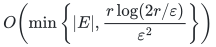

original items, with probability at least <code class="math">2/3</code>. It uses <code class="math">O(\log\log(2&#124;E&#124;))</code> calls to Quanrud's quotient-sparsification backend and polynomially many additional oracle operations. The zero-rank case returns the empty summary. For an exact rational rank oracle with a fixed common denominator polynomial in the rank, the construction has polynomial bit complexity under the value-oracle contract in QB4.

**Proof.** QB1 states the external backend with its required confidence. QB2 proves that every original query remains a quotient after restriction. QB3 supplies error parameters whose sum is independent of the input ground-set size. QB4 bounds the total failure probability and accumulated rational encoding length. These steps prove the theorem. The support improvement is an adaptive consequence of the existing quotient theorem.

## QB1. The public backend

Let <code class="math">f:2^E\to\mathbb R_{\ge0}</code> be normalized and monotone submodular. Suppose every nonzero marginal value is at least one, let <code class="math">r=f(E)</code>, and let the elements have arbitrary nonnegative weights. A set is closed if it contains every element with zero marginal relative to it. A quotient is the complement of a closed set.

Quanrud's SODA 2024 theorem gives, in randomized polynomial time with an evaluation oracle for <code class="math">f</code>, a nonnegative reweighting supported on
<!-- math-display: 101a5e80a2f085f34a470a50
O\!\left(\frac{r\log(mr)}{\eta^2}\right),\qquad m=|E|,
-->
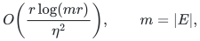
that preserves the weight of every quotient to relative error <code class="math">\eta</code>. The source is:

- Kent Quanrud, *Quotient sparsification for submodular functions*, Theorem 1.1 and Section 3: <https://kentq.s3.amazonaws.com/submodular-sparsification.pdf>.

We use the following conventional quantified form of that theorem. For one absolute constant <code class="math">A</code>, a call at error <code class="math">\eta\in(0,1)</code> has both the desired quotient guarantee and support at most
<!-- math-display: c90f6e98d8f59ae03eff834a
A r\eta^{-2}\log(2mr)
 \tag{QB1}
-->
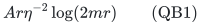
except with probability at most <code class="math">(2m)^{-4}</code>. Increasing the absolute sampling constant supplies this form. This is directly justified by the proof of Lemma 3.3: its failure bound is <code class="math">(mr)^{-c_3}</code>, and its footnote explicitly permits arbitrarily large fixed exponents by decreasing the threshold constant. Lemma 3.4 takes a union bound over at most <code class="math">m</code> strength levels, and the concluding Chernoff bound also controls the support. No variable confidence parameter is needed below.

The cases <code class="math">r=0</code>, an empty support, and a support of size at most one can be handled exactly.

## QB2. Restrictions preserve the old query family

Let <code class="math">S</code> be closed for <code class="math">f</code>, and let <code class="math">T\subseteq E</code> be an arbitrary retained support. Then <code class="math">S\cap T</code> is closed for the restriction <code class="math">f&#124;_T</code>.

Indeed, if <code class="math">e\in T\setminus S</code>, closedness gives
<!-- math-display: 987a830ca1fb12eb733c2de9
f(e\mid S)>0.
-->
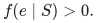
Since <code class="math">S\cap T\subseteq S</code>, submodularity gives
<!-- math-display: 43b5f41160a7db03a082a7ac
f(e\mid S\cap T)\ge f(e\mid S)>0.
-->
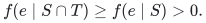
Every element already in <code class="math">S\cap T</code> has zero marginal to that set. Thus its closure inside <code class="math">T</code> is exactly <code class="math">S\cap T</code>. Consequently, if <code class="math">Q</code> is an original quotient, then <code class="math">Q\cap T</code> is a quotient of the restricted function.

This is also the restriction property recorded in Quanrud's Lemma 2.1. Therefore quotient approximations compose through arbitrary successive supports. The rank can only decrease; using the original <code class="math">r</code> as an upper bound is harmless. The lower bound of one on nonzero marginals is inherited by restriction.

## QB3. Adaptive error allocation

Here and below logarithms are natural. Fix <code class="math">\varepsilon\in(0,1)</code>. Increase the absolute constant <code class="math">A</code> in (QB1) if necessary so that <code class="math">A\ge1</code>, and define
<!-- math-display: 4b313ecde233c17fbd86f95b
Z=\frac{65536 A r}{\varepsilon^2},\qquad
 \beta=8\log(2Z),\qquad B=e^\beta=(2Z)^8.
 \tag{QB2}
-->
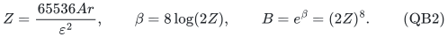

Maintain the current weighted restriction, with current support size <code class="math">m_i</code>.

While <code class="math">m_i&gt;B</code>, write <code class="math">t_i=\log m_i</code>, and invoke the backend with an error parameter <code class="math">\eta_i</code> satisfying
<!-- math-display: c1460ce2be462ea20a8ebd97
\frac{\varepsilon}{128}\sqrt{\frac{\beta}{t_i}}
 \ \le\ \eta_i\ \le\
 \frac{\varepsilon}{64}\sqrt{\frac{\beta}{t_i}}.
 \tag{QB3}
-->
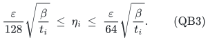
A dyadic rational in this interval suffices. Keep the returned support and weights. If the backend exceeds its stated support cap, terminate with a failure flag; this event is already included in its failure budget.

Once <code class="math">m_i\le B</code>, perform one final backend call with error <code class="math">\varepsilon/4</code>.

The preliminary calls shrink the logarithm of the support by at least a factor of two. To see this, <code class="math">m_i&gt;B</code> implies <code class="math">m_i\ge r</code>, so
<!-- math-display: cc981821fadbf82b30506b56
\log(2m_i r)\le 2t_i+\log 2\le 3t_i.
-->
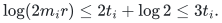
Using (QB1) and the lower bound in (QB3), the new support satisfies
<!-- math-display: 4fdf7d141e9617b9e7abf62e
m_{i+1}\le \frac{Zt_i^2}{\beta}.
 \tag{QB4}
-->
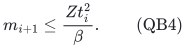
For <code class="math">t\ge\beta</code>, one has
<!-- math-display: 128f7b3e57af5a972798201d
\log Z+2\log t-\log\beta\le t/2.
 \tag{QB5}
-->
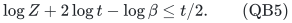
For completeness, the difference between the right and left sides has derivative <code class="math">1/2-2/t\ge0</code> on this range. At <code class="math">t=\beta</code>, the needed inequality is <code class="math">\log Z+\log\beta\le\beta/2</code>, which follows from <code class="math">\beta=8\log(2Z)</code> and <code class="math">Z\ge1</code>. Hence
<!-- math-display: 06f1dc032863794f4d4a0427
m_{i+1}\le\sqrt{m_i},\qquad
 t_{i+1}\le t_i/2.
 \tag{QB6}
-->
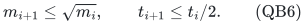
There are <code class="math">O(\log\log(2m))</code> preliminary calls.

Even though the number of calls depends on the original ground-set size, their error sum does not. If <code class="math">s</code> preliminary calls are made, repeated use of (QB6) gives
<!-- math-display: 5af69653d4bf37c8ae7852ad
\sum_{i=0}^{s-1}\eta_i
 \le \frac{\varepsilon}{64}
       \sum_{j\ge0}2^{-j/2}
 =\frac{\varepsilon}{64(1-2^{-1/2})}
 <0.054\varepsilon.
 \tag{QB7}
-->
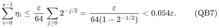
Adding the final error <code class="math">\varepsilon/4</code> makes the sum less than <code class="math">0.304\varepsilon</code>. For every original quotient, the total lower multiplicative factor is at least one minus this sum, and the upper factor is at most the exponential of this sum. Since <code class="math">0&lt;\varepsilon&lt;1</code>, both bounds lie within <code class="math">1\pm\varepsilon</code>.

The final support is at most
<!-- math-display: 365b05ce79ebc1a4ddfb6e43
O\!\left(
 \frac{r\log(2Br)}{\varepsilon^2}
 \right)
 =
 O\!\left(
 \frac{r\log(2r/\varepsilon)}{\varepsilon^2}
 \right).
 \tag{QB8}
-->
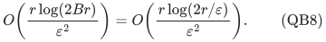
As usual, return the input itself if it is already smaller than the claimed target.

## QB4. Probability and computation

Use fresh randomness at every call, conditionally on the current restriction and its current weights. The source theorem applies to each such instance. The size checks ensure (QB6) along every nonterminated execution, independently of whether some quotient guarantee has silently failed.

Read the preliminary sizes backward from the last one. They are bounded below by <code class="math">B,B^2,B^4,\ldots</code>. Therefore the sum of their conditional failure budgets is at most
<!-- math-display: 485504765b4ee3857b90b409
\sum_{j\ge0}(2B^{2^j})^{-4}<1/100.
 \tag{QB9}
-->
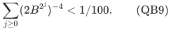
This pathwise bound also bounds the expectation of the sum of conditional failure probabilities. The final call has failure probability at most <code class="math">1/100</code> after a fixed adjustment to the sampling constant; tiny supports are treated exactly. Thus success probability <code class="math">2/3</code>, or any other fixed constant below one, follows without inserting a logarithm of the number of calls into the support.

The requested inverse errors are at most
<!-- math-display: 439a2689a7515889fe432709
O\!\left(\varepsilon^{-1}\sqrt{\log(2m)}\right).
-->
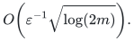
All restrictions use the original evaluation oracle on subsets of original element identifiers. The number of calls and arithmetic operations is polynomial in the original input size and <code class="math">\varepsilon^{-1}</code>.

For explicit integer-valued polymatroids and rational weights, the repeated calls also admit a standard polynomial-bit implementation; it is unnecessary to treat a sequence of arbitrary polynomial-time black boxes as automatically bit efficient. Use the exact strength decomposition in Quanrud's Section 3, and replace its logarithmic threshold multiplier by a dyadic rational within a fixed constant factor. Every output weight is an integer multiple of a threshold
<!-- math-display: e3644de3eecbe26faa12906c
\tau=\theta\,\frac{w(U)-w(V)}{f(U)-f(V)},
-->
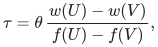
where <code class="math">\theta</code> has polynomially many bits and the positive denominator <code class="math">f(U)-f(V)</code> is an integer at most <code class="math">r</code>. If the current weights have a common denominator, one pass enlarges a common denominator by only the product of at most <code class="math">m_i</code> such integer rank gaps and the dyadic denominator. Its bit length increases by <code class="math">O(m_i\log(2r))</code> plus the parameter precision. Also <code class="math">\tau\le O(W_i)</code>, where <code class="math">W_i</code> is current total weight, so the total-weight bit length grows by at most <code class="math">O(\log(2m_i))</code> in that pass. Across the stated number of passes these increases remain polynomial in the initial description. Exact sampling of rational probabilities, or bounded-bit sampling with an additional fixed failure budget, is therefore sufficient.

**Fixed rational rank denominator.** The same ledger applies if all rank values have a fixed common denominator <code class="math">\Delta=\mathrm{poly}(r)</code>, while every positive marginal is still at least one. Write <code class="math">f(U)-f(V)=a/\Delta</code>, with <code class="math">1\le a\le r\Delta</code>. Then <code class="math">\tau=\theta\Delta(w(U)-w(V))/a</code>, so <code class="math">\Delta</code> appears only in the numerator, and one pass enlarges a common weight denominator by the product of at most <code class="math">m_i</code> integers bounded by <code class="math">r\Delta</code>, together with the dyadic parameter denominator. The additional bit length is <code class="math">O(m_i\log(2r\Delta))</code> plus parameter precision. Keep the same function and common denominator throughout the restrictions. Quanrud's theorem accepts these rational values directly; multiplying <code class="math">\Delta</code> into the rank for the support analysis would introduce an unnecessary loss. The companion [../../group-metric-constraints/manuscripts/rational-quotient-ranks-from-weak-oracles.md](../../group-metric-constraints/manuscripts/rational-quotient-ranks-from-weak-oracles.md) constructs precisely such a rational rank, with <code class="math">\Delta=O(r)</code>, from logarithmic subgroup ranks without requiring integer factorization.

## QB5. Applications

1. **Finite-field scalar codes.** Given weighted vectors <code class="math">v_e\in\mathbb F_q^D</code>, take <code class="math">f(T)=\dim\mathrm{span}\{v_e:e\in T\}</code>. For every query <code class="math">y</code>, the zero set <code class="math">\{e:\langle v_e,y\rangle=0\}</code> is closed. Thus one reweighting on <code class="math">O(D\log(2D/\varepsilon)/\varepsilon^2)</code> original vectors preserves every weighted nonzero-coordinate count, with no support dependence on <code class="math">q</code>.

2. **Finite-field block codes.** Given row spaces <code class="math">S_e\subseteq\mathbb F_q^D</code>, take <code class="math">f(T)=\dim\sum_{e\in T}S_e</code>. The blocks annihilating any fixed query again form a closed set. The same support bound preserves all weighted whole-block nonzero counts. No bound on individual block rank is needed.

3. **Polynomial fault lifts.** If an exact fault/query compiler maps the desired zero pattern to a scalar code of dimension <code class="math">D=r\binom{h+k}{k}</code>, this observation gives
   <!-- math-display: f05864f4d7c2cf2cc2f3618e
   O\!\left(
      \frac{r\binom{h+k}{k}}{\varepsilon^2}
      \log\frac{2r\binom{h+k}{k}}{\varepsilon}
      \right)
   -->
   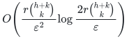
   retained original items. Neither a <code class="math">\log\log q</code> term nor a catalogue-enumeration argument is needed.

These applications use the same original-item identities throughout successive restrictions. The fault-dependent decoder and the quantum decomposition are proved in their companion manuscripts. <code class="math">\square</code>
