# Exact correlated-failure summaries for whole linear blocks, hyperedges, and commuting stabilizer checks

**Abstract.** We construct exact polynomial-label decoders for whole represented subspaces. One ordinary quotient sparsifier of the lifted blocks preserves all original subspace-complement queries after every allowed correlated deletion, using one fixed coefficient per original item. The same theorem gives cut and partition summaries for atomic hyperedge and hedge deletions, and all-state spectral summaries for globally commuting prime-dimensional stabilizer blocks. Explicit cut constructions establish the joint failure and inverse-accuracy support lower bounds in the stated size regimes.

## 1. A whole-block theorem

Let item <code class="math">e</code> have a positive rational weight <code class="math">w_e</code> and an explicitly represented subspace
<!-- math-display: 3eff48ba880371dacd912834
B_e=\mathrm{span}\{a_{e,1},\ldots,a_{e,t_e}\}
       \subseteq\mathbb K^N.
-->
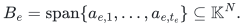
Let <code class="math">A</code> be the concatenation of all these columns, of rank <code class="math">r</code>. Each original row <code class="math">i</code> has a label set <code class="math">R_i</code>, and every column belonging to item <code class="math">e</code> has the same label set <code class="math">S_e</code>. Suppose every nonzero incidence satisfies
<!-- math-display: 376c3976d331318714286b52
A_{i,(e,j)}\ne0
 \quad\Longrightarrow\quad
 R_i\subseteq S_e,\qquad |S_e\setminus R_i|\le k.
 \tag{B1}
-->
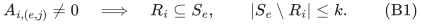
A failure set <code class="math">F</code>, with <code class="math">&#124;F&#124;\le h</code>, deletes the whole item whenever <code class="math">S_e\cap F\ne\varnothing</code>. For an arbitrary linear subspace <code class="math">W\subseteq\mathbb K^N</code>, define
<!-- math-display: 699eecb9ea6865fda1270fe1
\Phi_F(W)=
 \sum_{e:S_e\cap F=\varnothing}
        w_e\,\mathbf1[B_e\not\subseteq W].
 \tag{B2}
-->
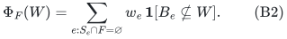

**Theorem B1.** There is one nonnegative original-item reweighting, simultaneously preserving (B2) within <code class="math">1\pm\epsilon</code> for every allowed <code class="math">F</code> and every <code class="math">W</code>, with support
<!-- math-display: cf49d2070cdc67ca5e601d60
O\!\left(\min\left\{m,\,
    \frac{D\log(2D/\epsilon)}{\epsilon^2}\right\}\right),
 \qquad
 D=r\binom{h+k}{k}.
 \tag{B3}
-->
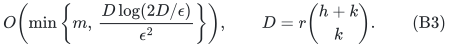
Here <code class="math">m</code> counts items, not columns. In particular there is no multiplicative dependence on the number of columns or the individual rank of a retained block. With explicit rational or finite-field matrices and rational weights, the construction is randomized polynomial time in the compact matrix input and <code class="math">\epsilon^{-1}</code>, with constant success probability for one event covering every query. The uniform polynomial statement uses the cap described below.

### Exact decoder and the quotient backend

Select <code class="math">r</code> independent original rows with row-selection matrix <code class="math">P</code>, and write <code class="math">A=C(PA)</code>. Keep the actual labels of these selected rows. Choose pairwise distinct field points <code class="math">\alpha_0,\ldots,\alpha_L</code>, where <code class="math">0</code> is a dummy label which never fails, and let
<!-- math-display: 7d53acbe35af07d54a16045d
\ell_c(z)=\sum_{t=0}^h\alpha_c^t z_t,
 \qquad
 p_T(z)=\prod_{c\in T}\ell_c(z)\,
                \ell_0(z)^{k-|T|}.
-->
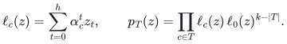
These homogeneous degree-<code class="math">k</code> polynomials have coefficient dimension <code class="math">\binom{h+k}{k}</code>. Ordinary monomial coefficients use no factorial denominators and are valid in every characteristic.

For each column <code class="math">a_{e,j}</code>, lift its selected row <code class="math">i</code> to the coefficient block
<!-- math-display: bd1273b9bf09ebaf07a5e0d5
(PA)_{i,(e,j)}p_{S_e\setminus R_i}.
-->
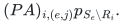
Denote the lifted column by <code class="math">z_{e,j}</code>, and let <code class="math">\widehat B_e</code> be the span of all lifted columns of item <code class="math">e</code>. Given a failure set, the normalized polynomial
<!-- math-display: e2781be66dcf4dcc259d5778
q_F(t)=\prod_{f\in F}\frac{t-\alpha_f}{\alpha_0-\alpha_f}
-->
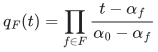
has degree at most <code class="math">h</code>, equals one at <code class="math">\alpha_0</code>, and vanishes at exactly the failed label points. Evaluating the row polynomial block at the coefficients of <code class="math">q_F</code>, and multiplying that row by <code class="math">\prod_{c\in R_i}q_F(\alpha_c)</code>, defines a linear map <code class="math">T_F</code> such that
<!-- math-display: a495b87b795a343d4ab06a8d
CT_Fz_{e,j}=\gamma_F(S_e)a_{e,j},
 \qquad
 \gamma_F(S_e)=\prod_{c\in S_e}q_F(\alpha_c).
 \tag{B4}
-->
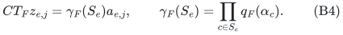
The scalar is common to every column of the item. It is zero exactly when that item fails.

For <code class="math">U=(CT_F)^{-1}(W)</code>, (B4) gives
<!-- math-display: a758c1f1ab63818963ddb3d5
\widehat B_e\not\subseteq U
 \quad\Longleftrightarrow\quad
 S_e\cap F=\varnothing\ \text{and}\ B_e\not\subseteq W.
 \tag{B5}
-->
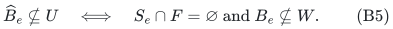
Now use the represented integer polymatroid
<!-- math-display: 59f76cf597cc4b478d3011d7
f(T)=\dim\sum_{e\in T}\widehat B_e,
 \qquad f(E)\le D.
-->
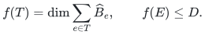
For every subspace <code class="math">U</code>, the item set <code class="math">Z_U=\{e:\widehat B_e\subseteq U\}</code> is closed: every block in the span of those blocks is also contained in <code class="math">U</code>. Thus its complement is a quotient. Quanrud's theorem and adaptive resparsification preserve the total weight of every such complement, with the support (B3). Equation (B5) proves the theorem. The selected items retain their full original block representation and one coefficient each.

Every quotient of every surviving original represented polymatroid is included: take <code class="math">W</code> to be the span of the blocks in its closed set. Hence the result is not limited to hyperplane queries or scalar codewords.

### Arithmetic and the uniform cap

The decoder maps are proof devices; no failure set is enumerated. Remove unused labels, cap <code class="math">h,k</code> at their effective label-universe bounds, and handle <code class="math">h=0</code> directly by the ordinary backend. If <code class="math">D\ge m</code>, retain the input before materializing the lifted blocks; compute the binomial coefficient with this cap. In the remaining branch the feature dimension is at most <code class="math">m</code>, and all block columns together are explicit input, so materialization and rank evaluations are polynomial. Zero-dimensional blocks may be discarded; if the total rank is zero, return the empty summary.

For rational matrices, integer label points give polynomial-bit coefficients. For finite fields, extending to a field with at least <code class="math">L+1</code> elements preserves every original linear dependence and subspace-membership query. When an extension is required, enumeration of irreducible polynomials over the original field is polynomial in the explicit label count, as detailed in the companion exact-label-cut note. Rational output weights use the integer-rank implementation and bit ledger of the quotient-resparsification note. No real-valued logarithmic-rank oracle is needed.

## 2. Whole hyperedges under incident-vertex color deletion

Consider a weighted hypergraph on <code class="math">n</code> vertices, with maximum hyperedge size <code class="math">t\ge2</code>. A vertex has at most <code class="math">a</code> labels and each hyperedge has at most <code class="math">b</code> additional labels. Failure deletes a vertex carrying a failed label and **removes every entire hyperedge incident to that vertex**; a failed additional hyperedge label also deletes the whole hyperedge. This is the atomic deletion convention. It does not mean that a hyperedge is shortened to its surviving vertices.

Represent hyperedge <code class="math">e</code> by the subspace spanned by <code class="math">e_u-e_v</code> for <code class="math">u,v\in e</code>, using a star of <code class="math">&#124;e&#124;-1</code> columns if desired. Put
<!-- math-display: a7168469148b97c736339c6b
S_e=\bigcup_{u\in e}R_u\ \cup\ T_e.
-->
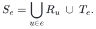
On a nonzero incidence at vertex <code class="math">u</code>,
<!-- math-display: 1097468473e099e4b5ff29e7
|S_e\setminus R_u|\le a(t-1)+b=:k.
-->
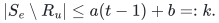
The concatenated incidence rank is <code class="math">r=n-c</code>, where <code class="math">c</code> is the number of components of the positive-weight hypergraph, including isolated vertices. For a Boolean cut vector <code class="math">x</code>, the block is not contained in <code class="math">\ker x^T</code> exactly when the hyperedge crosses that cut. Theorem B1 therefore gives
<!-- math-display: 38126c8abd84de49dc45bcfe
O\!\left(\min\left\{m,\,
 \frac{(n-c)\binom{h+a(t-1)+b}{a(t-1)+b}}{\epsilon^2}
 \log\frac{2(n-c)\binom{h+a(t-1)+b}{a(t-1)+b}}{\epsilon}
 \right\}\right)
 \tag{B6}
-->
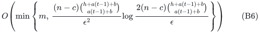
whole hyperedges, with one set of weights valid for every cut and every allowed label failure.

In particular, with one color per vertex and no additional edge labels, the failure factor is <code class="math">\binom{h+t-1}{t-1}</code>. The row-incidence structure saves one degree compared with treating all <code class="math">t</code> possible vertex colors as unrelated item labels.

The same summary preserves every partition's total weight of hyperedges crossing at least two parts. For a partition, take <code class="math">W</code> to be the span of all within-part pair differences. A hyperedge block is contained in <code class="math">W</code> precisely when it lies in one part. This is the partition objective counting a crossing hyperedge once, not the objective counting its number of intersected parts minus one.

### Joint failure and accuracy lower bound

The failure factor and <code class="math">\epsilon^{-2}</code> in (B6) are jointly necessary, up to its logarithm, in a sufficiently large-<code class="math">n</code> regime. We give the argument for arbitrary <code class="math">a,b\ge0</code> with <code class="math">k=a(t-1)+b\ge1</code>.

Put <code class="math">s=\lceil\epsilon^{-2}\rceil</code>, where <code class="math">0&lt;\epsilon\le1/2</code>, and <code class="math">q=\binom{h+k}{k}</code>. Index <code class="math">q</code> blocks by the <code class="math">k</code>-subsets <code class="math">S</code> of an <code class="math">(h+k)</code>-element label universe. Partition each <code class="math">S</code> into <code class="math">t-1</code> groups of size <code class="math">a</code> and one group of size <code class="math">b</code>. In its block create <code class="math">t-2</code> core vertices, carrying the first <code class="math">t-2</code> vertex-label groups, and <code class="math">s</code> left vertices, each carrying the last vertex-label group. There is one shared unlabelled right part of <code class="math">B\ge q(s+t-2)</code> vertices. For each left-right pair, add the hyperedge consisting of the block's core, that left vertex, and that right vertex; attach the block's <code class="math">b</code> additional labels to it. Every hyperedge has size exactly <code class="math">t</code>, and the input is simple and unweighted.

Failing the <code class="math">h</code> labels outside <code class="math">S</code> leaves precisely the hyperedges of block <code class="math">S</code>. All other blocks have at least one failed vertex or hyperedge label. There are
<!-- math-display: 7d36256075376c83b6ed5171
n=B+q(s+t-2)\le2B
-->
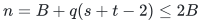
vertices.

For <code class="math">t=2</code>, the surviving block is <code class="math">K_{s,B}</code>, and the cut lower bound in the companion note applies directly. For <code class="math">t\ge3</code>, place all its core vertices on side zero of a cut. A hyperedge then crosses exactly when at least one of its left and right vertices has Boolean value one. Let <code class="math">W</code> be the <code class="math">s\times B</code> matrix of output weights in this block, let <code class="math">J</code> be all ones, and put <code class="math">E=W-J</code>. The cut with one right vertex on side one gives every column sum of <code class="math">W</code> in <code class="math">(1\pm\epsilon)s</code>. A cut with zero-valued left subset <code class="math">I</code> and zero-valued right subset <code class="math">J'</code> has value
<!-- math-display: 2ce1f7e2017e4f90d1cd625e
w(\text{all block edges})-w(I\times J').
-->
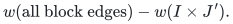
Comparing it and the full block cut gives
<!-- math-display: f6a320cc4ee700f2293ff2c5
\left|\sum_{i\in I,j\in J'}E_{ij}\right|
       \le2\epsilon sB
 \quad\text{for every rectangle }I\times J'.
-->
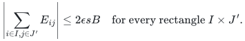
For any signs <code class="math">\sigma,\tau</code>, split their signed product into four rectangles. It follows that
<!-- math-display: 37bb8a99a9a2927eb437fc0e
|\sigma^T E\tau|\le8\epsilon sB.
-->
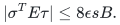
Choose <code class="math">\tau</code> to agree with <code class="math">E^T\sigma</code>, average independent uniform <code class="math">\sigma_i\in\{-1,1\}</code>, and use the Khintchine inequality <code class="math">\mathbb E&#124;v\cdot\sigma&#124;\ge\&#124;v\&#124;_2/\sqrt2</code>. Then
<!-- math-display: 5c5abc9609992bf610aa823c
\sum_j\|E_{\cdot j}\|_2\le8\sqrt2\,\epsilon sB.
-->
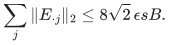
If column <code class="math">j</code> has <code class="math">u_j</code> nonzero output entries, its degree bound and the triangle inequality give
<!-- math-display: 1d6d019fb2f27f9894cae539
\|E_{\cdot j}\|_2\ge
     (1-\epsilon)s/\sqrt{u_j}-\sqrt{s}.
-->
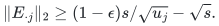
Every <code class="math">u_j&gt;0</code>. Convexity of <code class="math">x^{-1/2}</code>, with <code class="math">u=\sum_j u_j</code>, yields
<!-- math-display: 4b9a328bdcd11b7b7e9e2349
u\ge
 \frac{(1-\epsilon)^2sB}
       {(1+8\sqrt2\,\epsilon\sqrt{s})^2}
 =\Omega(B/\epsilon^2).
 \tag{B7}
-->
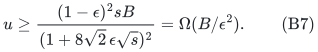
The <code class="math">t=2</code> cut bound is stronger and also implies (B7). Each isolated block must meet this lower bound on its own disjoint hyperedge set. Therefore every simultaneous summary needs
<!-- math-display: ab7ba693814a6b9e5abc0c7b
\Omega\!\left(
 \frac{n}{\epsilon^2}\binom{h+a(t-1)+b}{a(t-1)+b}
 \right)
 \tag{B8}
-->
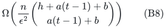
original hyperedges, even allowing arbitrary nonnegative output weights. The explicit regime is <code class="math">n=B+q(s+t-2)</code> with <code class="math">B\ge q(s+t-2)</code>; additional isolated vertices are not used to inflate the lower bound. For one color per vertex, set <code class="math">a=1,b=0</code>.

## 3. Hedges with correlated item-label failures

A hedge is a whole collection of hyperedges, and its cut weight is paid once if any constituent hyperedge crosses. Represent it by the span of star differences from all its constituent hyperedges. Give the whole hedge a failure-label list of size at most <code class="math">d</code>; row labels are empty. Theorem B1, with <code class="math">k=d</code> and <code class="math">r\le n-c</code>, preserves every cut and every partition-crossing objective after all <code class="math">h</code>-label failures using
<!-- math-display: 8c8da724c6cc0195f96a8130
O\!\left(\min\left\{m,\,
 \frac{(n-c)\binom{h+d}{d}}{\epsilon^2}
 \log\frac{2(n-c)\binom{h+d}{d}}{\epsilon}
 \right\}\right)
 \tag{B9}
-->
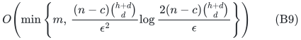
whole hedges. The number of constituent hyperedges, their individual ranks, and the number of connected components inside one hedge do not multiply this support bound. They remain part of the explicit input and evaluation cost.

The ordinary no-failure hedge theorem is already public. The asserted extension is the same coefficients for all later correlated whole-hedge deletions, rather than a new ordinary sparsification result.

## 4. Commuting stabilizer blocks with correlated clause deletions

Let the physical space be <code class="math">n</code> prime-dimensional qudits, of local dimension <code class="math">p</code>. Each item is a whole stabilizer acceptance projector <code class="math">E_e</code>, specified by any number of commuting Weyl eigenvalue checks, with penalty <code class="math">w_e(I-E_e)</code>. In this section, **all supplied Weyl generators commute globally across items**, not merely within each item. Give each item at most <code class="math">d</code> external failure labels.

Phase-aware linear algebra expresses all generators in one independent commuting projective basis of dimension at most <code class="math">n</code>. On its eigenvalue pattern <code class="math">x</code>, the penalty for item <code class="math">e</code> is
<!-- math-display: 6dc1c468f5b110c2120397b5
w_e\,\mathbf1[M_e(x,1)^T\ne0]
-->
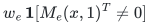
for an explicit affine constraint matrix <code class="math">M_e</code> over <code class="math">\mathbb F_p</code>. The extra coordinate homogenizes the affine phases. Inconsistent acceptance equations give a constant-one penalty and are represented by the same affine system; an empty or universally satisfied system contributes zero and may be removed.

Regard the row space of <code class="math">M_e</code> as the item's block in dimension at most <code class="math">n+1</code>. Use empty row labels and the external item labels, so <code class="math">k=d</code>. Theorem B1 gives one common coefficient per original stabilizer block and support
<!-- math-display: f47d65aad835f99e0652129a
O\!\left(\min\left\{m,\,
 \frac{D\log(2D/\epsilon)}{\epsilon^2}\right\}\right),
 \qquad D=(n+1)\binom{h+d}{d}.
 \tag{B10}
-->
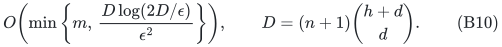
All Hamiltonians obtained by deleting allowed item-label sets remain diagonal in the same basis. Preserving every surviving affine block predicate therefore yields
<!-- math-display: 2ee0ef0ca4c401fcc0a68c66
(1-\epsilon)H_F\preceq\widehat H_F
                    \preceq(1+\epsilon)H_F
 \quad\text{simultaneously for all }|F|\le h.
 \tag{B11}
-->
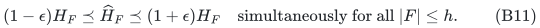
Thus every quantum-state energy is preserved, including that of entangled states, and every surviving Hamiltonian kernel is preserved exactly. There is no support factor for the number of checks within a block. Finite-field extension used for label points changes only the classical compiler; it does not change the physical local dimension.

The failure and accuracy dependence in (B10) is jointly necessary up to its logarithm for original-item summaries. Let <code class="math">q=\binom{h+d}{d}</code>, and form <code class="math">q</code> differently labelled copies of the same commuting two-local check family
<!-- math-display: 111ca9aab9d958b74b58ac68
I-\Pi_{Z_uZ_v^{-1},1},\qquad uv\in E(K_{s,B}),
 \quad s=\lceil\epsilon^{-2}\rceil,\quad B=n-s\ge s.
-->
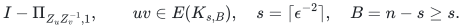
All copies use the same <code class="math">n</code> physical qudits. Index copies by the <code class="math">d</code>-subsets <code class="math">S</code> of an <code class="math">(h+d)</code>-label universe, giving every item of copy <code class="math">S</code> precisely those labels. Failure of the complement of <code class="math">S</code> isolates that copy. Restrict computational basis symbols to <code class="math">\{0,1\}\subseteq\mathbb F_p</code>; every check is exactly the Boolean cut indicator. The complete-bipartite cut lower bound then requires <code class="math">\Omega(n/\epsilon^2)</code> original items in each copy, hence
<!-- math-display: 4a1cc5b02264d6a6cf9045f8
\Omega\!\left(n\binom{h+d}{d}/\epsilon^2\right)
-->
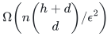
after summing all copies. This holds for <code class="math">0&lt;\epsilon\le1/2</code>, <code class="math">n\ge2\lceil\epsilon^{-2}\rceil</code>. Identical operators with different failure lists are distinct input items and cannot be merged across their deletion patterns. The same construction, represented by scalar incidence-vector blocks, gives the corresponding <code class="math">\Omega(r\binom{h+d}{d}/\epsilon^2)</code> lower bound for Theorem B1 when row labels are empty and <code class="math">k=d</code>. This uses the inherited cut lower bound and the explicit failure-isolation construction; no computational lower bound is asserted.

The construction is polynomial in the compact generator descriptions, the rational input bit length, <code class="math">\log p</code>, and <code class="math">\epsilon^{-1}</code>, with the feature cap above. It does not materialize <code class="math">p^n</code>-dimensional matrices. Failure here deletes an entire specified clause/block; it does not physically erase a qudit or trace out a subsystem.

This statement cannot be obtained by simply applying the earlier noncommuting peeling procedure once and then deleting arbitrary clauses: a deletion may remove one side of a balanced incompatible pair and destroy its uniform spectral lower bound. The global commutation condition in this section is essential to the proof supplied here. No common all-failure summary of the same size is asserted for arbitrary noncommuting stabilizer blocks.

## 5. Baselines and scope

- **Quanrud, *Quotient sparsification for submodular functions*, SODA 2024.** Theorem 1.1 supplies the ordinary rank-dependent quotient sparsifier. The companion adaptive-resparsification note accounts for removing the original item-count logarithm, accumulated error, conditional success probability, and the integer-rank bit model. <https://kentq.s3.amazonaws.com/submodular-sparsification.pdf>.
- **Chandrasekaran, Chekuri, Wang, and Zhu, *Hedgegraph Polymatroids*, 2025.** Theorem 7 gives ordinary weighted hedgegraph partition sparsifiers with <code class="math">O(n\log n/\epsilon^2)</code> hedges. The cut convention in its introduction charges a hedge once if any constituent hyperedge crosses. These ordinary whole-object guarantees are antecedents, not newly claimed here. <https://arxiv.org/html/2510.25043v1>.
- **Basu, Brakensiek, Chen, Putterman, Reis, and Zhang, *Optimal Sparsifiers for Minkowski Sums and Sums of Seminorms*, September 2026.** The optimal ordinary seminorm theorem implies existential <code class="math">O(n/\epsilon^2)</code> ordinary hypergraph-cut support. It does not by itself supply the simultaneous labeled-incidence transfer above. <https://arxiv.org/pdf/2609.20238>.
- **Oko, Sakaue, and Tanigawa, *Nearly Tight Spectral Sparsification of Directed Hypergraphs by a Simple Iterative Sampling Algorithm*, Section 7.8.2.** Their hypergraph-failure guarantee distinguishes a fixed deletion from one event uniform over all deletions; the section also notes a uniform spectral construction with a larger bound. Its faults are individual hyperedges. The present hypergraph corollary concerns correlated vertex/edge labels, atomic incident-hyperedge removal, and cut/partition preservation; it is not a spectral improvement over that theorem. <https://arxiv.org/pdf/2204.02537>.

The contribution is the exact block decoder, its shared-weight failure guarantee, and the explicit colored hyperedge lower construction. The stronger quantum all-state conclusion in Section 4 uses global commutation and does not enlarge the scope of the general cut theorem.
