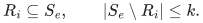
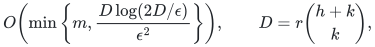
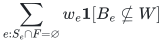
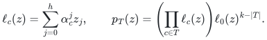
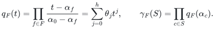
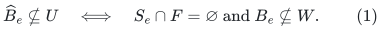
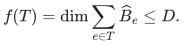
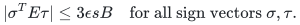
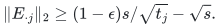
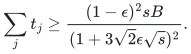

# Proofs for exact correlated-failure quotient summaries

## 1. Model and theorem

Let each original item <code class="math">e</code> be a subspace <code class="math">B_e</code> given by explicit columns over a rational or finite field, with weight <code class="math">w_e\ge0</code>. Let <code class="math">A</code> concatenate all columns and have rank <code class="math">r</code>. Row <code class="math">i</code> carries labels <code class="math">R_i</code>, while all columns of item <code class="math">e</code> carry labels <code class="math">S_e</code>. Assume every nonzero incidence satisfies

<!-- math-display: d0b45bfe647d6ba9746f7372
R_i\subseteq S_e,\qquad |S_e\setminus R_i|\le k.
-->

A failed label set <code class="math">F</code>, of size at most <code class="math">h</code>, deletes the entire item whenever <code class="math">S_e\cap F\ne\varnothing</code>.

**Theorem 1.** With constant success probability, one randomized preprocessing algorithm returns nonnegative coefficients on

<!-- math-display: 136412eaff3028e1aca542a7
O\!\left(\min\left\{m,
\frac{D\log(2D/\epsilon)}{\epsilon^2}\right\}\right),
\qquad D=r\binom{h+k}{k},
-->

original items, preserving

<!-- math-display: 5557f68f853f41f699f022bb
\sum_{e:S_e\cap F=\varnothing}w_e\mathbf1[B_e\not\subseteq W]
-->

within <code class="math">1\pm\epsilon</code>, simultaneously for every allowed <code class="math">F</code> and every linear subspace <code class="math">W</code>. Construction is polynomial in explicit compact input length and <code class="math">\epsilon^{-1}</code>.

## 2. Exact common-scalar decoding

**Proof.** Select <code class="math">r</code> independent original rows, with selector <code class="math">P</code>, and write <code class="math">A=C(PA)</code>. Keep their original row labels. Choose distinct field points <code class="math">\alpha_0,\ldots,\alpha_L</code>, where label zero is a dummy that never fails; extend a finite field if needed. Define

<!-- math-display: 2e8ee09824743528a242ab32
\ell_c(z)=\sum_{j=0}^h\alpha_c^jz_j,
\qquad
p_T(z)=\left(\prod_{c\in T}\ell_c(z)\right)\ell_0(z)^{k-|T|}.
-->

Homogeneous degree-<code class="math">k</code> polynomials in <code class="math">h+1</code> variables have coefficient dimension <code class="math">\binom{h+k}{k}</code>. Lift selected-row entry <code class="math">(PA)_{ie}</code> to its product with the coefficient vector of <code class="math">p_{S_e\setminus R_i}</code>. This defines a lifted vector for every original column and a lifted subspace <code class="math">\widehat B_e</code> for each item.

For a failure set <code class="math">F</code>, write

<!-- math-display: ae37c52dd36fbe295b3892e7
q_F(t)=\prod_{f\in F}\frac{t-\alpha_f}{\alpha_0-\alpha_f}
=\sum_{j=0}^h\theta_jt^j,
\qquad
\gamma_F(S)=\prod_{c\in S}q_F(\alpha_c).
-->

It has <code class="math">q_F(\alpha_0)=1</code> and vanishes precisely at failed label points. Evaluate each row's polynomial block at <code class="math">\theta</code> and multiply by <code class="math">\gamma_F(R_i)</code>. This linear map <code class="math">T_F</code> satisfies, for every column <code class="math">a_{e,j}</code> and its lift <code class="math">z_{e,j}</code>,

<!-- math-display: a56c10937c471f0b57635fe4
CT_Fz_{e,j}=\gamma_F(S_e)a_{e,j}.
-->

The scalar is identical for every column of a whole item and is zero exactly when the item fails. For the lifted subspace <code class="math">U=(CT_F)^{-1}(W)</code>, therefore,

<!-- math-display: d711e5ecaa1f1d0f9dc9aa6a
\widehat B_e\not\subseteq U
\quad\Longleftrightarrow\quad
S_e\cap F=\varnothing\text{ and }B_e\not\subseteq W.
\tag{1}
-->

This identity holds for every failure set and every subspace. Its decoder need not be constructed by preprocessing.

## 3. Quotient sparsification and the error ledger

On the original item identifiers, define the integer polymatroid

<!-- math-display: 8d6df9c50891c7a34344f622
f(T)=\dim\sum_{e\in T}\widehat B_e\le D.
-->

For any subspace <code class="math">U</code>, the set <code class="math">Z_U=\{e:\widehat B_e\subseteq U\}</code> is closed: every block already spanned by these blocks remains inside <code class="math">U</code>. Thus its complement is a quotient of <code class="math">f</code>. Quanrud's theorem preserves every quotient with <code class="math">O(D\log(2mD)/\eta^2)</code> support.

The [adaptive quotient theorem](manuscripts/adaptive-quotient-resparsification.md) removes the ground-set logarithm. Its restriction step is exact: if <code class="math">S</code> is closed in the original rank and <code class="math">T</code> is retained, every <code class="math">e\in T\setminus S</code> has positive marginal already at <code class="math">S</code>, and diminishing returns gives a positive marginal at <code class="math">S\cap T</code>. Hence <code class="math">S\cap T</code> remains closed.

While current support <code class="math">m_i</code> exceeds a fixed polynomial in <code class="math">D/\epsilon</code>, choose an error proportional to <code class="math">\epsilon\sqrt{\log(2D/\epsilon)/\log m_i}</code>. The next support is at most <code class="math">\sqrt{m_i}</code>. These preliminary errors sum geometrically, independently of the initial <code class="math">m</code>. One final call at constant-times-<code class="math">\epsilon</code> error gives <code class="math">O(D\log(2D/\epsilon)/\epsilon^2)</code> support. Fixed inverse-power failure bounds per call also sum to a constant, read backward along the size sequence. The cited proof supplies explicit constants and the rational bit-length ledger.

Applying this one all-quotient event to (1) proves the simultaneous approximation. No union bound over failures is used, and coefficients never change at query time. <code class="math">\square</code>

## 4. Uniform polynomial construction

The field points and polynomial coefficients have polynomial bit complexity. If <code class="math">D\ge m</code>, retain the input before materializing any lifted vectors; binomial coefficients can be computed with that cap. In the remaining branch the feature dimension is below the input item count, and the original block-column count is part of the explicit input. Rank queries are therefore polynomial.

For a finite field of size <code class="math">q_0&lt;L+1</code>, choose the least extension degree <code class="math">t</code> with <code class="math">q_0^t\ge L+1</code>. There are fewer than <code class="math">q_0(L+1)\le(L+1)^2</code> monic candidate polynomials of degree <code class="math">t</code>, so deterministic enumeration with irreducibility testing has polynomial cost in the explicit label universe. Extension preserves original linear dependences and membership in original-field subspaces. Rational matrices instead use integer label points. Zero-rank and zero-weight items are handled directly.

## 5. Graph and whole-object consequences

For an oriented graph incidence matrix, the rank is <code class="math">n-c</code>. An edge <code class="math">uv</code> has labels <code class="math">R_u\cup R_v\cup T_e</code>. On an incident row <code class="math">u</code>, at most <code class="math">a+b</code> labels are absent, giving <code class="math">k=a+b</code>. A Boolean cut vector <code class="math">x</code> has <code class="math">x^Ta_e\ne0</code> exactly for crossing edges, so take <code class="math">W=\ker(x^T)</code>. Theorem 1 gives the graph result.

A hyperedge of size at most <code class="math">t</code> is represented by the span of its pair differences, using a star basis. Its label deficit is at most <code class="math">a(t-1)+b</code>, and its block leaves a cut kernel exactly when the hyperedge crosses. The decoder deletes the entire hyperedge when any incident vertex fails. For partitions, use the subspace spanned by within-part differences; a block lies in it precisely when the hyperedge lies within a single part. A hedge is the span of the differences of all its constituent hyperedges, with external item labels.

For globally commuting prime-dimensional stabilizer blocks, phase-aware elimination gives an affine block predicate on at most <code class="math">n</code> variables. Homogenize with one coordinate and apply Theorem 1 to its row space. Because every surviving Hamiltonian is diagonal in the same basis, simultaneous block-predicate preservation is exactly simultaneous Loewner preservation. Global commutation is used here; applying a single noncommuting pair split before arbitrary failures would not establish this conclusion.

## 6. Joint support lower bounds

For a cut sparsifier of <code class="math">K_{s,B}</code>, let <code class="math">W</code> be its nonnegative weighted adjacency matrix and <code class="math">E=W-\mathbf1</code>. Cut constraints imply

<!-- math-display: 761f9fddf2c4c5557a193eb7
|\sigma^TE\tau|\le3\epsilon sB
\quad\text{for all sign vectors }\sigma,\tau.
-->

Choose <code class="math">\tau</code> according to <code class="math">E^T\sigma</code> and average independent signs <code class="math">\sigma</code>. Khintchine's inequality gives <code class="math">\sum_j\&#124;E_{\cdot j}\&#124;_2\le3\sqrt2\epsilon sB</code>. If column <code class="math">j</code> uses <code class="math">t_j</code> edges, its singleton cut gives

<!-- math-display: f60b3b20b4a78bba02e9387c
\|E_{\cdot j}\|_2\ge(1-\epsilon)s/\sqrt{t_j}-\sqrt s.
-->

Jensen's inequality yields

<!-- math-display: 0ea203335a2ca20b3b1849e2
\sum_jt_j\ge
\frac{(1-\epsilon)^2sB}{(1+3\sqrt2\epsilon\sqrt s)^2}.
-->

Take <code class="math">s=\lceil\epsilon^{-2}\rceil</code>, and index disjoint left blocks by all <code class="math">k</code>-subsets of an <code class="math">(h+k)</code>-label universe. Give one block precisely its labels, split between vertex and edge labels as required. Failing the complementary <code class="math">h</code>-set isolates that block, so each block separately needs <code class="math">\Omega(B/\epsilon^2)</code> retained edges. With a sufficiently large common right part, the total vertex count is <code class="math">\Theta(B)</code>. This forces <code class="math">\Omega(n\binom{h+k}{k}/\epsilon^2)</code> support in the stated size regime.

The [hyperedge proof](manuscripts/exact-label-whole-blocks-and-hyperedges.md) uses core vertices and a rectangle-discrepancy version of the same inequality to realize <code class="math">k=a(t-1)+b</code>. The same labeled-copy construction on commuting cut checks gives the quantum lower bound while sharing the same physical qudits.

**Attribution:** icekylinx and GPT-6 Astra Pro.
