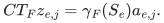
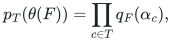

# Verification and scope

[Main proof](../proof.md) · [Source dependencies](../sources.md)

## Evidence status

The [rational compiler](../reference/README.md) now implements the exact
common-scalar whole-block decoder and the full-input dimension gate.
The [realization and composition audit](../manuscripts/reference-whole-block-decoder.md)
separates that executable scope from the published quotient sampler and its
proved adaptive composition. No dedicated executable currently samples a
family-wide sparse approximation. Enumerating a finite list of failure
scenarios would not establish its universal quantifiers.

Run the independent exact checker:

```sh
python3 problems/label-block-cut/verify/check_whole_blocks.py
```

The checker directly expands factor-index choices to compare ordinary
polynomial coefficients, reconstructs original columns from selected
original rows, compares exact common-scalar decoder images for whole items,
and checks subspace objectives using a separate matrix-rank calculation.
Original item reweightings are shared across columns. Graph cuts are checked
against crossing edges, and atomic hyperedge partition objectives against
original incident-label deletion and one charge per crossing item.

| Finite mechanism or outcome | Count |
|---|---:|
| Algebraic compilation fixtures | 16 |
| Materialized lifts in those fixtures | 11 |
| Full-input fallbacks in those fixtures | 3 |
| Zero-rank fixtures | 2 |
| Ordinary coefficient blocks compared | 1,140 |
| Original rank-compression columns | 573 |
| Independent whole-item rank queries | 33 |
| Algebraic failure patterns | 103 |
| Exact common-scalar item checks | 3,281 |
| Original subspace-complement queries | 487 |
| Fixed original-item reweighting queries | 103 |
| Exhaustive four-vertex graph topologies | 64 |
| Original graph cut/failure queries | 4,096 |
| Atomic hyperedge partition/failure queries | 567 |
| Huge formal-dimension gate with feature routines disabled | 1 |
| Rejected malformed input/query cases | 14 |

Fixtures include dependent original rows with different original labels,
rational entries, multi-column and empty items, zero columns, zero weights,
zero deficit, zero failure allowance, unused failure IDs and huge encoded
failure budgets. The large-dimension fixture has formal lift dimension
exceeding a decimal integer with eighty digits and disables both monomial
enumeration and polynomial multiplication before compilation.

These are checks of a deterministic exact compiler. They do not constitute
Monte Carlo success experiments, an implementation of adaptive quotient
sampling, or a finite-field/quantum backend.

## Exact common-scalar decoder

For every original block column,
<!-- math-display: a56c10937c471f0b57635fe4
CT_Fz_{e,j}=\gamma_F(S_e)a_{e,j}.
-->

The same scalar multiplies every column of that block, and its zero set is exactly the failed-label condition. Subspace membership therefore decodes independently of its nonzero magnitude.

The underlying polynomial identity is
<!-- math-display: bdd622350b15b02c1d92ba3e
p_T(\theta(F))=\prod_{c\in T}q_F(\alpha_c),
-->

with the dummy-label factor equal to one. Ordinary monomial coefficients require no factorial division, so the identity holds in every characteristic.

Rank compression selects original rows and preserves their labels. It does not label an arbitrary linear combination of rows. The explicit finite-field extension preserves the original-field membership queries.

## Construction and failure models

The query class remains closed after each restriction. Conditional failure probabilities and approximation errors have summable budgets independent of the initial number of items. The feature-dimension gate returns the full input before constructing a lift that is too large.

Hyperedge failure deletes the whole incident item, and a partition objective counts a crossing item once. The quantum failure specialization requires globally commuting blocks and one common eigenbasis for every surviving instance. These are the stated models, not automatic consequences for arbitrary quantum deletions.

## Lower bounds

A block indexed by a <code class="math">k</code>-subset of an <code class="math">(h+k)</code>-label universe survives failure of its complement; every other indexed block contains a failed label. Thus each original block must separately satisfy the underlying cut lower bound.

That cut bound is proved directly from discrepancies, singleton degree inequalities, the <code class="math">L_1</code> Khintchine inequality, and Jensen's inequality. A spectral lower bound alone would not establish the claimed cut lower bound. The compact runtime follows from the dimension gate and explicit arithmetic interfaces, rather than an empirical timing experiment.

**Attribution:** Yilin Liu and GPT-6 Astra Pro.
