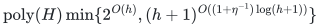

# Scheduling many common job sizes

**Guarantee**

For rational <code class="math">0&lt;\eta\le1</code>, returns <code class="math">C_{\max}\le\min\{2\mathrm{OPT},(2-1/(3+\eta))\mathrm{OPT}+u\}</code>.

**Objective and output**

Assign all mandatory job units and recover the original job-polymatroid bases from the workload construction.

**Randomness**

Deterministic workload aggregation, rank-based unit search, decomposition and additive rounding in both approximation variants.

**Time**

<!-- math-display: 7a9fe7499d686d8b7b961249
\mathrm{poly}(H)\min\{2^{O(h)},(h+1)^{O((1+\eta^{-1})\log(h+1))}\}
-->

**Space**

Polynomial in the complete binary input and paid oracle workspace; numerical resource multiplicities are not expanded into individual units.

**Parameters**

<code class="math">h</code> is the total rank of the largest positive size <code class="math">a</code>; <code class="math">u=\max\{p_j:p_j&lt;a,\ f_j(P)&gt;0\}</code>, or zero if no smaller jobs exist; <code class="math">\eta</code> is rational. <code class="math">H</code> includes the explicit ground, all rational and integer encodings, and paid rank, submodular-minimization, LP, intersection, and decomposition work.

**Model and representation**

Integral job polymatroids with common type processing sizes, arbitrary binary multiplicities, and mandatory totals. There is no arbitrary assignment-cost budget in this transfer.

**Lower-bound scope**

No lower bound is claimed for this algorithm.

**Review status**

**Ready for review.** The complete many-common-size workload theorem: original mandatory integral job-polymatroid bases, binary workload aggregation, full-physical-machine box dual, large integer quota and rank-dependent unit-core transfer, scaled original-type decomposition, per-machine upper-prefix rounding with explicit largest-smaller-job additive term, exact one-size/easy/rank-loss branches and one-sided original-grid optimization with the public fallback. The linked private-slack exact finite-rank refinement is audited through its player-only contraction, engineered exact quota, private insertion, attained cap threshold and capped-comparator optimization. The native complete-table reference implements aggregation, binary scaled decomposition, upper rounding, original equal-largest-type recovery and both target/search variants, with weak-basis and active-system enumeration costs separate.

**Dependencies and scope.** The guarantees retain the explicit additive largest-smaller-job term; a purely multiplicative near-five-thirds consequence needs the stated size-gap condition. This common-type-size transfer has no arbitrary assignment-cost budget. The private refinement compares against the larger of the original optimum and its own attained cap threshold; cap failure is not original infeasibility. The fast theorem uses the proved normalized rank-search and paid exact rank/SFM, integral decomposition/intersection and rounding primitives. The native reference instead enumerates weak selected bases and streams exact mandatory-base LP active systems, with explicit finite time costs and polynomial rational workspace in its complete-table/binary encoding. Generic intrinsic LP primitives are reused; optional allocation, disposal and lower-rounding interfaces are not transferred into this mandatory scheduling model. Binary counts, artificial workload multipliers and accuracy/rank/divisor encodings remain binary; no numerical unit expansion occurs. Finite reference evidence, complete asymptotic proof, proof-assistant formalization, external review and publication priority are distinct; the latter three are not claimed.

The [verification note](verify/README.md) identifies executable coverage. This status does not claim external peer review or proof-assistant verification.

**Source**

[Manuscript and proof](proof.md), with [dependencies and verification sources](sources.md).

The largest smaller size contributes an explicit additive load term. The [commitment theorem](../commitment-scheduling/README.md) gives a separate computable residual-rank refinement.

**Attribution.** Yilin Liu · GPT-6 Astra Pro
