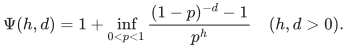

# Sharp matroid and submodular failure summaries

Exact failure summaries, rank-adaptive oracle constructions, and a sharp 13-item boundary at rank four.

[Proof](proof.md) · [Rank-adaptive paper](rank-adaptive-paper.pdf) · [Two-failure paper](two-failure-paper.pdf) · [Sources](sources.md)

**Guarantee**

For <code class="math">C=\binom{h+d}{d}</code>, represented matroids preserve every surviving fixed-cost prefix with at most <code class="math">\min\{N,rC\}</code> items. Arbitrary matroids preserve surviving rank with the same bound. For one failed label, arbitrary oracle matroids also admit the sharp weighted bound <code class="math">(d+1)r</code> in uniform polynomial time. For two or more failures, an explicit nonrepresentable family rules out the same weighted binomial bound. With two failures and at most one label per item, the largest minimum prefix summary has exactly 13 items at rank four; ranks at most three have the sharp bound <code class="math">3r</code>.

For at most one label per item, a fixed contraction reduces every failure
query to rank <code class="math">T</code>, the total number of single-failure replacement appearances.
The original rank contributes only <code class="math">r-T</code> fixed items. In particular <code class="math">T=0</code>
needs only the original basis, and <code class="math">T=1</code> has the sharp all-budget bound <code class="math">r+h</code>.

**Objective and output**

Original-element restrictions; canonical minimum-cost surviving bases and all cost prefixes, with different size bounds for represented and arbitrary oracle matroids; exact surviving ranks and integer-submodular values for arbitrary failure budgets.

**Randomness**

Deterministic exact constructions. Random permutations and Bernoulli failures appear only in output-size proofs; no query sampling or probability of error.

**Time**

Represented: uniform deterministic polynomial preprocessing, with <code class="math">O(ND^2)</code> field operations for elimination at gated dimension <code class="math">D=rC</code>, plus feature construction and rank compression.

For arbitrary weighted oracles, put <code class="math">S(a,h)=\sum_{i=0}^{h}a^i</code>, with <code class="math">0^0=1</code>. The canonical-basis tree uses at most <code class="math">NS(dr,h)</code> independence queries after sorting. The one-pass retained-prefix alternative uses <code class="math">N(K+1)S(dr,h)</code>. Here <code class="math">K=\min\{N,\lfloor r\Gamma(h,d)\rfloor\}</code>, and <code class="math">\Gamma(h,d)=(h+d)^{h+d}/(h^h d^d)</code>, with <code class="math">\Gamma=1</code> when <code class="math">hd=0</code>; the stronger size bounds below may also be used for <code class="math">K</code>.

A final reverse-deletion pass attains the sharp rank-only size within <code class="math">(N+K(K+1))S(dr,h)</code> queries, linear in <code class="math">N</code> for fixed parameters. One failed label takes at most <code class="math">(1+dr)N</code> queries. Two failures with one label per item take <code class="math">O(N(r+1)^2)</code> queries. Integral values have the analogous basis-tree bound <code class="math">1+NS(dR,h)</code> and the two-stage bound with rank replaced by the numerical range <code class="math">R</code>.

The [rank-loss contraction](manuscripts/rank-loss-contraction-for-prefix-summaries.md) replaces the basis-tree rank
by <code class="math">T\le r</code> when each item has at most one label. It uses at most
<code class="math">(1+\ell_0)N+r+N'S(T,h')</code> independence queries for <code class="math">T&gt;0</code>, where
<code class="math">\ell_0\le r</code> counts labels on the original basis, <code class="math">N'=N-r+T</code>, and
<code class="math">h'</code> is clipped to the label count in the minor. For <code class="math">T\ge2</code> this is
<code class="math">O(N(r+T^{h'}))</code> queries; for <code class="math">T=1</code> it is <code class="math">O(N(r+h'))</code>. Query-set
encoding costs are separate from the oracle count.

**Space**

Output counts original IDs. The <code class="math">O(D^2)</code> elimination workspace and oracle representation are separate. The bounded-depth oracle searches use polynomial input workspace after clipping the failure budget to the explicit label universe. No bit-kernel bound for arbitrary oracles is asserted.

**Parameters**

<code class="math">N</code> is element count; <code class="math">r</code> is rank; <code class="math">h</code> is failed-label budget; <code class="math">d</code> is actual maximum labels per item; <code class="math">L</code> is the explicit label universe; <code class="math">R</code> is the numerical submodular value range.

**Model and representation**

Rational or explicit finite-field columns for the general weighted-prefix theorem. Independence oracles suffice for arbitrary-budget rank preservation and weighted-prefix preservation with the explicit general size bounds below; one failure attains the sharp binomial factor. Value oracles supply integer-valued monotone submodular functions.

**Lower-bound scope**

The <code class="math">rC</code> and <code class="math">RC</code> retained-size bounds are exact in the worst case via labeled parallel classes or coverage functions. The weighted one-failure oracle bound is also sharp. For every <code class="math">h\ge2</code>, a rank-four one-label-per-item oracle matroid forces <code class="math">4(h+1)+1</code> items to preserve exact optimum costs, exceeding <code class="math">rC=4(h+1)</code>. For two failures, the 13-item example has minimum possible rank, label count and ground size for violating <code class="math">3r</code>, and 13 is the exact rank-four maximum. These are retained-support statements, not oracle-query hardness claims.

**Review status**

**Ready for review.** Main Theorems 1–7: represented prefix lift; sharp oracle-rank and integral-value constructions; sharp one-failure endpoint; explicit weighted obstruction; faster canonical-basis tree and original-basis size refinement; exact low-rank two-failure maxima and minimality of the 13-item example. Includes the sharp singleton-replacement bound r+2t, its failed-contracted-item proof, and the profile-sensitive construction with N(1+ell_0+binom(t+1,2)) queries. The fixed rank-loss contraction theorem preserves every failure basis and original prefix, reduces the tree parameter to the total single-failure replacement count T and proves the sharp r+h endpoint at T=1.

**Dependencies and scope.** Oracle results require the specified independence or value oracle and retain original items rather than encoding an arbitrary oracle. The best general weighted-oracle size remains open outside the proved low-rank cases. Finite programs support the written proofs and are not proof-assistant verification. The rank-loss contraction in this review uses one label per item and a fixed total order. The query ledger charges the original oracle separately from explicit query-set representation; a changed cost order may require another contraction.

The [verification note](verify/README.md) identifies executable coverage. This status does not claim external peer review or proof-assistant verification.

**Source**

[Complete proof](proof.md) and [canonical manuscript map](sources.md).

## Results

**Represented fixed-cost matroid summary**

**Exact bound.** <code class="math">\min\left\{N,r\binom{h+d}{d}\right\}</code> items

**Construction / interpretation.** Uniform deterministic polynomial preprocessing

**Arbitrary-matroid weighted summary for one failed label**

**Exact bound.** <code class="math">\min\{N,(d+1)r\}</code> items

**Construction / interpretation.** At most <code class="math">(1+dr)N</code> independence queries; canonical bases and every cost prefix are preserved, including rank drops.

**Arbitrary-matroid weighted summary for any failure budget**

**Exact upper bound.** <code class="math">\min\{N,\lfloor r\Psi(h,d)\rfloor\}</code> items

**Construction / interpretation.** The unique smallest preserver of every prefix of one fixed order, computed in deterministic FPT oracle time. The [complete construction](manuscripts/weighted-oracle-prefix-fpt-construction.md) gives a canonical-basis tree using at most <code class="math">NS(dr,h)</code> queries, and a one-pass tradeoff. Its original-basis refinement replaces <code class="math">\Gamma</code> by the no-larger factor

<!-- math-display: 5b398e55337e1c45462e1d46
\Psi(h,d)=1+\inf_{0<p<1}\frac{(1-p)^{-d}-1}{p^h}\quad(h,d>0).
-->

Use <code class="math">\Psi=1</code> when <code class="math">hd=0</code>. The algorithm does not need to compute the infimum; every fixed rational <code class="math">p</code> already proves an explicit bound.

**Rank-adaptive weighted summary, one label per item**

**Exact transfer.** <code class="math">H_h(M)=Q\,\dot\cup\,H_h(M/Q)</code>, where <code class="math">Q</code> is fixed,
<code class="math">&#124;Q&#124;=r-T</code>, and the minor has rank <code class="math">T</code>.

**Support bounds.** <code class="math">r+T</code> for one failure; <code class="math">r+h^hT/(h-1)^{h-1}</code> for <code class="math">h\ge2</code>.
For two failures, <code class="math">T\le3</code> gives <code class="math">r+2T</code>, and <code class="math">T=4</code> gives <code class="math">r+9</code>.
At <code class="math">T=1</code>, the stronger all-budget bound <code class="math">r+h</code> is sharp.

**Construction / interpretation.** At most <code class="math">(1+\ell_0)N+r</code> preprocessing
queries, followed by a rank-<code class="math">T</code> basis tree. Unlabelled items, loops, repeated
labels and surviving rank drops are allowed. The fixed order and the
one-label-per-item hypothesis are essential to the stated theorem.

**Two failed labels, arbitrary matroid and one label per item**

**Sharp low-rank bounds.** <code class="math">3r</code> items for ranks <code class="math">r\le3</code>; exactly 13 in the worst case at rank four.

**General upper bound.** <code class="math">\min\{N,5r,\binom{r+1}{2}+3\}</code> for <code class="math">r\ge2</code>, with stronger instance-dependent replacement-profile bounds.

**Construction / interpretation.** At most <code class="math">N(1+r+r^2)</code> independence queries after sorting; all prefixes of one fixed order are preserved. The [complete circuit and profile proof](manuscripts/two-failure-oracle-prefix-bounds.md) allows loops, unlabelled items and rank drops.

**Sharp structured case.** If all one-label failures introduce only one new
canonical-basis item, and that item occurs under <code class="math">t</code> single failures,
the exact worst-case summary size is <code class="math">r+2t\le3r</code>. Its construction uses
at most <code class="math">N(1+\ell_0+\binom{t+1}{2})</code> independence queries, where
<code class="math">\ell_0\le r</code> is the number of labels on the original basis. With no
new item, the original basis already suffices. The 13-item obstruction
therefore needs at least two distinct one-failure replacement items.

**Arbitrary-matroid rank summary**

**Exact bound.** <code class="math">r\binom{h+d}{d}</code> items

**Construction / interpretation.** Deterministic FPT construction with linear input dependence for fixed <code class="math">r,h,d</code>; the direct <code class="math">N(N+1)\sum_{i=0}^{h}(dr)^i</code> construction remains an alternative.

**Integral monotone-submodular failure-value summary**

**Exact bound.** <code class="math">R\binom{h+d}{d}</code> items

**Construction / interpretation.** Deterministic FPT in <code class="math">R+h+d</code>; <code class="math">R=f(E)-f(\varnothing)</code>

**Worst surviving final-marginal sum**

**Exact bound.** <code class="math">\sum_e\sigma_e\le\binom{h+d}{d}\,[f(E)-f(\varnothing)]</code>

**Construction / interpretation.** Real-valued monotone submodular <code class="math">f</code>; sharp

**Correlated-erasure conditional entropy**

**Exact bound.** <code class="math">\sum_e\max_F H(X_e\mid X_{E_F\setminus\{e\}})\le\binom{h+d}{d}H(X_E)</code>

**Construction / interpretation.** Finite joint Shannon entropy; sharp

**Represented completion and mergeability**

**Exact bound.** Same <code class="math">r\binom{h+d}{d}</code> size

**Construction / interpretation.** Fixed original linear representation and common feature assignment; arbitrary later matroid extensions preserve the original restriction

**Weighted oracle obstruction from two failures onward**

**Necessary size.** <code class="math">r(h+1)+r/4</code> for <code class="math">d=1</code>, <code class="math">h\ge2</code> and ranks divisible by four

**Construction / interpretation.** An explicit 13-item rank-four example, then parallel extensions and direct sums. The [complete failure table and proof](manuscripts/weighted-oracle-two-failure-obstruction.md) are independently reproducible.

**Attribution:** Yilin Liu and GPT-6 Astra Pro.
