# Exact binomial fault summaries for arbitrary matroids

**Abstract.** A circuit-blocking set-pair inequality gives the sharp binomial bound for rank-preserving summaries of arbitrary oracle matroids under correlated label failures. A direct failure-witness branching algorithm gives explicit fixed-parameter preprocessing. For one label failure, a separate weighted construction attains the sharp bound in uniform polynomial oracle time. The same argument extends to integer-valued monotone submodular functions and to sharp real-valued marginal and entropy inequalities. For two or more label failures, an explicit counterexample rules out the same sharp weighted bound for arbitrary matroids. A separate FPT construction preserves all weighted prefixes with the larger existing Bernoulli prefix factor.

## 1. Model and result

Let M be a matroid on a finite explicitly listed ground set E, with rank r. Each element e has a set Lambda(e) of at most d labels. A query F consists of at most h labels and deletes every element whose label set intersects F. Write

<!-- math-display: dfd28bf1075de9a8c5d7455e
X_F=\{e\in X: \Lambda(e)\cap F=\varnothing\}
-->
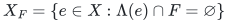

for X contained in E. We seek a single restriction H contained in E such that

<!-- math-display: 7c2793e733c497a22a8d8045
r_M(H_F)=r_M(E_F)\qquad\text{for every }|F|\le h. \tag{1}
-->
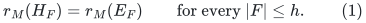

**Theorem 1 (sharp size).** Every inclusion-minimal H satisfying (1) obeys

<!-- math-display: 6f3ec4de7601b23f34261260
\boxed{|H|\le r\binom{h+d}{d}.} \tag{2}
-->
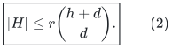

This bound is best possible, even for a direct sum of rank-one represented matroids. In particular, for one label per element, an exact (h+1)r bound holds for arbitrary matroids, not just represented ones.

**Theorem 2 (constructivity).** Given an independence oracle, a restriction satisfying (1) and (2) can be found deterministically in

<!-- math-display: 4f9a415ea84fd5065205732b
f(r,h,d)\,|E|^{O(1)}
-->
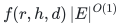

oracle time for a computable function f. A direct reverse-deletion implementation instead uses |E|^{O(h)} oracle time. The FPT statement includes r in the parameter; it is not a uniform polynomial-time construction when r,h,d are unrestricted inputs.

The combinatorial size proof is short and independent of the construction. The FPT construction uses a complete bounded-depth failure-witness search at each reverse-deletion step, with at most N(N+1) sum_{i=0}^h (dr)^i independence queries; Sections 5 and 6 give the full algorithm and count.

Before construction, one may clip `h` to the number `L` of distinct labels and `d` to the largest actual label-set size; rank is always at most `|E|`. The oracle statement treats one independence-oracle call as one unit of cost. It does not assume a linear representation, a field, or a bit-level encoding for oracle answers. Label indexing, basis scans and bounded-depth branching use `f(r,h,d)*|E|^{O(1)}` ordinary operations on explicit input identifiers. Thus the theorem gives an FPT oracle-query/time bound, not a polynomial-space bit-kernel claim.

## 2. A circuit-blocking set-pair lemma

For every e in a matroid ground set H, let A_e and B_e be disjoint subsets of some auxiliary label universe. Suppose

<!-- math-display: 5906d4b96c431d05a377b83a
e\notin\mathrm{cl}_M\bigl(\{f\in H-e:A_f\cap B_e=\varnothing\}\bigr). \tag{3}
-->
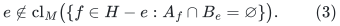

Equivalently, deleting all elements whose A-set meets B_e makes e a coloop. Then

<!-- math-display: 61459dc3cfee1351fd40029e
\boxed{\sum_{e\in H}\binom{|A_e|+|B_e|}{|A_e|}^{-1}\le r_M(H).} \tag{4}
-->
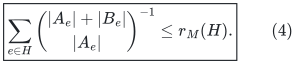

**Proof.** Order the finite auxiliary label universe uniformly at random. Select e if every label in A_e occurs before every label in B_e. The probability of this event is exactly

<!-- math-display: 706964314d418e660cf9c157
\binom{|A_e|+|B_e|}{|A_e|}^{-1};
-->
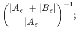

the event is automatic when either set is empty, agreeing with this formula.

Let J be the selected set. We show that J is independent. Suppose a circuit C were contained in J. Condition (3) says that, for every e in C, at least one f in C-e has A_f meeting B_e: otherwise C-e would survive B_e, contradicting (3). Consequently, C cannot have all its A-sets empty.

Choose e in C whose last A_e-label in the random order is as late as possible, treating the last label of the empty set as earlier than every real label. Choose f in C-e and a label lambda in A_f intersect B_e as guaranteed above. Its position is at most the position of the last A_f-label, which is at most the position of the last A_e-label. But e was selected, so every B_e-label, including lambda, occurs strictly after every A_e-label. This is a contradiction. Thus |J| is at most r_M(H); taking expectations proves (4). QED.

For rank one, (3) gives the ordinary strong cross-intersection condition between distinct set pairs, so (4) specializes to the classical Bollobas set-pairs inequality. The new use here is that circuit blocking replaces pairwise cross-intersection and the right-hand side becomes matroid rank.

## 3. Proof of the size theorem

Start with an inclusion-minimal H satisfying (1); existence is immediate because E itself satisfies (1). For each e in H, minimality gives a failure set F_e of at most h labels such that H-e does not satisfy (1). Since H does satisfy it, this says

<!-- math-display: 61a0f3237cad65666747e642
r_M((H-e)_{F_e})<r_M(H_{F_e}). \tag{5}
-->
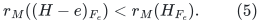

Necessarily Lambda(e) is disjoint from F_e, and (5) says that e is a coloop of M restricted to H_{F_e}. Apply (4) with A_e=Lambda(e) and B_e=F_e. Since |A_e| is at most d and |B_e| is at most h,

<!-- math-display: 69da865c2be90b1035285b29
\binom{|A_e|+|B_e|}{|A_e|}\le\binom{d+h}{d}.
-->
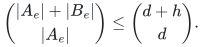

Therefore

<!-- math-display: a2ba879446d3e5368e613eb5
\frac{|H|}{\binom{h+d}{d}}
\le\sum_{e\in H}\binom{|A_e|+|B_e|}{|A_e|}^{-1}
\le r_M(H)\le r.
-->
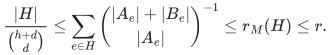

This proves (2). The nonuniform inequality (4) can also retain information about the actual element label degrees and witness sizes instead of replacing both by worst-case bounds.

### Tightness

Use h+d labels. In each of r rank-one direct-sum classes, create one element e_A for every d-element subset A of the labels, and give e_A label set A. To force a particular e_A, fail the h-element complement of A. In each class, e_A is then its only surviving element. Hence every rank-preserving restriction must contain all r times binomial(h+d,d) elements. The construction also works when h=0 or d=0, with the usual conventions.

### Extension interpretation

Because H_F is contained in E_F, rank equality implies equality of their original-matroid closures. This closure relation persists in any later matroid extension whose restriction to E is M. Thus the summary preserves the maximum number of surviving original elements that can extend any fixed independent background set in such an extension. Repeated exchange can retain that background exactly. This is an unweighted feasibility/cardinality consequence; no arbitrary-cost claim follows from it.

## 4. Direct XP construction

List the L labels actually occurring in E. Repeatedly remove e whenever

<!-- math-display: 279e17e5c0cc3cc877fc6de5
r_M((H-e)_F)=r_M(H_F)
-->
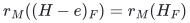

for every F contained in this label universe with |F| at most h. Each rank computation uses at most |E| independence queries by greedy augmentation. A single pass through the elements suffices: if e has a witness making it a coloop when tested, later deletions that keep e cannot destroy that coloop property. A safe implementation can also repeat to a fixed point.

The resulting H is inclusion-minimal and therefore satisfies (2). This straightforward method uses at most

<!-- math-display: 8677d63a15cd21b4f28fb434
O\!\left(|E|^2\sum_{i=0}^{h}\binom{L}{i}\right)
-->
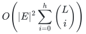

independence queries, up to bookkeeping and with h clipped at L. It is polynomial for each fixed h, but this expression alone is not an FPT bound in h.

## 5. A deterministic failure-witness search

The construction needs only independence queries. It does not require a
linear representation, a prime-field construction, or a separating family.
For a current restriction X and a protected element e in X, we decide whether
there is a set F of at most h labels, disjoint from Lambda(e), for which

<!-- math-display: d9db346149d7b3e47a97d8d5
e\notin\mathrm{cl}_M((X-e)_F). \tag{6}
-->
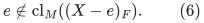

Such an F is exactly a witness that deleting e would change a required
surviving rank. A search state consists of the labels F_0 already failed,
the surviving set Y=X_{F_0} containing e, and the remaining budget t.

1. Compute a basis B of M restricted to Y-e by greedy augmentation.
2. If B+e is independent, return F_0. It satisfies (6), since B spans Y-e.
3. If t=0, return `NONE`.
4. For each label lambda occurring on B but not on e, recurse after deleting
   every element carrying lambda and replacing t by t-1. Return the first
   witness found, or `NONE` if every child returns `NONE`.

All scans and branches use the original element and label order. In
particular, this is an exact deterministic search. An already failed label
cannot occur on B, so each child spends its budget on a new label. Labels
on e are excluded in every branch, and e therefore remains present.

**Lemma 5.1 (complete branching).** The search returns a witness if and only
if a witness extending F_0 by at most t labels exists.

**Proof.** A returned witness is valid by the independence test in step 2.
Suppose step 2 fails, so e is in the closure of B. Let F' be any remaining
failure set that makes e leave the closure of the surviving Y-e. If F' were
disjoint from the labels of B, all of B would survive and would still span
e, a contradiction. Thus F' contains a label lambda on B. A valid witness
does not fail e, so lambda is not on e. The child for lambda exists, and
F'-{lambda} is a witness extension in that child. Induction on t proves
completeness, with t=0 immediate. QED.

Put

<!-- math-display: 63199149de8df34c92269e4f
S(a,h)=\sum_{i=0}^{h}a^i,
\qquad 0^0=1.
-->
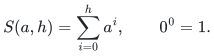

There are at most dr branch labels at every node and at most h levels.
One test uses at most S(dr,h) nodes, at most (|X|+1)S(dr,h)
independence queries, and O((d+1)|X|S(dr,h)) ordinary bookkeeping
operations after the explicit labels have been indexed. No failure set
over the full label universe is enumerated. If e is a loop, it can be
deleted immediately; this optional shortcut does not affect the proof.

## 6. Sharp construction and explicit parameter dependence

Start with X=E. Process its original elements once in a fixed order. For
each still-present e, run the search in Section 5 from (X,e,emptyset,h).
Delete e exactly when the answer is `NONE`.

**Theorem 6.1 (explicit oracle construction).** The resulting restriction H
preserves every allowed surviving rank and has at most

<!-- math-display: baff8a687699693472e08373
\min\left\{N,r\binom{h+d}{d}\right\}
-->
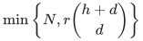

elements. Its construction uses at most

<!-- math-display: a98eed7e388410dbe8e3aecd
N(N+1)S(dr,h) \tag{7}
-->
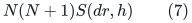

independence queries, in addition to at most N queries for an initial rank
computation if desired. Its ordinary bookkeeping cost is
O((d+1)N^2 S(dr,h)), with polynomial bit cost for explicit label identifiers.
In particular, the parameter dependence can be written as
(dr+1)^{O(h)} times a polynomial in the full input length.

**Proof.** By Lemma 5.1, every deletion preserves all surviving ranks.
Whenever e is retained, save its witness F_e. It makes e a coloop in
the current surviving restriction. Later deletions of other elements
cannot make e enter their closure, so the same witness remains valid
in the final H. Thus H is inclusion-minimal. Theorem 1 gives the sharp
size bound. There are at most N witness searches; the per-search count
in Section 5 gives (7). QED.

One may return H immediately if its size already meets the stated bound,
but the one-pass version additionally supplies a necessity witness for
every retained element. It does not optimize the cardinality of H on an
individual instance. Depth-first traversal needs only the current
restriction, a stack of at most h failure labels, and basis/work arrays;
storing a copy of each active restriction uses O((h+1)N) element IDs.

For fixed d and rank r=k, with failure budget h=O_d(k), (7) is

<!-- math-display: 53476c577380f51cc5922d93
2^{O_d(k\log(k+2))}N^2.
-->
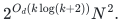

This explicit construction replaces the earlier separating-pool and
repeated-halving proof of computable fixed-parameter preprocessing.

### 6.1 Linear dependence on the explicit ground size

The [canonical-basis tree construction](weighted-oracle-prefix-fpt-construction.md)
first produces a rank-preserving restriction of size at most
<code class="math">K=\min\{N,\lfloor r\Gamma(h,d)\rfloor\}</code>, where
<code class="math">\Gamma(h,d)=(h+d)^{h+d}/(h^h d^d)</code> for positive <code class="math">h,d</code> and one otherwise.
Use the input order; no cost sorting is needed for this rank-only application.
The construction uses at most <code class="math">NS(dr,h)</code> independence queries by
rescanning the fixed ordered input at each branching node. Apply the
reverse deletion above to only those <code class="math">K</code> items. This gives the same sharp
<code class="math">r\binom{h+d}{d}</code> output bound with at most

<!-- math-display: 06a1ef8a9f9e64292aab11e1
(N+K(K+1))S(dr,h)
-->
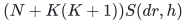

independence queries. For fixed rank, failure budget and label degree,
this is linear in <code class="math">N</code>. Explicit label indexing and sparse-list bookkeeping
are charged separately as in the linked construction. The first phase
preserves every prefix and has the general Bernoulli prefix size; the last phase may
discard cost-prefix information and is justified only for final ranks.

**Query interface after preprocessing.** Given F, filter H and run greedy
augmentation on H_F. This returns a surviving basis using at most |H|
independence queries, plus label filtering and output. For the submodular
extension below, one value query to f(H_F) returns the exact surviving
value. These are oracle bounds; no bit encoding of an arbitrary oracle
is supplied by the summary.

## 7. Weighted oracle summaries for one label failure

There is a sharp weighted result without a linear representation when
h=1. Fix a total order refining the signed element costs. Let B_0 be the
canonical greedy basis of E. For each label lambda occurring on B_0,
compute the canonical basis B_lambda after deleting all elements carrying
lambda, and retain

<!-- math-display: eeb503e946c9858c1b2d0fe7
H=B_0\cup\bigcup_{\lambda\in\Lambda(B_0)}B_\lambda.
-->
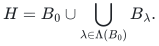

**Theorem 7.1 (one-failure weighted oracle summary).** H preserves every
surviving prefix rank and contains the canonical minimum-cost basis after
zero or one label failure. It is computed in deterministic uniform
polynomial time with at most (1+dr)N independence queries, and

<!-- math-display: cc6546d56cbc5e6428a65f3d
|H|\le\min\{N,(d+1)r\}. \tag{8}
-->
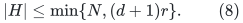

**Proof.** A greedy-accepted element e lies outside the closure of all
earlier elements. Deleting elements while retaining e can only shrink
that earlier set. Consequently every surviving element of B_0 remains
in the canonical basis B_lambda. Since its rank is at most r,

<!-- math-display: 0184c8a5071a77a36646819b
|B_\lambda\setminus B_0|
 \le |\{e\in B_0:\lambda\in\Lambda(e)\}|.
-->
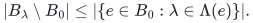

Summing over the at most dr relevant labels gives

<!-- math-display: 0609129a47b50d60a41f5918
|H|\le r+\sum_{e\in B_0}|\Lambda(e)|\le(d+1)r.
-->
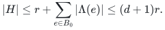

If a failed label does not occur on B_0, that entire basis survives and
the same stability argument shows that it remains the canonical basis.
All other one-label queries have their canonical basis explicitly included
in H. At every prefix of a fixed greedy scan, the accepted basis elements
span that prefix. Hence containment of the canonical basis proves equality
of every surviving prefix rank as well. The query and construction costs
follow from ordinary greedy augmentation. QED.

The bound is exact by the rank-one direct-sum construction in Section 3
with h=1. Signed costs, tied costs with a fixed tie order, loops, and rank
drops require no additional assumption. This resolves the weighted
oracle case for one failed label; it is separate from the rank-only
reverse-deletion algorithm of Section 6.

### Boundary for two or more failures

The argument establishing (4) requires a coloop witness in the **entire
surviving restriction**. A cost-prefix witness only makes e independent of
earlier surviving elements. In a selected circuit, the element with the
last own-label need not be the last element in cost order, so that weaker
witness does not prove (4). The proposed sharp weighted-prefix extension is false in general once h is
at least two: the [explicit weighted oracle obstruction](weighted-oracle-two-failure-obstruction.md)
uses rank four and one label per item, yet forces 4(h+1)+1 elements.
The h=2 instance has only 13 items and four labels. Its all-h extension
and direct sums are proved in the companion.

For explicitly represented matroids, the companion polynomial-feature
lift attains r binomial(h+d,d) with full fixed-cost preservation and
uniform polynomial preprocessing for every h. For arbitrary oracles,
Section 6 gives the sharp **rank-only** summary with explicit FPT work,
while Theorem 7.1 gives the sharp **weighted** summary when h=1.
No uniform polynomial sharp rank-summary algorithm for unrestricted h,d,r
is established. The known hardness of a generic colored failure-witness
problem with a smaller parameter set is not used as a lower bound on
these constructions.

## 8. Antecedents and comparison to public results

* The permutation event and its reciprocal-binomial probability are the classical Bollobas set-pairs method. A useful primary modern account, including the strong and skew versions and the distinction between them, is Gabor Hegedus and Peter Frankl, *Variations on the Bollobas set-pair theorem*: https://arxiv.org/html/2307.14704v1 . The circuit-blocking rank inequality (4) should be checked against matroidal extensions of set-pair inequalities before any priority claim.

* Matthias Bentert, Fedor V. Fomin, Petr A. Golovach, and Laure Morelle, *Fault-Tolerant Matroid Bases*, ESA 2025, DOI 10.4230/LIPIcs.ESA.2025.83: https://drops.dagstuhl.de/storage/00lipics/lipics-vol351-esa2025/html/LIPIcs.ESA.2025.83/LIPIcs.ESA.2025.83.html . Their main algorithm finds a **minimum-cardinality** set retaining the original full rank after a bounded number of **individual element failures**, with parameter rank plus fault budget. Our task uses arbitrary correlated label failures, permits the surviving input rank to drop, and only attains the exact universal worst-case size bound. These are different optimization requirements; this note does not claim to improve their minimum-cardinality algorithm.

* Dipan Dey and Telikepalli Kavitha, *Low-Cost Arborescence Under Edge Faults*, May 2026, Section 4: https://arxiv.org/html/2605.13800v1 . They explicitly construct a union of k+1 successive minimum-cost bases for at most k individual item faults in an arbitrary matroid. This gives the familiar (k+1)r weighted individual-fault bound, not a correlated-label result. Their v1 abstract and theorem print kr despite the k+1 bases in the algorithm/proof; the stated kr bound cannot hold under their at-most-k-failures definition, as a rank-one class of k+1 parallel elements shows. Use the actual construction and distinguish the parameter convention rather than quoting that displayed constant unchecked.

* Relative to Checkpoint W's LF rank summary, (2) replaces r (h+d)^(h+d)/(h^h d^d) by the sharp r binomial(h+d,d), but only the unweighted/rank part is upgraded for arbitrary matroids. The represented companion retains fixed-cost preservation. No unrestricted weighted-oracle improvement is asserted.

## 9. Monotone submodular functions

The permutation proof has a more general form that does not use matroid exchange or circuits.

**Theorem 3 (submodular set-pair inequality).** Let f be a finite real-valued monotone submodular function on a finite ground set H. Give each e disjoint auxiliary label sets A_e and B_e, and write

<!-- math-display: 2b7aa1fa216518d9d9aa97c8
H_e=\{x\in H:A_x\cap B_e=\varnothing\},
\qquad
\delta_e=f(H_e)-f(H_e-e).
-->
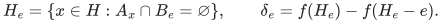

Then

<!-- math-display: 5d52050e4005533131a15cdd
\boxed{
\sum_{e\in H}
\frac{\delta_e}{\binom{|A_e|+|B_e|}{|A_e|}}
\le f(H)-f(\varnothing).
} \tag{10}
-->
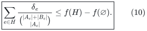

Here disjointness ensures e belongs to H_e. All delta_e are nonnegative by monotonicity. The matroidal inequality (4) is the special case f=r_M and delta_e=1.

**Proof.** Randomly order the labels and select e when all A_e-labels precede all B_e-labels, exactly as before. Order the selected elements by the position of their last A-label, in nondecreasing order, with the empty A-set first. Fix a selected e. Every label of every earlier selected element has position at most the last A_e-label, while every B_e-label has a strictly larger position. Thus all earlier selected elements lie in H_e-e. Diminishing returns gives

<!-- math-display: df84683db2af51ce99a494f6
f(J_{<e}+e)-f(J_{<e})\ge f(H_e)-f(H_e-e)=\delta_e.
-->
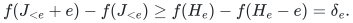

Summing over selected elements yields sum_{e in J} delta_e at most f(J)-f(emptyset), hence at most f(H)-f(emptyset). Taking expectations proves (10). Empty A-sets and empty B-sets obey the same argument with the stated ordering convention. QED.

**Corollary 4 (exact integral-submodular failure-value summary).** Let f be integer-valued and monotone submodular on E, and let R=f(E)-f(emptyset). Under the same at-most-d-labels-per-element and at-most-h-failures model, there is a restriction H with

<!-- math-display: cef32e44f839d3d3dc88cadd
f(H_F)=f(E_F)\quad\text{for all }|F|\le h,
\qquad
|H|\le R\binom{h+d}{d}. \tag{11}
-->
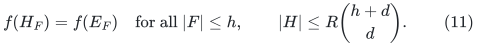

Every inclusion-minimal exact summary satisfies this size bound. Given a value oracle, the failure-witness search below constructs one using O(N(N+1) sum_{i=0}^h (dR)^i) value queries, where N=|E|. The parameter includes the numerical range R, not only its bit length.

To prove the size statement, choose an inclusion-minimal H and for each e a failure witness F_e where deleting e strictly reduces value. Integrality gives delta_e at least 1, so (10) proves (11). For construction, test each deletion with the same witness search as in Section 5. At a surviving state Y containing the protected e, return the current failed labels if f(Y)>f(Y-e). Otherwise greedily form B contained in Y-e with f(B)=f(Y-e), keeping an element exactly when its marginal is positive. Diminishing returns ensures that every skipped zero marginal stays zero, and integrality bounds |B| by R. Now f(B)=f(Y-e)=f(Y), so monotonicity gives f(B+e)=f(B). If a remaining failure misses all labels on B, then B survives; diminishing returns forces the marginal of e in that surviving restriction to be zero. Every positive-marginal witness must therefore hit a label on B that is not on e. Branch on those at most dR labels. Induction proves completeness. A positive marginal witness remains positive when other surviving elements are deleted, by diminishing returns. Therefore the same one-pass deletion gives an inclusion-minimal summary. Each search node uses at most |Y|+2 value queries, proving the stated count. The numerical range R, rather than its bit length, controls the branching factor.

The bound is already tight for coverage functions: use one feature for each of R classes in the lower-bound construction, and let an element cover exactly its class feature. The function counts covered features. Conversely, integrality or a positive marginal-gap assumption is needed for a cardinality consequence: a modular function giving each of N items weight 1/N has total value 1, but its value-preserving restriction must contain all N items even with no failures.

There is also a universal-context interpretation. If g is any monotone submodular extension of f to additional elements B, then

<!-- math-display: 757abc2bc8d2ad3d5f8a0856
g(H_F\cup B)=g(E_F\cup B)
-->
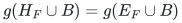

for every context B. Indeed, the zero marginal gain from adjoining E_F to H_F cannot increase after adjoining B, by submodularity. Thus (11) simultaneously preserves the exact value after correlated failures and arbitrary later augmentation, provided the later function restricts to the original f.

This extension concerns exact saturation/value preservation. It does not claim a smaller general-purpose coreset for constrained submodular maximization or minimum-cost submodular cover, and does not supply weighted-prefix preservation for h at least two, which is ruled out at the same sharp size by the obstruction in Section 7. Priority of (10) and its precise fault-summary application should be checked separately; the proof is self-contained.

### A sharp real-valued total-sensitivity consequence

For any real-valued monotone submodular f, define the maximum final marginal of e after allowed failures by

<!-- math-display: 7c5a951dc43947a7f1263c40
\sigma_e=\max_{\substack{|F|\le h\\\Lambda(e)\cap F=\varnothing}}
\bigl[f(E_F)-f(E_F-e)\bigr].
-->
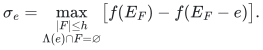

There is no minimum-marginal or integrality assumption in the following sharp inequality:

<!-- math-display: b619221f11aab752fdba21ef
\boxed{\sum_{e\in E}\sigma_e\le
\binom{h+d}{d}\,[f(E)-f(\varnothing)].} \tag{12}
-->
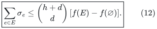

Indeed, choose a maximizing failure witness separately for each e and apply (10), followed by the worst-case reciprocal-binomial bound. This controls the sum of the individual worst marginal losses, even though different items may attain their maxima under different correlated failure queries.

For a concrete information-theoretic specialization, let X_e be jointly distributed discrete random variables with finite joint Shannon entropy, and put f(S)=H(X_S). Then

<!-- math-display: 0df80ed2f3d624e31cd47fdf
\boxed{
\sum_{e\in E}
\max_{\substack{|F|\le h\\\Lambda(e)\cap F=\varnothing}}
H\bigl(X_e\mid X_{E_F-e}\bigr)
\le\binom{h+d}{d}\,H(X_E).
} \tag{13}
-->
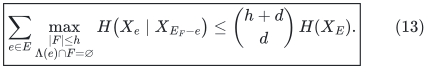

Thus the aggregate of the worst residual uncertainties of individual surviving variables under correlated erasures is bounded by the exact binomial multiplier of the original joint entropy. These are conditional entropies given **all other surviving variables**, not cost/time-prefix conditionings.

Equality is possible. Take independent variables Y_1,...,Y_r. For each i create C=binomial(h+d,d) identical copies of Y_i, indexed by the d-subsets A of an (h+d)-label universe, assigning label set A to its copy. Failing the complement of A leaves exactly that copy in each class. Its conditional entropy given the other surviving classes is H(Y_i). Hence the left side of (13) equals C sum_i H(Y_i)=C H(X_E). This also proves exact tightness of (12) for weighted coverage functions. No priority claim for this entropy formulation is made without further literature comparison.
