# Optimal oracle construction of rank-two label-failure prefix summaries

**Status: complete proof with exact finite verification.** This manuscript
concerns one fixed item order and at most one failure label per item. Its
oracle lower bound is for computing the exact canonical union, equivalently
the unique smallest restriction preserving every surviving prefix rank.
It is not a lower bound for returning an arbitrary valid restriction.
No literature-priority claim is made.

## 1. Statement and model

Let <code class="math">M</code> be a matroid on an explicitly listed ground set <code class="math">E</code> of <code class="math">N</code> items,
given by an independence oracle, with <code class="math">\mathrm{rank}(M)\le2</code>. Fix a total
order on <code class="math">E</code>. Each item has either one label <code class="math">\lambda(e)</code> or no label.
For a set <code class="math">F</code> of failed labels, let <code class="math">E_F</code> be the surviving ground and let
<code class="math">B_F</code> be its canonical greedy basis in the fixed order. Rank drops are
allowed. Given a nonnegative binary-encoded budget <code class="math">h</code>, the required output is

<!-- math-display: 9188f18cc898ab6f073f0e9d
H_h=\bigcup_{|F|\le h}B_F.
\tag{1}
-->
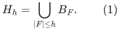

This is the unique smallest original-item restriction satisfying

<!-- math-display: 5a3d3a5db4d7db79f5e85b2d
\mathrm{rank}_M(H_h\cap P\cap E_F)
=\mathrm{rank}_M(P\cap E_F)
\quad\text{for every original-order prefix }P\text{ and }|F|\le h.
\tag{2}
-->
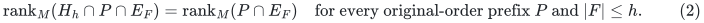

For completeness, if an item enters a canonical basis at its own position,
its earlier surviving prefix does not span it; omitting that item would
therefore violate (2) at that prefix. Conversely, the portion of a canonical
basis in any prefix spans that prefix. These two facts prove the assertion.

Let <code class="math">\ell</code> be the number of distinct labels on nonloops, and put
<code class="math">k=\min\{h,\ell\}</code>. The algorithm discovers the nonloops before using <code class="math">k</code>.
Failures of labels occurring only on loops never matter.

**Theorem 1 (rank-two construction).** There is a deterministic algorithm
that computes (1), together with one failed-label witness for each retained
item, using at most

<!-- math-display: fbf6824525dc712e48b66922
2N+\binom{k+1}{2}+(k+1)^2
\tag{3}
-->
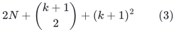

independence queries. Every query contains at most two items. After the fixed
order and label indexing have been supplied, its ordinary work is
<code class="math">O(N(k+1)+(k+1)^2)</code>, and its storage is <code class="math">O(N+(k+1)^2)</code> item/label records.
Label comparison and indexing costs are separate; deterministic sorting
gives <code class="math">O(N\log(N+2))</code> comparisons if indexing is not supplied.

The output has the sharp size bound

<!-- math-display: 96382ea45d4085ad57373758
|H_h|\le \min\{N,2(k+1)\}.
\tag{4}
-->
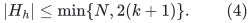

If the rank is known to be at most one, <code class="math">N</code> singleton queries suffice and
the output has at most <code class="math">k+1</code> items. The rank-zero case returns the empty set
without queries when that rank is supplied as a promise.

**Theorem 2 (matching exact-summary query lower bound).** For every pair of
integers <code class="math">h\ge0</code> and <code class="math">N\ge h+3</code>, some rank-two, singleton-labelled instance
forces every deterministic exact algorithm to use at least

<!-- math-display: 5918c1f3c280d79b6497eb8e
\binom{h+2}{2}+N-h-3
=\Omega(N+h^2)
\tag{5}
-->
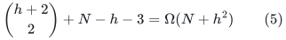

independence queries. This holds even when its ordinary computation is free
and queries of arbitrary cardinality are permitted. Together with Theorem 1,
it gives worst-case query complexity <code class="math">\Theta(N+h^2)</code> in this parameter range.
The restriction <code class="math">N\ge h+3</code> is part of the lower-bound statement; it is not
silently extrapolated to budgets covering almost all input labels.

The algorithm extends the earlier
[ordered-basis tree](weighted-oracle-prefix-fpt-construction.md) at low
residual rank. At rank two, its query bound replaces the tree bound
<code class="math">N\sum_{j=0}^{k}2^j</code> by <code class="math">O(N+(k+1)^2)</code>. The polynomial term is additive to
the input-size term. The theorem counts independence calls, not the running
time of a hidden implementation of that oracle.

## 2. The possible first surviving items

Query every singleton to remove loops from consideration, retaining the
ordered list of nonloops. Among these, scan in order and record the first
item of each previously unseen label. Stop immediately after either the
first unlabelled nonloop or the <code class="math">(k+1)</code>st recorded labelled item. If neither
occurs, continue to the end. Call the resulting ordered list <code class="math">A</code> and write
<code class="math">a=&#124;A&#124;\le k+1</code>.

**Lemma 3.** Under every allowed failure set with at least one surviving
nonloop, the first surviving nonloop belongs to <code class="math">A</code>. Every item of <code class="math">A</code> is
the first survivor for some failure set of size at most <code class="math">k</code>.

**Proof.** A labelled first survivor must be the first nonloop with its
label: any earlier such item survives with it. Skipping <code class="math">k+1</code> recorded
distinct labels requires more than <code class="math">k</code> effective failures. An unlabelled
nonloop cannot be skipped. This proves the first claim, including when all
recorded labelled items fail and no nonloop remains.

For an item <code class="math">x\in A</code>, fail exactly the labels of preceding items of <code class="math">A</code>.
These are at most <code class="math">k</code> distinct labels, none is the label of <code class="math">x</code>, and no
unlabelled item precedes <code class="math">x</code>. Every earlier nonloop has one of those labels.
Thus <code class="math">x</code> is the first survivor. <code class="math">\square</code>

Let <code class="math">F_x</code> denote this particular witness: the labels on the earlier entries
of <code class="math">A</code>. It is precisely the set of labels of all nonloops before <code class="math">x</code>.

When the rank is at most one, the first surviving nonloop is the complete
canonical basis. Thus <code class="math">H_h=A</code>, proving the rank-one part of Theorem 1.

## 3. Capped lists outside the relevant parallel classes

Two nonloops are parallel when their pair is dependent. Parallelism is an
equivalence relation: if <code class="math">x,y</code> and <code class="math">y,z</code> are dependent nonloop pairs, rank
submodularity gives

<!-- math-display: a7690e37c145620f3b371353
\mathrm{rank}_M(\{x,y,z\})
\le \mathrm{rank}_M(\{x,y\})+
\mathrm{rank}_M(\{y,z\})-\mathrm{rank}_M(\{y\})=1.
-->
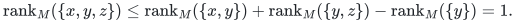

Consequently <code class="math">x,z</code> are parallel. A pair of nonloops from distinct classes
is independent. In a matroid of rank at most two, the canonical basis
consists of its first surviving nonloop and, if it exists, its first
surviving item outside that nonloop's parallel class.

Classify the items of <code class="math">A</code> into parallel classes by testing each new item
against the already chosen class representatives. This uses at most
<code class="math">\binom a2</code> independence queries. Let <code class="math">\mathcal C</code> be the resulting set of
classes, let <code class="math">c=&#124;\mathcal C&#124;\le a</code>, and choose a representative <code class="math">z_C\in A</code>
for each <code class="math">C\in\mathcal C</code>.

For each class <code class="math">C</code>, construct an ordered list <code class="math">L_C</code> as follows. Among the
nonloops outside <code class="math">C</code>, record the first occurrence of each distinct label.
Stop after the first unlabelled item outside <code class="math">C</code>, or after recording <code class="math">k+1</code>
distinct labelled items, whichever comes first. Thus <code class="math">&#124;L_C&#124;\le k+1</code>.

These lists can be built in one input scan without learning all the
parallel classes. Keep a touched-label set and a closed flag for each
<code class="math">C</code>. For a nonloop <code class="math">e</code> and an open list <code class="math">L_C</code>:

1. If <code class="math">e</code> is labelled and that label already occurs in <code class="math">L_C</code>, do nothing.
2. Otherwise, if <code class="math">e=z_C</code>, do nothing. In every other case query
   <code class="math">\{z_C,e\}</code>.
3. If the pair is independent, append <code class="math">e</code> to <code class="math">L_C</code>. Close the list if <code class="math">e</code>
   is unlabelled or if the list now has <code class="math">k+1</code> entries.

**Lemma 4 (query charging).** The list scan uses at most
<code class="math">N+c(k+1)</code> independence queries.

**Proof.** Every successful independence query appends one item to one
list. There are at most <code class="math">c(k+1)</code> such appends. A nonloop <code class="math">e</code> can be parallel
to at most one of the pairwise nonparallel representatives <code class="math">z_C</code>.
Consequently at most one of the queries involving this input item is
dependent, regardless of which lists are already closed or which labels
were skipped. The total number of dependent queries is therefore at most
the number of nonloops, hence at most <code class="math">N</code>. <code class="math">\square</code>

This charging is about oracle calls. The ordinary scan can inspect all
<code class="math">c\le k+1</code> list states for each input item, even when it makes no query.
That is the <code class="math">O(N(k+1))</code> term in Theorem 1. In particular the proof does not
replace this ordinary work by <code class="math">O(N+k^2)</code>.

## 4. Exact witnesses and extraction of the minimum summary

For <code class="math">e\in L_C</code>, let <code class="math">D_C(e)</code> be the labels on entries of <code class="math">L_C</code> strictly
before <code class="math">e</code>. No such earlier entry is unlabelled, because that would have
closed the list. Since <code class="math">e</code> occurs before truncation, <code class="math">D_C(e)</code> is exactly
the set of labels on all earlier nonloops outside <code class="math">C</code>.

For <code class="math">x\in A\cap C</code> and <code class="math">e\in L_C</code> later than <code class="math">x</code>, define

<!-- math-display: 7ab8d280c1088b94f4555ebc
W(x,e)=F_x\cup D_C(e).
\tag{6}
-->
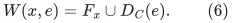

Call the pair admissible if

<!-- math-display: 24c91bec6cf82c810f75313a
|W(x,e)|\le k,\qquad
\lambda(x)\notin W(x,e),\qquad
\lambda(e)\notin W(x,e),
\tag{7}
-->
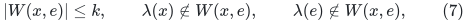

where a label-exclusion condition is vacuous for an unlabelled item.
Return <code class="math">A</code> together with every item <code class="math">e</code> occurring in some admissible pair.
Store <code class="math">F_x</code> as the witness for <code class="math">x\in A</code>, and <code class="math">W(x,e)</code> as the witness when
an admissible pair first adds <code class="math">e</code>.

**Lemma 5 (exact extraction).** This output is exactly <code class="math">H_h</code>.

**Proof.** Every <code class="math">x\in A</code> has the witness from Lemma 3. For an admissible
pair, failing <code class="math">W(x,e)</code> deletes every nonloop before <code class="math">x</code> and every nonloop
outside <code class="math">C</code> before <code class="math">e</code>, while preserving both <code class="math">x</code> and <code class="math">e</code>. Hence <code class="math">x</code> is
the first surviving nonloop and <code class="math">e</code> is the first survivor outside its
parallel class. They form the canonical basis, so <code class="math">e\in H_h</code>.

Conversely, suppose <code class="math">e</code> is the second item of a canonical basis for an
allowed failure set <code class="math">F</code>, and let <code class="math">x</code> be its first item. Lemma 3 gives
<code class="math">x\in A</code>. Let <code class="math">C</code> be the parallel class of <code class="math">x</code>. Every earlier nonloop
outside <code class="math">C</code> must fail. In particular <code class="math">e</code> is the first outside-<code class="math">C</code> item
with its own label, if it is labelled. At most <code class="math">k</code> distinct outside
labels can precede it, and no unlabelled outside item can precede it.
Therefore <code class="math">e\in L_C</code>. The same failure set contains <code class="math">F_x</code> and <code class="math">D_C(e)</code>,
so <code class="math">W(x,e)\subseteq F</code>; it preserves <code class="math">x,e</code>. Conditions (7) follow.
Every canonical basis has at most two items, which proves equality.
<code class="math">\square</code>

For ordinary-time accounting, process one <code class="math">x\in A</code> at a time. Initialize
an indexed set with <code class="math">F_x</code>, scan <code class="math">L_C</code> in order, test (7) using its current
size and membership flags, then insert the next list label. Touched-label
lists reset those flags in <code class="math">O(k+1)</code> work. This is <code class="math">O(k+1)</code> work per <code class="math">x</code>,
apart from copying the first witness for a newly retained item. There
are at most <code class="math">2(k+1)</code> retained items by Section 5, so explicitly storing
all witnesses also takes <code class="math">O((k+1)^2)</code> records and work.

There are <code class="math">N</code> singleton queries, at most <code class="math">\binom a2</code> classification queries,
and at most <code class="math">N+c(k+1)</code> list queries. Using <code class="math">a,c\le k+1</code> proves (3).
Clipping <code class="math">h</code> to <code class="math">\ell</code> ensures that a very large binary budget never
causes a loop of length equal to that numeric budget.

## 5. The sharp retained size

The following is a size proof, not the algorithm used to construct <code class="math">H_h</code>.
It gives a short self-contained specialization of the
[represented prefix lift](sharp-represented-matroid-failure-summaries.md).

Represent each nonloop parallel class by a distinct rational number <code class="math">t_C</code>
and represent each item in that class by <code class="math">v_e=(1,t_C)</code>. Loops have zero
vectors. This represents every rank-at-most-two matroid, except that a
one-class ground has rank one as it should. Choose distinct rational
numbers <code class="math">z_\lambda</code> for all labels and a distinct dummy <code class="math">z_0</code> for unlabelled
items. Lift each column to

<!-- math-display: 4f3aeed8cf2576a0bb3ac8cb
w_e=v_e\otimes(1,z_e,z_e^2,\ldots,z_e^k)
\in\mathbb Q^{2(k+1)}.
\tag{8}
-->
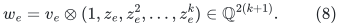

Take the canonical basis <code class="math">K</code> of the lifted columns in the original order.
It has at most <code class="math">2(k+1)</code> columns. For any effective failure set <code class="math">F</code> of size
at most <code class="math">k</code>, the polynomial

<!-- math-display: 392929c6080e0343f780ad1a
p_F(z)=\prod_{\lambda\in F}(z-z_\lambda)
-->
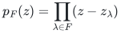

defines a linear map sending <code class="math">w_e</code> to <code class="math">p_F(z_e)v_e</code>. This image is zero
exactly for failed nonloops, and is a nonzero scalar multiple of <code class="math">v_e</code>
for surviving nonloops. Every original lifted prefix is spanned by its
columns in <code class="math">K</code>, so applying this map shows that <code class="math">K</code> preserves each
surviving prefix span. By the necessity argument preceding Theorem 1,
<code class="math">H_h\subseteq K</code>. This proves (4), without constructing the representation
or assuming access to it.

The bound is attained by two independent parallel classes, each containing
<code class="math">h+1</code> ordered items with pairwise distinct labels, all labels distinct
across both classes. Every item is needed: fail the at most <code class="math">h</code> labels of
its predecessors in its own class. The unfailed earlier items of the
other class cannot span it. Thus all <code class="math">2(h+1)</code> items belong to <code class="math">H_h</code>.

## 6. Independence-oracle lower bound

Let <code class="math">p=N-h-3</code>. Put <code class="math">p</code> loop items first in the order, followed by core
items <code class="math">b_1,\ldots,b_{h+2},z</code>. Give every item its own distinct label.
The base matroid <code class="math">M_0</code> is uniform of rank two on its <code class="math">h+3</code> core items,
with those <code class="math">p</code> loops adjoined.

The last item <code class="math">z</code> is absent from <code class="math">H_h(M_0)</code>: among its <code class="math">h+2</code> core
predecessors at least two survive any <code class="math">h</code> label failures, and these are
independent. For every pair <code class="math">\{b_i,b_j\}</code> among those predecessors,
define <code class="math">M_{ij}</code> by making this pair one parallel class and leaving all
other core items singleton parallel classes. It is again a rank-two
matroid. Fail the other <code class="math">h</code> predecessor labels. The pair survives with
rank one and <code class="math">z</code> becomes the second canonical item. Hence
<code class="math">z\in H_h(M_{ij})</code>.

The independence answers of <code class="math">M_0</code> and <code class="math">M_{ij}</code> differ on exactly the
two-element query <code class="math">\{b_i,b_j\}</code>. All singleton core queries are true;
all sets of at least three items are dependent; every query containing
a loop is dependent unless it is empty. Therefore the transcript of a
correct deterministic algorithm on <code class="math">M_0</code> must query every one of these
<code class="math">\binom{h+2}{2}</code> pairs. Otherwise it has the same transcript on a
matroid whose required output differs.

For each of the <code class="math">p</code> initial loops <code class="math">u</code>, also consider the variant in which
<code class="math">u</code> becomes a nonloop parallel to <code class="math">b_1</code>, while every other item is as in
<code class="math">M_0</code>. The rank remains two. This item is the first nonloop in the
unfailed order, so it belongs to the required summary in the variant
and not in <code class="math">M_0</code>. A query distinguishing this variant from <code class="math">M_0</code> is
either <code class="math">\{u\}</code> or a pair containing <code class="math">u</code> and a core item not parallel
to it. It can distinguish at most one such loop variant. Queries
containing two of the original loops remain dependent in each
single-loop variant, and queries of size at least three remain
dependent by rank two.

The transcript on <code class="math">M_0</code> therefore requires at least <code class="math">p</code> further queries,
disjoint from the mandatory core-pair queries. This proves (5). It is
an oracle-information lower bound, not merely an input-reading cost.
The exact-minimum output requirement is essential: returning all of
<code class="math">E</code> always preserves prefixes without learning the oracle.

## 7. Fixed-contraction and residual-rank consequences

The [fixed rank-loss contraction](rank-loss-contraction-for-prefix-summaries.md)
constructs <code class="math">Q\subseteq B_0</code> with <code class="math">&#124;Q&#124;=r-T</code> and the exact identity

<!-- math-display: a46498e172c0c0b07c94a734
H_h(M)=Q\ \dot\cup\ H_h(M/Q),
\tag{9}
-->
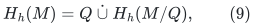

where <code class="math">T</code> is the total number of single-label replacements counted with
multiplicity, and the fixed minor has rank <code class="math">T</code>. Its construction takes
at most <code class="math">(1+\ell_0)N+r</code> original independence queries, where <code class="math">\ell_0</code>
counts the labels meeting <code class="math">B_0</code>. Write <code class="math">N'=N-&#124;Q&#124;</code>, and clip the remaining
failure budget to the labels on nonloops of the minor.

**Corollary 6.** Once that fixed contraction is computed, the exact summary
uses no further queries if <code class="math">T=0</code>, at most <code class="math">N'</code> further queries if <code class="math">T=1</code>,
and at most

<!-- math-display: dfabcce6cf5ec6884e0e8228
2N'+\binom{k+1}{2}+(k+1)^2
\tag{10}
-->
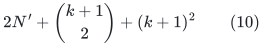

further queries if <code class="math">T=2</code>. The corresponding support bounds are

<!-- math-display: 0bf8e4fb17eb2ced754e6693
|H_h(M)|\le r+Th\qquad(T\in\{0,1,2\}).
\tag{11}
-->
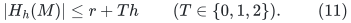

For <code class="math">T=1,2</code> and <code class="math">h\ge1</code>, equality is attained by adding <code class="math">r-T</code>
unlabelled coloops to <code class="math">T</code> independent parallel chains of <code class="math">h+1</code> items
with all labels distinct. Querying a singleton or pair in <code class="math">M/Q</code> means
querying its union with <code class="math">Q</code> in <code class="math">M</code>, so the number of calls is unchanged.
The original query set may now contain <code class="math">r-T+2</code> items; its encoding cost
is not constant and is charged separately.

The same terminal algorithms may be used inside the ordered-basis tree,
even when the original replacement rank is larger. At a node <code class="math">v</code> with
failed set <code class="math">F_v</code> and remaining budget <code class="math">k_v</code>, compute its canonical basis
on the surviving ground. Stop immediately at budget zero. Otherwise,
if its actual rank is at most two, call the corresponding algorithm
above on that surviving restriction. Only larger-rank nodes branch on
the labels of their canonical basis. The usual target-following proof
remains valid: a target failure either leaves that basis untouched,
or deletes a branch label; a terminal algorithm contains every target
basis below its node.

Let <code class="math">\mathcal V</code> be the actual visited nodes of this truncated tree,
<code class="math">N_v</code> their surviving ground sizes, and <code class="math">\mathcal L_2</code> its positive-budget
rank-two terminals. Including the rank-discovery scans, one explicit
query bound is

<!-- math-display: a89304ddcc425ecf7156b499
3\sum_{v\in\mathcal V}N_v+
\sum_{v\in\mathcal L_2}
\left[\binom{k_v+1}{2}+(k_v+1)^2\right].
\tag{12}
-->
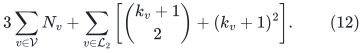

The budget in each summand can be clipped again to that node's occurring
nonloop labels. This is an actual-residual-rank bound; a tree whose
surviving ranks remain large does not receive an unproved polynomial
guarantee. Rank-one and rank-two terminals replace whole failure
subtrees by their exact canonical unions.

## 8. A linear-query endpoint when every label may fail

There is an additional endpoint when <code class="math">h\ge\ell</code>, where now <code class="math">\ell</code> counts
all occurring labels. It is valid at arbitrary matroid rank. Let <code class="math">U</code> be
the unlabelled ground and let <code class="math">r_U=\mathrm{rank}_M(U)</code>.

**Proposition 7 (all-label budget).** If every subset of occurring labels
is allowed to fail, the exact prefix summary can be constructed with at
most

<!-- math-display: a822e15091c9a0c24fc25106
N+r_U\ell
\tag{13}
-->
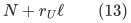

independence queries. Thus it uses <code class="math">O(N)</code> queries at rank at most two.
The query bound is an endpoint guarantee; it is not extended to smaller
failure budgets without an additional argument.

**Proof.** Write <code class="math">D_\lambda</code> for the items of label <code class="math">\lambda</code>. A labelled
item <code class="math">e\in D_\lambda</code> has some prefix witness if and only if it is
accepted in the greedy scan restricted to <code class="math">U\cup D_\lambda</code>. Indeed,
failing every label except <code class="math">\lambda</code> leaves the smallest possible earlier
surviving prefix that still preserves <code class="math">e</code>. Any witness on a larger
surviving prefix continues to witness acceptance on this smaller prefix.
The converse uses that very failure set. Similarly, an unlabelled item
has a witness exactly when it is accepted in the greedy scan of <code class="math">U</code>.

Maintain the current greedy basis <code class="math">B_U</code> of the unlabelled prefix. For
each label already encountered, also maintain the greedy basis <code class="math">B_\lambda</code>
of the prefix restricted to <code class="math">U\cup D_\lambda</code>. When a label first occurs,
initialize its state to the present <code class="math">B_U</code>. A labelled input item is
tested once against its label's state; retain it precisely when accepted.
An unlabelled input item is first tested against <code class="math">B_U</code>. If rejected, it
lies in the span of the preceding unlabelled prefix and therefore in the
span of every <code class="math">B_\lambda</code>; no label state changes. If accepted, retain it
and test its insertion into every active label state. Those independent
tests update precisely the canonical greedy scans in the common original
order. There are at most <code class="math">r_U</code> accepted unlabelled items.

There is one principal test per input item and at most <code class="math">r_U\ell</code> extra
state-update tests. Every returned item has the maximal-deletion witness
identified above, and every possible prefix witness implies one of these
greedy acceptances. This proves both exactness and (13). <code class="math">\square</code>

The stored bases use <code class="math">O((\ell+1)(r+1))</code> item and state records, in addition to input and
output. An original independence query has at most <code class="math">r+1</code> items. With
explicit query sets, ordinary basis and query-set copying has
<code class="math">O((r+1)(N+r_U\ell+\ell))</code> work; this factor is separate from (13).
For rank two these storage and ordinary-work bounds are linear in <code class="math">N</code>.
The endpoint explains why the quadratic lower bound is stated in the
specific range of Theorem 2: a budget allowing every label to fail has
a stronger direct algorithm.

## 9. Evidence and relationship to prior work

The [finite checker](../verify/check_rank_two_prefix.py) implements the
capped-list algorithm using only an independence callback. Its reference
answer enumerates failures and computes membership from ranks of original
prefixes, independently of the capped lists. It verifies every stored
witness, the exact output, the query charging and the support bound. The
full small suite covers every rank-at-most-two matroid through four
items, every one-label partition with an optional unlabelled class,
every item order and every effective budget. Additional larger partition
matroids test repeated labels, long classes, late unlabelled items,
rank drops, all-loop grounds, and very large binary budgets. A separate
suite checks every oracle answer in the small lower-bound families.
The all-label endpoint is also compared with exhaustive failure unions on
higher-rank represented matroids and the nonrepresentable 13-item example.
These finite checks supplement Sections 2--8; they do not prove the
asymptotic results.

Bentert, Fomin, Golovach and Morelle, *Fault-Tolerant Matroid Bases*,
ESA 2025, Theorem 4 and Corollary 12, give an <code class="math">O(N^2)</code> algorithm for a
different rank-at-most-two oracle optimization problem: select a
minimum-weight set whose original rank survives any permitted number
of individual-item deletions. The present output is the fixed-order
canonical union under correlated label deletions and permits the target
rank to drop. Their theorem is not used as a correctness or running-time
premise here. This comparison identifies a nearby primary source,
without claiming that a bounded search establishes priority for the
present query bound.

Primary source: [ESA 2025 article and bibliographic record](https://doi.org/10.4230/LIPIcs.ESA.2025.83).

**Attribution:** Yilin Liu and GPT-6 Astra Pro.
