# A fixed rank-loss contraction for ordered matroid failure summaries

**Status: ready for review.** The complete argument has undergone an independent
internal proof review and exact finite checks. This is an oracle-matroid result
for at most one label per item. It makes
no representation assumption or literature-priority claim. The order is fixed
throughout; a different cost order can require a different contraction.

## 1. Setup and the effective rank

Let <code class="math">M</code> be a matroid on a finite explicitly listed ground set <code class="math">E</code> of size <code class="math">N</code>
and rank <code class="math">r</code>, with a fixed total item order. Each item has one label or is
unlabelled. Distinct label classes <code class="math">D_\lambda</code> are disjoint. A failed label set
<code class="math">F</code> leaves <code class="math">E_F=E\setminus\bigcup_{\lambda\in F}D_\lambda</code>. Write <code class="math">B_F</code> for the
canonical greedy basis of this surviving ground, including its possible rank
drop. Let <code class="math">B_0</code> be the unfailed basis, and set

<!-- math-display: 0596612f2b5d6b4b0d4f9086
b_0=|\{e\in B_0:e\text{ is unlabelled}\}|,\qquad
 b_\lambda=|B_0\cap D_\lambda|,\qquad
 \delta_\lambda=r-r_M(E\setminus D_\lambda).
-->
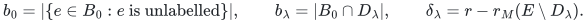

Every surviving item of <code class="math">B_0</code> remains accepted by greedy. Indeed, its surviving
earlier prefix is a subset of its original earlier prefix and therefore cannot
span an item that the original prefix did not span. Consequently

<!-- math-display: 67b72af141b875a15df86e8b
R_\lambda=B_{\{\lambda\}}\setminus B_0,
\qquad |R_\lambda|=b_\lambda-\delta_\lambda.
-->
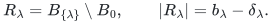

In particular, labels absent from <code class="math">B_0</code> have <code class="math">\delta_\lambda=0</code> and
<code class="math">R_\lambda=\varnothing</code>. Define

<!-- math-display: 8e2aa18707c0a6f4df6d92b2
T=\sum_\lambda |R_\lambda|
 =r-b_0-\sum_\lambda\delta_\lambda,
\qquad 0\le T\le r.
\tag{1}
-->
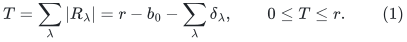

This is the [single-failure replacement total](two-failure-oracle-prefix-bounds.md), counting an
item once for each single failure in whose basis it appears. The theorem below
shows that it is also the rank of one fixed contraction sufficient for every
failure budget.

**Theorem 1 (fixed contraction).** One can construct an independent set
<code class="math">Q\subseteq B_0</code> of size <code class="math">r-T</code> such that, for the single fixed matroid
<code class="math">M'=M/Q</code> on <code class="math">E\setminus Q</code>, every failure set <code class="math">F</code> satisfies

<!-- math-display: 822b44e4f43f26109fe9f5be
B_F=(Q\cap E_F)\ \dot\cup\ B'_F,
\tag{2}
-->
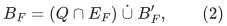

where <code class="math">B'_F</code> is the canonical basis of <code class="math">M'&#124;((E\setminus Q)_F)</code> in the inherited
order. In particular <code class="math">M'</code> has rank <code class="math">T</code>. For every original order prefix <code class="math">P</code>,

<!-- math-display: 739b052a086e200ecb054572
r_M(P\cap E_F)
 =|Q\cap P\cap E_F|
  +r_{M'}((P\setminus Q)\cap E_F).
\tag{3}
-->
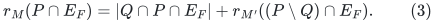

The construction uses at most <code class="math">(1+\ell_0)N+r</code> independence-oracle queries, where
<code class="math">\ell_0</code> is the number of labels meeting <code class="math">B_0</code>, so <code class="math">\ell_0\le r</code>. It is
deterministic. A query to the contracted independence oracle is one query to
the original oracle on the queried set together with <code class="math">Q</code>; ordinary query-set
representation and input bookkeeping are charged separately.

## 2. Constructing the contracted set

Put every unlabelled item of <code class="math">B_0</code> into <code class="math">Q_0</code>. For each label meeting <code class="math">B_0</code>,
compute a basis <code class="math">B_\lambda</code> of <code class="math">E\setminus D_\lambda</code> in the fixed order. Extend
this basis to a basis of <code class="math">E</code> by scanning the items of <code class="math">B_0\cap D_\lambda</code> in
the fixed order, adding an item when independence permits it. This succeeds:
<code class="math">B_\lambda</code> spans <code class="math">E\setminus D_\lambda</code>, and that set together with
<code class="math">B_0\cap D_\lambda</code> spans the original basis <code class="math">B_0</code> and hence all of <code class="math">E</code>.

Let <code class="math">Q_\lambda</code> be the added items. Then

<!-- math-display: d68cb329b539241d5cb5945b
Q_\lambda\subseteq B_0\cap D_\lambda,\qquad
 |Q_\lambda|=\delta_\lambda,
\qquad
r_M((E\setminus D_\lambda)\cup Q_\lambda)
 =r_M(E\setminus D_\lambda)+|Q_\lambda|.
\tag{4}
-->
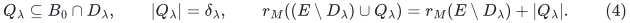

Thus <code class="math">Q_\lambda</code> is independent over the entire complementary ground. Define

<!-- math-display: 4102e3d862b9b0b3f1596aea
Q=Q_0\ \dot\cup\ \bigcup_\lambda Q_\lambda.
-->
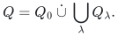

All these items belong to <code class="math">B_0</code>, so their union is independent. Equation (1)
gives <code class="math">&#124;Q&#124;=b_0+\sum_\lambda\delta_\lambda=r-T</code>.

Computing <code class="math">B_0</code> and the <code class="math">\ell_0</code> single-failure bases takes at most
<code class="math">(1+\ell_0)N</code> independence queries. The extension scans inspect at most
<code class="math">\sum_\lambda b_\lambda\le r</code> additional items. No other label needs a query.
The construction need not store all bases simultaneously: each <code class="math">B_\lambda</code>
can be discarded after its extension has been recorded. It stores the original
input, <code class="math">B_0</code>, <code class="math">Q</code>, the actual basis-label list and one temporary basis.

## 3. Why failed contracted blocks are jointly independent

First, if a set <code class="math">I</code> is independent over <code class="math">X</code>, meaning
<code class="math">r_M(X\cup I)=r_M(X)+&#124;I&#124;</code>, it is independent over every <code class="math">Y\subseteq X</code>.
To prove this, order the items of <code class="math">I</code>. Each has marginal rank one when added to
<code class="math">X</code> and its predecessors. By diminishing returns for matroid rank, its marginal
on the subset <code class="math">Y</code> and those same predecessors is at least one, hence exactly
one. Sum the increments.

Fix any failed label set <code class="math">F</code> and write

<!-- math-display: 5ca7a8f2d2c02c5dd3ab76d9
Q_s=Q\cap E_F,\qquad Q_f=Q\setminus E_F
       =\bigcup_{\lambda\in F}Q_\lambda.
-->
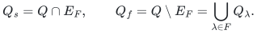

Add the blocks <code class="math">Q_\lambda</code> for <code class="math">\lambda\in F</code> one at a time to <code class="math">E_F</code>. When
adding <code class="math">Q_\lambda</code>, the ground already present consists of <code class="math">E_F</code> and blocks
<code class="math">Q_\mu</code> with <code class="math">\mu\ne\lambda</code>. Every such item lies outside <code class="math">D_\lambda</code> because
label classes are disjoint. The present ground is therefore a subset of
<code class="math">E\setminus D_\lambda</code>. Equation (4) and the preceding paragraph show that this
addition increases rank by exactly <code class="math">&#124;Q_\lambda&#124;</code>. Thus

<!-- math-display: 842e1743e447317f8fb78ea8
r_M(E_F\cup Q_f)=r_M(E_F)+|Q_f|.
\tag{5}
-->
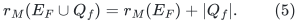

This argument proves joint independence; separate independence of each block
would not by itself be sufficient. It also proves the same equality starting
from any subset of <code class="math">E_F</code>, including a subset together with <code class="math">Q_s</code>.

## 4. Contracting failed blocks commutes with their deletion here

For any <code class="math">X\subseteq E_F\setminus Q</code>, equation (5) gives

<!-- math-display: 8ba92ca5379d7adcec236bb1
\begin{aligned}
r_{M/Q}(X)
 &=r_M(X\cup Q_s\cup Q_f)-|Q|\\
 &=r_M(X\cup Q_s)+|Q_f|-|Q_s|-|Q_f|\\
 &=r_{(M|E_F)/Q_s}(X).
\end{aligned}
\tag{6}
-->
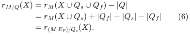

Hence the fixed contraction, restricted after failures, is exactly the same
matroid as restricting after failures and contracting only the surviving
members of <code class="math">Q</code>. No general commutation of arbitrary overlapping contractions
and deletions is being assumed. It is the complementary-ground independence
in (4), and disjointness of the label classes, that justify (6).

By greedy persistence, <code class="math">Q_s\subseteq B_F</code>. The canonical basis of a matroid
is its lexicographically first basis in the fixed order. Bases of a contraction
by an independent set <code class="math">Q_s</code> correspond exactly to bases of the original
matroid that contain <code class="math">Q_s</code>, with those common items removed. Since <code class="math">B_F</code>
already contains <code class="math">Q_s</code> and is first among all bases, <code class="math">B_F\setminus Q_s</code> is first
among bases of the contraction. Removing common items preserves their
lexicographic comparison. Together with (6), this proves (2).

A canonical greedy basis restricted to an order prefix is a basis of that
prefix. Applying this fact to (2), in both the original and the contracted
order, proves (3). This handles rank drops, unlabelled items, loops and repeated
label classes without additional assumptions.

## 5. Exact failure-summary transfer and preprocessing cost

Let <code class="math">H_h(M)</code> be the union of all canonical bases under at most <code class="math">h</code> failed
labels. The usual prefix argument shows that it is the unique smallest
original-item restriction preserving every surviving prefix rank: every item
in the union has a witnessing prefix rank increase and therefore must be
retained, while retaining all these bases suffices for every prefix. Taking
unions in (2) gives the exact identity

<!-- math-display: b3baddf7fdab70374b9e9d85
H_h(M)=Q\ \dot\cup\ H_h(M/Q),
\qquad
|H_h(M)|=r-T+|H_h(M/Q)|.
\tag{7}
-->
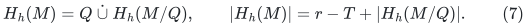

The unfailed query ensures that every item of <code class="math">Q</code> occurs in the union.
Labels that occur only in <code class="math">Q</code> have no effect on the contracted ground. They
may still change which fixed items are reinserted for a particular query;
the original labels on <code class="math">Q</code> are retained for this purpose.

Let <code class="math">N'=N-&#124;Q&#124;</code>, and let <code class="math">\ell'</code> be the number of labels actually occurring in
the remaining ground. Replace a binary-encoded budget <code class="math">h</code> by
<code class="math">h'=\min\{h,\ell'\}</code> for the minor construction. This is valid because failing
additional absent labels does not change the minor. The algorithm therefore
never loops a numeric <code class="math">h</code> times solely because that integer has a long or huge
binary value.

Apply the [ordered-basis tree](weighted-oracle-prefix-fpt-construction.md) to the rank-<code class="math">T</code> minor: compute its
canonical basis at each node, output those items, and branch only on labels
on that basis. There are at most <code class="math">T</code> children and depth at most <code class="math">h'</code>. Each node
requires at most <code class="math">N'</code> original independence queries through <code class="math">M/Q</code>. Thus, for
<code class="math">T&gt;0</code>, a transparent total bound is

<!-- math-display: f973e0d5f053ed3d37fa9307
(1+\ell_0)N+r+
N'\sum_{j=0}^{h'}T^j.
\tag{8}
-->
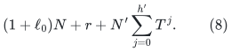

It is <code class="math">O(N(r+T^{h'}))</code> queries for <code class="math">T\ge2</code>, and <code class="math">O(N(r+h'))</code> for <code class="math">T=1</code>.
At <code class="math">T=0</code>, the minor consists only of loops and its tree is unnecessary:
<code class="math">H_h(M)=Q=B_0</code> for every <code class="math">h</code>. If the requested budget is zero, computing
<code class="math">B_0</code> directly already takes at most <code class="math">N</code> queries and no normalization is
needed.

The tree's correctness is independent of the size-bound proofs. For a target
failure set, either its remaining failures avoid the current canonical basis,
in which case that basis remains canonical, or one of those failures is a
branch label. Following such branches reaches a node whose basis equals the
target basis. The fixed contraction only changes the rank controlling this
branch count. A depth-first implementation stores the input, the fixed set
<code class="math">Q</code>, the output, and one rank-<code class="math">T</code> basis/branch list per active depth. Each
original oracle query can be represented explicitly using at most <code class="math">r+1</code> items;
this set-encoding work is not hidden in the count of oracle calls.

## 6. Rank-adaptive support bounds and sharp small-rank endpoints

Every existing ordered-prefix support bound at rank <code class="math">u</code> can now be applied at
<code class="math">u=T</code>, then add <code class="math">r-T</code>. For example, the proved Bernoulli prefix refinement gives,
for <code class="math">h\ge2</code> and one label per item (see the complete
[Bernoulli prefix refinement](weighted-oracle-prefix-fpt-construction.md)),

<!-- math-display: 005e5c7066c7a4a0d49b14dc
|H_h(M)|\le r+
\frac{h^h}{(h-1)^{h-1}}T.
\tag{9}
-->
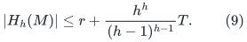

The random product measure is only used in that earlier size proof; the
construction here is deterministic. For one failure the sharp universal bound
becomes <code class="math">r+T</code>.

For two failures, the [proved small-rank/profile theorem](two-failure-oracle-prefix-bounds.md) gives

<!-- math-display: de3174a217d9167659e19f06
|H_2(M)|\le
\begin{cases}
r,&T=0,\\
r+2,&T=1,\\
r-T+\min\{5T,\binom{T+1}{2}+3\},&T\ge2.
\end{cases}
\tag{10}
-->
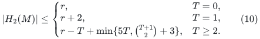

In particular <code class="math">T\le3</code> gives <code class="math">&#124;H_2(M)&#124;\le r+2T</code>, and <code class="math">T=4</code> gives <code class="math">r+9</code>.
These conclusions are insensitive to the original rank contributed by
unlabelled or privately labelled directions.

There is a stronger all-budget endpoint at <code class="math">T=1</code>:

<!-- math-display: f03e8a418fea0110348af391
|H_h(M)|\le r+h.
\tag{11}
-->
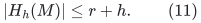

A rank-one minor has at most one basis item at a node and hence at most one
child. Its tree has at most <code class="math">h'+1</code> nodes, so its union has at most <code class="math">h'+1</code> items.
Use (7). The bound is sharp: take <code class="math">r-1</code> unlabelled coloops and a rank-one
parallel class of <code class="math">h+1</code> ordered items with distinct labels, for <code class="math">h\ge1</code>.
The only one-failure replacement is the second parallel item replacing the
first, so <code class="math">T=1</code>. Each of the first <code class="math">h+1</code> parallel items is the first survivor
when its predecessors' labels fail, so all <code class="math">r+h</code> original items are necessary.
No representation is used by the algorithm or by the proof of the upper bound.

When the fixed order is nondecreasing cost followed by a permanent item ID,
these summaries preserve the canonical minimum-cost basis under every allowed
failure, including rank drops. This does not assert that the same <code class="math">Q</code> is valid
for all possible cost orders, or that a prefix-minimal summary is minimal among
sets asked to preserve only the numerical optimum cost.

## 7. Exact independent finite checks

The [checker](../verify/check_rank_loss_contraction.py) constructs <code class="math">Q</code> using only
independence queries. Its reference uses ranks of the **original full prefixes**
to identify canonical membership; it does not reconstruct the expected answer
by the algorithm's contraction. For each failure it verifies joint independence
of failed blocks, the rank identity (6) on every surviving subset for the small
suite, equation (3) on every prefix, equation (2), and the complete union (7)
for every failure budget. It also checks the stated query caps, <code class="math">T=0,1</code>, rank
drops, all-zero/loop instances, and the binary-large budget <code class="math">10^{100}</code>.

The completed small suite includes all 92 matroids on at most four labelled
items, all one-label partitions up to label renaming with an optional unlabelled
class, and every item order: 86,359 instances, 375,093 failure queries,
1,495,618 prefix comparisons and 1,450,577 arbitrary-subset contraction-rank
comparisons. It checks 250,091 budget instances and 86,359 huge-budget cases.

The larger suite has 230 ordered/labelled instances from 220 matroids. These
include binary represented matroids, the nonrepresentable 13-item obstruction
augmented by privately labelled parallel components and unlabelled coloops,
and exact <code class="math">T=1</code> lower-bound families. It checks 4,680 failures, 42,512 prefixes,
196,560 additional contraction-rank comparisons and 1,051 budget instances.
The larger arbitrary-subset checks use fixed-seed samples in addition to the
empty and full surviving ground; only the small suite is exhaustive over
all such subsets. The default command uses all matroids through three items
plus the complete larger suite; `--full` also runs every four-item instance.
The checker writes no repository files and rejects Python `-O`. These finite
checks supplement the proof rather than replace it. Reproduction commands
and the scope of the other suites appear in the
[verification note](../verify/README.md).

**Attribution:** Yilin Liu and GPT-6 Astra Pro.
