# Two-failure weighted prefix bounds for arbitrary matroids

## 1. Scope and results

Let <code class="math">M</code> be an arbitrary matroid of rank <code class="math">r</code> on a finite explicitly listed
ground <code class="math">E</code>, with one fixed total item order. Each item has at most one
label; unlabelled items are allowed. A failed label deletes its entire
class. Let <code class="math">H_j</code> be the union of the canonical greedy bases after at
most <code class="math">j</code> label failures, including the unfailed query.

The order may be nondecreasing signed rational cost followed by a
permanent item ID. Every statement concerns that one fixed order.
The [general prefix theorem](weighted-oracle-prefix-fpt-construction.md)
shows that <code class="math">H_j</code> is the unique smallest original-item set preserving
every surviving prefix rank for those queries. It therefore preserves
the canonical minimum-cost surviving bases, including rank drops.

This note proves the following bounds for **two failures and at most
one label per item**:

<!-- math-display: 4f95a2c730b480de3cc4a4b1
|H_2|\le\min\left\{5r,\binom{r+1}{2}+3\right\}
\qquad(r\ge2).
\tag{TF1}
-->
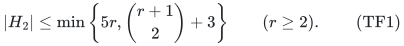

The bounds at ranks zero and one are zero and three, respectively.
An instance-dependent bound from the one-failure replacement profile is
stronger and is stated below. It gives the sharp <code class="math">3r</code> bound whenever
no replacement item appears in more than two single-failure bases.
The same conclusion holds whenever all single failures add only one
shared replacement item, even if its multiplicity is large (Section 5).
In particular,

<!-- math-display: 4b1c220391bfc130dd4496f9
\boxed{|H_2|\le3r\quad\text{for every matroid of rank }r\le3.}
\tag{TF2}
-->
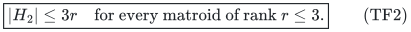

At rank four the universal bound is 13, and the explicit obstruction
attains it. Thus the largest possible size of the minimum prefix
preserver is **exactly 13 at rank four**. The same <code class="math">3r</code> bound holds at
every rank when at most three labels occur.
Together these facts prove that the
[rank-four, four-label, 13-item obstruction](weighted-oracle-two-failure-obstruction.md)
has the smallest possible rank, label count and original ground size for
violating the represented <code class="math">3r</code> bound at these fixed failure parameters.
This is a mathematical minimality statement within this model, not a
publication-priority claim or a statement for other failure budgets.

The ordered-basis tree constructs <code class="math">H_2</code> with at most
<code class="math">N(1+r+r^2)</code> independence queries, where <code class="math">N=&#124;E&#124;</code>, by rescanning
the fixed ordered input at each tree node. This is
<code class="math">O(N(r+1)^2)</code> queries after sorting. The retained-prefix witness
alternative scans that input once and uses at most
<code class="math">N(K+1)(1+r+r^2)</code> queries, where <code class="math">K</code> is any valid bound on
<code class="math">&#124;H_2&#124;</code>, clipped at <code class="math">N</code>. At any fixed rank both bounds are linear
in <code class="math">N</code>. No representation or field arithmetic is needed.

## 2. The single-failure replacement profile

Let <code class="math">B_0</code> be the ordinary canonical basis. For each occurring label
<code class="math">\lambda</code>, let <code class="math">D_\lambda</code> be its class and <code class="math">B_\lambda</code> the
canonical basis of <code class="math">E\setminus D_\lambda</code>. Define

<!-- math-display: 5cc38c7a73ff377f1f07f324
R_\lambda=B_\lambda\setminus B_0,
\qquad
G=H_1\setminus B_0,
\qquad
t_e=|\{\lambda:e\in R_\lambda\}|\quad(e\in G),
-->
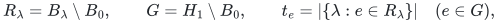

<!-- math-display: df844c9c711d0cde479d93df
T=\sum_{e\in G}t_e=\sum_\lambda|R_\lambda|.
\tag{TF3}
-->
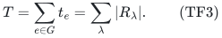

Thus <code class="math">t_e</code> counts the single-failure bases in which the same replacement
item appears; <code class="math">T</code> counts these appearances with multiplicity. Every
<code class="math">t_e</code> is positive. A label absent from <code class="math">B_0</code> leaves that basis unchanged,
so only at most <code class="math">r</code> labels need to be queried. The entire profile can
be computed with at most <code class="math">(1+r)N</code> independence queries.

Let <code class="math">b_0</code> be the number of unlabelled items in <code class="math">B_0</code>, and let

<!-- math-display: 0eb49f05b4d81b870721007c
\delta_\lambda=r-r_M(E\setminus D_\lambda)
\tag{TF4}
-->
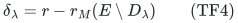

be the rank lost under the single failure. Greedy-accepted items persist
under deletions that keep them. Consequently <code class="math">B_\lambda</code> contains
<code class="math">B_0\setminus D_\lambda</code>, and

<!-- math-display: fc37328136d60741ff6dbcb5
|R_\lambda|=|B_0\cap D_\lambda|-\delta_\lambda.
-->
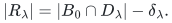

The label classes are disjoint, so

<!-- math-display: a3e5496ff068c18fc34f9e03
T=r-b_0-\sum_\lambda\delta_\lambda\le r.
\tag{TF5}
-->
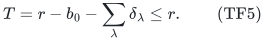

This identity allows loops, unlabelled items and rank drops. It does not
assume that every surviving ground has full rank.

## 3. Profile bound with rank losses included

**Theorem 1 (replacement-profile bound).** With the notation above,

<!-- math-display: 9dd9fb1cb57a1d83a9c0d102
\boxed{
|H_2|\le r+2T+
\sum_{e\in G}\binom{t_e-1}{2}.}
\tag{TF6}
-->
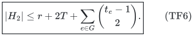

Here <code class="math">\binom{0}{2}=\binom{1}{2}=0</code>. There is also the bound

<!-- math-display: cafc6eaeadc60ee6cf5063e0
|H_2|\le r+4T.
\tag{TF7}
-->
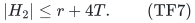

**Proof.** For every failed label set <code class="math">F</code>, including sets larger than
two, rank submodularity gives

<!-- math-display: c055c8a19dc1a5bd570f5d00
r_M(E_F)\le r-\sum_{\lambda\in F}\delta_\lambda.
\tag{TF8}
-->
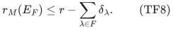

Indeed, when <code class="math">\lambda\notin F</code>, the sets
<code class="math">E\setminus D_\lambda</code> and <code class="math">E_F</code> have union <code class="math">E</code> and intersection
<code class="math">E_{F\cup\{\lambda\}}</code>. Submodularity says that deleting
<code class="math">\lambda</code> after <code class="math">F</code> loses at least <code class="math">\delta_\lambda</code> rank.
Add these inequalities one failed label at a time. This step uses
disjoint label classes; overlapping lists of two or more labels do not
satisfy the same argument.

Independently fail each label with probability <code class="math">p\in(0,1)</code> and put
<code class="math">q=1-p</code>. By TF8, the expected surviving rank is at most
<code class="math">r-p\sum_\lambda\delta_\lambda</code>. The items of <code class="math">B_0</code> contribute
exactly <code class="math">b_0+(r-b_0)q</code> to expected greedy rank.

An item <code class="math">e\in G</code> is accepted whenever any one of its <code class="math">t_e</code> witness
labels fails and its own label, if present, survives. These are disjoint
label sets. Its acceptance probability is therefore at least
<code class="math">q(1-q^{t_e})</code>. For an unlabelled item, omitting the factor <code class="math">q</code> would
give an even stronger probability, so the common lower bound is valid.

Put <code class="math">n_2=&#124;H_2\setminus H_1&#124;</code>. Each of these remaining items has a
two-failure prefix witness and contributes at least <code class="math">qp^2</code> to expected
rank. Deleting additional earlier items cannot invalidate acceptance of
a surviving protected item. Combining the disjoint item contributions
with TF5 gives

<!-- math-display: c6d668463285082d1b065da8
n_2qp^2
\le pT-q\sum_{e\in G}(1-q^{t_e}).
\tag{TF9}
-->
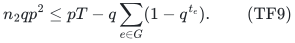

For every fixed positive integer <code class="math">t</code>,

<!-- math-display: 1a8acb59f8a008f7d1e2711a
q(1-q^t)
 =tp-\left(t+\binom{t}{2}\right)p^2+O(p^3)
\quad\text{as }p\downarrow0.
-->
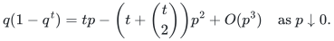

Since <code class="math">\sum_e t_e=T</code>, divide TF9 by <code class="math">qp^2</code> and let
<code class="math">p\downarrow0</code> to obtain

<!-- math-display: 61b5391a9b72eadb024fa3bd
n_2\le T+\sum_{e\in G}\binom{t_e}{2}.
-->
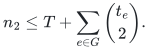

Add <code class="math">&#124;H_1&#124;=r+&#124;G&#124;</code> and rearrange each summand to get TF6.

For TF7, ignore the extra one-failure information and give every item
of <code class="math">H_2\setminus B_0</code> its general lower probability <code class="math">qp^2</code>.
Subtracting the <code class="math">B_0</code> contribution from the upper expected rank leaves
exactly <code class="math">pT</code>, by TF5. Thus
<code class="math">&#124;H_2&#124;-r\le T/(pq)</code>; take <code class="math">p=q=1/2</code>. No random choices are used
by the summary algorithm. The product measure only proves its size.
<code class="math">\square</code>

If every <code class="math">t_e\le2</code>, the sum in TF6 vanishes, giving
<code class="math">&#124;H_2&#124;\le r+2T\le3r</code>. This applies to arbitrary matroids satisfying
that explicit profile condition, regardless of representability.

For a parameter-only bound, note that
<code class="math">g(t)=\binom{t-1}{2}</code> satisfies
<code class="math">g(a+b)-g(a)-g(b)=ab-1\ge0</code> for positive integers <code class="math">a,b</code>.
If <code class="math">T&gt;0</code>, then <code class="math">\sum_e g(t_e)\le g(T)</code>. Since <code class="math">T\le r</code>,
TF6 gives

<!-- math-display: fa533aa12345f4443540725f
|H_2|\le r+2r+\binom{r-1}{2}=\binom{r+2}{2}
\quad(r\ge1).
-->
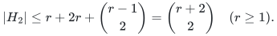

If <code class="math">T=0</code>, TF6 gives <code class="math">&#124;H_2&#124;=r</code> directly; rank zero is also immediate.
This proves the preliminary bound
<code class="math">&#124;H_2&#124;\le\min\{5r,\binom{r+2}{2}\}</code>, including <code class="math">&#124;H_2&#124;\le3</code>
at rank one. The next section improves the quadratic term.

## 4. A circuit argument improves the universal bound

### 4.1. Which missing pairs can a new item replace?

**Lemma 2 (circuit extension).** Let <code class="math">C</code> be a circuit of size
<code class="math">m\ge3</code>, and let <code class="math">y\notin C</code> be a nonloop in its span. Form a
graph on <code class="math">C</code> whose edges are the pairs <code class="math">\{a,b\}</code> for which

<!-- math-display: 41cc5ab8eab5cc4dac31a4ab
y\notin\mathrm{cl}_M(C\setminus\{a,b\}).
-->
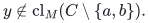

This graph is complete multipartite with at least two nonempty parts.
Every induced subgraph on <code class="math">s</code> vertices therefore has either no edges
or at least <code class="math">s-1</code> edges.

**Proof.** Define <code class="math">a\sim b</code> if <code class="math">a=b</code> or if
<code class="math">y\in\mathrm{cl}_M(C\setminus\{a,b\})</code>. Symmetry and
reflexivity are immediate. For distinct <code class="math">a,b,c</code>, the flats

<!-- math-display: e563a5cf7a7362d1478c9b07
L_{ab}=\mathrm{cl}_M(C\setminus\{a,b\}),
\qquad
L_{bc}=\mathrm{cl}_M(C\setminus\{b,c\})
-->
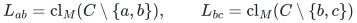

each have rank <code class="math">m-2</code>. Their union has rank <code class="math">m-1</code>: it contains the
basis <code class="math">C\setminus\{b\}</code> and lies in <code class="math">\mathrm{cl}_M(C)</code>.
Rank submodularity bounds their intersection rank by <code class="math">m-3</code>. Their
intersection already contains the rank-<code class="math">m-3</code> flat
<code class="math">\mathrm{cl}_M(C\setminus\{a,b,c\})</code>. Since a proper
inclusion between flats increases rank, the two flats are equal:

<!-- math-display: 9f01f51b6d1bd9f9c8b26f57
L_{ab}\cap L_{bc}
=\mathrm{cl}_M(C\setminus\{a,b,c\}).
-->
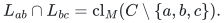

Thus <code class="math">a\sim b</code> and <code class="math">b\sim c</code> imply <code class="math">a\sim c</code>, proving
transitivity.

There cannot be just one equivalence class. Fix <code class="math">c\in C</code> and put
<code class="math">B=C\setminus\{c\}</code>. For subsets <code class="math">A,A'</code> of the independent
set <code class="math">B</code>, rank submodularity similarly gives

<!-- math-display: 9f5cd560fbbd0a41741fb192
\mathrm{cl}_M(A)\cap\mathrm{cl}_M(A')
=\mathrm{cl}_M(A\cap A').
-->
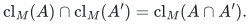

If all pairs were equivalent, <code class="math">y</code> would belong to every
<code class="math">\mathrm{cl}_M(B\setminus\{a\})</code> for <code class="math">a\in B</code>.
Repeatedly applying this equality puts <code class="math">y</code> in
<code class="math">\mathrm{cl}_M(\varnothing)</code>, contradicting that it is a
nonloop. Edges are exactly the pairs in different equivalence classes,
so the graph has the asserted form. If an induced subgraph is nonempty,
choose one of its parts of size <code class="math">a</code>, where <code class="math">1\le a&lt;s</code>. Its edges
to the other vertices alone number
<code class="math">a(s-a)\ge s-1</code>. <code class="math">\square</code>

### 4.2. All but one replacement profile

We prove <code class="math">&#124;H_2&#124;\le\binom{r+1}{2}+3</code> for <code class="math">r\ge2</code>.
If <code class="math">1\le T\le r-1</code>, the preliminary convexity calculation gives

<!-- math-display: 6211010819ff1a022030bde0
|H_2|\le r+2(r-1)+\binom{r-2}{2}
=\binom{r+1}{2}+1,
-->
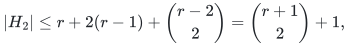

and <code class="math">T=0</code> gives the stronger bound <code class="math">r</code> directly. If <code class="math">T=r</code> and
<code class="math">&#124;G&#124;\ge2</code>, the sum of <code class="math">g(t_e)=\binom{t_e-1}{2}</code> is maximized
by multiplicities <code class="math">r-1,1</code>. To see this, the increments
<code class="math">g(t+1)-g(t)=t-1</code> are nondecreasing: moving a unit from a smaller
part of size at least two to a largest part cannot reduce the sum.
Keep at least two positive parts. TF6 then gives

<!-- math-display: 20b2f5bd6568902beef245e7
|H_2|\le3r+\binom{r-2}{2}=\binom{r+1}{2}+3.
-->
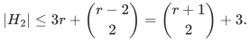

Only the following profile remains:

<!-- math-display: 4d8d362a415be730cce2869e
T=r,\qquad G=\{x\},\qquad t_x=r.
\tag{TF10}
-->
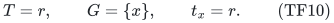

### 4.3. The exceptional profile starts with a circuit

For any prefix <code class="math">P</code> of the fixed order, write <code class="math">H_j(P)</code> for the canonical
union computed in the restriction to <code class="math">P</code>. Greedy decisions never change
after a prefix has been scanned, so

<!-- math-display: 3bf8517b40842e664f3a5f79
H_j(P)=H_j(E)\cap P\quad(j=1,2).
\tag{TF11}
-->
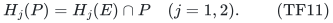

If <code class="math">H_1(P)</code> is just its unfailed basis, its profile has <code class="math">T(P)=0</code>.
TF6 then says that <code class="math">H_2(P)</code> is that same basis. In particular, no
two-failure-only item precedes <code class="math">x</code> in the exceptional case.

Each label whose failure makes <code class="math">x</code> enter greedy must hit an earlier
item of <code class="math">B_0</code>; otherwise the earlier unfailed basis survives and
continues to span <code class="math">x</code>. Since <code class="math">t_x=r</code>, all <code class="math">r</code> items of <code class="math">B_0</code>
precede <code class="math">x</code> and have distinct labels. TF5 also gives <code class="math">b_0=0</code> and
<code class="math">\delta_\lambda=0</code> for every label.

We may restrict to <code class="math">H_2</code>: it contains every required canonical basis,
and deleting only rejected items preserves all required prefix ranks
and greedy decisions. Indeed, induction through the order leaves the
accepted set unchanged whenever a rejected item is removed. The first
<code class="math">r+1</code> remaining items are therefore <code class="math">Q=B_0\cup\{x\}</code>. For each
<code class="math">a\in B_0</code>, failing its label gives the basis
<code class="math">(B_0\setminus\{a\})\cup\{x\}</code>. Together with <code class="math">B_0</code>, these
are all <code class="math">r</code>-subsets of <code class="math">Q</code>. Thus <code class="math">Q</code> is a circuit of size
<code class="math">r+1</code> and rank <code class="math">r</code>.

The item <code class="math">x</code> is either unlabelled or has a new label: it survives each
of the <code class="math">r</code> witness labels. If it is unlabelled, only the
<code class="math">\binom r2</code> failed pairs among the labels of <code class="math">B_0</code> can remove two
items of <code class="math">Q</code>. Every other query leaves <code class="math">r</code> independent items of
<code class="math">Q</code> and accepts no later item. Each relevant pair leaves rank <code class="math">r-1</code>
inside <code class="math">Q</code> and accepts at most one later item. Hence

<!-- math-display: bc28509c0165928233c50bea
|H_2|\le r+1+\binom r2=\binom{r+1}{2}+1.
-->
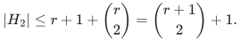

Assume that all <code class="math">r+1</code> items of <code class="math">Q</code> have distinct labels. Only the
<code class="math">\binom{r+1}{2}</code> failed pairs of these labels can accept a later
item. Each query accepts at most one: the first surviving item outside
the closure of its surviving <code class="math">r-1</code> items of <code class="math">Q</code>. Call it the
query's winner. If there is no later winner, the required bound already
holds.

Otherwise let <code class="math">y</code> be the first item of <code class="math">H_2</code> after <code class="math">Q</code>. It is a
nonloop and lies in the span of <code class="math">Q</code>, since that circuit already has
the full rank <code class="math">r</code>. Lemma 2 says that the failed pairs for which it
would increase rank form a complete multipartite graph on <code class="math">Q</code>.

If <code class="math">y</code> has the label of some <code class="math">c\in Q</code>, it survives exactly the
failed pairs that avoid <code class="math">c</code>. Its winning pairs are therefore the
edges in the induced graph on <code class="math">Q\setminus\{c\}</code>. This graph has
an edge because <code class="math">y</code> wins a query, so it has at least <code class="math">r-1</code> edges.
If <code class="math">y</code> has an outside label or is unlabelled, it survives all these
pairs and wins at least <code class="math">r</code> queries, which is stronger. There are no
earlier later winners to compete with <code class="math">y</code> in either case.

Thus one item accounts for at least <code class="math">r-1</code> of the relevant queries.
All other queries together supply at most
<code class="math">\binom{r+1}{2}-(r-1)</code> distinct later winners. Consequently

<!-- math-display: abec9488e2bb068d6b2108db
|H_2|\le(r+1)+1+\binom{r+1}{2}-(r-1)
=\binom{r+1}{2}+3.
-->
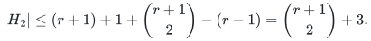

Combining this with TF7 proves TF1. In particular the universal bounds
at ranks two, three and four are 6, 9 and 13. The rank-one bound proved
above completes TF2. Rank-<code class="math">r</code> partition matroids with three ordered
copies per parallel class, labelled by the same three distinct labels
in every class, attain <code class="math">3r</code> under two failures. The explicit rank-four
obstruction attains 13. These upper bounds use only matroid ranks.

## 5. One shared single-failure replacement has a sharp linear bound

**Theorem 3 (one replacement item).** Suppose <code class="math">H_1\setminus B_0=\{x\}</code>.
Let <code class="math">W</code> be the set of labels whose single-failure canonical basis
contains <code class="math">x</code>, and put <code class="math">t=&#124;W&#124;=T\ge1</code>. Then

<!-- math-display: 1d974dc743d810f560f38bd9
\boxed{|H_2|\le r+2t\le3r.}
\tag{TF12}
-->
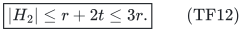

The bound <code class="math">r+2t</code> is attained by explicitly represented matroids for
every <code class="math">1\le t\le r</code>. If <code class="math">x</code> is unlabelled, there is the stronger bound

<!-- math-display: a3bba17fe0d123b2d19a0d9e
|H_2|\le r+1+\max\{0,2t-3\}.
-->
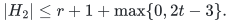

No assumption is made about the number of items of <code class="math">B_0</code> sharing a
label or about rank losses after a failure. If <code class="math">H_1=B_0</code> instead,
TF6 gives <code class="math">H_2=B_0</code> directly.

### 5.1. Only a small set of failed pairs can add items

Write <code class="math">b_\lambda=&#124;B_0\cap D_\lambda&#124;</code>. The single-failure basis is
<code class="math">B_0\setminus D_\lambda</code>, together with <code class="math">x</code> exactly when
<code class="math">\lambda\in W</code>. Therefore

<!-- math-display: 5b2528bd1835e9d5ee1e29f6
\delta_\lambda=b_\lambda-\mathbf1[\lambda\in W].
-->
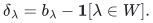

For every <code class="math">&#124;F&#124;\le2</code>, TF8 gives

<!-- math-display: ba81f9dc63f154f1e4bc412b
r_M(E_F)\le |(B_0)_F|+|F\cap W|.
-->
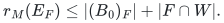

Every surviving original-basis item is still accepted. If <code class="math">x</code> survives
and <code class="math">F\cap W\ne\varnothing</code>, deletion stability also keeps <code class="math">x</code>
accepted. Thus an item of <code class="math">H_2\setminus H_1</code> can appear only after
one of the following pairs: two labels of <code class="math">W</code>, or a label of <code class="math">W</code>
together with the own label <code class="math">X</code> of <code class="math">x</code>, when <code class="math">x</code> is labelled.
The latter label is outside <code class="math">W</code>. Each such pair accepts at most one
item outside <code class="math">H_1</code>.

We may move all original-basis items before the other items without
changing any required canonical basis. For a fixed failure, its old
accepted set already contains the promoted surviving basis items.
Induction through the remaining order keeps that same independent
accepted set: an old rejected item is still spanned by its old earlier
accepted items, possibly with more promoted items. The prefix argument
in Section 4.3 shows that no item of <code class="math">H_2\setminus H_1</code> precedes <code class="math">x</code>.
After promotion, the critical items are therefore <code class="math">B_0</code>, then <code class="math">x</code>,
then the remaining items in their original relative order.

### 5.2. A circuit quotient preserves each relevant replacement test

Let <code class="math">C</code> be the fundamental circuit of <code class="math">x</code> with respect to <code class="math">B_0</code>:
the unique circuit in <code class="math">B_0\cup\{x\}</code>. For every <code class="math">\lambda\in W</code>,
choose <code class="math">u_\lambda\in C\cap D_\lambda</code>. Such an item exists because
otherwise <code class="math">B_0\setminus D_\lambda</code> would span <code class="math">x</code>. Set

<!-- math-display: 4e4424ba7ecf58f356506a1b
A=B_0\setminus\{u_\lambda:\lambda\in W\},
\qquad
Q=\{u_\lambda:\lambda\in W\}\cup\{x\}.
-->
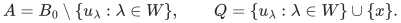

Contract the independent set <code class="math">A</code> for this proof. The contraction has
rank <code class="math">t</code>, and <code class="math">Q</code> is a <code class="math">(t+1)</code>-item circuit: deleting <code class="math">x</code> from
<code class="math">Q</code> lifts to <code class="math">B_0</code>, while deleting <code class="math">u_\lambda</code> lifts to the
basis <code class="math">B_0-u_\lambda+x</code>.

Some contracted items may have failed labels. The following explicit
intersection argument is needed; treating them as surviving would be
incorrect. For a relevant failed pair <code class="math">F</code>, let <code class="math">S_F=(H_1)_F</code>. For
every surviving <code class="math">e\notin H_1</code>,

<!-- math-display: 5e929381f13e20834ce331c3
e\notin\mathrm{cl}_M(S_F)
\quad\Longleftrightarrow\quad
e\notin\mathrm{cl}_{M/A}(Q_F).
\tag{TF13}
-->
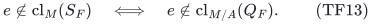

First take <code class="math">F=\{\lambda,\mu\}\subseteq W</code>, and write

<!-- math-display: fac92233fc1adc90a55785fe
Z=(B_0\setminus\{u_\lambda,u_\mu\})\cup\{x\},
\qquad
L_\lambda=\mathrm{cl}_M((B_0\setminus D_\lambda)\cup\{x\}),
-->
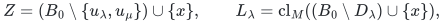

with <code class="math">L_\mu</code> defined similarly. The item <code class="math">e</code> belongs to both
single-failure basis flats <code class="math">L_\lambda,L_\mu</code>.
The ranks of <code class="math">\mathrm{cl}_M(Z)</code> and <code class="math">L_\lambda</code> are
<code class="math">r-1</code> and <code class="math">r-b_\lambda+1</code>. Their union has rank <code class="math">r</code> because
it contains <code class="math">B_0-u_\lambda+x</code>. Their intersection therefore has
rank at most <code class="math">r-b_\lambda</code> and contains the independent set
<code class="math">(B_0\setminus(D_\lambda\cup\{u_\mu\}))\cup\{x\}</code> of that
rank. Hence it is exactly that set's closure. Intersecting with
<code class="math">L_\mu</code> similarly has rank at most <code class="math">r-b_\lambda-b_\mu+1</code>:
the union in the submodularity inequality contains
<code class="math">B_0-u_\mu+x</code>, of rank <code class="math">r</code>. The intersection contains <code class="math">S_F</code>
of that exact rank, so

<!-- math-display: da530f9f0ab29ecb799c6eae
\mathrm{cl}_M(Z)\cap L_\lambda\cap L_\mu
=\mathrm{cl}_M(S_F).
-->
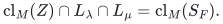

Since <code class="math">Z=A\cup Q_F</code>, this proves TF13 for such pairs.

For <code class="math">F=\{\lambda,X\}</code>, use
<code class="math">Z=B_0\setminus\{u_\lambda\}</code> and
<code class="math">L_X=\mathrm{cl}_M(B_0\setminus D_X)</code>.
The same calculation gives
<code class="math">\mathrm{cl}_M(Z)\cap L_\lambda =\mathrm{cl}_M(B_0\setminus D_\lambda)</code>.
Intersecting with <code class="math">L_X</code> gives
<code class="math">\mathrm{cl}_M(B_0\setminus(D_\lambda\cup D_X))</code>,
because these are closures of subsets of the independent set <code class="math">B_0</code>.
This is <code class="math">\mathrm{cl}_M(S_F)</code> and proves TF13 in the remaining
case. These calculations explicitly allow <code class="math">b_\lambda&gt;1</code> and
<code class="math">D_X\cap B_0\ne\varnothing</code>.

### 5.3. A decreasing potential bounds all later winners

When <code class="math">x</code> has label <code class="math">X</code>, relevant failed pairs are the edges of a
complete graph on <code class="math">W\cup\{X\}</code>, with <code class="math">n=t+1</code> vertices. If <code class="math">x</code>
is unlabelled, use the complete graph on <code class="math">W</code>, with <code class="math">n=t</code> vertices.
Initially every such query is unresolved. Each later critical item
wins at least one unresolved query and resolves every surviving query
for which it increases rank.

By TF13 and Lemma 2 in the circuit quotient, its rank-increasing pairs
form a complete multipartite graph, restricted to the relevant labels.
The two-item circuit case has the same property directly. If its own
label is one of those vertices, pairs incident with that vertex delete
the item and cannot be won. Thus a winner removes all edges between
different parts of a partition of the current graph, except that edges
incident with one protected vertex may be spared.

The unresolved graph always decomposes into clique blocks joined only
through separating vertices. Initially there is just one clique.
An operation splits a block into disjoint cliques if its protected
vertex is absent, or into cliques sharing just that vertex if it is
present. These operations preserve the forest of blocks. Ignore isolated
vertices, and use the potential

<!-- math-display: eb7c1fc6c19135c3ae2a721a
\Phi(G)=\sum_{\text{nontrivial blocks }D}(2|D|-3).
-->
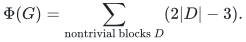

A protected split into <code class="math">k\ge2</code> nontrivial cliques sharing the protected
vertex lowers the potential by <code class="math">k-1</code>. For an unprotected split with
<code class="math">a</code> singleton parts and <code class="math">b</code> parts of size at least two, the decrease
is <code class="math">2a+3b-3</code>. It is at least one whenever an edge is removed. An
operation may split several blocks, so every actual winner decreases
<code class="math">\Phi</code> by at least one.

The initial potential is <code class="math">2n-3</code> for <code class="math">n\ge2</code> and zero for
<code class="math">n\le1</code>. Hence there are at most <code class="math">\max\{0,2n-3\}</code> later critical
items. Adding the <code class="math">r+1</code> items of <code class="math">H_1</code> proves TF12 and the
unlabelled refinement. This graph is a proof device; the summary
algorithm need not construct it or perform any contraction.

### 5.4. Sharp represented examples and faster construction

For <code class="math">t\ge2</code>, take the ordered vectors
<code class="math">e_1,\ldots,e_t</code> of a standard basis over <code class="math">\mathbb F_2</code>, labelled
<code class="math">1,\ldots,t</code>, followed by
<code class="math">x=e_1+\cdots+e_t</code> with a new label <code class="math">X</code>. Append:

1. one copy of <code class="math">e_i</code> labelled <code class="math">X</code> for each <code class="math">1\le i&lt;t</code>;
2. one copy of <code class="math">e_i</code> for each <code class="math">1\le i\le t</code>, labelled <code class="math">i+1</code>
   cyclically modulo <code class="math">t</code>.

The single-failure union adds only <code class="math">x</code>, with multiplicity <code class="math">t</code>.
The first appended copy of <code class="math">e_i</code> is forced by failures <code class="math">\{i,t\}</code>:
earlier appended copies are parallel to surviving initial basis items.
The second appended copy of <code class="math">e_i</code> is forced by <code class="math">\{X,i\}</code>, which
removes every copy in the first appended group. Thus all <code class="math">3t</code> items
are necessary. Adding <code class="math">r-t</code> unlabelled coloops gives exactly <code class="math">r+2t</code>
forced items. For <code class="math">t=1</code>, use three parallel items with distinct labels
and add <code class="math">r-1</code> unlabelled coloops. Powers-of-two costs in the displayed
order also force every item for fixed optimum-value preservation.

The profile gives an algorithmic improvement. Compute <code class="math">B_0</code> and its
single-failure bases for the <code class="math">\ell_0\le r</code> labels touching <code class="math">B_0</code>.
Other labels leave <code class="math">B_0</code> unchanged. If the extra-item union is empty,
return <code class="math">B_0</code>. If it consists of <code class="math">x</code>, compute just the relevant
pair-failure bases described in Section 5.1 and add them to <code class="math">H_1</code>.
All other queries have no item outside <code class="math">H_1</code>, so this returns exactly
<code class="math">H_2</code>. The independence-query bound is

<!-- math-display: 951acc6774949fdbded4f7c9
N\left(1+\ell_0+\binom{t+1}{2}\right),
\tag{TF14}
-->
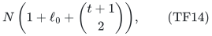

or <code class="math">N(1+\ell_0+\binom t2)</code> when <code class="math">x</code> is unlabelled. Thus the
observable singleton profile permits <code class="math">O(N(r+t^2))</code> oracle work after
sorting, while retaining the original oracle and all canonical prefix
ranks. No field representation is required by this algorithm.

## 6. Three occurring labels also suffice at every rank

Let <code class="math">E_0</code> be the unlabelled core and <code class="math">D_1,\ldots,D_L</code> the
nonempty classes, where <code class="math">L\le3</code>.

If <code class="math">L\le2</code>, every critical labelled item belongs to the canonical
basis of <code class="math">E_0</code> together with its own label class: delete all other
classes after a witness and use greedy stability. Every critical
unlabelled item belongs to the basis of <code class="math">E_0</code>, obtained by deleting
all <code class="math">L</code> classes. These are at most <code class="math">L+1\le3</code> bases, so their union
contains <code class="math">H_2</code> and has size at most <code class="math">3r</code>.

If <code class="math">L=3</code>, use just the three canonical bases of <code class="math">E_0\cup D_i</code>.
A critical labelled item belongs to the basis for its own label. A
critical unlabelled item has a witness leaving at least one class
<code class="math">D_i</code>; extend that witness by deleting the other two classes. The
item survives, is still accepted, and lies in the <code class="math">i</code>-th basis.
Again <code class="math">&#124;H_2&#124;\le3r</code>.

## 7. Minimality and the exact rank-four maximum

The explicit obstruction has rank four, four occurring labels and 13
original items. Section 4 excludes a violation at any smaller rank,
and Section 6 excludes a violation with fewer labels. Any violation
must force at least <code class="math">3r+1\ge13</code> items, so the example also has the
smallest possible original ground size.

Theorem 3 also shows that any violation needs at least two distinct
replacement items in the one-failure union. The example has exactly two,
so it attains this minimum as well.

The example's powers-of-two costs make the relevant optimum bases
unique. Its 13 items are therefore necessary even if a restriction need
only preserve the fixed optimum-cost values. The upper results in this
note preserve all prefixes and hence imply the weaker optimum-value
guarantees. The minimality statement covers both requirements at
<code class="math">h=2,d=1</code>; it does not address arbitrary cost queries or other failure
budgets and label degrees.

For that particular instance, its unfailed basis is
<code class="math">\{1,2,3,4\}</code>, and its only one-failure replacement items are item
5 with multiplicity three and item 6 with multiplicity one. Thus
<code class="math">T=4</code> and TF6 gives <code class="math">4+8+1=13</code>, an exact upper certificate for
the example. Section 4 proves that every rank-four instance has a
prefix preserver of at most 13 items, so the rank-four maximum is
exactly 13. The optimal general-rank constant remains open here: the
direct sum of this example forces <code class="math">13r/4</code> items when four divides
<code class="math">r</code>, while the universal linear upper bound is <code class="math">5r</code>.

## 8. Verification

The [prefix checker](../verify/check_weighted_prefix.py) includes a
separate degree-one profile suite over all 92 labelled matroids on at
most four items, with unlabelled items, loops and rank drops. It checks
TF5, TF8 for every failure subset, TF6, TF7, and TF1 against independently
enumerated canonical bases. It also checks the profile of the
nonrepresentable 13-item example in 26 fixed item orders.

The circuit lemma is checked independently by enumerating every basis
family that extends a fixed circuit of each size from two through five
by one nonloop item, testing the basis-exchange axiom, and computing
complete rank tables. The checker then forms the missing-pair graph
from rank increments and tests its multipartite structure and every
own-color case for the first later item. A separate rank-three check
enumerates every side-line membership pattern allowed by rank
submodularity. The few-label argument is
checked on all coarsenings of the example's labels into three classes
or the unlabelled core. The general bounds and minimality results
are proved in Sections 4--7; these finite checks are supporting evidence,
not an exhaustive enumeration of all matroids at those ranks.

The separate [singleton-profile checker](../verify/check_single_replacement.py)
compares the localized-pair algorithm with every original canonical
basis. It covers the zero-extra case, the sharp represented examples,
small arbitrary matroids, and coarsenings and seeded orders of the
nonrepresentable example. It checks the quotient equivalence even when
contracted basis items fail, promotes original-basis items independently,
and verifies every decreasing-potential step. A separate enumeration
checks all graphs reachable by protected or unprotected binary cuts
on complete graphs of sizes two through six. Its block decomposition
is computed from graph edges, without assuming the clique invariant.
Both checkers refuse optimized Python mode that would disable assertions.

All algorithmic requirements are explicit: the original independence
oracle, the finite label lists and the fixed item order. The probability
calculations are proof devices, and the code uses only exact integer
arithmetic and Python's standard library.

**Attribution:** Yilin Liu and GPT-6 Astra Pro.
