# Deterministic FPT construction of weighted oracle failure summaries

## 1. The retained size and construction time

Let <code class="math">M</code> be an arbitrary independence-oracle matroid on an explicitly
listed ground <code class="math">E</code> of size <code class="math">N</code> and rank <code class="math">r</code>. Each item <code class="math">e</code> has a set
<code class="math">\Lambda(e)</code> of at most <code class="math">d</code> labels. A failure set <code class="math">F</code> deletes every item
whose label set intersects <code class="math">F</code>; write <code class="math">X_F</code> for the survivors in <code class="math">X</code>.
The failure budget is <code class="math">&#124;F&#124;\le h</code>. Fix one total item order, for example
nondecreasing signed rational cost followed by a permanent item ID.
Let <code class="math">P_i</code> be its first <code class="math">i</code> items.

Define

<!-- math-display: 9c8b368b4bc1f6ffb622e5cc
\Gamma(h,d)=
\begin{cases}
\dfrac{(h+d)^{h+d}}{h^h d^d},&h,d>0,\\
1,&hd=0,
\end{cases}
\qquad
S(a,h)=\sum_{j=0}^{h}a^j,
\quad 0^0=1.
\tag{WP1}
-->
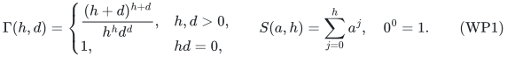

**Theorem 1.** A deterministic algorithm returns the unique smallest
original-item set <code class="math">H</code> such that

<!-- math-display: 7086ce01eb1dca4f0f4c87f6
r_M(H\cap(P_i)_F)=r_M((P_i)_F)
\quad\text{for every }i\text{ and every }|F|\le h.
\tag{WP2}
-->
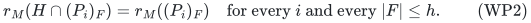

The set <code class="math">H</code> is exactly the union of the canonical greedy bases of <code class="math">E_F</code>
over all allowed <code class="math">F</code>. In particular, it contains the canonical
minimum-cost surviving basis, including when the surviving rank drops.
Its size is at most

<!-- math-display: bc0f6d8e82ac9cd4899a4694
K=\min\{N,\lfloor r\Gamma(h,d)\rfloor\}.
\tag{WP3}
-->
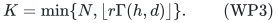

After sorting the items, an ordered-basis branching algorithm uses at most

<!-- math-display: ba760a1254a9abed3cd67a20
NS(dr,h)
\tag{WP4}
-->
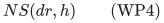

independence queries. It rescans the fixed ordered input at each tree
node. With indexed label flags and touched-label lists, bookkeeping
uses <code class="math">O((d+1)(N+1)S(dr,h))</code> ordinary operations. A depth-first
implementation uses <code class="math">O((h+1)(d+1)(r+1))</code> item and label IDs as search
workspace, in addition to the input, indexed-label table and retained
output.

A second construction scans the ordered input only once and uses at most

<!-- math-display: 82d9dbb5855940440a280458
N(K+1)S(dr,h)
\tag{WP4a}
-->
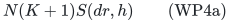

independence queries, with
<code class="math">O((d+1)N(K+1)S(dr,h))</code> bookkeeping operations and
<code class="math">O((h+1)(K+1))</code> item IDs of search workspace under the same exclusions.
This version tests each item against the retained earlier prefix.
One may clip <code class="math">h</code> to the number of occurring labels. Neither construction
needs to know <code class="math">r</code> or <code class="math">K</code> in advance.

The Bernoulli size factor <code class="math">\Gamma</code> is the previous project prefix bound, already
recorded in the [arbitrary-matroid comparison](arbitrary-matroid-and-submodular-failure-summaries.md#8-antecedents-and-comparison-to-public-results)
and the [represented comparison](sharp-represented-matroid-failure-summaries.md#8-baselines-and-attribution-boundaries).
The contribution here is a complete deterministic FPT construction of
the canonical prefix summary, together with a one-pass alternative whose
per-item oracle work depends on the retained prefix size.
Section 3 supplies the size proof from the matroid axioms;
no historical checkpoint or external implementation is needed. No priority
claim for the factor or its probabilistic proof is made.

The parameters in WP4 include <code class="math">r,h,d</code>. This is an FPT oracle algorithm;
it is not a uniform polynomial-time algorithm when all three parameters
are unrestricted. The output retains the original oracle and item
encodings, so WP3 is an item-count bound, not a parameter-only bit kernel.

## 2. Exact prefix witnesses

For an item <code class="math">e_i</code> at position <code class="math">i</code>, call <code class="math">F</code> a prefix witness if
<code class="math">&#124;F&#124;\le h</code>, <code class="math">F\cap\Lambda(e_i)=\varnothing</code>, and

<!-- math-display: 62884dd28f0ad2854e53d925
e_i\notin\mathrm{cl}_M((P_{i-1})_F).
\tag{WP5}
-->
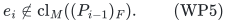

An item belongs to the canonical greedy basis of <code class="math">E_F</code> exactly when it
survives and increases the rank of the earlier surviving prefix. Thus
the union <code class="math">H_*</code> of all these bases consists precisely of the items with
a prefix witness.

Every set satisfying WP2 must contain every item of <code class="math">H_*</code>. If <code class="math">e_i</code> is
omitted, its witness gives a strict rank increase from <code class="math">(P_{i-1})_F</code> to
<code class="math">(P_i)_F</code>, while the restricted prefix contains only earlier items.
Conversely, <code class="math">H_*</code> contains the full canonical basis for every <code class="math">F</code>, and
the portion of that basis in <code class="math">P_i</code> is a basis of <code class="math">(P_i)_F</code>. Therefore
<code class="math">H_*</code> satisfies WP2. It is the unique minimum set for this simultaneous
prefix requirement, not merely an inclusion-minimal output.

This optimality concerns preserving every prefix of this one fixed order.
It does not claim minimum cardinality among summaries preserving only
final ranks, or among restrictions preserving only one optimum-cost
value when several bases have tied costs.

## 3. The existing Bernoulli size bound

For each <code class="math">e_i\in H_*</code> choose a prefix witness <code class="math">F_i</code>. Independently fail
each occurring label with probability <code class="math">p\in(0,1)</code>, giving a random
failure set <code class="math">Z</code>. In this proof <code class="math">Z</code> may contain more than <code class="math">h</code> labels;
the rank bound <code class="math">r_M(E_Z)\le r</code> holds for all <code class="math">Z</code>.

The event

<!-- math-display: 2ef9ac3c5fb57db34237b9a2
F_i\subseteq Z,
\qquad Z\cap\Lambda(e_i)=\varnothing
\tag{WP6}
-->
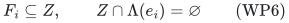

has probability <code class="math">p^{&#124;F_i&#124;}(1-p)^{&#124;\Lambda(e_i)&#124;}</code>, at least
<code class="math">p^h(1-p)^d</code>. On this event <code class="math">e_i</code> survives and its earlier surviving
prefix is contained in <code class="math">(P_{i-1})_{F_i}</code>. A smaller set cannot span an
item that the larger set does not span. Thus <code class="math">e_i</code> contributes one to
the greedy rank of <code class="math">E_Z</code>.

Summing the rank contributions and taking expectations gives the useful
nonuniform inequality

<!-- math-display: e77309eff53ed921d648cdfd
\sum_{e_i\in H_*}
p^{|F_i|}(1-p)^{|\Lambda(e_i)|}
\le \mathbb E[r_M(E_Z)]\le r.
\tag{WP7}
-->
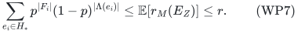

For <code class="math">h,d&gt;0</code>, choose <code class="math">p=h/(h+d)</code> to obtain
<code class="math">&#124;H_*&#124;\le r\Gamma(h,d)</code>. If <code class="math">h=0</code> or <code class="math">d=0</code>, there is only one
effective surviving ground, and <code class="math">H_*</code> is its ordinary canonical basis.
This proves WP3 in every case.

No random choices are used by the construction. The product measure
only bounds the size of its deterministic output. In particular, the
proof does not enumerate or sample failure sets in the implementation.

### A stronger bound using the original basis

The same argument gives a strictly smaller general upper bound by using
the items that need no failure witness. Let <code class="math">B_0</code> be the ordinary
canonical basis of <code class="math">E</code>. Every surviving item of <code class="math">B_0</code> stays accepted by
greedy: deleting earlier items cannot make them span an item that they
previously did not span. Its acceptance probability is therefore exactly
<code class="math">(1-p)^{&#124;\Lambda(e)&#124;}</code>.

The <code class="math">r</code> original-basis items and the other retained items are disjoint.
Using their separate expected contributions in WP7 gives, for every
<code class="math">p\in(0,1)</code> and <code class="math">h,d&gt;0</code>,

<!-- math-display: 07870a6244c2440b2250af4f
\boxed{
|H_*|\le r+
\frac{r-\displaystyle\sum_{e\in B_0}(1-p)^{|\Lambda(e)|}}
 {p^h(1-p)^d}.}
\tag{WP7a}
-->
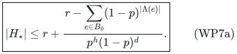

This is an instance-sensitive bound: label-free or lower-degree items
in <code class="math">B_0</code> reduce the numerator. For a bound depending only on the
parameters, define

<!-- math-display: 3904e17db2c55bb1637d71a9
\Psi(h,d)=
1+\inf_{0<p<1}\frac{(1-p)^{-d}-1}{p^h}
\quad(h,d>0),
\qquad
\Psi(h,d)=1\quad(hd=0).
\tag{WP7b}
-->
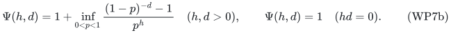

**Corollary 2.** Theorem 1 and the one-pass query bound also hold with
<code class="math">K=\min\{N,\lfloor r\Psi(h,d)\rfloor\}</code>. The data-dependent
right side of WP7a can improve this further. The algorithm does not
evaluate this infimum or use the bound as a stopping rule.

Indeed, the original-basis sum is at least <code class="math">r(1-p)^d</code>, giving WP7b.
For each <code class="math">p</code>, its parameter-only expression equals

<!-- math-display: b3b4a9790aa2f1023d4259f0
\frac1{p^h(1-p)^d}+1-\frac1{p^h}.
-->
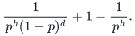

Consequently <code class="math">\Psi(h,d)&lt;\Gamma(h,d)</code> when <code class="math">h,d&gt;0</code>.
For <code class="math">h=1</code>, taking <code class="math">p\downarrow0</code> gives <code class="math">\Psi(1,d)=d+1</code>;
the reverse inequality follows from
<code class="math">(1-p)^{-d}\ge1+dp</code>. This is consistent with the separate sharp
one-failure construction, which is the depth-one case of the basis tree.

For <code class="math">h\ge2</code> the infimum is attained in the interior. If
<code class="math">q=1-p</code>, its unique minimizing point satisfies

<!-- math-display: 708eb9416e0dae7bf117e309
h\sum_{j=1}^{d}q^j=d.
\tag{WP7c}
-->
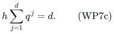

To check this, differentiate
<code class="math">(q^{-d}-1)/(1-q)^h</code>, cancel the positive denominator, and use
<code class="math">(1-q^d)/(1-q)=\sum_{j=0}^{d-1}q^j</code>.
The left side of WP7c increases continuously from zero to <code class="math">hd&gt;d</code>,
so it has exactly one root in <code class="math">(0,1)</code>, and the objective diverges at
both endpoints. Any rational <code class="math">p</code> in WP7a already gives an exact
computable upper bound; no algebraic-root routine is a dependency.

In particular, for one label per item and <code class="math">h\ge2</code>, the minimizing
point is <code class="math">p=(h-1)/h</code>, giving

<!-- math-display: ead3441b40144d95d5c2f32d
\boxed{
|H_*|\le r\left(1+
\frac{h^h}{(h-1)^{h-1}}\right).}
\tag{WP7d}
-->
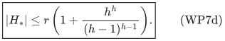

For two failures this is <code class="math">5r</code>, improving the Bernoulli baseline
<code class="math">27r/4</code>. If <code class="math">b</code> items of <code class="math">B_0</code> have no label, WP7a further gives
<code class="math">r+4(r-b)</code> in this two-failure case. These are upper bounds, not
claims of optimal constants. The rank-four obstruction forces 13
items while WP7d alone allows 20. The
[two-failure profile theorem](two-failure-oracle-prefix-bounds.md)
improves the universal rank-four upper bound to 13, exactly matching
that example, and gives a more detailed instance-dependent certificate.

## 4. A complete failure-witness search

### 4.1. Branch on the canonical basis of the whole surviving ground

At a node with already failed set <code class="math">F</code> and remaining budget <code class="math">t</code>:

1. Scan <code class="math">E_F</code> in the fixed order to compute its canonical basis <code class="math">B_F</code>.
2. Add every item of <code class="math">B_F</code> to the output.
3. If <code class="math">t&gt;0</code>, recurse once on
   <code class="math">F\cup\{\lambda\},t-1</code> for every distinct label
   <code class="math">\lambda\in\bigcup_{e\in B_F}\Lambda(e)</code>.

Start with <code class="math">F=\varnothing,t=h</code>. A basis item survives at its node,
so none of the branch labels has already failed. Fix the branch order
by the indexed label IDs. Repeatedly reaching the same failed set is
allowed; memoization is unnecessary.

**Exactness.** Every node represents at most <code class="math">h</code> failed labels, so
every output item belongs to <code class="math">H_*</code>. Conversely, fix any allowed target
set <code class="math">F_*</code>. Follow nodes with <code class="math">F\subseteq F_*</code>. If
<code class="math">F_*\setminus F</code> avoids all labels on <code class="math">B_F</code>, then every item of
<code class="math">B_F</code> survives. Deleting only greedy-rejected items leaves the
canonical scan unchanged: its accepted items and every independence
test on those items are the same. Thus <code class="math">B_F=B_{F_*}</code>, and the target
basis has already been output. Otherwise a remaining label of <code class="math">F_*</code>
touches <code class="math">B_F</code> and is one of the branches. Following it strictly
decreases <code class="math">&#124;F_*\setminus F&#124;</code>. After at most <code class="math">&#124;F_*&#124;</code> steps the
target basis has been output. The returned union is exactly <code class="math">H_*</code>,
so all the preceding size bounds apply to this tree, not just to the
one-pass construction.

A node uses at most <code class="math">N</code> independence queries and has at most <code class="math">dr</code>
children. Its depth is at most <code class="math">h</code>, giving WP4. Iterate only the
labels actually touched by its basis; do not scan the full label
universe at every node. A stack keeps one basis, one touched-label
list and one input-scan position per active level, giving the stated
workspace bound. When <code class="math">h=2,d=1</code>, this is at most
<code class="math">N(1+r+r^2)</code> queries, or <code class="math">O(N(r+1)^2)</code>.

### 4.2. Test one protected item against an earlier prefix

Suppose <code class="math">Q</code> is an earlier retained prefix and <code class="math">e</code> is the next item.
We test whether some <code class="math">F</code> of at most <code class="math">h</code> labels, avoiding <code class="math">\Lambda(e)</code>,
makes <code class="math">e\notin\mathrm{cl}_M(Q_F)</code>. At a search node let <code class="math">Y</code> be the
surviving part of <code class="math">Q</code>, <code class="math">F_0</code> the labels already failed, and <code class="math">t</code> the
remaining budget.

1. Compute any greedy basis <code class="math">B</code> of <code class="math">Y</code>.
2. If <code class="math">B+e</code> is independent, return <code class="math">F_0</code>.
3. If <code class="math">t=0</code>, return `NONE`.
4. For each label <code class="math">\lambda</code> on <code class="math">B</code> that is not on <code class="math">e</code>, recurse on
   <code class="math">Y_{\{\lambda\}}</code>, <code class="math">F_0\cup\{\lambda\}</code>, and <code class="math">t-1</code>.
   Return the first witness found, or `NONE` if every child fails.

The fixed input order specifies every basis scan and branch order, so
the search is deterministic. Already failed labels cannot occur on <code class="math">B</code>.
Each branch spends one new failure, and no branch deletes <code class="math">e</code>.

**Completeness.** If step 2 fails, <code class="math">B</code> spans <code class="math">e</code>. Any successful further
failure must hit a label on <code class="math">B</code>: otherwise all of <code class="math">B</code> survives and still
spans <code class="math">e</code>. Such a label cannot be on <code class="math">e</code>. Hence every valid witness has
a first branch in step 4, and induction on <code class="math">t</code> proves that the search
returns a witness exactly when one exists. This is the
[rank-summary witness search](arbitrary-matroid-and-submodular-failure-summaries.md#5-a-deterministic-failure-witness-search)
applied to a protected next item and an earlier prefix.

The basis has at most <code class="math">r</code> items, so there are at most <code class="math">dr</code> branches per
node and at most <code class="math">S(dr,h)</code> nodes. A node uses at most <code class="math">&#124;Q&#124;+1</code>
independence queries. No enumeration of the full label universe or
exponential memoization table is required.

## 5. Retain only the necessary earlier prefix

Start with <code class="math">H_0=\varnothing</code>. Process <code class="math">e_1,\ldots,e_N</code> in the fixed
order. Run the search in Section 4 with <code class="math">Q=H_{i-1}</code> and protected item
<code class="math">e_i</code>. Keep <code class="math">e_i</code> exactly when the search returns a witness; otherwise
set <code class="math">H_i=H_{i-1}</code>.

The invariant is

<!-- math-display: 9d71971a4db79468a76dbf68
\mathrm{cl}_M((H_i)_F)
 =\mathrm{cl}_M((P_i)_F)
\quad\text{for every }|F|\le h.
\tag{WP8}
-->
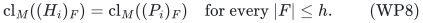

It is true at <code class="math">i=0</code>. At the next step, WP8 for <code class="math">i-1</code> makes a witness
against the retained earlier prefix equivalent to a witness against the
original earlier prefix. If there is a witness, the algorithm keeps the
item, and adjoining the same surviving item to sets with equal closure
preserves closure equality. If there is no witness, <code class="math">e_i</code> is spanned by
the retained earlier survivors for every allowed failure that does not
delete it. Omitting it therefore preserves the invariant in this case
as well. Failures that delete <code class="math">e_i</code> require no change.

It follows that the algorithm keeps exactly the items with original
prefix witnesses, hence returns <code class="math">H_*</code>. This explains why it is safe to
query only retained prefixes. Merely applying rank-only reverse deletion
to the entire ground would not give this property.

At every step <code class="math">&#124;H_{i-1}&#124;\le &#124;H_*&#124;\le K</code>. There are <code class="math">N</code> searches,
each using at most <code class="math">(K+1)S(dr,h)</code> queries, proving WP4a. The same count
with <code class="math">N+1</code> in place of <code class="math">K+1</code> gives a simpler alternative implementation
that always tests the complete original earlier prefix. An input already
presented in the specified order can be processed in one pass, since
future items are never inspected by the search. This is an ordered-input
statement, not a dynamic-update or arbitrary-order streaming guarantee.

For a query <code class="math">F</code>, filter <code class="math">H</code> and run ordinary greedy in the fixed order.
This uses at most <code class="math">&#124;H&#124;</code> independence queries and returns exactly the
canonical greedy basis that would be obtained on <code class="math">E_F</code>.

## 6. Sharp endpoints and the obstruction

When <code class="math">h=1</code>, the basis tree specializes to the
[one-failure construction](arbitrary-matroid-and-submodular-failure-summaries.md#7-weighted-oracle-summaries-for-one-label-failure).
It gives the same canonical-basis union, has the sharp size
<code class="math">(d+1)r</code>, and uses at most <code class="math">(1+dr)N</code> independence queries in uniform
polynomial time. When a linear representation is supplied, the
[polynomial feature construction](sharp-represented-matroid-failure-summaries.md)
attains <code class="math">r\binom{h+d}{d}</code> in uniform polynomial time for every <code class="math">h</code>.

The [weighted oracle obstruction](weighted-oracle-two-failure-obstruction.md)
shows why WP3 is not simply replaced by this exact binomial expression
for arbitrary matroids: rank four, one label per item, and two failures
can force 13 retained items, exceeding <code class="math">4\binom{3}{1}=12</code>. Its amplified
examples fail the proposed sharp weighted formula for every <code class="math">h\ge2</code>.
The exact optimal universal weighted-oracle size between that lower
bound and WP7b remains outside the claims here. For <code class="math">h=2,d=1</code>,
the direct-sum obstruction requires <code class="math">13r/4</code> when <code class="math">r</code> is divisible
by four, whereas the stronger upper bound here is <code class="math">5r</code>.
The [two-failure companion](two-failure-oracle-prefix-bounds.md)
additionally proves the universal upper bound
<code class="math">\min\{5r,\binom{r+1}{2}+3\}</code> for <code class="math">r\ge2</code>, the sharp
<code class="math">3r</code> bound for every rank at most three, the exact rank-four
maximum 13, and minimality of the 13-item obstruction at <code class="math">h=2,d=1</code>.
If all single failures add just one shared replacement item, used by
<code class="math">t</code> single-failure bases, that companion gives the sharp bound
<code class="math">r+2t\le3r</code> and a profile-sensitive <code class="math">O(N(r+t^2))</code> construction.

For sparse packing with item-label degree <code class="math">\delta</code> and solution bound
<code class="math">\kappa</code>, the saturated-row budget <code class="math">h=\delta(\kappa-1)</code> gives

<!-- math-display: f39fd49f1d7725d3e5e7beb0
\kappa\Gamma(\delta(\kappa-1),\delta)
 =\kappa\left(
 \frac{\kappa^\kappa}{(\kappa-1)^{\kappa-1}}
 \right)^\delta
 \le e^\delta\kappa^{\delta+1}
\quad (\kappa\ge2).
\tag{WP9}
-->
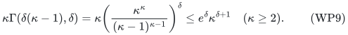

Using nonincreasing profit order now gives no-worse-profit replacements
for arbitrary many signed profit values. The full original-context
packing transfer is in the
[sparse-packing manuscript](../../weighted-prefix-quota-frontier/manuscripts/sharp-sparse-packing-fpt-restrictions.md).
The exact-binomial rank-only and equal-profit-class alternatives remain
useful when their stronger constants or equality requirements apply.

## 7. Integral-submodular prefix values

There is an analogous construction for an integer-valued monotone
submodular function <code class="math">f</code>, with
<code class="math">R=f(E)-f(\varnothing)</code>. Keep an item precisely when some allowed
failure gives it a positive marginal on its earlier surviving prefix.
The resulting unique smallest prefix-value preserver has at most
<code class="math">R\Gamma(h,d)</code> items. Indeed, on WP6 its marginal is still positive
by diminishing returns, hence at least one by integrality. The sum of
all surviving prefix marginals telescopes to
<code class="math">f(E_Z)-f(\varnothing)\le R</code>, giving WP7 with <code class="math">R</code>.

The faster construction is the ordered-basis tree of Section 4.1 with
each basis replaced by the positive-marginal items of the surviving
scan. Cache <code class="math">f(\varnothing)</code> once. Within a node, keep a set <code class="math">B</code>
and its current value; query <code class="math">f(B+e)</code> for each surviving item, and
adjoin the item exactly when this value increases. Such a set has at
most <code class="math">R</code> items because every positive integer increment is at least
one. Branch on its at most <code class="math">dR</code> touched labels.

Deleting a zero-marginal rejected item leaves this scan's state
unchanged. More generally, for <code class="math">A\subseteq B</code> with <code class="math">f(A)=f(B)</code>,
monotonicity and diminishing returns give
<code class="math">f(A+e)=f(B+e)</code> for every item <code class="math">e</code>. Thus skipping rejected items
preserves every original prefix value. If a target failure deletes
none of the node's positive-marginal items, the whole scan is unchanged;
otherwise it contains a touched label on which the tree branches.
The same target-following proof as for matroids shows that the output
is exactly the union of the canonical positive-marginal items for all
allowed failures. The tree therefore uses at most

<!-- math-display: f7d8baa71234452e987360e2
1+NS(dR,h)
\tag{WP9a}
-->
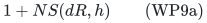

value queries, including the single cached baseline query. It never
needs to know <code class="math">R</code> in advance.

For the one-pass alternative, use the
[value-witness search](arbitrary-matroid-and-submodular-failure-summaries.md#9-monotone-submodular-functions):
at a zero-marginal node choose a value-spanning set <code class="math">B</code> of the earlier
survivors by keeping only positive marginal items. It has at most <code class="math">R</code>
items. Every successful witness must delete a label on <code class="math">B</code> that is not
on the protected item, so branching has at most <code class="math">dR</code> choices. The
search uses <code class="math">O(N(K_f+1)S(dR,h))</code> value queries, where
<code class="math">K_f=\min\{N,\lfloor R\Gamma(h,d)\rfloor\}</code>.

The retained-prefix invariant is exact value equality, so the same
zero-marginal argument makes tests against retained and original
earlier prefixes agree. The numerical range <code class="math">R</code>, rather
than its bit length, is part of the parameter. This statement preserves
values of one ordered prefix sequence under failures; it does not claim
an exact coreset for arbitrary minimum-cost submodular cover.

The original-basis refinement also extends to this setting. Let <code class="math">B_0</code>
be the positive-marginal items in the unfailed ordered scan, let
<code class="math">b=&#124;B_0&#124;\le R</code>, and let <code class="math">\Delta_e</code> be the original positive marginal
of <code class="math">e\in B_0</code>. These marginals sum to <code class="math">R</code>. If <code class="math">e</code> survives further
deletions of earlier items, diminishing returns preserves a marginal of
at least <code class="math">\Delta_e</code>. In place of WP7a, the same expectation argument
therefore gives

<!-- math-display: 51adeb5b2d5484717c2eab72
|H_*|\le b+
\frac{R-\displaystyle\sum_{e\in B_0}
\Delta_e(1-p)^{|\Lambda(e)|}}{p^h(1-p)^d}
\qquad(h,d>0).
\tag{WP10}
-->
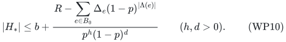

Taking the infimum over <code class="math">p</code>, using <code class="math">b\le R</code> and
<code class="math">\sum_{e\in B_0}\Delta_e=R</code>, gives <code class="math">&#124;H_*&#124;\le R\Psi(h,d)</code>.
Thus <code class="math">K_f</code> in the construction bound may also use
<code class="math">\lfloor R\Psi(h,d)\rfloor</code>. Here the first term is the number
of initially positive items, while the sum uses their marginal values;
replacing both indiscriminately by the same quantity would lose the
argument. The case <code class="math">R=0</code> returns the empty set, and the baseline
<code class="math">f(\varnothing)</code> is never assumed zero.

## 8. Verification and dependency scope

The [finite checker](../verify/check_weighted_prefix.py) independently
enumerates canonical bases and all prefix ranks from complete matroid
rank tables. It compares their exact union with both the ordered-basis
tree and the retained-prefix witness algorithm, verifies each necessity
witness and both explicit oracle-call bounds, and checks the Bernoulli event implication
also on failure sets larger than the requested budget. It includes all
labeled matroids on at most four items and the nonrepresentable
13-item obstruction. These are finite checks, not a proof for all
matroids; the general proof is Sections 2--5. A separate value-oracle
suite tests the ordered positive-marginal tree on scaled matroid ranks
and weighted coverage functions. It checks all original surviving
prefix values, the exact canonical union, WP9a and WP10, including
nonzero baselines, zero range and marginal jumps larger than one.
The general integral-submodular theorem is proved in Section 7.
The size checks include WP7a at exact rational probabilities, the
degree-one optimizer WP7d, and the sharp <code class="math">h=1</code> endpoint. No numerical
minimization or floating-point comparison is used.

The construction requires only the original independence oracle,
finite explicit label lists and the fixed item order. There is no field
representation, randomization, separator implementation or external
solver dependency.

**Attribution:** Yilin Liu and GPT-6 Astra Pro.
