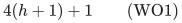
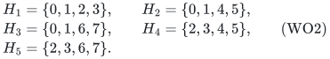
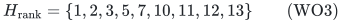
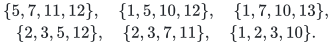

# Weighted oracle summaries exceed the binomial bound from two failures onward

## 1. Statement and scope

The sharp rank-only bound
<code class="math">r\binom{h+d}{d}</code> does not extend to fixed-cost summaries of arbitrary
oracle matroids. It already fails for rank four, one label per item, and
two failed labels.

**Theorem 1.** There is a rank-four matroid on 13 original items, each
carrying one of four labels and a fixed positive integer cost, such that
every original-ground restriction preserving the minimum cost of a
surviving basis after every at-most-two-label failure must retain all 13
items. All six two-label queries have surviving rank four. In contrast,
<code class="math">r\binom{h+d}{d}=4\binom{3}{1}=12</code>.

Consequently 12 items cannot suffice even for preserving only the exact
minimum-cost value; preserving every cost prefix or the canonical optimum
is at least as demanding.

**Theorem 2.** For every integer <code class="math">h\ge2</code>, there is a rank-four,
one-label-per-item example requiring

<!-- math-display: e49eee6f46f9e37e525ac0af
4(h+1)+1
\tag{WO1}
-->

original items. Taking direct sums gives, for every rank <code class="math">r</code> divisible
by four, examples requiring <code class="math">r(h+1)+r/4</code>. Thus the one-failure weighted
oracle theorem is a substantive endpoint. The represented-matroid theorem
is unaffected: the resource matroid used here is not representable over
any field, as verified directly in Section 6.

These are exact finite constructions with proofs. They do not assert an
optimal general weighted-oracle bound above the displayed obstruction.
The [two-failure upper-bound companion](two-failure-oracle-prefix-bounds.md)
proves that every rank-at-most-three matroid, and every instance with at
most three occurring labels, still admits a <code class="math">3r</code> prefix summary at
<code class="math">h=2,d=1</code>. Thus Theorem 1 has the smallest possible rank, label count
and original ground size for a violation in that fixed model. The same
companion proves that the universal rank-four maximum is exactly 13
and gives an exact one-failure-profile certificate for this instance.
It also proves that a violation requires at least two distinct items
outside the original basis in the one-failure union; this example has
exactly two.

## 2. The underlying eight-class matroid

Let the underlying class ground be <code class="math">\{0,1,\ldots,7\}</code>. Declare every set
of at most three classes independent, and declare a four-class set a
basis except for the following five forbidden sets:

<!-- math-display: 272636c63670f85bda71dbd6
\begin{aligned}
H_1&=\{0,1,2,3\}, & H_2&=\{0,1,4,5\},\\
H_3&=\{0,1,6,7\}, & H_4&=\{2,3,4,5\},\\
H_5&=\{2,3,6,7\}.&&
\end{aligned}
\tag{WO2}
-->

Sets larger than four are dependent. This is a relabeling of the classical
Vámos matroid. Its needed properties follow from the explicit definition;
no representation theorem is assumed.

**Lemma 2.1.** The declared bases define a rank-four matroid.

**Proof.** Different forbidden four-sets intersect in at most two
classes. Take two allowed bases <code class="math">B,C</code> and <code class="math">e\in B\setminus C</code>. If
<code class="math">&#124;C\setminus B&#124;=1</code>, its only replacement gives <code class="math">C</code> itself. Otherwise
the candidate sets <code class="math">B-e+f</code>, for <code class="math">f\in C\setminus B</code>, are distinct
four-sets sharing the three-set <code class="math">B-e</code>. At most one can be forbidden, so
an allowed exchange exists. This is the basis-exchange axiom.

Every three-set has five possible fourth classes, and at most one of its
four-set extensions is forbidden. Thus every set of at most three
classes is contained in an allowed basis, as declared. There are
<code class="math">\binom84-5=65</code> bases, so the rank is four. <code class="math">\square</code>

Replace some underlying classes by parallel copies. A set of copies is
independent exactly when it contains at most one copy of each class and
its class set is independent in WO2. This defines a matroid: heredity is
immediate, and augmentation follows by augmenting the smaller underlying
independent class set with a class from the larger one and then taking
its available copy. This explicit parallel-extension oracle is the entire
resource interface below.

It is an explicit, efficiently evaluable oracle: check duplicate classes,
the cardinality, and the five constant-size forbidden sets. The lower
bound concerns the retained original ground, not computational difficulty
hidden inside the oracle.

## 3. The 13 ordered, colored items

Give item <code class="math">i</code> cost <code class="math">c_i=2^{i-1}</code>. All subset costs are distinct, so each
surviving optimum is unique. The cost order is the item order in this
table. The last column gives one failure query under which that item is
forced into the unique optimum.

| Item <code class="math">i</code> | Underlying class | Its only label | A necessity witness |
|---|---:|---|---|
| 1 | 5 | B | fail C,D |
| 2 | 2 | A | fail C,D |
| 3 | 3 | A | fail C,D |
| 4 | 1 | C | fail B,D |
| 5 | 7 | D | fail B,C |
| 6 | 4 | B | fail A,D |
| 7 | 0 | C | fail A,B |
| 8 | 6 | D | fail A,C |
| 9 | 2 | D | fail A,B |
| 10 | 1 | B | fail C,D |
| 11 | 5 | C | fail B,D |
| 12 | 4 | D | fail B,C |
| 13 | 2 | C | fail A,D |

Every underlying class has a copy, so the extension has rank four.
Failure of a label removes every item carrying that label. The six
two-label optima are as follows.

| Failed labels | Surviving labels | Unique minimum-cost basis | Cost |
|---|---|---|---:|
| A,B | C,D | <code class="math">\{4,5,7,9\}</code> | 344 |
| A,C | B,D | <code class="math">\{1,5,6,8\}</code> | 177 |
| A,D | B,C | <code class="math">\{1,4,6,13\}</code> | 4137 |
| B,C | A,D | <code class="math">\{2,3,5,12\}</code> | 2070 |
| B,D | A,C | <code class="math">\{2,3,4,11\}</code> | 1038 |
| C,D | A,B | <code class="math">\{1,2,3,10\}</code> | 519 |

**Lemma 3.1.** This table lists the canonical greedy basis and the unique
minimum-cost basis in every displayed restriction.

**Proof.** Greedy scans the surviving items in the given increasing cost
order. It rejects repeated underlying classes and the five forbidden
four-sets in WO2. The complete nontrivial rejection traces are short:

- With labels C,D surviving, greedy takes <code class="math">4,5,7</code>, rejects item 8 because
  its classes would be <code class="math">H_3</code>, and takes 9.
- With labels B,D surviving, it takes <code class="math">1,5,6,8</code>. The four classes are
  <code class="math">\{4,5,6,7\}</code>, the allowed union of the last two underlying pairs.
- With labels B,C surviving, it takes <code class="math">1,4,6</code>, rejects item 7 by <code class="math">H_2</code>,
  rejects 10 and 11 as parallel repetitions, and takes 13.
- With labels A,D surviving, it takes <code class="math">2,3,5</code>, rejects 8 by <code class="math">H_5</code> and 9
  as a repetition, and takes 12.
- With labels A,C surviving, it takes <code class="math">2,3,4</code>, rejects 7 by <code class="math">H_1</code>, and
  takes 11.
- With labels A,B surviving, it takes <code class="math">1,2,3</code>, rejects 6 by <code class="math">H_4</code>, and
  takes 10.

All listed accepted four-sets are allowed bases. Matroid greedy minimizes
the fixed additive cost of a basis, and distinct powers of two make this
optimum unique. The numerical costs are the corresponding sums.
<code class="math">\square</code>

**Proof of Theorem 1.** The union of the six displayed bases is all 13
items. If a restriction omits item <code class="math">i</code>, use its necessity query from the
first table. The unique original optimum contains <code class="math">i</code>, so the restricted
instance either has no rank-four basis or has strictly larger optimum
cost. Either outcome violates the prescribed guarantee. Thus every valid
restriction retains all 13 items. This also proves the prefix obstruction:
at the prefix ending in an accepted item, omitting that item loses the
greedy rank increase. <code class="math">\square</code>

## 4. Amplification to every failure budget at least two

Fix <code class="math">h\ge2</code>. Before the 13-item order, prepend <code class="math">h-2</code> blocks
<code class="math">Q_1,\ldots,Q_{h-2}</code>. Each block consists of four new parallel copies
whose underlying classes are the allowed basis <code class="math">\{1,2,3,5\}</code>. Give all
four copies in <code class="math">Q_j</code> a new single label <code class="math">Z_j</code>; these labels are distinct
and do not belong to the original four-label alphabet. Assign costs as
successive powers of two in the complete new order.

Every item of <code class="math">Q_j</code> is forced by the query failing
<code class="math">Z_1,\ldots,Z_{j-1}</code>. The remaining earlier blocks are absent, and
<code class="math">Q_j</code> is the first surviving block and a full basis. Greedy takes all of
it. This query uses at most <code class="math">h-3</code> failures whenever such a block exists.

Every one of the original 13 items is still forced: fail all <code class="math">h-2</code>
new block labels, then use its two-label witness from Section 3. This
uses exactly <code class="math">h</code> failures and leaves the same ordered original instance.
There are <code class="math">4(h-2)+13=4(h+1)+1</code> forced items and the resource rank
remains four. This proves WO1.

In fact every allowed failure still leaves rank four. If a new block
survives, it is a full basis. If no new block survives, at least <code class="math">h-2</code>
failures were spent on their labels, leaving at most two failures among
the four original labels. Section 3 then supplies a surviving basis.

For <code class="math">t</code> disjoint copies of the construction, take the direct sum of their
resource matroids and reuse the same label alphabet across copies. A
surviving basis is a union of bases of the separate components. Give all
items distinct power-of-two costs, keeping the prescribed local order
inside each component. The optimum is unique and componentwise optimal,
so the same witness still forces each copy of each item. The rank is
<code class="math">r=4t</code>, and the necessary support is
<code class="math">t(4(h+1)+1)=r(h+1)+r/4</code>. <code class="math">\square</code>

## 5. Why this does not contradict the rank-only theorem

The nine-item restriction

<!-- math-display: c1e57261111b67663164ccaf
H_{\mathrm{rank}}=\{1,2,3,5,7,10,11,12,13\}
\tag{WO3}
-->

already preserves full rank after every allowed failure in the base
13-item example. For failures A,B; A,C; A,D; B,C; B,D; and C,D,
respectively, it contains the following surviving bases:

<!-- math-display: eff1495668c14ea5c9708aa5
\begin{gathered}
\{5,7,11,12\},\quad \{1,5,10,12\},\quad
\{1,7,10,13\},\\
\{2,3,5,12\},\quad \{2,3,7,11\},\quad
\{1,2,3,10\}.
\end{gathered}
-->

Their underlying class sets are all allowed by WO2. Every zero- or
one-label failure leaves a superset of one of these two-label surviving
instances, so it also retains rank four. Some of these bases are more
expensive than the true optimum, which is permitted by rank preservation.

Thus the sharp rank-only summary, the one-failure weighted oracle summary,
and the represented fixed-cost theorem have different valid scopes. The
obstruction rules out silently transferring the last theorem to all
independence-oracle matroids for <code class="math">h\ge2</code>.

## 6. Nonrepresentability and source attribution

Here is a short independent check of the representation boundary. Group
the underlying classes into pairs
<code class="math">P=\{0,1\}</code>, <code class="math">Q=\{2,3\}</code>, <code class="math">R=\{4,5\}</code>, and <code class="math">S=\{6,7\}</code>.
Suppose vectors over a field represented WO2, and let the same letters
denote their two-dimensional spans. The five forbidden pair unions have
dimension three, whereas <code class="math">R+S</code> has dimension four. Also
<code class="math">P+Q+R</code> and <code class="math">P+Q+S</code> have dimension four.

Since <code class="math">\dim(P+Q)=3</code>, let <code class="math">L=P\cap Q</code>, a line. Both <code class="math">R\cap P</code> and
<code class="math">R\cap Q</code> are lines. If they were different, they would span <code class="math">R</code>
inside <code class="math">P+Q</code>, contradicting <code class="math">\dim(P+Q+R)=4</code>. They must therefore be
the same line, namely <code class="math">L</code>, so <code class="math">L\subseteq R</code>. The identical argument
gives <code class="math">L\subseteq S</code>. This forces <code class="math">\dim(R+S)\le3</code>, contradicting
its required dimension four. No field representation exists. A parallel
extension containing every class cannot remove this obstruction.

The underlying matroid is classical; the 13-item coloring, order, failure
table, and amplification above are the concrete obstruction used here.
For primary background on the Vámos matroid, see Karn, Nasr, Proudfoot
and Vecchi, [*Equivariant Kazhdan--Lusztig theory of paving matroids*,
Section 5](https://pages.uoregon.edu/njp/eq-relax.pdf). None of its
representation or polynomial-invariant results is needed for the proof
above. No publication-priority claim is made for this failure-summary
application.

## 7. Reproducible exact certificate

Run

~~~sh
python3 -B \
  problems/matroid-failure-summaries/verify/check_weighted_obstruction.py
~~~

The checker independently enumerates the 65 underlying bases, the 386
extended bases, and all 8,192 subsets of the 13-item ground. It verifies
basis exchange, constructs the complete rank table by exhaustive subset
recurrence, and compares greedy with literal minimum cost over all
surviving bases. It checks all zero-, one-, and two-label queries, every
item's optimum and prefix necessity witness, and the rank-only restriction
WO3. Small amplified instances are also checked directly; the proof in
Section 4 establishes the unbounded family.

The computational search used to discover the example is not part of
this certificate or a premise of the theorem. The committed checker is
deterministic and verifies only the fully specified construction.

**Attribution:** icekylinx and GPT-6 Astra Pro.
