# Sharp matroid and submodular failure summaries

## 1. Statements and distinction of models

Each element of a rank-<code class="math">r</code> matroid has at most <code class="math">d</code> failure labels. A query fails a set <code class="math">F</code> of at most <code class="math">h</code> labels and retains <code class="math">E_F=\{e:\Lambda(e)\cap F=\varnothing\}</code>. Put <code class="math">C=\binom{h+d}{d}</code>.

**Theorem 1 (represented, fixed cost).** A rational or explicitly represented finite-field matroid admits a deterministic uniformly polynomial construction retaining at most <code class="math">\min\{N,rC\}</code> original elements. The restriction preserves the span at every surviving prefix of one fixed cost order and contains the canonical minimum-cost basis after every failure, including rank drops.

**Theorem 2 (arbitrary oracle, rank).** Every inclusion-minimal restriction preserving all surviving ranks has at most <code class="math">rC</code> elements. One can construct such a restriction in deterministic <code class="math">f(r,h,d)N^{O(1)}</code> independence-oracle time. Direct failure enumeration is an XP alternative. The final deletion step preserves rank and feasibility, without an arbitrary-cost-prefix claim.

The explicit construction uses at most
<code class="math">N(N+1)\sum_{i=0}^{h}(dr)^i</code> independence queries. It needs no linear
representation or separating-family construction.
Section 4.2 improves this to a linear dependence on <code class="math">N</code> for fixed
<code class="math">r,h,d</code> by first constructing a bounded weighted-prefix summary.

**Theorem 3 (one failed label, arbitrary oracle and fixed cost).** For
<code class="math">h=1</code>, the sharp weighted-prefix guarantee also holds for arbitrary
independence-oracle matroids: at most <code class="math">(d+1)r</code> elements, constructed with
at most <code class="math">(1+dr)N</code> independence queries in uniform polynomial time. The
same weighted oracle bound with <code class="math">h\ge2</code> is false in general, as follows.

**Theorem 4 (weighted representation boundary).** For every <code class="math">h\ge2</code>
there is a rank-four arbitrary-oracle matroid, with one label per element,
whose exact minimum-cost surviving bases force <code class="math">4(h+1)+1</code> retained
elements. Thus the weighted bound <code class="math">r\binom{h+d}{d}</code> cannot extend to
all oracle matroids even at <code class="math">d=1</code>. Section 6 gives the construction.

**Theorem 5 (arbitrary-budget weighted oracle construction).** Put

<!-- math-display: 980bf6c4ad8986dedcfcd8cf
\Gamma(h,d)=
\begin{cases}
(h+d)^{h+d}/(h^h d^d),&h,d>0,\\
1,&hd=0,
\end{cases}
\qquad K=\min\{N,\lfloor r\Gamma(h,d)\rfloor\}.
-->
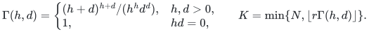

The unique minimum restriction preserving every surviving prefix of
one fixed order has at most <code class="math">K</code> elements. It can be constructed
deterministically with at most
<code class="math">N\sum_{i=0}^{h}(dr)^i</code> independence queries, after sorting.
The canonical-basis tree computes this exact union by branching on labels
of the current canonical basis. Its original-basis size refinement and
one-pass retained-prefix alternative are also proved locally.
Its proof and distinction from the sharp represented bound are in the
[weighted oracle construction](manuscripts/weighted-oracle-prefix-fpt-construction.md).

**Theorem 6 (two failures, one label per item).** For arbitrary matroids and one fixed order, the canonical prefix union satisfies

<!-- math-display: 1ee6b4cf94b8ba9a3399df0f
|H_2|\le\min\left\{5r,\binom{r+1}{2}+3\right\}\quad(r\ge2).
-->
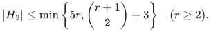

Ranks zero and one have bounds zero and three. The exact worst-case size is <code class="math">3r</code> for every <code class="math">r\le3</code>, and **13 at rank four**. At every rank, at most three occurring labels also give <code class="math">3r</code>. Thus the rank-four, four-label, 13-item obstruction is minimal in all three of rank, label count and ground size for violating the represented <code class="math">3r</code> bound at <code class="math">h=2,d=1</code>. The canonical-basis tree constructs the summary with at most <code class="math">N(1+r+r^2)</code> independence queries after sorting. Section 7 gives the proof route and complete companion.

If the one-failure union adds exactly one item <code class="math">x</code> to the original basis,
let <code class="math">t</code> count the single failures whose canonical basis contains <code class="math">x</code>.
Then the stronger bound <code class="math">r+2t\le3r</code> is sharp at every <code class="math">1\le t\le r</code>,
even for represented matroids. The summary can be found with
<code class="math">N(1+\ell_0+\binom{t+1}{2})</code> independence queries, or with
<code class="math">\binom t2</code> in place of <code class="math">\binom{t+1}{2}</code> when <code class="math">x</code> is unlabelled.
If the one-failure union adds no item, the original basis suffices.

**Theorem 7 (fixed rank-loss contraction).** Suppose each item has at most
one label. Let <code class="math">B_0</code> be the unfailed canonical basis, let <code class="math">b_0</code> count its
unlabelled items, and let <code class="math">\delta_\lambda=r-r_M(E\setminus D_\lambda)</code>.
The replacement total is

<!-- math-display: 978beed2d009a2cc86ec1f2d
T=\sum_\lambda |B_{\{\lambda\}}\setminus B_0|
 =r-b_0-\sum_\lambda\delta_\lambda.
-->
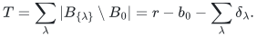

There is a fixed independent <code class="math">Q\subseteq B_0</code> with <code class="math">&#124;Q&#124;=r-T</code> such that
<code class="math">M'=M/Q</code> has rank <code class="math">T</code> and, for every failure set <code class="math">F</code>,

<!-- math-display: fe42d2d9603f218b5923ae3c
B_F=(Q\cap E_F)\,\dot\cup\,B'_F,
\qquad H_h(M)=Q\,\dot\cup\,H_h(M').
-->
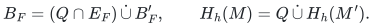

Here <code class="math">B'_F</code> is the canonical surviving basis in the inherited order, and
<code class="math">H_h</code> is the unique smallest preserver of every surviving prefix rank.
The identity also reconstructs every original prefix rank by adding the
number of surviving contracted items in that prefix. Computing <code class="math">Q</code> uses
at most <code class="math">(1+\ell_0)N+r</code> independence queries, with <code class="math">\ell_0\le r</code>.
A basis tree on the minor then uses at most
<code class="math">(N-r+T)\sum_{j=0}^{h'}T^j</code> further queries, where <code class="math">h'</code> is clipped to the
minor's occurring labels. At <code class="math">T=0</code>, <code class="math">B_0</code> alone suffices for every budget.
At <code class="math">T=1</code>, the sharp all-budget support bound is <code class="math">r+h</code>.
Section 8 proves the reduction and records its remaining rank-adaptive bounds.

## 2. Proof of the represented theorem

Choose distinct field points <code class="math">a_0,a_\lambda</code>, with <code class="math">a_0</code> never failing. For element <code class="math">e</code>, define
<!-- math-display: 62d92c37391e57566606960c
g_e(T)=(T-a_0)^{d-|\Lambda(e)|}\prod_{\lambda\in\Lambda(e)}(T-a_\lambda)
=T^d+\sum_{j<d}b_j(e)T^j.
-->
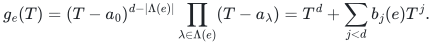
Let <code class="math">\phi(e)</code> list all monomials of total degree at most <code class="math">h</code> in the <code class="math">d</code> coefficients. Its dimension is <code class="math">C</code>. For each query,
<!-- math-display: 28ecec65179d63900f45df30
\prod_{\lambda\in F}g_e(a_\lambda)=\ell_F(\phi(e))
-->
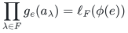
is a linear functional of those monomials, zero exactly when <code class="math">e</code> fails.

After compressing the original representation to rank <code class="math">r</code>, retain a fixed-order greedy basis of <code class="math">v_e\otimes\phi(e)</code>. Every omitted column is a linear combination of earlier retained columns. Applying <code class="math">I\otimes\ell_F</code> kills failed columns and maps survivors to nonzero scalar multiples of their original columns. Division by the protected column's scalar proves equality of surviving prefix spans. An element accepted by canonical greedy cannot be omitted, since it would already lie in the span of earlier retained survivors. This proves Theorem 1. <code class="math">\square</code>

Compute <code class="math">rC</code> with saturation before enumerating features; if <code class="math">rC\ge N</code>, return the input. Otherwise the lift has fewer than <code class="math">N</code> rows. Rational feature bit lengths are polynomial. If a finite field is too small, use an extension with at least <code class="math">L+1</code> elements; when an extension is needed its size can be kept below <code class="math">(L+1)^2</code>, permitting deterministic enumeration of irreducible polynomials. Extending scalars preserves original ranks.

## 3. Circuit-blocking set-pair lemma

**Lemma 3.1.** Give each <code class="math">e\in H</code> disjoint label sets <code class="math">A_e,B_e</code>, and assume
<!-- math-display: 5829af7bcbdc65b1fdb60d9f
e\notin\mathrm{cl}\{f\in H-e:A_f\cap B_e=\varnothing\}.
-->
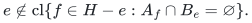
Then
<!-- math-display: eb80e84085b66f338f3b12ee
\sum_{e\in H}\binom{|A_e|+|B_e|}{|A_e|}^{-1}\le r(H).
-->
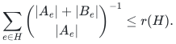

**Proof.** Uniformly order the labels and select <code class="math">e</code> when every <code class="math">A_e</code>-label precedes every <code class="math">B_e</code>-label. The selection probability is the reciprocal binomial coefficient. If a selected circuit existed, choose <code class="math">e</code> whose last own-label is latest. The hypothesis supplies another circuit element <code class="math">f</code> with a label in <code class="math">A_f\cap B_e</code>. Its position is no later than the last <code class="math">A_e</code>-label, contradicting selection of <code class="math">e</code>. Empty own-label sets are placed first. Hence every selected set is independent; take expectations. <code class="math">\square</code>

For an inclusion-minimal rank-preserving restriction, each <code class="math">e</code> has a failure witness <code class="math">F_e</code> under which it is a coloop. Apply the lemma with <code class="math">A_e=\Lambda(e)</code>, <code class="math">B_e=F_e</code>. Both sizes are bounded by <code class="math">d,h</code>, so <code class="math">&#124;H&#124;\le rC</code>.

For tightness, use <code class="math">r</code> parallel classes. In each class, create one element for every <code class="math">d</code>-subset <code class="math">A</code> of an <code class="math">(h+d)</code>-label universe, with labels <code class="math">A</code>. Failing the complement of <code class="math">A</code> isolates that element in its class; all <code class="math">rC</code> elements are necessary.

## 4. Fixed-parameter construction

To decide whether a current element <code class="math">e</code> can be deleted, search for at most
<code class="math">h</code> failed labels avoiding <code class="math">\Lambda(e)</code> under which <code class="math">e</code> becomes a coloop.
At a search node, let <code class="math">Y</code> be the surviving restriction and compute a basis
<code class="math">B</code> of <code class="math">Y-e</code>. If <code class="math">B+e</code> is independent, the labels already failed are a
valid witness. Otherwise <code class="math">B</code> spans <code class="math">e</code>. Any remaining successful failure
must hit a label of <code class="math">B</code>: if all of <code class="math">B</code> survives, it still spans <code class="math">e</code>.
Branch on every label in <code class="math">\Lambda(B)\setminus\Lambda(e)</code>, delete its entire
class, and decrease the remaining budget. Return no witness when the
budget is exhausted or every child fails. Induction on the budget proves
completeness, with at most <code class="math">dr</code> children per node.

Process the original elements once, deleting <code class="math">e</code> exactly when the search
finds no witness. Every deletion preserves all ranks. A witness that keeps
<code class="math">e</code> remains valid after later deletions, because taking a subset cannot
make <code class="math">e</code> enter its closure. The result is inclusion-minimal, so Section 3
gives size <code class="math">rC</code>. Each search uses at most <code class="math">\sum_{i=0}^{h}(dr)^i</code> nodes and
at most <code class="math">N+1</code> independence queries per node, proving Theorem 2 with the
explicit bound above. Rank is part of the parameter.

### 4.1 Sharp weighted oracle construction for one failure

Let <code class="math">B_0</code> be the canonical greedy basis in one fixed total cost order.
For every label <code class="math">\lambda</code> occurring on <code class="math">B_0</code>, compute the canonical basis
<code class="math">B_\lambda</code> after that label fails. Retain their union with <code class="math">B_0</code>.
A surviving element accepted by the original greedy scan remains accepted
after deletions: its earlier set has only shrunk. Thus, writing
<code class="math">D_\lambda</code> for the failed class, <code class="math">B_0\setminus D_\lambda\subseteq B_\lambda</code>.
Since <code class="math">&#124;B_\lambda&#124;\le r</code>,

<!-- math-display: ba07e74a5f705727df198d46
|B_\lambda\setminus B_0|\le|B_0\cap D_\lambda|,
\qquad
\left|B_0\cup\bigcup_\lambda B_\lambda\right|
 \le r+\sum_{e\in B_0}|\Lambda(e)|\le(d+1)r.
-->
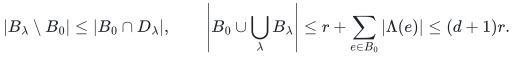

A failed label missing <code class="math">B_0</code> leaves that entire canonical basis unchanged.
Every other query has its canonical basis included in the retained union.
Canonical greedy basis elements in each prefix span that prefix, so this
containment preserves every prefix rank, including prefixes within ties.
At most <code class="math">dr+1</code> greedy scans give the construction cost. The lower example
of Section 3 with <code class="math">h=1</code> proves sharpness. This proves Theorem 3, including
signed costs and rank drops.

### 4.2 Linear input dependence for the sharp rank construction

First apply Theorem 5 using the input order; no cost sorting is needed.
Its output <code class="math">Q</code> has at most <code class="math">K</code> items and preserves every surviving rank.
Run the reverse deletion of Section 4 only on <code class="math">Q</code>. The final restriction
still preserves the ranks of the original ground and has the sharp
size <code class="math">rC</code>. The total number of independence queries is at most

<!-- math-display: f424cef5c456fd235303d38b
(N+K(K+1))\sum_{i=0}^{h}(dr)^i.
-->
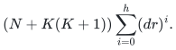

The first stage rescans the fixed ordered input once at each basis-tree
node. The final deletion stage scans only <code class="math">Q</code>. Indexed label flags and
sparse original-ID lists give
<code class="math">O((d+1)(N+K(K+1))\sum_{i=0}^{h}(dr)^i)</code> ordinary bookkeeping
operations after explicit label indexing. For fixed <code class="math">r,h,d</code> this is
linear in <code class="math">N</code>. The direct quadratic construction remains an alternative
with the same sharp output bound.

## 5. Submodular and entropy consequences

For monotone submodular <code class="math">f</code>, write <code class="math">H_e=\{x:A_x\cap B_e=\varnothing\}</code> and <code class="math">\delta_e=f(H_e)-f(H_e-e)</code>. The same permutation method gives
<!-- math-display: d0f1750f36ee77ff6391106a
\sum_e\frac{\delta_e}{\binom{|A_e|+|B_e|}{|A_e|}}\le f(H)-f(\varnothing).
-->
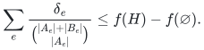
Indeed, order selected elements by their last own-label. Earlier selected elements lie in <code class="math">H_e-e</code>, so diminishing returns gives marginal at least <code class="math">\delta_e</code>. Sum the marginals and take expectations.

If <code class="math">f</code> is integer-valued with range <code class="math">R=f(E)-f(\varnothing)</code>, an inclusion-minimal exact failure-value summary has at most <code class="math">RC</code> items. The witness search extends directly: a positive current marginal for <code class="math">e</code> is a witness. Otherwise greedily form <code class="math">B\subseteq Y-e</code> with <code class="math">f(B)=f(Y-e)=f(Y)</code> and <code class="math">&#124;B&#124;\le R</code>. Since <code class="math">f(B+e)=f(B)</code>, any failure preserving <code class="math">B</code> keeps the marginal of <code class="math">e</code> zero by diminishing returns. Branch on the at most <code class="math">dR</code> labels on <code class="math">B</code> that avoid <code class="math">e</code>. The same induction and reverse deletion use <code class="math">O(N(N+1)\sum_{i=0}^{h}(dR)^i)</code> value queries. Without integrality, the valid cardinality-free conclusion is
<!-- math-display: 44d1ce09ecb72cbd93c74a1b
\sum_e\max_{\substack{|F|\le h\\\Lambda(e)\cap F=\varnothing}}
 [f(E_F)-f(E_F-e)]\le C R.
-->
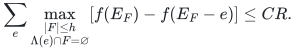
For finite joint Shannon entropy this becomes
<!-- math-display: de9ded7b01826fc52d0537a9
\sum_e\max_{\substack{|F|\le h\\\Lambda(e)\cap F=\varnothing}}
 H(X_e\mid X_{E_F-e})\le C H(X_E).
-->
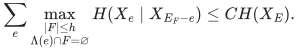
Copies of independent variables indexed by the <code class="math">d</code>-subsets attain equality.

The [ordered value-summary construction](manuscripts/weighted-oracle-prefix-fpt-construction.md#7-integral-submodular-prefix-values)
also permits the two-stage improvement above. With
<code class="math">K_f=\min\{N,\lfloor R\Gamma(h,d)\rfloor\}</code>, first form that
prefix summary, then apply value-preserving reverse deletion to it.
This retains at most <code class="math">RC</code> items with
<code class="math">O((N+K_f(K_f+1))\sum_{i=0}^{h}(dR)^i)</code> value queries.
The numerical range <code class="math">R</code> is a parameter; this is not a bound polynomial
in the binary length of <code class="math">R</code>.

## 6. The weighted boundary is an explicit obstruction

Start with a rank-four matroid on eight classes: every four-set is a basis
except <code class="math">\{0,1,2,3\}</code>, <code class="math">\{0,1,4,5\}</code>, <code class="math">\{0,1,6,7\}</code>,
<code class="math">\{2,3,4,5\}</code> and <code class="math">\{2,3,6,7\}</code>. Different forbidden sets intersect
in at most two elements, so among two or more one-element exchanges
sharing a three-set at most one is forbidden. This proves basis exchange.

The [explicit 13-item parallel extension](manuscripts/weighted-oracle-two-failure-obstruction.md#3-the-13-ordered-colored-items)
assigns one of four labels and cost <code class="math">2^{i-1}</code> to item <code class="math">i</code>. Its six
two-label-failure optima are unique and their union is all 13 elements.
Each omitted element therefore destroys some exact minimum-cost value,
although <code class="math">r\binom31=12</code>. The full table and its short greedy traces
are in the linked proof; the exact checker separately enumerates every
surviving basis and optimum.

For any <code class="math">h\ge2</code>, prepend <code class="math">h-2</code> copies of an underlying four-element
basis, each with its own new single label and earlier costs. Every item
in block <code class="math">j</code> is forced after the earlier block labels fail. Each original
item is forced after all block labels and its two original witness labels
fail. There are <code class="math">4(h-2)+13=4(h+1)+1</code> forced elements and the rank stays
four. All allowed failures still leave a basis. Direct sums give
<code class="math">r(h+1)+r/4</code> for <code class="math">r</code> divisible by four. This proves Theorem 4.

The represented lift is unaffected; the underlying eight-class matroid is
not representable over any field, as proved in the obstruction manuscript.
The rank-only theorem is also unaffected: the same 13-item example has a
nine-item restriction preserving every required surviving rank.

## 7. Exact low-rank weighted boundary under two failures

Let <code class="math">B_0</code> be the unfailed canonical basis. For each single label failure,
count the appearances of replacement item <code class="math">e\notin B_0</code> in its canonical
basis by <code class="math">t_e</code>, and put <code class="math">T=\sum_e t_e\le r</code>. The complete
[two-failure companion](manuscripts/two-failure-oracle-prefix-bounds.md)
proves

<!-- math-display: be9dd0c2465b5201969dfe81
|H_2|\le r+2T+\sum_e\binom{t_e-1}{2},
\qquad |H_2|\le r+4T.
-->
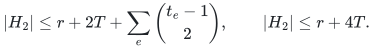

Rank losses under distinct failed classes are superadditive. Subtract the
surviving original-basis contribution from expected greedy rank under
independent label failures; the constant and first-order terms cancel,
and the second-order term gives the first inequality. Taking failure
probability one half gives the second. Randomness is used only in this
size proof.

Every replacement profile except <code class="math">T=r,t_x=r</code> immediately gives the
quadratic term in Theorem 6. In that exceptional case, prefix locality
forces the first <code class="math">r+1</code> critical items to form a circuit. A later item's
winning failed pairs form a complete multipartite graph: rank
submodularity makes the complementary closure relation transitive.
Its first genuine winner accounts for at least <code class="math">r-1</code> pairs, which gives
<code class="math">\binom{r+1}{2}+3</code>. All closure, prefix and counting steps are proved in
the companion, including unlabelled items and rank drops.

Three-copy partition matroids attain <code class="math">3r</code>. The 13-item obstruction
attains the rank-four upper bound. With at most three labels, the union
of at most three single-class-survivor canonical bases suffices at any
rank. These facts prove the claimed minimum rank, label count and ground
size. Uniqueness of the obstruction's optimum costs transfers its lower
bound to optimum-value-only preservation as well. This proves Theorem 6.

For the additional singleton case, rank-loss superadditivity confines all
new winners to pairs of witness labels, together with pairs containing the
label of <code class="math">x</code>. Contracting the other original-basis elements yields a
rank-<code class="math">t</code> circuit. Two explicit flat-intersection calculations preserve
these tests even when contracted elements carry failed labels. In that
quotient, a later item resolves the edges of a complete multipartite graph,
except possibly edges incident to its own failed label. The unresolved graph
has clique blocks; the potential <code class="math">\sum_B(2&#124;B&#124;-3)</code> drops at least one for
each new winner. It starts at <code class="math">2t-1</code> for labelled <code class="math">x</code>, giving
<code class="math">r+1+(2t-1)=r+2t</code>. The complete proof, a faster query enumeration and
sharp binary representations appear in Theorem 3 of the
[two-failure companion](manuscripts/two-failure-oracle-prefix-bounds.md).

## 8. Fixed contraction by single-failure rank losses

For each label meeting <code class="math">B_0</code>, compute the canonical basis <code class="math">B_\lambda</code> after
that single failure. Extend it to a full basis using items of
<code class="math">B_0\cap D_\lambda</code>. The added set <code class="math">Q_\lambda</code> has size <code class="math">\delta_\lambda</code>
and is independent over the entire complement <code class="math">E\setminus D_\lambda</code>.
Let <code class="math">Q</code> consist of these disjoint sets and the unlabelled items of <code class="math">B_0</code>.
Its size is <code class="math">r-T</code> and it is independent as a subset of <code class="math">B_0</code>.

Fix a failure set <code class="math">F</code>, and put <code class="math">Q_s=Q\cap E_F</code> and <code class="math">Q_f=Q\setminus E_F</code>.
The failed blocks are jointly independent over <code class="math">E_F</code>: when adding one
<code class="math">Q_\lambda</code>, every previously present item lies outside <code class="math">D_\lambda</code>,
so that block adds all of its <code class="math">&#124;Q_\lambda&#124;</code> rank. This argument also works
over every subset of <code class="math">E_F</code>. Therefore, for <code class="math">X\subseteq E_F\setminus Q</code>,

<!-- math-display: 083f89b6f6a817a6a8b8cdf3
r_{M/Q}(X)=r_M(X\cup Q_s)-|Q_s|
          =r_{(M|E_F)/Q_s}(X).
-->
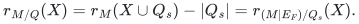

Greedy persistence gives <code class="math">Q_s\subseteq B_F</code>. Bases of the contraction
correspond to original bases containing <code class="math">Q_s</code>, with those common items
removed. Removing common items preserves lexicographic order, so the
canonical basis decomposes exactly as in Theorem 7. Intersecting that
identity with every original order prefix proves the corresponding rank
identity; taking unions over failures gives the exact minimum-summary
identity. This justifies contraction even for items whose labels fail.

Every proved rank-based support bound now applies at rank <code class="math">T</code>, followed
by reinserting the <code class="math">r-T</code> fixed items. Thus one failure has bound <code class="math">r+T</code>;
for <code class="math">h\ge2</code> the Bernoulli prefix refinement gives
<code class="math">r+h^hT/(h-1)^{h-1}</code>. For two failures, <code class="math">T\le3</code> gives <code class="math">r+2T</code> and <code class="math">T=4</code>
gives <code class="math">r+9</code>. A rank-one minor has a single-child basis tree with at most
<code class="math">h+1</code> nodes, which gives <code class="math">r+h</code>. A colored parallel chain with <code class="math">r-1</code>
unlabelled coloops attains that endpoint.

The [complete contraction proof](manuscripts/rank-loss-contraction-for-prefix-summaries.md)
includes the joint-independence argument, the contraction/deletion equality,
the original-prefix identity, query-set costs, the binary-budget cutoff,
and the <code class="math">T=0,1</code> cases. It makes no representation assumption, and it keeps
the item order fixed. This proves Theorem 7.

## 9. Optimal queries at residual rank at most two

**Theorem 8.** At rank at most two and with at most one label per item,
the exact union of canonical surviving bases can be constructed using

<!-- math-display: 8d4a43f7d6f8860a712eae5f
2N+\binom{k+1}{2}+(k+1)^2
-->
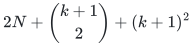

independence queries, where <code class="math">k</code> is the failure budget clipped to the
number of labels on nonloops. The output has at most <code class="math">2(k+1)</code> items.
For <code class="math">N\ge h+3</code>, computing this exact union requires
<code class="math">\Omega(N+h^2)</code> queries in the worst case.

**Proof.** The first surviving nonloop belongs to the first <code class="math">k+1</code>
distinct-label first occurrences, stopping at an unlabelled nonloop.
Classify these candidates into parallel classes. For each candidate
class, retain the first <code class="math">k+1</code> distinct-label occurrences outside the
class, again stopping at an unlabelled item. Each successful pair query
adds an entry to one of these bounded lists. Each input item is parallel
to at most one representative, so at most <code class="math">N</code> pair queries fail.
Together with the singleton and classification scans, this gives the
displayed bound. Exact unions of the labels preceding the first and
second candidates characterize feasible witnessing failures. Lemmas 3–5
of the [complete proof](manuscripts/optimal-rank-two-prefix-oracle-construction.md)
prove both directions, including repeated labels and rank decreases.

For the lower bound, use <code class="math">h+3</code> rank-two uniform core items. Making any
one pair among the first <code class="math">h+2</code> items parallel changes whether the last
item belongs to the summary, and only a query of that pair distinguishes
it. Prepending <code class="math">N-h-3</code> loops supplies independent single-loop variants,
each requiring a further distinguishing query. Theorem 2 of the companion
proves this oracle adversary in full. Its lower bound requires the exact
minimum output, since returning the entire ground needs no oracle calls. ∎

Combine Theorem 8 with Theorem 7's fixed contraction. For <code class="math">T=2</code> the total
query count is <code class="math">O(Nr+(h'+1)^2)</code>, and the sharp retained size is <code class="math">r+2h</code>.
For <code class="math">T=1</code>, the residual summary requires only <code class="math">N'</code> singleton queries.
The same direct algorithms terminate basis-tree nodes whenever their
actual surviving rank drops to one or two. The companion also proves
the arbitrary-rank endpoint <code class="math">N+r_U\ell</code> when every label may fail.
Ordinary computation, query-set encoding, and oracle calls retain their
separate ledgers.

## 10. Building represented lifts in their actual rank

Let <code class="math">\rho</code> be the row rank of the formal polynomial-label lift in
Theorem 1. The
[evaluation-module construction](../persistence-failure-certificates/manuscripts/feature-rank-construction.md)
starts with <code class="math">r</code> independent original rows and expands only accepted
coordinatewise products, in nondecreasing degree. Rejected degree-<code class="math">t</code>
rows are combinations of accepted rows of degree at most <code class="math">t</code>, so all
their required children lie in the span generated at the next degree.
Theorem 1 of that manuscript proves equality with the full truncated
module and identifies its earliest row pivots with the ordered column
basis. At most <code class="math">r+d\rho</code> candidate rows are considered. Thus
<code class="math">O(N\rho(r+d\rho))</code> field operations suffice after the explicit input
row selection and coefficient generation, even when the ambient lift
would be larger than the input. This construction retains exactly
<code class="math">\rho</code> columns and preserves every surviving prefix; it does not claim
that this represented lifted basis is always the minimum original summary.

## Complete proofs

[Represented lift and field construction](manuscripts/sharp-represented-matroid-failure-summaries.md); [arbitrary-matroid and submodular proofs](manuscripts/arbitrary-matroid-and-submodular-failure-summaries.md); [weighted oracle FPT construction](manuscripts/weighted-oracle-prefix-fpt-construction.md); [weighted two-failure obstruction](manuscripts/weighted-oracle-two-failure-obstruction.md); [two-failure profile bounds and exact rank-four maximum](manuscripts/two-failure-oracle-prefix-bounds.md); [rank-loss contraction and all-budget adaptive bounds](manuscripts/rank-loss-contraction-for-prefix-summaries.md); [optimal rank-two oracle construction](manuscripts/optimal-rank-two-prefix-oracle-construction.md); [actual feature-rank construction](../persistence-failure-certificates/manuscripts/feature-rank-construction.md).

**Attribution:** icekylinx and GPT-6 Astra Pro.
