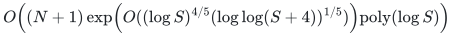

# Static and threshold min-cost flow

**Guarantee**

Exact static min-cost flow and exact insertion-only fixed-threshold feasibility with integral witness recovery.

**Objective and output**

Decide whether the integral demand can be routed under capacities and a cost threshold; when feasible, return an explicit integral flow while retaining original edge identifiers.

**Randomness**

Deterministic exact static and fixed-threshold constructions, with local flow-maintenance and edge-retirement proofs for the stated adaptive polynomial-length histories. Published numerical primitives are identified in the source map.

**Time**

<!-- math-display: ef3cbdd3ca6458cbdcbe6ec7
O\!\left((N+1)\exp\!\left(O((\log S)^{4/5}(\log\log(S+4))^{1/5})\right)\mathrm{poly}(\log S)\right)
-->

This substitutes the constructed raw-cycle bound into the generic lifetime theorem; its fixed fourth power is absorbed into the constant in the exponential. Explicit output of a full flow is charged separately.

**Space**

Polynomial binary storage for actual edge records and numerical state; stored values use logarithmic bit length in the declared cap. Writing the full flow is a separate output cost.

**Parameters**

<code class="math">N</code> bounds edge records over their lifetime, including the artificial initialization arcs; lazy initialization keeps their number linear in original edge births. <code class="math">n</code> and <code class="math">m</code> count vertices and current edges; <code class="math">S</code> is the declared power-of-two numerical cap, including the fixed full-stream artificial penalty. Capacities, costs, demands, and threshold are binary encoded.

**Model and representation**

Oriented multigraph with loops, parallel arcs, integral capacities, integral costs, integral divergence, and the explicit initial-flow or initialization interface.

**Lower-bound scope**

No lower bound is claimed. The generic interface theorem and its constructed four-fifths specialization are stated separately in the proof.

**Review status**

**Ready for review.** The complete static and insertion-only fixed-threshold moving-box log-barrier construction, instantiated with the locally realized raw-cycle search, numerical lifetime and retirement rules. Includes affine integral recovery, artificial-edge penalties and prefix-safe deferred initialization. The published-flow capacity-bit adapter is a separately proved alternative for exact max-flow calls.

**Dependencies and scope.** The numerical cap, polynomial adaptive-history horizon and full-flow output charge remain part of the theorem. The incremental result is a fixed-threshold guarantee, not a fresh optimal flow after every update. An infeasible early prefix does not imply permanent infeasibility. The alternative capacity-bit route uses van den Brand et al., arXiv:2407.10830v1, Theorem 6.17, with polynomial capacity relative to each actual call size. Its published algorithm is an external proof dependency; local finite adapter checks do not execute it.

The [verification note](verify/README.md) identifies executable coverage. This status does not claim external peer review or proof-assistant verification.

**Source**

[Complete theorem and proof](proof.md), [dependencies and primary sources](sources.md).

**Attribution.** icekylinx · GPT-6 Astra Pro
