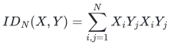
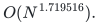
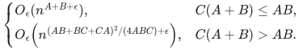
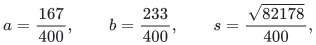

# Integral character profiles and ordered crossing circuits

A common integer circuit construction combines a full three-shape matrix bound with integral crossing pieces, ordered insertion and shared matrix products. It computes the noncommutative identity polynomial in <code class="math">O(N^{1.719516})</code> gates over every associative unital ring, using only constants <code class="math">0,1,-1</code>.

[Proof companion](proof.md) · [Complete mathematical manuscript](manuscripts/crossing.tex) · [Sources](sources.md) · [Finite verification](verify/README.md)

**Guarantee**

One chosen integer circuit family computes the free associative polynomial

<!-- math-display: c4d7becd3710c0cecb8b5004
ID_N(X,Y)=\sum_{i,j=1}^{N}X_iY_jX_iY_j
-->

and evaluates correctly in every associative unital ring, including characteristic two and rings with zero divisors. The construction combines normalization-one Schur-lattice crossing pieces with a full integral three-shape matrix theorem. It keeps individual character profiles before pairing them, preserves the order of every nonscalar product and shares the bilinear computations across both variable blocks.

**Objective and output**

The output is a noncommutative arithmetic circuit for <code class="math">ID_N</code>. Its gates perform addition and ordered multiplication, and its only scalar constants are <code class="math">0,1,-1</code>.

**Randomness**

Exact deterministic arithmetic circuits; circuit-description generation and arbitrary ring-element bit costs are separate from gate count.

**Time**

The selected circuit size is

<!-- math-display: 68ee88789c6d96e58481e4f8
O(N^{1.719516}).
-->

Its substantial matrix ingredient is one integer ordered bilinear circuit family for dimensions <code class="math">(\lceil n^A\rceil,\lceil n^B\rceil,\lceil n^C\rceil)</code>, for every fixed <code class="math">A\ge B\ge C\ge0</code> and positive <code class="math">\epsilon</code>, with gate bound

<!-- math-display: 275a51d1d5652f1fdda48f73
\begin{cases}
O_\epsilon(n^{A+B+\epsilon}),&C(A+B)\le AB,\\[2pt]
O_\epsilon\!\left(n^{(AB+BC+CA)^2/(4ABC)+\epsilon}\right),&C(A+B)>AB.
\end{cases}
-->

The zero boundary lies in the first case. All additions and scalar-linear work are charged. These are arithmetic gate counts; the bit cost of evaluating arbitrary ring elements and circuit-description generation time are separate resources.

**Space**

Circuit size bounds the stored arithmetic DAG. Straightforward evaluation stores at most that many ring values. No sharper evaluation-space bound is asserted. Finite coefficient queries in the construction use polynomial workspace in their partition-weight parameters; this does not imply polynomial workspace for evaluating the whole circuit.

**Parameters**

<code class="math">N</code> is the size of each of the two variable lists in <code class="math">ID_N</code>. The matrix theorem fixes its real shape parameters and exponent slack before choosing a finite integer witness. The selected circuit uses

<!-- math-display: 6d791408eba0a4dc9f030b44
a=\frac{167}{400},\qquad b=\frac{233}{400},\qquad
s=\frac{\sqrt{82178}}{400},
-->

with two shared matrix shapes that are permutations of <code class="math">(s+a,b,a)</code>. An exact rational padding certificate gives a strict gap below the displayed exponent and pays for all constant construction, rounding and partition factors.

**Model and representation**

The theorem is an identity in the free associative algebra over the integers. Integer constants map to central elements of any target associative unital ring; target variables may fail to commute. A separate fast algorithm for each field would not by itself imply this common integer family. The integral spectrum and convolution/sector constructions are explicit cited mathematical inputs. Neither a SAT solver nor a dense square-permanent evaluator is required.

**Lower-bound scope**

No optimality of the displayed circuit exponent is claimed. The result is a
common integer arithmetic circuit family; it gives neither a corresponding
bit-time bound for arbitrary ring representations nor a faster general
square-permanent algorithm. The full integral three-shape deduction has
explicit recent-source inputs, stated separately from its local proof.

**Review status**

**Ready for review.** Complete mathematical deduction of the common constant-free integer crossing circuit with exponent 1.719516, including the normalization-one lattice, ordered insertion, shared products and full integral three-shape composition, assuming the explicitly named integral spectrum/convolution/sector source interfaces.

**Dependencies and scope.** Recent integral tensor interfaces are cited mathematical premises recorded against the checkpoint source pin; this review does not freshly certify those source ingredients or import their formal build artifacts. The known field curve alone is not used as a universal ring theorem. The 10,825 exact finite checks cover the stated local components and rational certificate. They neither implement the asymptotic matrix/crossing engine nor formally verify the theorem. TeX cross-references were checked, but no local PDF build is claimed.

The [verification note](verify/README.md) identifies executable coverage. This status does not claim external peer review or proof-assistant verification.

**Source**

icekylinx and GPT-6 Astra Pro. Apache-2.0 under the repository [license](../../LICENSE). The [source map](sources.md) separates the released crossing construction, the established field-profile analysis, recent integral source ingredients and the reconstructed mathematical composition. The full curve was already known over fields; the selected construction preserves its stronger common-integer, ordered coefficient interface.
