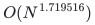
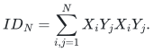
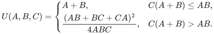
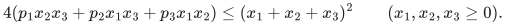
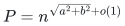
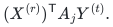
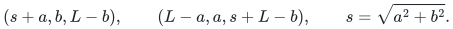
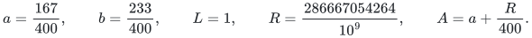
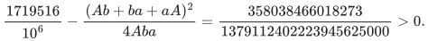

# Proof companion for integral ordered crossing circuits

[Statement](README.md) · [Complete mathematical manuscript](manuscripts/crossing.tex) · [Sources](sources.md) · [Finite checks](verify/README.md)

## The completed result and its resource

There is one integer noncommutative circuit family, using only constants <code class="math">0,1,-1</code>, of size

<!-- math-display: 698725192eb2a7629e8f26e8
O(N^{1.719516})
-->

for

<!-- math-display: 37af0d3bcc138bde86aa549a
ID_N=\sum_{i,j=1}^{N}X_iY_jX_iY_j.
-->

The same circuit evaluates correctly over every associative unital ring. Every addition, ordered multiplication and scalar-construction gate counts. The result is an arithmetic circuit theorem with cited source ingredients, not a uniform bit-time bound on arbitrary ring representations or a matching bound on circuit generation.

The retained [TeX manuscript](manuscripts/crossing.tex) contains the full local composition. Its external mathematical inputs are the integral spectrum, convolution and sector constructions of Zhou–Wang, the real-variable profile analysis of Amanov–van den Berg–Zuiddam, and standard symmetric-function and partition facts. The source boundary is explicit in [sources.md](sources.md). These are stated mathematical theorems and constructions; no missing fast evaluator is assumed.

## Full integer three-shape bound

For fixed <code class="math">A\ge B\ge C\ge0</code> and any fixed positive slack, multiplication of matrices of dimensions <code class="math">(\lceil n^A\rceil,\lceil n^B\rceil,\lceil n^C\rceil)</code> has one ordered integer bilinear family with exponent at most

<!-- math-display: f69e8e26b71543c9eb3278b8
U(A,B,C)=\begin{cases}
A+B,&C(A+B)\le AB,\\[2pt]
\dfrac{(AB+BC+CA)^2}{4ABC},&C(A+B)>AB.
\end{cases}
-->

Positive exponent slack is understood. At <code class="math">C=0</code> use the first branch. The full [integral proof](manuscripts/integral-three-shape.tex) works in the integer tensor semiring consisting of zero and tensors admitting a restriction to the unit. Restricting to this class is essential: a nonzero tensor such as <code class="math">2xyz</code> need not admit the unit over the integers.

For each individual character, retain the three oriented-dot parameters <code class="math">p_i\in[0,1]</code>. Integral shared-leg separation gives sector entropy; the determinant filtration gives discrete concavity with exactly the required factor two, and the three-sector construction gives coupled tripling. These statements hold before averaging a character with a permuted character. The weighted six-profile growth argument then proves

<!-- math-display: d0dc412c725d130d63e294bf
4(p_1x_2x_3+p_2x_1x_3+p_3x_1x_2)
\le(x_1+x_2+x_3)^2
\qquad(x_1,x_2,x_3\ge0).
-->

The matrix-character exponent is <code class="math">Ap_2+Bp_3+Cp_1</code>. Substitute <code class="math">(A+B,B,A)</code> for the flat region and use nonnegativity of <code class="math">p_1</code>. Substitute <code class="math">(AB,BC,CA)</code> in the other region. These give the two branches above, after consistent leg labeling. Integral spectral duality converts this character bound to integer asymptotic rank.

Fix positive slack before selecting a finite integer rank witness. Recursion on that ordered bilinear witness charges scalar-linear work as well as products: rational flattenings lower-bound its rank by each input/output dimension, so the full operation count is bounded by the rank recurrence with a logarithmic overhead. Rational approximation, padding and the reserved slack cover real shapes. Integer coefficients of the fixed witness are generated by additions and negations. Thus the family is selected before its target ring.

The full curve itself is established over fields by Amanov–van den Berg–Zuiddam. The substantive composition here transfers the unpaired profile argument to integral source ingredients and carries its common integer witness through an ordered circuit construction. It does not infer a universal-ring theorem from the bare existence of separate algorithms over every field.

## Integral crossing and ordered insertion

The [finite crossing proof](manuscripts/finite-crossing.tex) derives the operator identity by central commutators and a finite matching expansion. The [Schur-lattice proof](manuscripts/integral-pieces.tex) changes the original monomial normalization to one, so both factorizations have integer entries. The [coefficient algorithm](manuscripts/coefficient-computation.tex) gives explicit finite queries with polynomial bit height and bounded workspace.

For base dimensions <code class="math">p=n^{a+o(1)}</code> and <code class="math">q=n^{b+o(1)}</code>, minimal partition weights and the two factorization ranks yield a mixed crossing with

<!-- math-display: 487dc464162b10cfe892174d
P=n^{\sqrt{a^2+b^2}+o(1)}
-->

rank-one terms, with polynomial-logarithmic factors charged explicitly. Its two orientations contract against <code class="math">X_xY_yX_vY_u</code>. Row terms multiply two ordered bilinear outputs. Column terms require simultaneous insertion of a middle output between two linear forms. The [insertion lemma](manuscripts/ordered-insertion.tex) constructs all such terms together by bihomogenization and transposition of a scalar-linear circuit. It uses addition, multiplication and central integer coefficients; it never divides by two. Both factor families remain shared.

Partitioning both target variable lists into blocks gives all replicated forms as

<!-- math-display: b8f4e1791fe6e4422974a634
(X^{(r)})^{\mathsf T}A_jY^{(t)}.
-->

Stack the coefficient matrices, multiply once by the matrix of <code class="math">Y</code> blocks, reshape, then multiply by the matrix of <code class="math">X</code> blocks. The two multiplication shapes are

<!-- math-display: c105d76fa86644ec12c77663
(s+a,b,L-b),\qquad(L-a,a,s+L-b),\qquad s=\sqrt{a^2+b^2}.
-->

The [shared-products proof](manuscripts/shared-products.tex) charges all output forms and insertion overhead. When <code class="math">a+b=L</code>, the shapes are permutations of <code class="math">(s+a,b,a)</code>. Integer tensor-leg permutations reinterpret the left/right input roles; they do not commute target-ring values.

## Exact selected exponent and constant-free conversion

Choose

<!-- math-display: 8455b615e13226ef67272431
a=\frac{167}{400},\qquad b=\frac{233}{400},\qquad L=1,
\qquad R=\frac{286667054264}{10^9},\qquad A=a+\frac R{400}.
-->

Integer squaring proves <code class="math">R^2&gt;82178</code>, so padding permits the rational matrix shape <code class="math">(A,b,a)</code>. The shape lies in the curved region. Exact substitution gives

<!-- math-display: 8582b3e7aa7c6a24f855f779
\frac{1719516}{10^6}
-\frac{(Ab+ba+aA)^2}{4Aba}
=\frac{358038466018273}{1379112402223945625000}>0.
-->

Fix the matrix witnesses with exponent slack inside this strict gap. Crossing coefficients have polynomial logarithmic bit length, and the fixed matrix witnesses use only a fixed finite set of integer coefficients. Replacing an integer scalar of bit length <code class="math">d</code> by binary doubling, addition and a possible negation costs <code class="math">O(d+1)</code> gates. This adds a polynomial-logarithmic factor, also absorbed in the strict gap. Scalar-only subcircuits remain as circuits rather than being collapsed into unanalyzed constants.

All final identities hold in the free associative algebra over the integers, so evaluating the chosen circuit in any associative unital ring preserves the polynomial, including in characteristic two and with zero divisors. The decimal exponent is an explicit upper bound from the displayed rational choice; global optimality is not claimed.

Established integer identities also transfer this construction to the degree-four distinct-index polynomial and row-ordered four-row rectangular permanent. Their complete short identities appear at the end of the manuscript. They are inherited outputs, with a constant-factor matrix simulation, and are not presented as additional algorithmic contributions. The number of rows stays four.

**Attribution:** icekylinx and GPT-6 Astra Pro. Apache-2.0.
