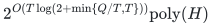
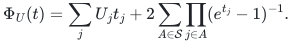

# Numeric targets and support-sensitive optimization

Exact feasibility and signed-scalar optimization under one global integral polymatroid, with bounds that retain target size and support geometry.

The [native CC reference](reference/README.md) supplies exact mixed-target
decision and signed-scalar recovery on complete original tables. Its finite
LP costs and [partial mathematical audit](reference-realization.md) are
separate from the full refinement family and the theorem bounds below.

**Objective and output**

Decide nonnegative integer upper, equality and covering targets; return an attaining integer vector for the exact minimum or maximum of one rational scalar. Approximation variants specify their own direction.

**Randomness**

Deterministic upper algorithms in the stated exact rank/optimization-oracle model. The success-probability-`2/3` randomized statement is an oracle lower bound, not a randomized upper algorithm.

**Time**

For total target <code class="math">T&gt;0</code> and <code class="math">Q&gt;0</code> distinct original nonempty eligible-column supports:

<!-- math-display: 9d066e8a87642fb6b89ffa91
2^{O(T\log(2+\min\{Q/T,T\}))}\mathrm{poly}(H)
-->

Cases <code class="math">T=0</code> or <code class="math">Q=0</code> are polynomial. The results below give distinct refinements.

**Space**

Uniform polynomial binary workspace, including infeasible instances.

**Parameters**

<code class="math">T=\sum_jT_j</code>; <code class="math">Q</code> counts distinct supports, not coefficient values; <code class="math">d</code> is row dimension; <code class="math">H</code> includes the full binary input and charged polynomial oracle work; <code class="math">H_\epsilon</code> also includes the rational accuracy.

**Model and representation**

One normalized monotone integral polymatroid, with exact rank access or a readable implementation of that rank. Counts and capacities are binary encoded. Each result states optional-vector or original-total-base feasibility. The scalar may be signed.

**Lower-bound scope**

For every budget pair <code class="math">t\ge512,q\ge1</code>, a rank-oracle family with <code class="math">T\le t,Q\le q</code> requires at least <code class="math">2^{t\log_2(2+\min\{q/t,t\})/256}</code> queries, including bounded-error randomized decision. Separate ETH results use readable rank programs; they are not hardness claims for every explicit matroid class.

**Review status**

**Ready for review in the stated scope.** The complete central BC budget-classification proof, including its original-support and total-target upper dependencies and calibrated bounded-error hidden-matroid query lower bound; the complete UP useful-prefix/interval construction; the complete CC mixed-target chain representation and direct bounded coefficient-profile recovery/counts. Includes a native CC exact mixed-target signed-scalar solver with original eligibility, optional versus mandatory mass, polynomial copied-ground representation, streamed occupied profiles, exact shared-resource recovery and producer-independent original verification.

**Dependencies and scope.** The executable implements CC covering-row permutations, retaining its explicit factorial cover factor; it does not implement the stronger mixed-support UP interval compiler. Generic streamed exact LP recovery has a separately charged `binom(M,D)` active-system factor for actual remaining rows and free dimension. The fast mathematical bounds pay named polynomial SFM/weighted-intersection primitives. Complete original-table input, all rational work and binary ranks/targets are charged; no copied-ground subset table or resource-unit list is expanded. This partial review does not cover the seven approximation schemes and constants, every fixed-dimensional/single-objective/support-geometric refinement, all encoded ETH families or nonlinear/global/mandatory/robust compositions. Those retain their linked mathematical statements and dependencies; no whole-family readiness is claimed. The BC lower bound is worst-case under parameter upper budgets in the rank-oracle model, including its stated bounded-error scope. It is not an exact-pair or representation-independent hardness statement. Finite exact checks and internal proof review are not proof-assistant formalization, external peer review or an exhaustive priority audit.

The [verification note](verify/README.md) identifies executable coverage. This status does not claim external peer review or proof-assistant verification.

**Source**

[Main theorem and proof](proof.md), [all companion manuscripts and primary sources](sources.md).

## Results

Each time bound includes <code class="math">\mathrm{poly}(H)</code> unless another input size is shown.

**Arbitrary row count and support**

<code class="math">2^{O(T\log(2+\min\{Q/T,T\}))}</code>; matching worst-case rank-query order under parameter budgets.

**Fixed dimension <code class="math">d</code>**

<code class="math">\exp(O_d((T+1)^{d/(d+1)}))</code>; matching exponent on balanced-target oracle families.

**Unequal positive auxiliary caps <code class="math">U_j</code>**

<code class="math">\exp((d+2(2^d-1))K(U))</code>, where <code class="math">K(U)=\max_{\varnothing\ne S}(\prod_{j\in S}U_j)^{1/(&#124;S&#124;+1)}</code>. For two caps: <code class="math">\max\{\sqrt{U_1},\sqrt{U_2},(U_1U_2)^{1/3}\}</code>.

**Single integer objective, one exact scalar side condition**

Target decision in <code class="math">2^{O(\sqrt{T+1})}</code>; exact optimization in <code class="math">2^{O(\sqrt{\mathrm{OPT}+1})}</code>.

**Seven single-resource approximation variants**

A <code class="math">(1-\epsilon)</code> maximum or <code class="math">(1+\epsilon)</code> minimum, with exact side constraint, in <code class="math">\epsilon^{-1}\exp(141/(50\epsilon)+7)\mathrm{poly}(H_\epsilon)</code>.

**At most one target row per column**

<code class="math">\exp(3\sum_j\sqrt{U_j})\le e^{3T}</code>, where upper/equality rows use <code class="math">U_j=T_j</code> and covering rows use <code class="math">U_j=2T_j-1</code>.

**At most two target rows per column**

<code class="math">\exp(O(T\log(2+m/T)))</code> for <code class="math">m</code> distinct interacting row pairs. Dense instances give the <code class="math">T\log T</code> oracle boundary.

**Disconnected support geometry**

Product of the component partition bounds; the resource recovery remains one global problem.

**Unequal targets and actual support family <code class="math">\mathcal S</code>**

Profile count at most <code class="math">\exp(\inf_{t&gt;0}\Phi_U(t))</code>, with

<!-- math-display: d4461d6128b7b5b561d252a3
\Phi_U(t)=\sum_jU_jt_j+2\sum_{A\in\mathcal S}\prod_{j\in A}(e^{t_j}-1)^{-1}.
-->

Any required cover-lift preparation is charged separately.

**Connected star, <code class="math">k</code> unit leaves and center target <code class="math">B</code>**

<code class="math">\exp(O(k\log(2+B/k)))</code> when every nonzero column touches a leaf. Matching-order oracle and encoded-ETH families are provided.

**Selected disjoint objective blocks**

<code class="math">\binom qr\exp(O(r\sqrt{T+1}))</code> for an actual rank-<code class="math">r</code> selected basis; the integer grid is part of the parameter.

**Global allocation and scheduling**

Allocation <code class="math">\binom qr\exp(O(r/\epsilon))</code>; mandatory scheduling <code class="math">\exp(O(q/\epsilon))</code>; six-profile <code class="math">3/2</code> endpoint <code class="math">6^q</code>. Exact shared budgets and original totals are retained.

**Mandatory fair allocation and adaptive scenarios**

Charged active/passive copies retain all units and costs; a common selection is combined with separate scenario assignments.

**Compressed nonlinear utility, cost and load**

Polynomially many binary-length marginal bands preserve the corresponding linear profile bounds.

**Aligned nonlinear numeric rows**

Convex upper rows, concave covering rows and linear equalities inherit the linear exact bound; overlap is measured on the refined band columns.

Zero-coefficient coordinates retain their actual costs and resource contributions. Optional disposal is added only to an originally optional problem. The numeric parameter is the integer target, not its encoding length or approximation accuracy.

**Attribution:** icekylinx and GPT-6 Astra Pro.
