# Exact numeric-target schemes for global-resource fairness and scheduling

**25 October 2026. Complete transfer; full root and two independent
internal reviews passed.** This extends the one-block exact count-profile algorithm
to disjoint utility or load blocks, one arbitrary global integral
resource polymatroid, actual optional player/machine selection, and
one exact shared setup-plus-assignment budget.

For an integer target T, exact target feasibility and an actual integer
witness can be found in

<!-- math-display: 89daeecfd763adbc1a743126
\binom qr\exp\bigl(O(r\sqrt{T+1})\bigr)
                     \mathrm{poly}(H+\log(T+1))
       \tag{BQ1}
-->
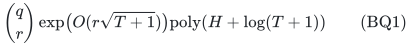

time and polynomial binary space. Here an actual rank-r basis of a
selection matroid chooses the participating blocks from q candidates.
When the blocks are all compulsory, put r=q and omit the binomial
factor. Both optional-resource and mandatory-base fair allocation
are covered, by different exact recovery constructions. Scheduling
always retains its original mandatory resource base.

Exact optimization has the same form with T replaced by OPT/g, where
g is a common positive rational grid of the original values or times.
This is a numeric-parameter theorem, not a square-root-accuracy EPTAS.

## 1. Resource, objective blocks and the two allocation models

Let E be an explicitly listed coordinate ground, partitioned into
q disjoint blocks E_p. Let F be normalized, monotone, integral and
submodular, with original total R=F(E). It is supplied by an exact
rank oracle. Counts are nonnegative integers and may be binary-large.

A rank-r selection matroid M on the blocks chooses an actual basis
B. Counts are supported on the original eligibility mask and on
the union of blocks selected by B. The selection is integral before
any resource optimization. Fixed compulsory blocks are the special
case of the unique selected set P.

Coordinate e has nonnegative rational assignment cost c_e. Selecting
p incurs nonnegative rational setup cost sigma_p. The one exact
combined budget is

<!-- math-display: 173bb8c0effe382ac4215748
\sigma(B)+c x\le C.                  \tag{BQ2}
-->
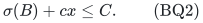

In fair allocation, each coordinate has a nonnegative INTEGER value
v_e, and the objective is

<!-- math-display: f2ec023236c99b6a6ad19c89
\max\min_{p\in B}\sum_{e\in E_p}v_e x_e.   \tag{BQ3}
-->
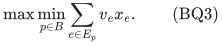

There are two distinct feasible resource families:

- **Optional resources:** x belongs to P(F); unused units are allowed.
- **Mandatory resources:** x belongs to B(F); the original total R is
  required after every eligibility or selected-set restriction.

In scheduling, each coordinate has nonnegative INTEGER processing
time ell_e, x must belong to the original B(F), and the objective is
the minimum of the maximum selected-block load. A global resource
base does not silently impose additional named type totals. Such
totals follow in the direct-sum recipient-type case; for arbitrary
F they must be part of its actual encoded resource structure.

The original coordinates, rank-value bounds and all rational cost
and setup data have encoding H. Integer values/times and the target
are stored in binary. No polynomial dependence on their numerical
magnitude is hidden in a per-profile subroutine.

## 2. Exact zero and original-feasibility gates

For optional-resource allocation, zero counts are legal on any basis
with sigma(B)<=C. A minimum-setup basis supplies such an initializer,
or certifies that none exists. A general implementation may simply
enumerate all actual bases; its cost fits BQ1.

For mandatory allocation or scheduling, enumerate the actual bases B.
Reject unaffordable setup. Let A_B be the allowed assignment ground.
Reject F(A_B)<R. Otherwise minimize the actual assignment cost over
the restricted resource base at ORIGINAL total R and compare it with
C-sigma(B). This is an integral polynomial optimization. If every
selected basis fails, the original instance is infeasible. Otherwise
retain an actual original full-base solution as an initializer.

Zero fair utility needs no extra gate after original feasibility.
For scheduling target zero, repeat the selected-basis checks using
only zero-time assignments while retaining R and the complete budget.
This exactly decides zero makespan.

If R=0, every mandatory feasible allocation has zero counts. A
rank-zero selected set is handled separately: no nonzero assignment
can be supported, and the empty objective convention is not folded
into a minimum or maximum over nonempty selected blocks. Below r>=1.

## 3. The exact partition-count intersection primitive

Suppose the current coordinate ground is partitioned into groups
D_1,...,D_m with prescribed nonnegative integer counts h_1,...,h_m.
Let N=sum_i h_i. The constraints x(D_i)<=h_i define an integral
partition-count polymatroid K_h, with rank

<!-- math-display: 1a45ce2826858ffc0bd5aa16
K_h(S)=\sum_{i:S\cap D_i\ne\varnothing}h_i.
                 \tag{BQ4}
-->
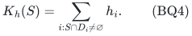

Intersect it with the current resource polymatroid. The total is at
most N. If the intersection cannot attain N, the exact profile is
infeasible. Otherwise its total-N face is nonempty and integral,
by two-polymatroid intersection integrality. All group upper bounds
are tight there because their caps sum to N.

Minimize the actual assignment cost on this face. An integral
minimizer meets the exact residual budget if and only if some
integer vector of this profile does. Thus every successful profile
gives exact integer group counts and an actual cost-feasible output.
The budget halfspace is not asserted to preserve integrality; it
is tested through scalar optimization on the integral face.

For an original mandatory base, use N=R. For optional resources,
N is instead the total number of prescribed useful units. A profile
with N above the available resource rank fails. These two total
conventions are not interchangeable.

All optimizations use polynomial paid oracle work on the explicit
coordinate ground. They require no expansion into N individual units.

## 4. Counting positive value-class profiles

At a block, group coordinates with the same positive integer
auxiliary value a. There is at most one group for each occupied
positive value. For an integer bound U, a profile satisfies

<!-- math-display: 49beb56bd512d0ed0593292e
\sum_{a>0}a h_a\le U.                \tag{BQ5}
-->
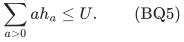

It injects into an integer partition of total at most U. For U>=1,
the elementary cumulative partition bound is

<!-- math-display: fb76b2006939c0e5748d2928
\#\{h:\text{BQ5}\}
   \le e^{tU}\prod_{j\ge1}(1-e^{-tj})^{-1}
   \le\exp(tU+2/t).
 \tag{BQ6}
-->
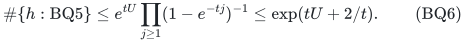

Set t=1/sqrt(U) to obtain exp(3sqrt(U)). When U=0 there is one
all-zero positive profile. The product is an analysis device only.

Only the at most |E| occupied positive values are stored. Given
partial weight W, the next count ranges from zero to floor((U-W)/a),
and may also be capped by the remaining available total. Every
generated partial vector has an all-zero completion with weight at
most U. Hence all traversal work, including final profiles that
fail a lower target or resource test, is polynomial per profile
counted in BQ6. This is not an enumeration of a table indexed by U.

Counts, partial weights and coefficients have polynomial binary
length. Cartesian products across r selected blocks are streamed;
the combined state count is exp(3r sqrt(U)), up to a polynomial
traversal factor.

## 5. Exact fair target with optional resources

Fix integer T>=1 and an actual affordable selected basis B.
Discard zero-value coordinates; this is legitimate here because
resources are optional and assignment costs are nonnegative.
Credit every remaining coordinate with

<!-- math-display: f52a551aaa366604c8978af4
a_e=\min\{v_e,T\}.                \tag{BQ7}
-->
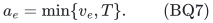

At each selected block enumerate counts by its occupied credited
value classes such that

<!-- math-display: c9ac9fd06e859c29a315bb77
T\le\sum_{a>0}a h_{p,a}\le2T-1.
                    \tag{BQ8}
-->
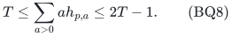

Generate through the upper bound 2T-1 and filter the lower bound
at completion. Let N be the total prescribed positive count over
all selected blocks. Apply Section 3 to all these disjoint positive
groups, with total N in the restricted original resource P(F).

If the minimum cost is within C-sigma(B), the integer output has
credited utility at least T at every selected block, hence true
utility at least T. All original resource inequalities and the
exact combined budget hold.

Conversely, consider any integer full-T original allocation.
Capping at T preserves its target. At each block, keep a first
prefix of positive capped units whose sum reaches T. Before its
last unit the integer sum is at most T-1, and the last unit is at
most T. The retained utility lies in [T,2T-1]. Delete all other
assigned units. The resource vector only decreases coordinatewise,
so it remains in P(F), and its nonnegative cost cannot increase.
Its counts give one enumerated profile passing the exact cost test.

Thus the target gate is an exact equivalence. It does not incur
rounding loss or merely return a weak target approximation.

## 6. Exact fair target with a mandatory original base

Now no real resource unit may be deleted. For a selected basis B,
retain its original full allowed rank R and the actual costs.
Replace each allowed coordinate e by active and passive copies,
both carrying true cost c_e, with shared resource rank

<!-- math-display: 9808481c37e4fa4dc391cf66
F^{\uparrow}(S)=F(\pi(S)).           \tag{BQ9}
-->
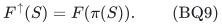

For every nonnegative copy vector z, its aggregate
x_e=z_(e^a)+z_(e^p) is independent exactly when z is independent
in this lifted rank. Totals agree, so lifted bases correspond
exactly to original bases. The costs also agree under aggregation.
No independent extra resource capacity has been introduced.

Give active copies credited value min(v_e,T), and passive copies
value zero. Keep every passive and original zero-value coordinate.
Enumerate each selected block's positive active value-class counts
under BQ8. Let N be their global total count. If N>R, reject.

Put ALL zero-credited coordinates, across every selected block,
in one global zero group. Prescribe its count to be

<!-- math-display: 289b22a026d8b699de730879
h_0=R-N.                     \tag{BQ10}
-->
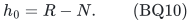

The positive group caps and this one zero-group cap sum to R.
Apply Section 3 to the lifted resource at total R. Thus each
positive active class count is exact and all remaining original
units are retained in the global zero group. There is no need
to guess how the passive count splits among players.

Success gives a full lifted base within the actual budget.
Merging both copies returns an original base; each player's
true utility dominates its credited active utility and is at
least T. Its setup fee remains fixed.

For completeness, start from an integer full-T original base.
At every selected block mark only a first-reaching positive
capped prefix active and mark all remaining units passive.
The active sum lies in [T,2T-1]. This relabeling preserves the
entire base and every actual cost. It supplies an enumerated
profile and exactly the global zero count R-N. The exact cost
test therefore succeeds on some profile.

This proof preserves mandatory resources even if the global rank
couples all players and types. The unit-prefix argument is only
an existence proof of counts; the algorithm never lists units.

## 7. Exact scheduling target

Fix integer T>=0 and an actual selected machine basis B. Every
original mandatory resource unit remains required. Forbid positive
processing times above T, and reject any loss of original rank R.

At each selected machine enumerate exact positive processing-class
counts with

<!-- math-display: a4f1710b6c4be8ca5eb1c7da
\sum_{a>0}a h_{p,a}\le T.             \tag{BQ11}
-->
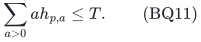

Let N be the total positive count. Reject N>R. All zero-time
coordinates, across all selected machines, form one zero group
with prescribed count R-N. The partition caps sum to R.
Use Section 3 on the restricted ORIGINAL resource at total R
and minimize the actual assignment cost.

A successful integer profile has exactly the prescribed class
counts, so every actual machine load is at most T. The complete
original base and setup-plus-assignment budget are preserved.
Every original integer full-T schedule has one enumerated count
profile and the same zero count, proving completeness.

For T=0 there is only the zero positive profile; this is the
original-rank minimum-cost gate on zero-time coordinates. Exact
target decision is therefore polynomial per selected basis at
zero, and uses BQ6 with U=T at positive targets.

## 8. Explicit time and binary-space bounds

For either fair-allocation model, at T>=1 each selected block
has at most exp(3sqrt(2T-1)) profiles. Thus the exact target time
is at most

<!-- math-display: dc04e78fabe9b250c07eb539
\binom qr\exp\bigl(3r\sqrt{2T-1}\bigr)
                     \mathrm{poly}(H+\log(T+1)).
       \tag{BQ12}
-->
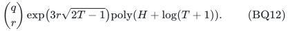

For scheduling at T>=1 it is at most

<!-- math-display: d2c1e024f49204672207c3be
\binom qr\exp\bigl(3r\sqrt T\bigr)
                     \mathrm{poly}(H+\log(T+1)).
       \tag{BQ13}
-->
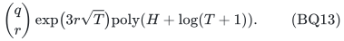

Zero targets and original feasibility cost binomial(q,r)*poly(H).
These bounds include failed selected bases, rank checks, every
generated partial profile and every infeasible cost subproblem.
They imply the common form BQ1 for T>=0.

There are at most |E| occupied value classes before lifting and
at most twice as many coordinates afterward. Group identifiers
are actual binary values, not positions in a length-T array.
Profiles and the global zero count are binary. Partition rank
evaluation and lifted rank evaluation each use polynomial work;
the latter uses an image set and one original rank query.

One streamed selected basis, the current block profiles, one exact
intersection solver and the best actual output fit in polynomial
space in H+log(T+1). No state table of exponential profile size,
unit expansion, or numerical-length list of values is stored.

## 9. Exact optimization on an original rational grid

The theorems also apply to nonnegative rational original values or
times. Choose a common positive rational grid g dividing all positive
coefficients of the relevant objective, and divide those coefficients
by g. They become nonnegative integers. A common denominator and gcd
give a largest such grid with polynomial encoding. Every original
integer utility and load lies on this grid.

Let

<!-- math-display: 3b8d16fb8a44c862965a8465
B_*={\mathrm{OPT}}/{g}.            \tag{BQ14}
-->
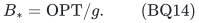

It is an integer on an originally feasible instance. If no positive
coefficient exists, the initializer has exact objective zero.

For fair allocation, query integer targets 1,2,4,... until the
first exact failure. If target one fails, B_*=0 and the initialized
solution is optimal. Otherwise the first failure is at most 2B_*,
and the last success is a lower bound. Exact integer binary search
between them ends at B_* and returns its saved optimal original
allocation. The same selected basis need not be used at different
targets; all actual bases are considered by every complete gate.

For scheduling, test target zero first. If it fails, B_*>=1.
Query 1,2,4,... until the first success, which is at most 2B_*.
Binary search between the last failure and first success finds
the exact optimum and a corresponding actual selected basis.

Every queried target is O(B_*+1). Also B_* is bounded by the
original resource rank times the largest normalized coefficient,
so the number and encoding length of the target calls are
polynomial in the original binary input. Consequently exact
optimization has time

<!-- math-display: 561e8fa4b256ee42b363b43f
\binom qr\exp\bigl(O(r\sqrt{B_*+1})\bigr)
                          \mathrm{poly}(H),              \tag{BQ15}
-->
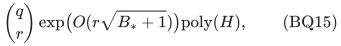

and polynomial binary space. More explicitly, for B_*>=1 the
fairness exponent in BQ12 is at most 6r sqrt(B_*), and the
scheduling exponent in BQ13 is at most 3r sqrt(2B_*), up to the
polynomial number of target calls. The uniform B_*+1 form
also includes zero optimum without a special exponential convention.

## 10. Explicit adaptive scenarios with a common selected basis

The exact target proof also composes over a nonempty explicit list
of scenarios. Each scenario may have its own global rank, original
mandatory total where applicable, values or times, eligibility,
assignment costs, setup vector and exact upper budget. The actual
selected basis B is common; scenario allocations may adapt.

Enumerate B and check original feasibility in EVERY scenario.
For optional allocation this includes all scenario setup charges;
a minimum under one setup vector cannot substitute for these checks.
Mandatory resources require every original rank and minimum-cost
base test. At a target, run the exact fixed-B gate separately in
each scenario. If one fails, reject B; if all pass, retain the
same B and their actual integer outputs.

A robust target witness supplies a successful profile in each
scenario for its common basis. Conversely all successful scenario
outputs are exactly legal. Their searches add over scenarios;
the algorithm does not enumerate a Cartesian product of scenario
profiles. BQ12--BQ15 therefore retain their profile factors with
polynomial dependence on the complete explicit scenario input.

Use a common original objective grid across scenarios. Robust
max-min value or worst-scenario makespan remains integral on it,
so the same exact doubling and binary-search argument applies.
The output contains explicitly many separate resource vectors,
with polynomial total encoding.

This is not a multiple-budget theorem for one common integer
allocation. Each scenario recovers its own vector and preserves
its own one exact scalar budget.

## 11. Meaning, lower-bound scope and the accuracy boundary

With one objective block, these arguments include exact budgeted
matroid independent-set maximization, exact maximum-value matroid
base, and exact constrained minimum-base optimization, as well as
their binary integral-polymatroid counterparts. The one-block
manuscript [exact-numeric-target-single-matroid-scheme.md](exact-numeric-target-single-matroid-scheme.md) also
handles the lower scalar side row and exact objective equality.

The separate all-seven hidden-oracle construction has integer
optimum Theta(n^2) and requires 2^(Omega(n)) rank queries.
Thus a square-root numeric exponent is necessary already for
one block in the relevant matroid subclasses. This does not
prove that the factor r in BQ15 is necessary, or establish a
matching lower bound for a specific explicit graphic or linear
representation.

The method uses one resource polymatroid and one disjoint
count-partition polymatroid. Overlapping weighted utility/load
supports, two unrelated resource ranks, or several simultaneous
exact cost rows do not follow. Arbitrary extra named type totals
also do not follow from a general global base.

Finally, B_* is an ORIGINAL numeric objective measured in grid
units. It may be much larger than 1/epsilon. Scaling arbitrary
coefficients to a coarser grid can accumulate error over the
number of selected units, which may be binary-large. Hence
BQ15 does not imply a `2^(O(r/sqrt(epsilon)))` approximation
scheme. The established approximation and exact numeric-target
parameters remain distinct.

This note attributes the one-block exact profile primitive to
the companion NT manuscript and the charged passive lift to
the companion PB manuscript. It makes no publication-priority
claim. Its contribution is the complete disjoint-block/global-
resource composition, with the single global zero group,
selection and initialization details, and exact scenario lift.
