# Exact mixed numeric targets with a tight fixed-dimensional exponent

**25 October 2026. Complete theorem and proof; two independent internal full reviews passed, including the unequal-target refinement.**
This increment permits overlapping target rows. It is an exact
numeric-parameter theorem, not an approximation scheme.

## 1. The theorem and its scope

Fix a positive integer d. Let F be one normalized monotone integral
submodular rank on an explicit coordinate ground E. Integer resource
vectors belong either to P(F) or to B(F). Capacities and rank values
are binary encoded; no unit expansion is assumed.

For j=1,...,d, let a^j be a nonnegative integer vector, let T_j be a
nonnegative integer, and independently choose a relation rho_j from
{<=, =, >=}. Rows may overlap arbitrarily. Write

<!-- math-display: f455bc6cf117194fcd9fa220
{\cal X}=\{x\in P(F)\cap\mathbb Z^E:
              a^j x\ \rho_j\ T_j\text{ for all }j\},
 \qquad T=\sum_{j=1}^d T_j .
 \tag{MD1}
-->
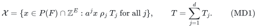

The base version replaces P(F) by B(F). Original eligibility masks
are allowed. An original base always retains its original required
total; a restriction never silently redefines that total.

For any rational scalar functional w, one can detect emptiness and
compute either its exact minimum or its exact maximum over X in

<!-- math-display: 74d9281a17905a5523c2be64
\boxed{\exp\!\bigl(O_d((T+1)^{d/(d+1)})\bigr)
              \mathrm{poly}(H)}
 \tag{MD2}
-->
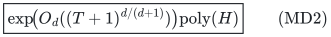

time and polynomial binary space, for fixed d. Here H is the full
input encoding, including the targets and paid polynomial rank-oracle,
submodular-minimization and weighted polymatroid-intersection work.
The output is an actual integer resource vector.

Consequently, one additional arbitrary rational upper or lower scalar
side condition is decided exactly by optimizing that scalar in the
appropriate direction. This does not add an unrelated second scalar
objective under that side condition.

The exponent d/(d+1) in MD2 is tight in the rank-oracle model for
fixed d: even d equality rows on ordinary matroid bases require

<!-- math-display: 1c5d82c40a9f7ac0ecbc56a4
\exp(\Omega_d(T^{d/(d+1)}))
 \tag{MD3}
-->
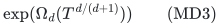

queries in the worst case. The lower bound includes bounded-error
randomized decision algorithms with success probability at least 2/3.
The statements concern the order of the exponent, not its constant,
and do not assert such a lower bound for an explicit graphic or
linearly represented matroid.

## 2. Exact optional-to-base representation and zero targets

Let R=F(E) before original eligibility restrictions. For an optional
P(F) problem, add a free disposal coordinate 0 with all target
coefficients and scalar weight zero. Define

<!-- math-display: 1ba7126d41d288ec67f6e1d5
\widehat F(S)=
 \begin{cases}
 F(S),&0\notin S,\\
 R,&0\in S.
 \end{cases}
 \tag{MD4}
-->
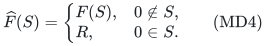

This is an integral polymatroid rank. Every x in P(F) extends to a
base by x_0=R-x(E), and every such base projects back to P(F).
The representation is exact for every mixed target relation and for
the scalar functional. It adds one binary-capacity coordinate.

An original mandatory base receives no free disposal. From now on
work with a required base total R in either legitimate representation.

A covering row with T_j=0 is automatic and can be removed. For an
upper or equality row, every coordinate with a^j_e>T_j is forbidden.
This is necessary for every feasible integer vector, since all
coefficients and resource coordinates are nonnegative integers.
Keep the required total R after all masks. If the remaining rank
is below R, the instance is infeasible. In particular, an upper
or equality target zero masks all coordinates with positive value
in that row. These operations include the rank-zero and T=0 cases.
Removed zero-target covering rows are absent from every subsequent
component filter; their allowed interval is never interpreted as
[0,-1]. They may simply be omitted or represented by a zero coordinate
with no filter when keeping the original dimension for counting.

Let F_0 denote the restriction to the remaining eligible ground.
Whenever it survives, F_0 has total rank R.

## 3. Row-subset active and passive copies for covering rows

Let C be the set of remaining covering rows, all with T_j>=1, and
let s=|C|<=d. For each current coordinate e create a copy (e,S)
for every subset S of C. A unit in this copy is counted actively
in precisely the covering rows in S.

Let pi forget the subset label. Define the shared lifted rank

<!-- math-display: 83a67652ab10c145ee66ec91
F^\uparrow(Y)=F_0(\pi(Y)).
 \tag{MD5}
-->
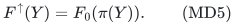

This is an integral polymatroid rank: projection commutes with
unions, while pi(A intersect B) is a subset of
pi(A) intersect pi(B), which together with monotonicity proves
the submodular inequality. For a nonnegative vector z, let
x_e=sum_S z_(e,S). Directly from all projection-preimage
constraints,

<!-- math-display: 49304d16e2feaf5fc7e13bad
z\in P(F^\uparrow)\ \Longleftrightarrow\ x\in P(F_0),
 \qquad
 z\in B(F^\uparrow)\ \Longleftrightarrow\ x\in B(F_0).
 \tag{MD6}
-->
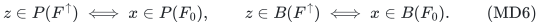

All copies retain the same original scalar weight w_e. Thus every
resource unit and its true scalar contribution are retained.
Capacities are shared through F^up; they are not duplicated independently.

For an upper or equality row put b^j_(e,S)=a^j_e on every copy.
For a covering row put

<!-- math-display: 725cf3f7e3406c6c6ea08378
b^j_{(e,S)}=
 \begin{cases}
 \min(a^j_e,T_j),&j\in S,\\
 0,&j\notin S.
 \end{cases}
 \tag{MD7}
-->
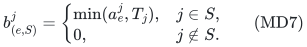

Every b coefficient is a nonnegative integer. For upper and
equality rows, b^j z=a^j x exactly. For a covering row,
a^j x>=b^j z.

### Completeness of the marking

Take an arbitrary feasible original integer base x. For each
covering row independently, cap its unit values at T_j. The capped
sum is still at least T_j. In any order of its positive capped
units, mark a first-reaching prefix. Its integer sum W_j satisfies

<!-- math-display: a3904bcaf8848908d06db283
T_j\le W_j\le 2T_j-1.
 \tag{MD8}
-->
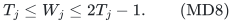

Give each original unit the subset label of exactly the covering
rows in which it was marked. This produces a single compatible
lifted integer base z satisfying all row markings simultaneously.
No original unit is removed. This is an existence argument;
the algorithm never constructs an expanded unit list.

The auxiliary totals for the other rows still equal their original
totals. The scalar functional is unchanged. Thus every original
feasible vector has a lifted representative whose totals lie in
the bounded intervals

<!-- math-display: 5443bedbcbb380e69f0a4729
\begin{array}{c|c}
 \rho_j & \text{allowed auxiliary total }W_j\\ \hline
 \le & 0\le W_j\le T_j\\
 =   & W_j=T_j\\
 \ge & T_j\le W_j\le 2T_j-1 .
 \end{array}
 \tag{MD9}
-->
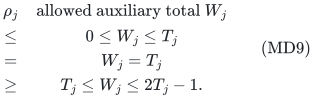

Conversely, every lifted integer base satisfying MD9 projects to an
original feasible integer base with exactly the same scalar value.
The use of all row-subset labels is essential: one active/passive
bit shared by all covering rows would not justify independent
bounded first-reaching totals.

## 4. Exact vector-class counts give an integral subproblem

Group lifted coordinates by their complete auxiliary coefficient
vector b in Z^d_{\ge0}. There is one group D_b for each distinct
input-occupied vector. Define

<!-- math-display: 145191dff25ab6e8787d599e
U=\sum_{j\notin C}T_j+\sum_{j\in C}(2T_j-1)\le 2T.
 \tag{MD10}
-->
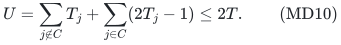

Enumerate nonnegative integer counts h_b for the occupied nonzero
vectors subject to

<!-- math-display: cf7f67f7bbcaa2b89cac8993
m=\sum_{b\ne0}h_b\le R,\qquad
       \sum_{b\ne0}\|b\|_1h_b\le U.
 \tag{MD11}
-->
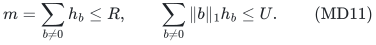

Retain a profile only if its component totals
W_j=sum_b b_j h_b satisfy MD9. Put h_0=R-m. The zero group
contains every coordinate with the zero coefficient vector,
including any legitimate disposal and fully passive zero copies.
If this group is empty and h_0>0, the profile will be infeasible.

Let K_h be the partition-count polymatroid with group capacities
h_b, including h_0. Its rank on Y is the sum of the capacities of
the groups that Y meets. Optimize the chosen scalar functional
on

<!-- math-display: b9c5de5f1f3fdb784d8bf26c
P(F^\uparrow)\cap P(K_h)
             \cap\{z:z(E^\uparrow)=R\}.
 \tag{MD12}
-->
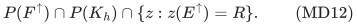

Two integral polymatroids have an integral intersection. Its total
is at most R, so a nonempty total-R face is integral. Because all
partition capacities sum to R, every group count equals its
prescribed capacity on this face. Thus MD12 enforces exact vector
counts and consequently exact component totals.

Weighted polymatroid intersection supplies an integral optimum
or declares the face empty in polynomial oracle time. Taking the
best scalar value over all retained feasible profiles solves the
original scalar optimization exactly, by both directions of
Section 3. A side inequality on this same scalar is decided by
its corresponding extremum; no extra halfspace is presumed integral.

## 5. Colored partitions and the all-input running time

Ignore the resource count bound and component filters to upper-bound
the number of profiles. They inject into multisets of nonzero
vectors b in Z^d_{\ge0} of total l1 weight at most U. For any t>0,

<!-- math-display: 2fbaabd5f114a255846f438c
{\cal P}_d(U)\le
 e^{tU}
 \prod_{b\in\mathbb Z^d_{\ge0}\setminus\{0\}}
                       (1-e^{-t\|b\|_1})^{-1}.
 \tag{MD13}
-->
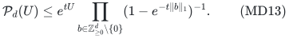

The logarithm of the product is

<!-- math-display: 28c11fb0e88f1c6ce4c9cb1d
\begin{aligned}
 \sum_{\ell\ge1}\frac{(1-e^{-\ell t})^{-d}-1}{\ell}
 &\le \sum_{i=1}^d {d\choose i}t^{-i}
                              \sum_{\ell\ge1}\ell^{-(i+1)}\\
 &\le 2\bigl((1+1/t)^d-1\bigr).
 \end{aligned}
 \tag{MD14}
-->
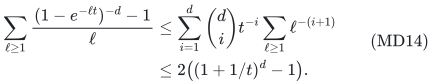

The first inequality uses
1/(1-e^{-x})=1+1/(e^x-1)<=1+1/x.
For U>=1 choose t=U^{-1/(d+1)}<=1. It follows that

<!-- math-display: b817354286fc28ab24377dfd
\log {\cal P}_d(U)
 \le (1+2^{d+1})U^{d/(d+1)}.
 \tag{MD15}
-->
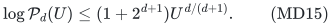

For U=0 only the zero positive-count profile occurs.
This establishes MD2 with an explicit, nonoptimized fixed-d
constant and U<=2T.

The enumeration has the same bound on infeasible inputs. Store
only the occupied nonzero coefficient vectors and stream a
depth-first traversal. For the next vector b, enumerate its count
up to min(R-m, floor((U-W)/||b||_1)), where W is the current
total l1 weight. Every visited partial profile has an all-zero
completion satisfying MD11. At each depth, those completions
are distinct. Hence total traversal size is at most the
number of occupied vectors times the bounded complete profile count.
Component filters and failed resource/side subproblems cannot
increase this bound.

There are at most 2^d times the original number of coordinates
after the lift. For fixed d this is polynomial in H. Counts,
targets, rank values and objective values have polynomial bit
length. The recursion depth is at most the number of occupied
vectors. There is no array of length U, enumeration of all
vectors of weight U, or expansion into R units. Weighted oracle
subproblems are run one at a time. Workspace is polynomial
in the full binary encoding for fixed d.

If d is variable, both the 2^s clone expansion and the displayed
dimension dependence must be charged explicitly. The theorem
does not claim uniform polynomial workspace in a succinct
variable-d instance.
The companion variable_dimension_total_target_classification.md
uses a different chain-copy construction to obtain that stronger
uniform workspace guarantee.

## 6. A matching fixed-dimensional rank-oracle lower bound

Fix d and let k be an even positive integer tending to infinity.
Take n=k^d elements indexed by the distinct vectors

<!-- math-display: 13e82cafc839d5cb3feff712
u\in\{1,\ldots,k\}^d,
       \qquad r=n/2.
 \tag{MD16}
-->
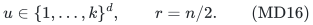

Among all r-subsets, choose a most populous class H_alpha with
the same vector sum alpha. Each sum component has at most nk
possible values. Thus, writing N=|H_alpha|,

<!-- math-display: 04d4c5f4ca87a01aca314002
N\ge\frac{{n\choose r}}{(nk)^d}
          =2^{\,n-O_d(\log n)}.
 \tag{MD17}
-->
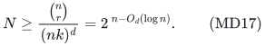

For fixed d, alpha can be computed by a cardinality-and-vector-sum
dynamic program in polynomial time in n. Count entries have O(n)
bits. Consequently all displayed weight vectors and targets are
explicit polynomial input data; only the hidden matroid oracle
varies between instances.

No two distinct sets in H_alpha differ by one exchange: such an
exchange would replace one vector label by a different vector label
without changing the sum, which is impossible.

Define a rank-r matroid M_0 by making every subset of size less
than r independent and making precisely the r-subsets outside
H_alpha bases. For any hidden A in H_alpha, define M_A by also
making A a basis. Here is a direct augmentation check. Only an
independent set I of size r-1 and an independent set J of size r
need attention. If J minus I has one element, adding it gives J.
If it has at least two elements, the corresponding r-sets I+e
are pairwise one-exchange neighbors, so at most one can lie
in the forbidden family. At least one augmentation is allowed.
Both definitions are therefore matroids.

Their rank oracles differ only on the query set A itself. Sets
of size below r have their cardinality as rank. An r-set has
rank r except when it is forbidden, in which case its rank is
r-1. Every larger set contains two one-exchange-neighbor
r-subsets, at least one of which is a base, and therefore has
rank r in every instance.

Give element u coefficient a^j_u=u_j in equality row j and
set T_j=alpha_j. The reference M_0 has no feasible basis.
The hidden M_A has exactly the feasible basis A. All scalar
weights may be zero.

The total target has the required numeric size. For any fixed
coordinate j, each label value 1,...,k occurs exactly k^{d-1}
times. The smallest possible sum of that coordinate over
r=n/2 elements is

<!-- math-display: edf994695c6c69dd39fb6cef
k^{d-1}\sum_{i=1}^{k/2}i
           =\frac{n(k+2)}8\ge\frac{nk}8.
 \tag{MD18}
-->
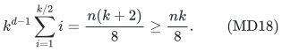

The largest possible sum is at most nk/2. Therefore

<!-- math-display: 4b5d288b437e8e6d0fecbd7b
\frac{dnk}8\le T=\sum_j\alpha_j
                           \le\frac{dnk}2,
 \qquad T=\Theta_d(n^{1+1/d}).
 \tag{MD19}
-->
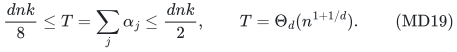

On the reference transcript, Q oracle queries can hit at most
Q hidden candidates. Deterministic exact decision therefore
needs at least N queries in the worst case. For randomized
decision, use the distribution placing probability one half
on M_0 and one half on a uniformly random M_A. For each fixed
random seed, only the at most Q hidden sets queried along
the reference transcript can cause it to diverge. Average
decision success is at most 1/2+Q/(2N). Success at least 2/3
on every input implies Q>=N/3.

Combining MD17 and MD19 proves MD3. Exact scalar optimization
with infeasibility reporting inherits the decision lower bound.
For an optional independent-vector version, one additional
scalar covering side row x(E)>=r forces a basis and carries
the same lower bound.

## 7. Parameter comparisons and boundaries

For d=1, MD2 recovers the square-root numeric-target exponent.
For d=2 it becomes exp(O(T^{2/3})); for d=3 it becomes
exp(O(T^{3/4})). These rows can overlap on every original
coordinate. The distinct disjoint-block result can be sharper:
one-hot coefficient groups factor into ordinary partitions,
giving exp(O(sum_j sqrt(T_j+1))) instead of the general
colored-partition exponent. Neither theorem supersedes the
other's useful parameterization.

The row-subset lift supports a mixture of exact numeric
budgets, equality requirements and covering demands. Its
soundness uses nonnegative row coefficients. Arbitrary signed
rows permit cancellation and are not covered by the target-sum
count bound.

This result uses one resource polymatroid. Replacing it by an
unrelated intersection of two resource polymatroids would add
a third rank in MD12; the integral subproblem proof would no
longer apply.

This is not an EPTAS with exponent d/(d+1) in 1/epsilon.
Converting arbitrary rational objectives to small integers
can introduce the resource cardinality or numeric magnitude
into T. The numeric target and the approximation accuracy
remain different parameters.

## 8. Public baseline and attribution

Eisenbrand, Rohwedder and Wegrzycki,
*Sensitivity, Proximity and FPT Algorithms for Exact Matroid
Problems*, arXiv:2404.03747v2 (24 August 2024), Theorem 3,
gives fixed-parameter algorithms for exact vector-weight bases
in the coefficient bound Delta and the number of dimensions.
Its introduction explicitly describes the earlier technique
of guessing counts for each weight vector and imposing them
with a partition matroid. Count-profile intersection is
therefore an established method.

Primary full text:
<https://arxiv.org/html/2404.03747v2>.

The theorem proved here instead controls nonnegative mixed
target rows by their total numeric right-hand side, permits
one arbitrary scalar optimization, includes binary-capacity
integral polymatroids, and supplies a matching target-exponent
oracle construction. These are bounded proved statements;
this checkpoint does not assert publication priority or an
exhaustive comparison with every algorithm in every explicit
matroid class.

## 9. A sharper bound for unequal targets

The total-target exponent is a convenient worst-case summary.
One can keep the individual auxiliary upper caps and obtain
a strictly sharper bound when their magnitudes differ.
For every surviving row set

<!-- math-display: 2271f949ebd7878c24408253
U_j=
 \begin{cases}
 T_j,&\rho_j\in\{\le,=\},\\
 2T_j-1,&\rho_j=\ge .
 \end{cases}
 \tag{MD20}
-->
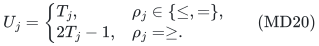

Rows with U_j=0 force zero auxiliary contributions and can be
removed from the vector-class dimension after the corresponding
positive coordinates are masked. Zero-target covering rows
were already removed. If no dimension remains, scalar
optimization is polynomial. Let d'<=d be the remaining number,
so every remaining U_j is a positive integer, and define

<!-- math-display: d1efb3777fef528101a40a9b
K(U)=
  \max_{\varnothing\ne S\subseteq[d']}
            \left(\prod_{j\in S}U_j\right)^{1/(|S|+1)}.
 \tag{MD21}
-->
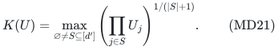

A refined streamed traversal enumerates only count profiles with
each component total at most its cap U_j. At a partial state
with component totals W_j, the next nonzero vector b has
count range

<!-- math-display: 7c46d3618b95c5656954ea30
0\le h_b\le
 \min\left\{R-m,\
       \min_{j:b_j>0}
              \left\lfloor\frac{U_j-W_j}{b_j}\right\rfloor
     \right\}.
 \tag{MD22}
-->
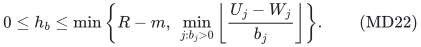

This replaces the l1-only bound in Section 5. Lower/equality
filters are still applied at completion. Every visited
partial profile has a zero completion satisfying all the
upper caps, so the traversal remains polynomial per counted
complete profile, including all infeasible inputs.

For arbitrary positive real t_1,...,t_d', the number of
component-capped vector partitions obeys

<!-- math-display: cb5993c9a74fac03c8bc4de9
\begin{aligned}
 \log {\cal P}(U)
 &\le \sum_jt_jU_j+
   \sum_{\ell\ge1}\frac{
           \prod_j(1-e^{-\ell t_j})^{-1}-1}{\ell}\\
 &\le \sum_jt_jU_j+
       2\sum_{\varnothing\ne S\subseteq[d']}
                       \prod_{j\in S}t_j^{-1}.
 \end{aligned}
 \tag{MD23}
-->
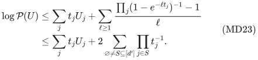

The second inequality expands the product of
1+1/(ell*t_j) and again uses
sum_ell ell^{-(|S|+1)}<=2. Put t_j=K(U)/U_j.
The definition of K gives

<!-- math-display: 8a55e52d5d62296993a01b5e
\prod_{j\in S}t_j^{-1}
   =\frac{\prod_{j\in S}U_j}{K(U)^{|S|}}
   \le K(U)
 \tag{MD24}
-->
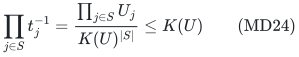

for every nonempty S. Hence the exact algorithm takes

<!-- math-display: 031a3fe79e3954dcd3b6bd4d
\boxed{
 \exp\!\left((d'+2(2^{d'}-1))K(U)\right)
                     \mathrm{poly}(H)
 }
 \tag{MD25}
-->
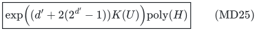

time and polynomial binary space for fixed d.
The generating-function parameters and K are analysis devices;
the algorithm uses only the exact integer bounds MD22.

For two positive caps this reads

<!-- math-display: c561cddb91330b8cd2d1a3a6
K(U_1,U_2)=
 \max\{\sqrt{U_1},\sqrt{U_2},(U_1U_2)^{1/3}\}.
 \tag{MD26}
-->
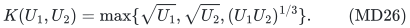

In particular, caps (1,N) give a square-root exponent in N,
whereas the total-target-only form would give N^{2/3}.
For balanced caps U_j=N, the largest subset is the full
dimension and K=N^{d'/(d'+1)}, recovering the earlier order.
The lower family in Section 6 has balanced caps of order
nk and therefore also matches the K exponent on that family.
This is not a claim of a separate lower bound at every
prescribed unbalanced cap vector.

Only the largest caps need be considered when evaluating
K as a comparison formula: among subsets of any given size,
their product is maximized by the largest caps. This observation
is optional and changes neither the exact enumeration nor
the theorem's fixed-dimensional encoding assumptions.
