# Refined explicit accuracy constants for the seven single-matroid schemes

**25 October 2026. Complete refinement; full root and independent
internal reviews passed.** This note changes the MAX objective scales and tightens the
profile count in [seven-variant-single-matroid-profile-scheme.md](seven-variant-single-matroid-profile-scheme.md). It
retains the same exact side constraint, original integer comparator and
polynomial binary workspace.

For every rational 0<epsilon<=1, all seven single-matroid variants, and
their single integral-polymatroid versions, admit the previously proved
approximation guarantees in time

<!-- math-display: 15199a119dd89238f6d8617c
\frac1\epsilon\exp\left(\frac3\epsilon+7\right)
                   \mathrm{poly}(H_\epsilon).
 \tag{AC1}
-->
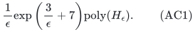

An elementary sharpening of the same calculation gives the stronger bound

<!-- math-display: 6d74e7c018b74fd733ba5f4e
\boxed{\frac1\epsilon
       \exp\left(\frac{141}{50\epsilon}+7\right)
                   \mathrm{poly}(H_\epsilon).}
 \tag{AC2}
-->
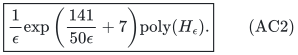

Space is polynomial in H_epsilon. The polynomial has a fixed degree;
there is no suppressed numerical polynomial in 1/epsilon other than the
displayed factor. Here H_epsilon includes the complete rational accuracy
encoding. These refinements improve explicit constants in the accuracy
exponent. They do not change its asymptotic order 1/epsilon or close the
gap to the separate square-root accuracy-exponent oracle lower bound.

## 1. Reused exact interface and initialization

The original theorem gives a single integral resource rank F on an
explicit coordinate ground. For an independent-vector problem use its
exact zero-value, zero-side-weight disposal representation as a base.
For an original base problem retain every original mandatory unit. In
either case let R be the required full base total after this legitimate
representation.

There is one nonnegative objective vector v, one nonnegative side vector
w, and one exact side condition w*x<=L or w*x>=L. First optimize w in
the appropriate direction on the original allowed base. Failure detects
original infeasibility; success supplies an actual legal initializer.
Retain all original zero-value coordinates. For minimization, also test
the exact zero objective by masking positive values and preserving R.

The two integral recovery interfaces remain unchanged. Upper-prefix
recovery minimizes or maximizes the original side weight, as required.
Lower-prefix recovery uses the exact complement base y=d-x; it maximizes
w*y for an original upper constraint and minimizes w*y for an original
lower constraint. Both preserve the complete original base and the
specified side inequality at the same integer point.

## 2. An original objective grid with bounded bit length

If R=0 or all eligible v values are zero, the initialized feasible
solution has exact objective zero. Otherwise choose a positive rational
g that generates the additive integer grid of all positive original
values. For example, take a common denominator D, multiply the values
by D, and let g be their integer gcd divided by D. Both D and the gcd
have polynomial encoding.

Every original integer objective is an integer multiple of g. In
particular, if OPT>0 then OPT=m g for an integer m>=1. Define

<!-- math-display: 3631ff20f3be62f5473e1094
M=\frac{R\max_e v_e}{g}.             \tag{AC3}
-->
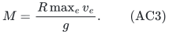

This is a positive integer of polynomial bit length. It upper-bounds m
whenever OPT>0. The zero-value disposal coordinate, if present, has no
effect on the grid. Original real zero-value coordinates are kept in
the resource base even though they do not affect g.

## 3. Grid-rounded scales for MAX

Generate an increasing sequence of positive integers by

<!-- math-display: 3855d6153dc2c569725563e4
K_0=1,\qquad
 K_{a+1}=\max\{K_a+1,\lfloor(1+\epsilon)K_a\rfloor\}.
 \tag{AC4}
-->
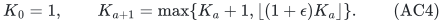

Use scales V_a=K_a g and stop after processing the first K_a>=M.
There is no repeated multiplication of a rational scale whose
denominator grows. Every stored K_a is an integer.

Let m be any integer in [1,M], and let K_a be the first term at least m.
If a=0, m=1 and K_a=m. Otherwise K_(a-1)<m, so

<!-- math-display: 5bc724d8c26c0e97f6d43a63
K_{a-1}+1\le m,
 \qquad \lfloor(1+\epsilon)K_{a-1}\rfloor
                         \le(1+\epsilon)m.
 \tag{AC5}
-->
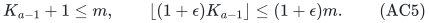

The maximum of these two quantities is at most (1+epsilon)m.
Consequently a positive optimum has an enumerated good scale

<!-- math-display: 926857263fd47c9342fa3594
\mathrm{OPT}\le V\le(1+\epsilon)\mathrm{OPT}.
               \tag{AC6}
-->
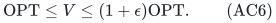

This includes grid values near zero. In particular, when K<1/epsilon,
AC4 advances by one; it does not jump over a small positive optimum.

### Number of scales

There are at most ceil(2/epsilon) terms before K reaches 2/epsilon,
because it strictly increases by at least one. Thereafter,

<!-- math-display: b33dd75bf4654d088cd4bffd
K_{a+1}\ge\lfloor(1+\epsilon)K_a\rfloor
       \ge(1+\epsilon)K_a-1
       \ge(1+\epsilon/2)K_a.
 \tag{AC7}
-->
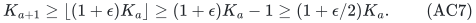

Thus there are

<!-- math-display: c8526b51b70a257beb43a518
O\left(\epsilon^{-1}(1+\log M)\right)
       \tag{AC8}
-->
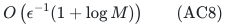

scales, including the case M<2/epsilon. The logarithm of M is
polynomially bounded by the original numeric encoding.

Before the last term K<M. Because epsilon<=1, its successor is at most
2M. Hence every stored K has O(log M+1) bits, and every V has polynomial
encoding. The multiplication by the supplied rational epsilon and the
floor in AC4 are exact operations on integers of polynomial bit length.
Long rational numerators or denominators near epsilon=1 are included
through H_epsilon.

## 4. MAX profile accuracy at the closer scale

Use the original full-base dyadic construction, but replace its scales
by AC4 and set

<!-- math-display: 51849b9f599fc327325e95ae
\delta=\frac{\epsilon}{2(1+\epsilon)},\qquad
 J=\lfloor1/\delta\rfloor
   =\left\lfloor\frac2\epsilon\right\rfloor+2.
 \tag{AC9}
-->
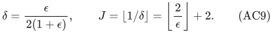

For a current scale V, forbid coordinates with v_e>V while retaining
the original required total R. Reject a mask of rank below R. Small
values are at most delta V. Bin the larger normalized values by

<!-- math-display: 2c56c79cee758ca7f1460d85
(\lambda_i,\mu_i],\quad
 \lambda_i=\delta+i\delta^2,
 \mu_i=\min\{1,\delta+(i+1)\delta^2\}.
 \tag{AC10}
-->
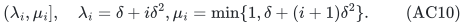

Internal endpoints belong to the preceding interval. Enumerate integer
big-bin profiles satisfying

<!-- math-display: 89b053757f7e370174e07893
\sum_i h_i\le J,\qquad
        \sum_i\lambda_i h_i\le1.                \tag{AC11}
-->
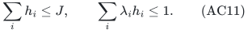

For each profile solve the full-base LP with its EXACT big-bin counts
and original exact side row, maximizing the true fractional objective
v*x. There is no total-v upper cap and no trimming of real coordinates.

At a good scale AC6, the original optimal integer base uses no coordinate
above V. Its actual big count is less than 1/delta, and its lower-bin
sum is at most OPT/V<=1. It supplies one enumerated profile. The LP
optimum on that profile has value at least OPT.

Replace big values by their bin lower endpoints and keep true small
values. Exact big-bin counts bound fractional surrogate replacement
loss by

<!-- math-display: 97b0aba5127d13a6802dd6ee
J\delta^2V\le\delta V.        \tag{AC12}
-->
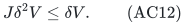

Apply the direct full-base lower-prefix recovery to this ordering.
Completed big-bin prefixes have integral fractional counts, so their
rounding errors vanish. Only the small tail loses utility, by at most
delta V. The exact original side row is retained by the appropriate
complement objective. The final original base therefore has value at
least

<!-- math-display: 64f5e0bfb8016d6d40a24dd2
\mathrm{OPT}-2\delta V
 \ge\mathrm{OPT}
          -\frac{\epsilon}{1+\epsilon}(1+\epsilon)\mathrm{OPT}
 =(1-\epsilon)\mathrm{OPT}.
 \tag{AC13}
-->
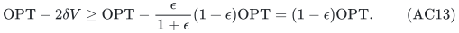

This proof is unaffected if the profile's fractional objective exceeds
V. Its loss is controlled by the prescribed big counts and the largest
small coefficient, not by an upper bound on that fractional objective.

Keep the best actually feasible result over all scales and profiles,
including the original initializer. If OPT=0, the initializer already
meets the approximation guarantee; no positivity oracle is required.
All scales may be processed in that case without changing correctness
or the time bound.

## 5. Count only partitions whose parts are at least J

For either MIN or the refined MAX scheme, delta<=1/2 and
J=floor(1/delta)>=2. The profile lower sum is at most one.
Since lambda_i>=delta^2(J+i), each profile injects into a partition
having h_i parts of size J+i and total at most

<!-- math-display: 037dae49e470f30eefbf4a0f
N=\lfloor\delta^{-2}\rfloor<(J+1)^2.
                  \tag{AC14}
-->
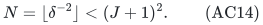

Unlike the coarser count over all positive integer parts, every part
in this partition is at least J. Let P_(J,N) be the number of partitions
of total at most N with this minimum part. At t=1/J,

<!-- math-display: 9386423ecb7b3e241e356e0f
P_{J,N}\le e^{tN}\prod_{a\ge J}(1-e^{-ta})^{-1}.
 \tag{AC15}
-->
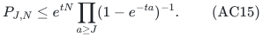

The logarithm of the product is

<!-- math-display: 2f2db6654801a8d3bd633e17
\sum_{b\ge1}\frac{e^{-b}}{b(1-e^{-b/J})}
 \le \sum_{b\ge1}\frac{e^{-b}}b
          +J\sum_{b\ge1}\frac{e^{-b}}{b^2},
 \tag{AC16}
-->
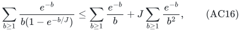

using 1/(1-e^-x)=1+1/(e^x-1)<=1+1/x. Write the two convergent
series in AC16 as A and D. The elementary bounds A<1 and D<1/2
give

<!-- math-display: 4917a9a8b160a52c3ab371b9
\log P_{J,N}
   <\frac{(J+1)^2}{J}+1+\frac J2
   \le\frac32J+4.
 \tag{AC17}
-->
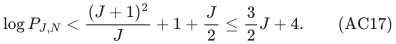

For example, A<=1/(e-1)<1. Also e>5/2 and
D<=1/e+1/[4e(e-1)]<7/15<1/2. No evaluation of an infinite
product or special function is part of the algorithm.

For MIN retain delta=epsilon/2, hence J=floor(2/epsilon) and
AC17 is at most 3/epsilon+4. For MAX use AC9, giving at most
3/epsilon+7. The O(epsilon^-1 poly(H_epsilon)) scales in AC8
therefore prove AC1 for every MAX case; the original polynomial
number of MIN target calls fits the same common bound.

## 6. An elementary improvement from 3 to 141/50

The same argument can retain a better elementary bound on D.
From the first six terms of the series for e,

<!-- math-display: 65a3b775a8de8418fa3c486a
e>\sum_{a=0}^5\frac1{a!}=\frac{163}{60}>
                      \frac{19}{7}.
 \tag{AC18}
-->
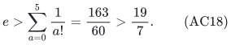

Put r=7/19. Bounding the remaining square denominators by 16 gives

<!-- math-display: 2b0ca106fe133996e008e682
\begin{aligned}
 D&<r+\frac{r^2}{4}+\frac{r^3}{9}
                         +\frac{r^4}{16(1-r)}\\
  &=\frac{1618771}{3950784}<\frac{41}{100}.
 \end{aligned}
 \tag{AC19}
-->
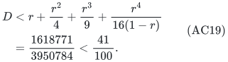

Thus the profile count satisfies

<!-- math-display: 72efdb544ad044500d54e24b
\log P_{J,N}<\frac{141}{100}J+4.
                  \tag{AC20}
-->
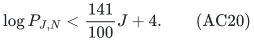

For refined MAX, J<=2/epsilon+2, so

<!-- math-display: 59212bf85cc7bf852bc01774
\log P_{J,N}
       <\frac{141}{50\epsilon}+\frac{141}{50}+4
       <\frac{141}{50\epsilon}+7.
 \tag{AC21}
-->
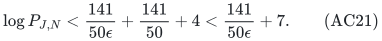

The MIN count is smaller, with constant term four. Combining AC21
with the scale and target-call accounting proves AC2. This sharper
bound changes only the analysis; the exact same algorithm attains it.

## 7. All-input traversal and polynomial binary space

Use only occupied input bins and the pruned count iterator from SV.
At each step the next integer count ranges only up to the remaining
count cap and floor(remaining lower load / next lower endpoint).
Every generated partial profile has an all-zero completion, so the
number of traversal nodes is at most a polynomial factor times the
number counted in AC15. Infeasible masks, failed profile LPs and
unsuccessful scales are all included.

The improvement would not follow from enumerating every unweighted
composition and applying the lower-load test only at the end. The
weighted test is part of generation.

All count caps and occupied bin indices have polynomial binary length;
the algorithm stores no array of size 1/epsilon or delta^-2. By AC4
the scales also have bounded binary length, rather than products of
unboundedly many rational factors. Profile coefficients and all exact
LPs therefore stay within polynomial bit complexity in H_epsilon.

The exact polymatroid-intersection faces and their side-weight
objectives are unchanged from SV. They consume polynomial oracle
work and polynomial space per profile. Store one scale or target,
one profile, one solver state and the best original feasible output.
Optional-to-base disposal adds one coordinate, and this refinement
needs no additional active/passive coordinates. The main passive
construction remains an independent proof of the same asymptotic
approximation theorem.

## 8. A parameterized analytic bound, not a new exponent claim

One may choose t=a/J for any fixed a>0 in AC15. Define

<!-- math-display: fedef25e920a43266ff5dc4e
A(a)=\sum_{b\ge1}\frac{e^{-ab}}b,\qquad
 D(a)=\sum_{b\ge1}\frac{e^{-ab}}{b^2}.
 \tag{AC22}
-->
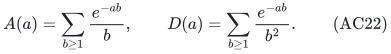

The same calculation gives

<!-- math-display: 26752d2fd144c65bf47c5c88
\log P_{J,N}
  <\left(a+\frac{D(a)}a\right)J
            +2a+\frac aJ+A(a).
 \tag{AC23}
-->
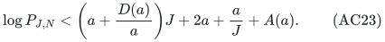

Thus further constant improvements can be certified by elementary
bounds on these convergent series. AC2 uses a=1 and the rational
estimate AC19. No numerical minimizer or unverified decimal constant
is required for the stated theorem.

This calculation cannot by itself improve the ORDER of the accuracy
exponent for this profile family. To see a precise counting gate,
take delta=1/J with integer J>=4. Make bins i=0,...,J-1 occupied.
For every subset of floor(J/2) of these bins, put h_i=1 on that
subset and zero elsewhere. Every lower endpoint is below 2/J, so
the total lower load is at most one and the count cap J is respected.
There are

<!-- math-display: 00a35c4990cc67d6545412ea
\binom{J}{\lfloor J/2\rfloor}
                    \ge\frac{2^J}{J+1}
           \tag{AC24}
-->
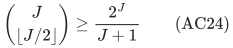

such profiles. Occupancy can be realized by one rational input
coordinate strictly inside each indicated bin.

AC24 is a lower bound on the size of the candidate profile family,
not on all algorithms or even on every instance's realized search.
It shows that a subexponential-in-J upper bound for THIS entire
family is impossible. A `2^(o(1/epsilon))` algorithm would need a
different profile representation, an additional structural way to
avoid most profiles, or a different recovery method. It cannot
follow merely by sharpening the partition count of AC11.

The independent all-seven rank-oracle lower bound remains
`2^(Omega(epsilon^(-1/2)))`. The interval between these two accuracy
exponents is a genuine remaining research question.
