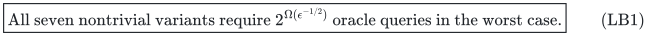
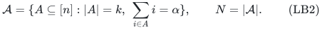
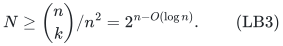
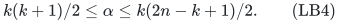
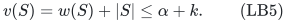
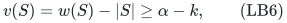
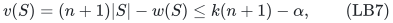
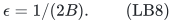
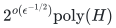

# Accuracy lower bounds for the seven single-matroid variants

**25 October 2026. Source audit and a separately derived quantitative
strengthening.** The parameter refinement was proposed by the root
agent and independently checked by transfer_frontier and allocation_four.

The supported conclusion is:

<!-- math-display: 6ee49515462e215bfcb04b57
\boxed{\text{All seven nontrivial variants require }
       2^{\Omega(\epsilon^{-1/2})}\text{ oracle queries in the worst case.}}
 \tag{LB1}
-->

This is an unconditional oracle lower bound, already for matroid rank
oracles. It does **not** establish a `2^{Omega(1/epsilon)}` lower bound.
Consequently it does not prove that the new `2^{O(1/epsilon)}` upper
bound has optimal accuracy dependence. The upper and lower exponents
remain different.

## 1. What the primary source states

Doron-Arad, Kulik and Shachnai, *Lower Bounds for Matroid Optimization
Problems with a Linear Constraint*, ICALP 2024, Theorem 1, excludes a
randomized FPTAS for all seven nontrivial oracle variants. Its full
version, Definition 3.1 and equation (5), uses an error parameter
`1/[8(n+1)(T+1)(c(E)+1)]`. On its equal-sum family with labels
`c_i=i`, balanced rank, and target of order `n^2`, this parameter is of
order `n^-5`. Thus the stated reduction cannot simply be read as an
inverse-error exponential lower bound.

Section 5 of the same public full version also explicitly announces
that a modified reduction gives an inverse-error quarter-power
exponent, Omega(2^(epsilon^-1/4)), with details deferred there.
That quantitative public observation is separate from the literal
equation-(5) parameter and must be credited. The square-root exponent
proved below strengthens that announced order; this note does not
claim to be the first quantitative accuracy lower bound.

Primary published version:
<https://drops.dagstuhl.de/storage/00lipics/lipics-vol297-icalp2024/LIPIcs.ICALP.2024.56/LIPIcs.ICALP.2024.56.pdf>.

Primary full version:
<https://arxiv.org/html/2307.07773v2>.

The derivation below uses the same equal-sum oracle idea but changes the
objective tie-breaks and tracks the resulting integer gap explicitly.
LB1 is the independently derived quantitative statement here; it is
not attributed to the source as a displayed theorem.

## 2. A large equal-sum family with one hidden basis

Let `n` be even and sufficiently large, and let `k=n/2`. The ground is
`[n]`. Among all `k`-element subsets, choose a sum `alpha` attained by
the largest number of subsets, and define

<!-- math-display: e20df95aaf44ef97431f537e
\mathcal A=\{A\subseteq[n]:|A|=k,\ \sum_{i\in A}i=\alpha\},
 \qquad N=|\mathcal A|.
 \tag{LB2}
-->

There are at most `n^2` possible sums, so

<!-- math-display: 9d0d83ac61b7aec98c9ca6f9
N\ge\binom nk/n^2=2^{n-O(\log n)}.
 \tag{LB3}
-->

Every such sum satisfies

<!-- math-display: b25dd26271dbe1979d7d9518
k(k+1)/2\le\alpha\le k(2n-k+1)/2.
 \tag{LB4}
-->

In particular `alpha=Theta(n^2)`. For large `n`, `N>1`, whereas the
minimum and maximum sums each have a unique realizing set. Hence
`alpha` is strictly between those extreme sums.

The known value alpha can also be computed uniformly in polynomial
time: a cardinality-and-sum dynamic program counts subsets of
{1,...,i} by their size and integer sum, then selects a largest
size-k count. There are polynomially many states because all sums
are at most n(n+1)/2, and each counter has at most n+1 bits.
Only the chosen hidden set A is withheld inside its rank oracle.

For a hidden `A in mathcal A`, define `M_A` to have as independent sets
all sets of size less than `k`, all `k`-sets whose sum differs from
`alpha`, and the one additional `k`-set `A`. Let `M_empty` omit that
last additional set.

These are rank-`k` matroids. To check augmentation, only an independent
set `S` of size `k-1` and a larger independent set `T` need attention.
If `T\S` has one element, adding it gives `T`. If it has at least two
elements, their distinct numeric labels give distinct augmented sums;
at most one sum is `alpha`. The other augmentation is independent.
Hereditary closure is immediate.

The rank oracles of `M_A` and `M_empty` differ only on the set `A`
itself. Sets smaller than `k` have rank their size. A `k`-set's rank is
`k-1` exactly when it is an excluded equal-sum set. Any set larger than
`k` contains two `k`-subsets differing in one distinct label, so at
least one has sum different from `alpha`; its rank is `k` in both
matroids. Thus a rank query cannot reveal the hidden set indirectly by
querying a larger set.

## 3. All seven objective and constraint directions

Use the same side weight `w_i=i` and threshold `L=alpha` in every row
below. The original feasible family is either independent sets or
bases of `M_A`. Objective values `v_i` are nonnegative integers.

| Variant | Objective coefficient `v_i` | Hidden optimal value `B` |
|---|---:|---:|
| Maximum independent set, `w(S)<=L` | `i+1` | `alpha+k` |
| Maximum independent set, `w(S)>=L` | `n+1-i` | `k(n+1)-alpha` |
| Minimum independent set, `w(S)>=L` | `i-1` | `alpha-k` |
| Maximum basis, `w(S)<=L` | `i` | `alpha` |
| Maximum basis, `w(S)>=L` | `n+1-i` | `k(n+1)-alpha` |
| Minimum basis, `w(S)<=L` | `n+1-i` | `k(n+1)-alpha` |
| Minimum basis, `w(S)>=L` | `i` | `alpha` |

The excluded eighth case, minimum independent set under an upper
budget, is solved by the empty set and is not covered by the claim.

Here are the cardinality checks that matter for the independent-set
rows. For the maximum upper-budget row,

<!-- math-display: ffd1e241f759bcad9afdd587
v(S)=w(S)+|S|\le\alpha+k.
 \tag{LB5}
-->

Equality requires both `w(S)=alpha` and `|S|=k`. For the minimum
covering row,

<!-- math-display: d220f60a88f5d8b3dd575ae8
v(S)=w(S)-|S|\ge\alpha-k,
 \tag{LB6}
-->

and equality again requires both conditions. The coefficient `v_1=0`
is permitted by the nonnegative-value model. For the maximum covering
row,

<!-- math-display: 6dc4fad0798117f508b52b5f
v(S)=(n+1)|S|-w(S)\le k(n+1)-\alpha,
 \tag{LB7}
-->

with equality only at full cardinality and exact sum. These small
tie-breaks avoid a large cardinality-enforcing constant.

For bases, `|S|=k` is automatic. The two objective choices `w(S)` and
`k(n+1)-w(S)` give the table immediately for their corresponding side
directions. In all seven cases, equality in the optimal bound is
equivalent to a `k`-set of sum `alpha`. In `M_A` that set must be the
hidden `A`. Thus `A` is the unique optimum, and every other feasible
solution has an objective at least one integer unit worse.

All seven hidden instances are feasible because `A` meets the side
constraint at equality. The reference `M_empty` instances are feasible
as well: minimum-sum and maximum-sum bases, which do not have sum
`alpha`, supply either side of the inequality as needed. The empty
independent set is also available for the upper-budget maximum row.

By LB4, every displayed `B` is positive and `Theta(n^2)`. In particular
`alpha-k>=k(k-1)/2`, and the complementary value
`k(n+1)-alpha` satisfies bounds of the same quadratic order.

## 4. Relative approximation must identify the hidden basis

For each row choose

<!-- math-display: ee59a3e5bd91d44553e5810c
\epsilon=1/(2B).
 \tag{LB8}
-->

A maximizing `(1-epsilon)` guarantee returns integer value at least
`B-1/2`, hence at least `B`. A minimizing `(1+epsilon)` guarantee
returns integer value at most `B+1/2`, hence at most `B`. Either must
return the unique hidden optimum `A`. The usual maximizing
`1/(1+epsilon)` convention has the same implication here.

The side constraints remain exact in this argument. Allowing a budget
or cover violation would be a different approximation problem.

Now follow any deterministic algorithm on `M_empty`. Unless it queries
`A`, its transcript on `M_A` is identical. If at least two hidden sets
are unqueried, its one output cannot be correct on both corresponding
instances. At least `N-1` worst-case rank queries are therefore needed.

For a randomized algorithm using at most `Q` queries, fix its random
coins and choose `A` uniformly from the `N` possibilities. Its reference
transcript queries at most `Q` candidates and can guess at most one
additional hidden set as its output. Its success probability averaged
over the hidden set is at most `(Q+1)/N`. Success probability at least
one half on every instance requires `Q>=N/2-1`.

Finally, `1/epsilon=2B=Theta(n^2)`, and the explicitly encoded numeric
data have length `O(n log n)`. Combining this with LB3 proves LB1 on
an infinite sequence of accuracies. In particular, an oracle algorithm
with time

<!-- math-display: 48c96f8cd8a0bb265f4b6217
2^{o(\epsilon^{-1/2})}\mathrm{poly}(H)
-->

would contradict the query bound, for each of the seven variants.

## 5. What may and may not be concluded

The quantitative barrier applies even to the stronger rank-oracle
access used by the profile algorithms, and it permits randomized
algorithms with constant success probability. It is therefore a
precise obstacle to polynomial or sufficiently small subexponential
accuracy dependence in this oracle model.

It leaves a gap between `epsilon^-1/2` in the lower exponent and
`epsilon^-1` in the new upper exponent. The phrase "tight accuracy
dependence" is not justified. No linear inverse-error lower exponent
has been established here.

This oracle argument also does not imply the same lower bound for
graphic, linear-represented, laminar, or another specific explicit
matroid class. The primary paper has a separate encoded-matroid
hardness construction under a complexity assumption; that fact is not
a substitute for a quantitative lower bound in any of those concrete
representations.
