# A support-sensitive partition potential and a sharp connected-star family

**25 October 2026. New incremental theorem and proof; root and independent full mathematical reviews passed.**

The support-pattern count can retain the entire pattern of unequal row targets, rather than replacing it by their sum. This note proves a dimension-uniform analytic bound, and uses it to solve a connected star family in

<!-- math-display: bcf08ac30c3840a8490ffe3d
\exp\!\left(O\!\left(k\log\left(2+\frac Bk\right)\right)\right)
 \mathrm{poly}(H).
 \tag{SP1}
-->
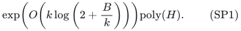

There are k leaf rows with target one and a central row with target B. Every nonzero column touches one leaf, and can also touch the center; no center-only columns are allowed. Leaf rows are upper bounds or equalities, while the center may be an upper bound, equality, or cover. The resource is one arbitrary integral polymatroid, with optional vectors or original-total bases, and one arbitrary signed rational scalar is optimized exactly.

For B=k squared, this is exp(O(sqrt(T) log(T+2))) with total target T=B+k, even though the row-interaction graph is connected. A matching-order rank-oracle lower family exists. The same family also gives a matching conditional computational lower bound under ETH when the resource is supplied by an explicit polynomial-time rank program.

These statements retain the exact-profile integral recovery already proved in the preceding increments. They are not claims of hardness for graphic or matrix-represented matroids, and no publication-priority claim is made.

## 1. The exact profile problem

Suppose the target instance has already been prepared on an explicit polynomial-size ground: all auxiliary coefficients are nonnegative integers, and every row j has a positive upper allowance U_j. Let the occupied nonzero coefficient vectors be grouped into classes. A profile gives each distinct vector b a nonnegative integer multiplicity h_b, subject to

<!-- math-display: 85845aafb142b7fe2fb82abc
W_j=\sum_b b_j h_b\le U_j.
 \tag{SP2}
-->
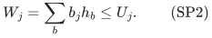

The original resource-count cap may also be imposed. It only reduces the profile family. The single zero-vector group is recovered from the original required total, and is not included in this count.

Let S be the collection of distinct nonempty exact supports of the occupied vectors. Thus a support belongs to S only when at least one actual vector has precisely that positive support. Repeated coordinates or several vectors on the same support do not duplicate the support.

Write N(U,S) for the number of profiles satisfying SP2. This notation counts coefficient-vector multiplicities, not choices of original resource elements. Element choices and exact scalar optimization are handled by the integral resource/profile intersection.

## 2. A dimension-uniform support potential

For positive real numbers t_j, define

<!-- math-display: a041bb099191a616675378da
\Phi_U(t)=
 \sum_j U_jt_j+
 2\sum_{A\in S}\prod_{j\in A}\frac1{e^{t_j}-1}.
 \tag{SP3}
-->
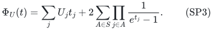

Then

<!-- math-display: c5354f2c1479f96c8f01b399
\boxed{\log N(U,S)\le\Phi_U(t)\quad\hbox{for every }t>0.}
 \tag{SP4}
-->
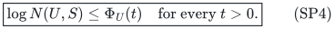

Consequently the same inequality holds with the infimum of SP3 over the positive orthant. The constant two is independent of the number of rows, the support sizes, the numeric targets, and the number of occupied coefficient vectors.

To prove SP4, enlarge the class catalogue to include every positive integer vector on every exact support A in S. For each fixed t>0, its weighted multiset generating function is

<!-- math-display: 61d0d18ec36f8c45eb20f3c5
Z(t)=
 \prod_{A\in S}\prod_{b\in\mathbb Z_{>0}^{A}}
                  (1-e^{-\sum_{j\in A}t_jb_j})^{-1}.
 \tag{SP5}
-->
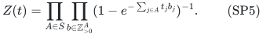

Every profile satisfying SP2 has weight at least exp(-sum_j U_jt_j). Expanding the product with nonnegative terms therefore gives

<!-- math-display: dd2d233abc71d6495b413e69
N(U,S)\le e^{\sum_jU_jt_j}Z(t).
 \tag{SP6}
-->
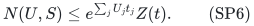

The logarithm of the factor for one support A is

<!-- math-display: 95f6c8c4bc9ada8c6126f29c
\sum_{\ell\ge1}\frac1\ell
             \prod_{j\in A}\frac1{e^{\ell t_j}-1}.
 \tag{SP7}
-->
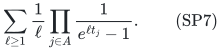

For an integer ell>=1,

<!-- math-display: 56c4148aa05a990f6c173888
e^{\ell t}-1=(e^t-1)(1+e^t+\cdots+e^{(\ell-1)t})
                  \ge\ell(e^t-1).
 \tag{SP8}
-->
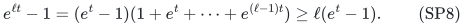

Thus SP7 is at most

<!-- math-display: c27cef71bba13fb255bd607c
\left(\sum_{\ell\ge1}\ell^{-(|A|+1)}\right)
             \prod_{j\in A}(e^{t_j}-1)^{-1}
 \le 2\prod_{j\in A}(e^{t_j}-1)^{-1}.
 \tag{SP9}
-->
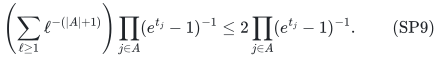

Here |A|>=1 and sum_ell ell^(-2)<=1+integral_1^infinity x^(-2)dx=2. These estimates also prove convergence of the products used above. Summing SP9 and using SP6 proves SP4.

No independence between supports or between resource blocks is asserted. The product appears only in an upper bound on the catalogue of coefficient multisets.

## 3. Algorithmic meaning and convexity

Use the componentwise-pruned depth-first profile enumeration from the preceding exact-target proofs. At every depth, fill all unassigned multiplicities with zero. This injects states at that depth into the upper-cap profile family. The number of occupied classes is polynomial in the explicit prepared input. Hence the entire traversal, including all final target-filter and resource failures, takes at most

<!-- math-display: 271e5837a31bddbf4cebc89d
\exp\!\left(\inf_{t>0}\Phi_U(t)\right)
                  \mathrm{poly}(H)
 \tag{SP10}
-->
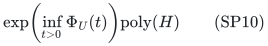

time, multiplied only by the size factor of the explicit preparation. The algorithm does not need to compute a minimizing t. It is the same exact enumerator; every positive t gives a valid analysis of its running time.

For each final profile, prescribe its class totals with a partition-count polymatroid, intersect with the single shared resource rank, and require the original total. The face is integral when nonempty and all class caps are tight. Arbitrary signed rational scalar minimization or maximization is therefore exact. Original mandatory bases are never replaced by independent vectors; optional vectors use only the legitimate zero-value disposal conversion.

Workspace remains polynomial whenever the prepared copied ground has polynomial size. This includes arbitrary support for pure upper/equality rows, support at most two for mixed rows using at most four copies per original coordinate, and each fixed support bound with its bounded local-copy expansion. For unrestricted mixed support the earlier chain method remains available, with its separate order-enumeration factor. SP10 does not remove that preparation cost.

The function Phi_U is convex. Indeed,

<!-- math-display: b4fdf5c441f757c06361d8cd
\frac{d^2}{dt^2}\bigl[-\log(e^t-1)\bigr]
                 =\frac{e^t}{(e^t-1)^2}>0.
 \tag{SP11}
-->
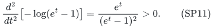

Each positive product in SP3 is log-convex and hence convex, and the remaining summand is linear. This observation can help choose or certify useful t values, but no approximate convex solver is hidden in the exact algorithm or its complexity claim.

If the support hypergraph has several connected components, SP3 separates additively over them. The profile catalogue likewise factors before the global resource-count and feasibility filters. The resource itself still need not decompose.

## 4. The star model and its exact upper bound

Let row zero be the center, with target B>=1, and let rows 1,...,k, k>=1, have target one. Each leaf is an upper or equality row. The center has any of the three orientations.

After the usual upper/equality masks, every nonzero coefficient vector is supported on either {j} or {0,j} for one leaf j. Thus its leaf coefficient is exactly one. Coordinates with a zero coefficient vector may remain, with arbitrary scalar coefficients. They are handled by the global zero group. Coordinates supported only on the center are excluded by the model.

If the center is a cover, use an active/passive copy of each center-positive coordinate, cap its active central credit at B, and retain its leaf coefficient and scalar on both copies. A first-reaching marked prefix has central credit between B and 2B-1. Consequently copying creates only leaf singletons and center-leaf pairs, never a center-only support.

Define

<!-- math-display: f91b027b1bb0c50a14669dc8
V=\begin{cases}
 B,&\hbox{center upper or equality},\\
 2B-1,&\hbox{center covering}.
 \end{cases}
 \tag{SP12}
-->
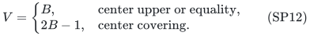

The auxiliary caps are U_0=V and U_j=1 on leaves. There are at most k pair supports and at most k leaf-singleton supports. Set

<!-- math-display: c033ea22e1019c7a6625b283
t_0=\frac{k}{V+k},
 \qquad
 t_j=\log\left(2+\frac Vk\right)\quad(j=1,\ldots,k).
 \tag{SP13}
-->
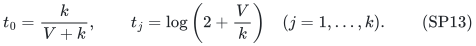

Since e^t-1>=t,

<!-- math-display: 311d96c179c3b8bdcd721511
(e^{t_0}-1)^{-1}\le\frac{V+k}{k},
 \qquad
 (e^{t_j}-1)^{-1}=\frac{k}{V+k}.
 \tag{SP14}
-->
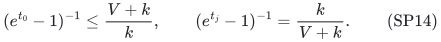

Each pair product in SP3 is at most one, and each leaf singleton is at most one. The central linear term is Vk/(V+k)<=k. Therefore

<!-- math-display: dd612815a888ea3c63acc0a2
\boxed{
 \Phi_U(t)\le k\left[5+\log\left(2+\frac Vk\right)\right].
 }
 \tag{SP15}
-->
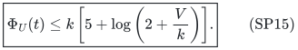

This proves SP1 because V<=2B. It holds on feasible and infeasible inputs, with original binary resource capacities and exact signed scalar optimization.

When the center is upper/equality and there are no leaf singleton patterns, one can instead choose t_0=k/B and t_j=log(1+B/k), obtaining the slightly smaller bound k[3+log(1+B/k)]. The uniform bound SP15 accommodates the broader stated class.

For B=k squared, the total target is T=k squared+k, and SP1 is exp(O(k log k))=exp(O(sqrt(T) log(T+2))). The row graph is a connected star with k edges. The earlier density-only estimate exp(O(T log(2+k/T))) is exp(O(k squared)) on these instances; component separation alone does not improve it.

## 5. A matching composition-family query lower bound

Let k>=2 and B>=2k be integers. Create one element (j,a) for every leaf j in {1,...,k} and integer a in {1,...,B}. Its central coefficient is a and its leaf-j coefficient is one; all other coefficients are zero.

Set the center equality target to B, every leaf equality target to one, and the resource rank to r=k. A solution meeting all equalities chooses exactly one element from every leaf. Thus its central values form an ordered composition of B into k positive parts. Let H be this family of rank-sized sets. Then

<!-- math-display: 557f29ec11e833581368a11b
|H|=\binom{B-1}{k-1}.
 \tag{SP16}
-->
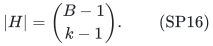

Distinct members of H are not one-exchange neighbors. Their full vector sums agree, and every individual element has a distinct full coefficient vector. A one-element exchange preserving that sum would have to exchange equal vectors, which is impossible for distinct elements.

Let the reference matroid declare all sets smaller than r independent and every r-set outside H a basis. A hidden instance additionally declares one A in H a basis. These are valid matroids: in the only nontrivial augmentation case, two candidate additions to an (r-1)-set are adjacent r-sets, so at most one is forbidden. If only one addition is available, it produces the known independent larger set.

Their rank oracles differ only on the hidden query A. Below r all sets have their cardinality as rank. Above r any set contains two adjacent r-subsets, at least one outside H. There are reference bases, for example r-sets with a repeated leaf or a different central total.

The reference equality instance is infeasible, while the hidden instance has exactly its hidden feasible member. The statement holds over independent sets and bases, since the leaf equalities themselves force cardinality r.

A balanced distribution between the reference instance and a uniformly random hidden instance bounds a Q-query algorithm's average success by 1/2+Q/(2|H|). Therefore bounded-error randomized decision with success at least 2/3 on every instance needs at least |H|/3 worst-case rank queries.

For B>=2k and k>=2,

<!-- math-display: 0fc1b59534f5550387281d6c
\log\binom{B-1}{k-1}
       =\Theta\!\left(k\log\left(1+\frac Bk\right)\right),
 \tag{SP17}
-->
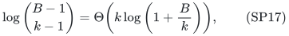

with uniform absolute constants. The upper estimate is the standard binomial bound. For the lower estimate use binomial(n,h)>=(n/h)^h, with n=B-1 and h=k-1; h>=k/2 and n/h>=B/k>=2. This proves the matching order for this family.

The explicit ground has kB elements. Thus SP17 is an unconditional query lower bound with explicit coefficient data; it should not be confused with a total computational lower bound after charging an arbitrary polynomial in that input size. The balanced specialization B=k squared below has polynomial input in k and makes the exponential obstruction meaningful against every polynomial input factor.

## 6. Polynomial ranking of the compositions

Order the positive compositions a_1+...+a_k=B lexicographically. For a prefix, let S be the remaining sum and h the number of positions remaining, including the current one. A possible current part b has

<!-- math-display: cf27aadebe96c9ba3a01d5ff
\binom{S-b-1}{h-2}
 \tag{SP18}
-->
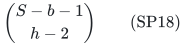

completions when h>=2 and S-b>=h-1; otherwise it has zero completions. When h=1 there is exactly one legal last part, namely S.

For the observed current part a, add SP18 for each positive b<a satisfying the range condition, subtract a from S, and continue. Initially S=B and h=k. This computes a bijective zero-based rank between zero and binomial(B-1,k-1)-1.

The direct implementation makes at most kB binomial evaluations. Its integer lengths are at most O(k log(B+1)); binomial coefficients can be evaluated by elementary polynomial-time integer arithmetic. Recognition of one element per leaf, the central sum, and this composition rank all take polynomial time in the explicit instance size. No enumeration of the whole composition family occurs.

## 7. A matching ETH lower bound with readable rank programs

Given a 3-CNF formula phi with nu variables, choose the smallest integer k>=2 such that

<!-- math-display: cc96c7f7374aa3b0b0c58754
L_k=\binom{k^2-1}{k-1}\ge2^\nu,
 \qquad B=k^2.
 \tag{SP19}
-->
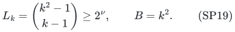

Such a k can be found by polynomially many binomial evaluations. SP17 gives log L_k=Theta(k log k). Minimality, applying the same bounds at k-1, therefore gives

<!-- math-display: c6263952208cdefea92cc662
k\log k=\Theta(\nu),\qquad
 T=k^2+k,\qquad
 \sqrt T\log(T+2)=\Theta(\nu)
 \tag{SP20}
-->
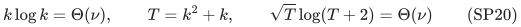

for growing nu; constant-size initial inputs can be handled directly. The selected k and the ground of size k cubed are polynomial in nu.

Decode a composition A into the nu assignment bits of rank(A) modulo 2^nu. The map is surjective because L_k>=2^nu. Accept a member of H precisely when phi accepts its decoded assignment.

Define M_phi by making all sets smaller than r=k independent, all r-sets outside H bases, and exactly the accepted members of H additional bases. Every forbidden subfamily of H is still nonadjacent, so the preceding augmentation proof gives a valid matroid for every formula, without a promise depending on satisfiability.

Its full rank evaluator returns cardinality below r, r above r, and r on any r-set outside H. On an r-set in H it computes its composition rank, evaluates phi on the one decoded assignment, and returns r or r-1 accordingly. All branches run in polynomial time, including larger-set queries, and the entire routine with formula data can be compiled into a polynomial-size rank circuit.

An algorithm may inspect the supplied program and formula; the reduction does not require opacity. The numeric data, program, and circuit have total size polynomial in nu+|phi|. The equalities are feasible if and only if phi is satisfiable.

Consequently deterministic ETH rules out a deterministic exact algorithm of time

<!-- math-display: a6779284c91364d8ad94b777
2^{o(\sqrt T\log(T+2))}\mathrm{poly}(H)
 \tag{SP21}
-->
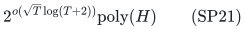

on this balanced connected-star family with polynomial-time rank programs. For bounded-error randomized algorithms the same reduction requires randomized ETH as a separate assumption.

The calibration also matches SP1's exponent k log(2+B/k). This is an encoded-representation result for the stated family, not a claim about every choice of unequal targets or every star-constrained resource representation.

## 8. Relation to the other new bounds

The support-only estimate 2^U binomial(Q+U,U), the per-component menu, and SP3 are compatible analyses of the same pruned profile enumeration. Their minimum is a valid time estimate, provided any explicit-copy or order-enumeration preparation factor is included. The potential retains row-by-row allowances and actual support geometry, which is why it improves a connected star that a total-density bound cannot distinguish.

The universal count in SP3 does not depend on knowing all possible coefficient magnitudes through a target. It sums an infinite coefficient catalogue only for analysis. The implementation stores and visits only occupied vector classes and one binary multiplicity profile.

Aligned compressed nonlinear instances can use the same counting bound after the shared band reduction if their actual band columns satisfy the star or support-pattern conditions. Those conditions must be checked on the refined marginal columns. No claim is made for arbitrary nonlinear equality rows, adverse curvature, or access to functions only through value oracles.

## 9. Primary antecedents and scope

Guessing coefficient-vector counts and recovering a basis through partition intersection is an established method. Eisenbrand, Rohwedder and Wegrzycki, "Sensitivity, Proximity and FPT Algorithms for Exact Matroid Problems," gives a primary account:

https://arxiv.org/html/2404.03747v2

Accepted-subfamily paving constructions and efficient SAT matroid decoders have direct public antecedents in Doron-Arad, Kulik and Shachnai:

https://arxiv.org/html/2307.07773v2

https://arxiv.org/html/2412.02217v2

The ETH convention used here is the deterministic variable-count subexponential-time assumption for 3-SAT. A primary article on that framework is Impagliazzo, Paturi and Zane, "Which Problems Have Strongly Exponential Complexity?":

https://courses.cs.washington.edu/courses/cse599i/24sp/papers/ImpagliazzoPaturiZane_2001_jcss.pdf

The new claims proved in this note are the actual-support potential, its explicit connected-star target estimate, and the composition-family lower calibrations. They are not attributed to the preceding papers as displayed results. A bounded source comparison does not establish publication priority.
