# Exact numeric targets and support-sensitive algorithms

Let <code class="math">F</code> be one normalized, monotone integral polymatroid rank on an explicit coordinate ground. Resource counts and ranks are binary encoded. Feasible vectors are integer points in <code class="math">P(F)</code>, or in the original base face of total <code class="math">F(E)</code>. Target rows have nonnegative integer coefficients; the separately optimized rational scalar may be signed.

The central theorem below proves the sharp two-parameter budget classification, including its constants and randomized rank-query lower bound. The following companion theorems give distinct refinements of the same exact resource-and-profile framework.

| Theorem | Bound, excluding polynomial work in the encoded input | Complete proof |
|---|---|---|
| Total target and original support patterns | <code class="math">2^{O(T\log(2+\min\{Q/T,T\}))}</code> | Sections 1–7 below |
| Fixed row dimension <code class="math">d</code> | <code class="math">\exp(O_d((T+1)^{d/(d+1)}))</code> | [Mixed targets](manuscripts/fixed-dimensional-mixed-numeric-targets.md) |
| Unequal positive auxiliary caps <code class="math">U_j</code> | <code class="math">\exp((d+2(2^d-1))K(U))</code>, <code class="math">K(U)=\max_{\varnothing\ne S}(\prod_{j\in S}U_j)^{1/(\lvert S\rvert+1)}</code> | [Anisotropic bound, Section 9](manuscripts/fixed-dimensional-mixed-numeric-targets.md) |
| One integer objective and one scalar side constraint | <code class="math">2^{O(\sqrt{T+1})}</code>; exact optimization uses <code class="math">\mathrm{OPT}</code> in place of <code class="math">T</code> | [Single objective](manuscripts/exact-numeric-target-single-matroid-scheme.md) |
| Seven single-resource approximation variants | <code class="math">\epsilon^{-1}\exp(141/(50\epsilon)+7)</code> | [Schemes](manuscripts/seven-variant-single-matroid-profile-scheme.md), [exact constant](manuscripts/refined-single-matroid-accuracy-constants.md) |
| Disjoint row supports | <code class="math">\exp(3\sum_j\sqrt{U_j})\le \exp(3T)</code> | [Support-one theorem](manuscripts/column-support-numeric-target-dichotomy.md) |
| At most two rows per column, <code class="math">m</code> interacting row pairs | <code class="math">\exp(O(T\log(2+m/T)))</code> | [Overlap density](manuscripts/row-overlap-density-numeric-target-refinement.md) |
| Component-sensitive and unequal-support counts | Product of component catalogue bounds; <code class="math">\exp(\inf_{t&gt;0}\Phi_U(t))</code> for a prepared ground | [Components](manuscripts/component-sensitive-numeric-target-catalogues.md), [partition potential](manuscripts/support-sensitive-partition-potential-and-star-targets.md) |
| Connected star, <code class="math">k</code> unit-target leaves and center target <code class="math">B</code> | <code class="math">\exp(O(k\log(2+B/k)))</code> | [Star theorem](manuscripts/support-sensitive-partition-potential-and-star-targets.md) |
| Selected disjoint objective blocks | <code class="math">\binom qr\exp(O(r\sqrt{T+1}))</code> | [Block targets](manuscripts/block-global-exact-numeric-target-schemes.md) |
| Compressed nonlinear rows | The matching linear bound for convex upper rows, concave covers and linear equalities | [Aligned rows](manuscripts/aligned-nonlinear-mixed-numeric-targets.md), [overlap transfer](manuscripts/aligned-nonlinear-overlap-density-transfer.md) |
| Global allocation, scheduling and adaptive scenarios | Profile bounds with one shared resource in each scenario, exact budgets and original totals | [Global transfer](manuscripts/global-polymatroid-profile-transfers.md), [mandatory lift](manuscripts/mandatory-base-fair-allocation-passive-lift.md), [robust composition](manuscripts/global-robust-profile-composition.md) |

All algorithms use uniform polynomial binary workspace in the stated oracle or readable-program model. The fixed-dimensional and support-sensitive bounds are different analyses and retain their own parameters. In particular, the number of rows is not silently treated as constant in the two-parameter classification.

The recovery mechanism is shared: a streamed multiplicity profile fixes the totals of coefficient classes; one partition-count polymatroid enforces those totals, and its intersection with the one shared resource rank is integral. A mandatory base keeps its original total throughout masks and lifts. Optional disposal is added only for an originally optional problem. Real zero-coefficient coordinates retain their actual scalar costs.

## Main theorem: a sharp budget classification

This note combines the original-support upper bound with the total-target upper bound, and calibrates two different hidden-matroid families to every sufficiently large pair of parameter budgets. The result is a worst-case classification under upper bounds on the parameters. It does not assert a lower bound for every exactly prescribed pair of parameter values, or for every individual instance.

Throughout this note, logarithms have base two. For positive real numbers define

<!-- math-display: af676f47430054d5c631674e
f(t,q)=t\log_2\!\left(2+\min\{q/t,t\}\right).
 \tag{BC1}
-->
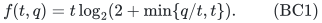

## 1. Model and the classification

Use the model of [unrestricted-support-pattern-numeric-targets.md](manuscripts/unrestricted-support-pattern-numeric-targets.md) (UP) and [variable-dimension-total-target-classification.md](manuscripts/variable-dimension-total-target-classification.md) (VT): one normalized monotone integral polymatroid on an explicit ground, integer points in its independent-set polytope or its original base polytope, explicit nonnegative integer rows with relations in <code class="math">\{\le,=,\ge\}</code>, and one arbitrary rational scalar objective to minimize or maximize exactly. Resource counts and ranks are binary encoded. Scalar coefficients may have either sign. Original mandatory totals must be retained, and optional disposal is used only for an originally optional independent-set problem.

Let <code class="math">T</code> be the sum of the row targets. Following the exact zero-target and eligibility preparation in UP, let <code class="math">Q</code> count the distinct nonempty positive supports of the original eligible columns. Repeated supports count once even if their coefficient values differ. The scalar objective is not included in these supports. Let <code class="math">H</code> be the complete binary input size, with polynomially implemented rank, submodular minimization and weighted intersection operations charged.

There is a deterministic exact algorithm, including infeasibility detection, using

<!-- math-display: f2e96e22fad2b27aee374004
2^{O(f(T,Q))}\mathrm{poly}(H)
 \tag{BC2}
-->
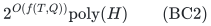

time and uniform polynomial binary workspace whenever <code class="math">T,Q&gt;0</code>. The cases <code class="math">T=0</code> or <code class="math">Q=0</code> are polynomial.

Conversely, for every pair of integers

<!-- math-display: 39fd293ee21238eb69f6700d
t\ge512,\qquad q\ge1,
 \tag{BC3}
-->
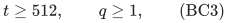

there is a family of rank-oracle instances whose actual parameters satisfy <code class="math">T\le t</code> and <code class="math">Q\le q</code>, whose common explicit non-oracle data have size polynomial in <code class="math">t</code>, and on which exact feasibility has worst-case rank-query complexity at least

<!-- math-display: fd51c2655f17833bf4df64fe
2^{f(t,q)/256}.
 \tag{BC4}
-->
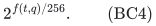

This applies to any randomized algorithm with success probability at least <code class="math">2/3</code> on every instance and a bounded worst-case number of queries. It therefore also applies to deterministic exact algorithms. Ordinary matroid ranks, equality rows, scalar zero, and coefficients in <code class="math">\{0,1,2\}</code> suffice. The construction works separately for mandatory bases and optional independent sets.

Together BC2 and BC4 establish the exponential order <code class="math">2^{\Theta(f(t,q))}</code> in the worst case over the parameter-budget class, up to polynomial factors. The constants are uniform in the row count, the column arity, and the budgets.

## 2. Upper bound and monotonicity in the budgets

UP gives an exact algorithm with exponent <code class="math">O(T\log_2(2+Q/T))</code>, uniformly in the row count and column arity. VT gives exponent <code class="math">O(T\log_2(T+2))</code> for positive integral <code class="math">T</code>. Run the two algorithms by alternating simulation steps and stop when the first finishes. Both outputs are exact, so this costs at most twice the faster running time and stores two polynomial-space states. Consequently the exponent is

<!-- math-display: 5486373087b63f63f71f6791
\begin{aligned}
 &O\!\left(\min\{T\log_2(2+Q/T),\ T\log_2(T+2)\}\right)\\
 &\hspace{35mm}=O(f(T,Q)).
\end{aligned}
 \tag{BC5}
-->
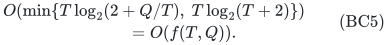

No exponential expression needs to be computed or stored by the algorithm.

The function <code class="math">f</code> is nondecreasing in each coordinate. Monotonicity in <code class="math">q</code> is immediate. For fixed <code class="math">a&gt;0</code>, the derivative of <code class="math">x\ln(2+a/x)</code> is

<!-- math-display: 691ee748fdb849dd3b5f6be1
\ln(2+z)-\frac{z}{2+z}>0,
                    \qquad z=a/x\ge0.
 \tag{BC6}
-->
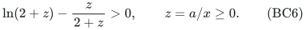

Indeed this expression is <code class="math">\ln2</code> at zero and has derivative <code class="math">z/(2+z)^2\ge0</code> in <code class="math">z</code>. Also <code class="math">x\ln(x+2)</code> is increasing. The minimum of these two increasing functions is increasing. Thus <code class="math">T\le t,Q\le q</code> implies <code class="math">f(T,Q)\le f(t,q)</code>, giving the claimed upper bound for the whole budget class.

For <code class="math">T=0</code>, zero-target preprocessing leaves only masks and scalar optimization. If <code class="math">Q=0</code> and positive targets remain, every eligible column is zero in every row. A positive equality or covering target is then impossible; upper rows are automatic. Scalar optimization on the remaining resource is polynomial. These cases do not use the expression <code class="math">Q/T</code>.

## 3. A common hidden-matroid lemma

Let <code class="math">\mathcal H</code> be a family of <code class="math">r</code>-subsets of a finite ground such that no two different members differ by a single-element exchange. Assume some <code class="math">r</code>-subset is outside <code class="math">\mathcal H</code>. A reference matroid permits every set of size below <code class="math">r</code>, and permits an <code class="math">r</code>-subset as a base exactly when it is outside <code class="math">\mathcal H</code>. For a chosen hidden <code class="math">A\in\mathcal H</code>, also permit <code class="math">A</code>.

These are matroids. Heredity is immediate. The only nontrivial augmentation case has an independent <code class="math">(r-1)</code>-set and an independent <code class="math">r</code>-set. If there is just one candidate added element, the resulting set is the given larger independent set. If there are at least two, the resulting <code class="math">r</code>-subsets are pairwise single-exchange neighbors; at most one is forbidden. Thus an augmentation exists. The assumed outside set establishes rank <code class="math">r</code>.

The hidden and reference rank oracles differ only on <code class="math">A</code>. A smaller set has its cardinality as rank. A larger set contains two adjacent <code class="math">r</code>-subsets, at least one of which is a base in every instance. At size <code class="math">r</code>, only the status of <code class="math">A</code> changes.

Suppose the target equalities are infeasible in the reference instance and have unique feasible set <code class="math">A</code> in its hidden instance. Let <code class="math">\mathcal G\subseteq\mathcal H</code> contain <code class="math">N</code> possible hidden sets. Under the distribution giving probability one half to the reference and one half to a uniformly chosen hidden instance, a deterministic algorithm making at most <code class="math">D</code> queries succeeds with probability at most

<!-- math-display: 77a4cc9905e5f92caed1d3fc
\frac12+\frac{D}{2N}.
 \tag{BC7}
-->
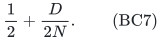

To see this, follow the reference transcript. Its queries name at most <code class="math">D</code> hidden candidates; all other hidden inputs give the same transcript. If the final answer is NO, only queried hidden inputs can contribute additional successes beyond the reference half. If it is YES, the total success is at most the hidden half plus any possible gain on the queried inputs, which is bounded by the same expression. Averaging over random coins proves the randomized bound. Success at least <code class="math">2/3</code> on every input therefore requires <code class="math">D\ge N/3</code>.

The following two constructions use this lemma. Their rank queries have ordinary explicit subsets as inputs and polynomial-bit rank outputs. They do not provide an uncharged stronger oracle.

## 4. Low support-pattern budgets

Suppose <code class="math">t\ge8</code> and <code class="math">q/t\le4</code>. Choose the largest integer <code class="math">h\ge1</code> such that

<!-- math-display: 93a0d743badaf035cc01da28
r=2^h,\qquad T_h=r(3h+1)\le t.
 \tag{BC8}
-->
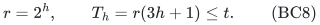

Use the one-support construction OS, recalled here to fix its parameter accounting. The ground is <code class="math">E=\{1,2\}^{2h}</code>, with <code class="math">&#124;E&#124;=r^2</code>. Each of the <code class="math">2h</code> label coordinates is an equality row with target <code class="math">3r/2</code>. Add an all-ones cardinality equality with target <code class="math">r</code>. Every column has the same full nonempty support, so <code class="math">Q=1\le q</code>, and the total target is precisely <code class="math">T_h</code>.

Let <code class="math">\mathcal H</code> contain all balanced <code class="math">r</code>-subsets, meaning those with label sum <code class="math">(3r/2,\ldots,3r/2)</code>. Distinct labels imply that two members cannot be single-exchange neighbors. There is an outside reference base: choose <code class="math">r</code> labels with first coordinate one, possible because <code class="math">r^2/2\ge r</code>.

Pair each label <code class="math">u</code> with its complement <code class="math">3-u</code>. Taking any <code class="math">r/2</code> of these <code class="math">r^2/2</code> pairs gives a balanced candidate, so use the candidate family of size

<!-- math-display: 90b6eed7bb0b56885adf4731
N=\binom{r^2/2}{r/2},\qquad
       \log_2N\ge\frac{rh}{2}\ge\frac{T_h}{8}.
 \tag{BC9}
-->
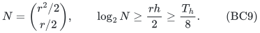

The binomial lower bound follows from <code class="math">\binom{M}{k}\ge(M/k)^k</code>. The cardinality equality forces full rank even for the optional independent-set problem. Hence the reference is infeasible and the hidden instance has exactly its restored candidate as a feasible set.

The consecutive target sizes satisfy

<!-- math-display: 7ccf242edbcc7aa6ceb96a6b
\frac{T_{h+1}}{T_h}
       =2\frac{3h+4}{3h+1}
       \le\frac72.
 \tag{BC10}
-->
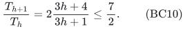

Maximality in BC8 yields <code class="math">T_h&gt;2t/7</code>, and thus <code class="math">\log_2N&gt;t/28</code>. In this regime
<code class="math">f(t,q)\le t\log_2 6&lt;3t</code>, giving

<!-- math-display: fdce868308dc576a3eddd5d7
\log_2N>f(t,q)/84.
 \tag{BC11}
-->
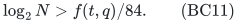

The ground has at most <code class="math">t^2</code> elements and <code class="math">O(\log t)</code> rows. Every non-oracle datum has polynomial total size in <code class="math">t</code>, independently of how large the stated budget <code class="math">q</code> is.

## 5. Higher support-pattern budgets

Suppose <code class="math">q/t&gt;4</code> and <code class="math">t\ge16</code>. Set

<!-- math-display: 06ba8b50722916e8e06b8891
\begin{split}
 b&=2\min\{\lfloor q/t\rfloor,\lfloor t/4\rfloor\},\\
 L&=\lfloor t/b\rfloor,\qquad t'=Lb.
 \end{split}
 \tag{BC12}
-->
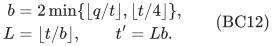

These quantities can be formed with integer arithmetic. The integer <code class="math">b</code> is even and satisfies <code class="math">8\le b\le t/2</code>. Also <code class="math">t/2\le t'\le t</code>.

Take <code class="math">L</code> disjoint cliques on <code class="math">b</code> vertices. The ground consists of their edges. There is one equality row per vertex, with edge-incidence coefficients and target one. Its total target and support count are

<!-- math-display: ac09059a865e4a7d35c405a6
T=t',\qquad
 Q'=L\binom b2=\frac{t'(b-1)}2
                    \le\frac{tb}{2}\le q.
 \tag{BC13}
-->
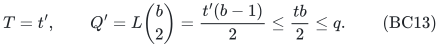

Every edge has its own two-element positive support. Let the one global resource matroid have rank <code class="math">r=t'/2</code>, and let <code class="math">\mathcal H</code> be all perfect matchings of this graph. Equalities force a perfect matching, including in the optional formulation. Distinct edge-incidence columns make <code class="math">\mathcal H</code> nonadjacent under one-element exchange. An outside <code class="math">r</code>-set exists: from a perfect matching, replace one edge by an edge sharing an endpoint with a different retained matching edge inside its clique. The reference/hidden construction therefore applies with

<!-- math-display: 8c6f7efe2379bdc3380c99ab
N=((b-1)!!)^{L}.
 \tag{BC14}
-->
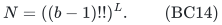

This is a single hidden global matroid, not a direct sum of independently queried resource matroids.

For <code class="math">b\ge8</code>, at least <code class="math">\lfloor b/4\rfloor\ge b/8</code> factors of <code class="math">(b-1)!!</code> are at least <code class="math">b/2</code>, and <code class="math">\log_2(b/2)\ge\tfrac12\log_2b</code>. Hence

<!-- math-display: 87e002513a714b937b8d16b2
\log_2((b-1)!!)\ge\frac{b}{16}\log_2b.
 \tag{BC15}
-->
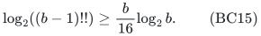

Write <code class="math">x=q/t</code>, <code class="math">z=\min\{x,t\}</code>, and <code class="math">a=\min\{x,t/4\}</code>. Then <code class="math">a\ge4</code>, <code class="math">z\le4a</code>, and <code class="math">b=2\lfloor a\rfloor\ge a</code>. It follows that <code class="math">2+z\le4b+2\le5b\le b^2</code>, so
<code class="math">\log_2b\ge\tfrac12\log_2(2+z)</code>. Combining this with BC12 and BC15 gives

<!-- math-display: 8f4249f2f1bd37ef9156922b
\log_2N
   \ge\frac{t'}{16}\log_2b
   \ge\frac{t}{32}\log_2b
   \ge\frac{f(t,q)}{64}.
 \tag{BC16}
-->
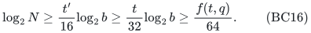

There are at most <code class="math">t^2/4</code> ground elements and at most <code class="math">t</code> rows, with binary coefficients. The full explicit matrix and all other non-oracle data are polynomial in <code class="math">t</code>.

## 6. Uniform lower constant and precise scope

The two regimes give the convenient common bound

<!-- math-display: 132427f8d7ed47f0dbf075e2
N\ge2^{f(t,q)/128}.
 \tag{BC17}
-->
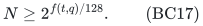

For <code class="math">t\ge512</code>, one has <code class="math">f(t,q)\ge t\ge512</code>. Thus <code class="math">2^{f(t,q)/256}\ge4&gt;3</code>, and BC7 implies

<!-- math-display: 45773e7ddf266eb4153dedd2
D\ge N/3\ge2^{f(t,q)/256},
 \tag{BC18}
-->
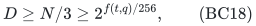

as claimed. This also explains why a polynomial factor in the explicit input size cannot absorb the lower bound: all constructed non-oracle encodings have size polynomial in <code class="math">t</code>, while <code class="math">f(t,q)\ge t</code>.

The quantifiers are over a family with common explicit data and varying rank oracle. For each budget pair, any algorithm correct for the class has a hard instance in that family. The assertion is not that one fixed, publicly identified instance is hard for every algorithm.

The budgets need not be attained exactly. In particular the lower construction deliberately uses <code class="math">Q=1</code> throughout the low-budget regime, and uses whole even cliques in the high-budget regime. This is sufficient and necessary for the stated worst-case envelope; it is not an exact-pair classification. It also makes no instancewise hardness claim for easy subclasses such as modular resources.

This theorem is unconditional in the rank-oracle model. The separately proved encoded rank-program/circuit reductions in OS and [encoded-overlap-density-eth-lower-bound.md](manuscripts/encoded-overlap-density-eth-lower-bound.md) give ETH exclusions along their calibrated parameter families. They are not being promoted here to an encoded ETH assertion for every arbitrary numerical budget pair. Likewise, the result does not turn an oracle lower bound into hardness for a more restrictive explicit matroid representation.

## 7. Dependencies and contribution

The upper bound uses the complete UP and VT algorithms without changing their proofs, mandatory-total conventions, or polynomial-space guarantees. The lower families are the reviewed one-support construction OS and the reviewed disjoint-clique construction RD/ED. The new work is the all-budget calibration, the uniform constants, the monotonicity needed to pass from actual parameters to budgets, and the precise matching worst-case envelope.

The upper-bound algorithms and the two lower constructions are proved in the companion manuscripts. The calibration above establishes a worst-case classification under parameter budgets; it does not assert an exact-pair or representation-independent lower bound.

**Attribution:** Yilin Liu and GPT-6 Astra Pro.
