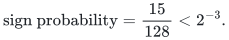
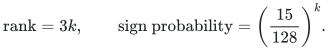

# Exact separation and a conditional-sign obstruction

These are two proved boundary results with different meanings: a compact membership problem is coNP-complete, and a finite represented-matroid example refutes one exact probability inequality.

## Results

**Membership in the binary-code relative-error body <code class="math">Q_a</code>, with <code class="math">a=1/4</code>**

**Conclusion.** coNP-complete

**Exact scope.** Deterministic polynomial reduction; homogeneous binary checks of arity at most two, positive rational weights, and supplied vector in <code class="math">\{0,1/2\}^m</code>

**Proof.** [Proposition 1](manuscripts/exact-separation-for-compact-codes.md)

**Fixed-amplitude one-sided sign-cone probability for the listed rank-three non-Fano representation over <code class="math">\mathbb F_3</code>**

**Conclusion.**

<!-- math-display: 06906a269dfcc45318ac9c0e
\text{sign probability}=\frac{15}{128}<2^{-3}.
-->

**Exact scope.** Deterministic exact count on seven columns and amplitude vector <code class="math">(6,5,3,5,5,5,6)</code>; all ternary row-space queries. The displayed probability belongs to the mathematical random-sign model, not an algorithm's failure event

**Proof.** [Proposition 1](manuscripts/non-fano-obstruction-to-fixed-amplitude-bound.md)

**Direct sum of <code class="math">k</code> copies of the same representation**

**Conclusion.**

<!-- math-display: aee17bd3d4b474955abb1a71
\text{rank}=3k,\qquad\text{sign probability}=\left(\frac{15}{128}\right)^k.
-->

**Exact scope.** Independent signs and fixed amplitudes on disjoint coordinate blocks; a deterministic direct-sum construction and exact probability identity

**Proof.** [Direct-sum corollary](manuscripts/non-fano-obstruction-to-fixed-amplitude-bound.md)

## Contract

**Objective and output**

Classify exact membership in a compact partial-coloring body and give an exact counterexample to the proposed fixed-amplitude sign bound.

**Randomness**

Deterministic reductions, explicit constructions and exhaustive exact verification. The non-Fano sign probability describes a mathematical random-sign experiment, not a randomized algorithm or algorithm failure probability.

**Time**

The membership classification uses a polynomial reduction from weighted Max-Cut. The seven-element count is verified by finite exact enumeration, with a complete combinatorial proof in the manuscript.

**Space**

The reduction has polynomial description length. The fixed counterexample requires no asymptotic workspace claim.

**Parameters**

Binary-code dimension and number of checks for the reduction; represented rank three, field <code class="math">\mathbb F_3</code>, and seven positive amplitudes for the obstruction.

**Model and representation**

Exact rational membership and independent uniform signs at fixed amplitudes. The Gaussian amplitude distribution is a different model.

**Lower-bound scope**

Exact compact separation would imply <code class="math">\mathsf{P}=\mathsf{NP}</code>. The non-Fano example refutes the coefficient one in <code class="math">2^{-r}</code> for conditional signs. Neither result proves that compact optimal sparsifiers are impossible or disproves a Gaussian <code class="math">\exp(-Cr)</code> estimate.

**Review status**

**Ready for review.** Both canonical obstruction theorems: exact compact-code membership is coNP-complete through the weighted Max-Cut reduction, including sparse certificates for binary-encoded unused dimensions; and the precise non-Fano fixed-amplitude counterexample with its direct-sum product. The exact reference constructs the reduction, verifies original-input dense or sparse violations without search, recovers violating cuts and separates by streamed enumeration of used coordinates.

**Dependencies and scope.** The Max-Cut primary source uses positive integer weights and a non-strict target; the reduction explicitly shifts that target to its strict-cut threshold. Construction and certificate verification charge actual rational and coordinate bit lengths. The reference separator is exponential in used coordinates. No polynomial exact separator, approximate-separation hardness, Gaussian-amplitude counterexample or general sparsifier construction is claimed. Independent internal proof review and finite executable evidence do not assert external peer review or proof-assistant verification.

The [verification note](verify/README.md) identifies executable coverage. This status does not claim external peer review or proof-assistant verification.

**Source**

[Proofs](proof.md), [source map](sources.md), [model review](verify/README.md), [finite replay](verify/README.md).

**Attribution:** Yilin Liu and GPT-6 Astra Pro.

## Executable exact reduction and certificates

The [reference backend](reference/README.md) constructs the compact body from
original weighted Max-Cut instances, verifies strict violation witnesses
and decodes them back to original cuts. A separate streamed exact separator
has explicitly exponential time; it does not supply the polynomial compact
oracle excluded by the theorem.
