# Exact separation for compact binary-code partial coloring

**Abstract.** Exact membership in the relative-error partial-coloring body of a compact binary linear code is coNP-complete, even for checks on at most two variables and a supplied vector with only two distinct coordinate values. A polynomial reduction from weighted Max-Cut proves the statement. The theorem concerns this exact oracle problem and does not assert hardness of constructing optimal-support sparsifiers by other methods.

## 1. Statement

Let <code class="math">b_e:\mathbb F_2^d\to\{0,1\}</code> be homogeneous binary linear-check predicates
<!-- math-display: 213c5505c8f8e2814bbb7cae
b_e(y)=\mathbf1[a_e\cdot y\ne0],
-->
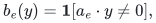
with positive rational weights <code class="math">w_e</code>. For <code class="math">0&lt;a\le1/2</code>, write
<!-- math-display: 75b73ecc5bd5ffc0ceb75c98
W(y)=\sum_e w_e b_e(y),
\qquad
Q_a=
\left\{z\in[-1,1]^m:
\left|\sum_e w_ez_e b_e(y)\right|
\le aW(y)\ \text{for every }y\in\mathbb F_2^d
\right\}.
\tag{1}
-->
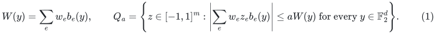
This is the symmetric perturbation body used by the Gaussian whole-subgroup sparsification argument.

**Proposition 1.** At the fixed value <code class="math">a=1/4</code>, deciding whether a specified rational vector belongs to <code class="math">Q_a</code> is coNP-complete. This holds when every <code class="math">a_e</code> has Hamming weight at most two and the specified vector belongs to <code class="math">\{0,1/2\}^m</code>.

Consequently a general exact polynomial-time separation oracle for the compactly represented bodies (1) would imply <code class="math">\mathrm P=\mathrm{NP}</code>. Enumerating all <code class="math">2^d</code> query vectors supplies an exact oracle, but is exponential in the compact dimension.

## 2. Reduction

Start with an instance of weighted Max-Cut: an undirected graph on <code class="math">n</code> vertices, nonnegative integer edge weights <code class="math">\lambda_{uv}</code>, and a threshold <code class="math">K</code>. Let
<!-- math-display: 467a8c3f741a4f6e2052d8eb
M=\max_v\sum_{u:uv\in E}\lambda_{uv}.
-->
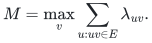
The edgeless case is trivial, so take <code class="math">M&gt;0</code>. Introduce binary variables <code class="math">x_1,\ldots,x_n,t</code>. Consider the signed sum of homogeneous linear-check predicates
<!-- math-display: 52c8007c9b4700e0f7c3ec82
\begin{split}
F(x,t)
={}&\sum_{uv\in E}\lambda_{uv}(x_u\mathbin{\oplus}x_v)\\
&-\frac M2\sum_{v=1}^n
\bigl(x_v+(x_v\mathbin{\oplus}t)\bigr)
+\left(\frac{Mn}{2}-K\right)t.
\end{split}
\tag{2}
-->
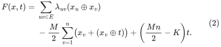
Here the binary quantities are interpreted as real <code class="math">0/1</code> numbers. Every summand is a homogeneous linear-check predicate on at most two coordinates.

If <code class="math">t=0</code> and <code class="math">S=\{v:x_v=1\}</code>, then
<!-- math-display: e079df15e8519f6e045f3c00
F(x,0)=\mathrm{cut}_\lambda(S)-M|S|
\le0,
\tag{3}
-->
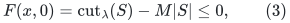
because every cut edge incident to <code class="math">S</code> is counted in the weighted-degree sum of <code class="math">S</code>. If <code class="math">t=1</code>, then <code class="math">x_v+(x_v\oplus1)=1</code>, so
<!-- math-display: 6c0dc93f4e662deb08080c2e
F(x,1)=\mathrm{cut}_\lambda(S)-K.
\tag{4}
-->
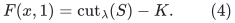
Thus
<!-- math-display: bbffa027efae245ab662715e
F(y)\le0\ \text{for every }y\in\mathbb F_2^{n+1}
\quad\Longleftrightarrow\quad
\mathrm{MaxCut}_\lambda(G)\le K.
\tag{5}
-->
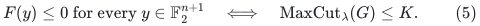

Write (2) as <code class="math">F(y)=\sum_e c_e b_e(y)</code>, keeping each displayed term as its own input item and dropping zero coefficients. Set
<!-- math-display: 4dcdd0c3d37e161943c5a5cc
a=\frac14,\qquad
w_e=\frac{|c_e|}{a}=4|c_e|,
\qquad
z_e=a(1+\mathrm{sign}c_e).
\tag{6}
-->
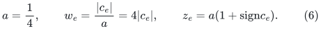
All weights are positive rationals, and <code class="math">z_e\in\{0,1/2\}</code>. Moreover,
<!-- math-display: 2471ded5c0d8382c20fac5a0
\sum_e w_e(z_e-a)b_e(y)=F(y).
\tag{7}
-->
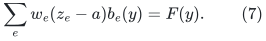
The upper inequality in (1) is therefore exactly the left side of (5). The lower inequality in (1) is automatic: <code class="math">z_e\ge0</code> and <code class="math">b_e(y)\ge0</code>, so the perturbed sum is nonnegative. The cube constraint is also automatic. Hence
<!-- math-display: ad1d02d9e4c7b655fb248477
z\in Q_{1/4}
\quad\Longleftrightarrow\quad
\mathrm{MaxCut}_\lambda(G)\le K.
\tag{8}
-->
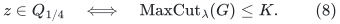
The construction has polynomial size and rational bit complexity.

This proves coNP-hardness. Nonmembership lies in NP because a violating query <code class="math">y</code>, or a violated cube coordinate, is a polynomially checkable certificate. For sparse rows with a binary-encoded ambient dimension, the query certificate
need only list its one-valued used coordinates: omitted coordinates can be
zero, and at most the total row length many coordinates affect any predicate.
Thus the certificate remains polynomial in that encoding as well.
Therefore membership is coNP-complete. <code class="math">\square</code>

## 3. Algorithmic implications

The optimal-support subgroup theorem gives <code class="math">O(d/\epsilon^2)</code> support for binary linear checks. Its generic constructive proof uses partial coloring and a separation oracle for a body of the form (1). Proposition 1 shows why simply declaring that oracle efficient on compact code input is invalid, even when every check has arity at most two.

This is **not** evidence that optimal-support code sparsifiers cannot be constructed in compact polynomial time. Indeed, the arity-two setting in the reduction also has special graph structure, and graph spectral sparsification has efficient optimal-support methods that avoid this exact query-separation problem. A new code-specific partial-coloring implementation, a suitable relaxation, or a different constructive argument could likewise circumvent the obstruction.

The proposition addresses exact separation. It does not establish a hardness factor for every possible weak oracle or relaxation. No claim about approximate separation is needed for the algorithmic distinction in the companion manuscripts.

For whole finite-field block queries, the available compact construction in this checkpoint instead applies Quanrud's weighted quotient-sparsification theorem with adaptive resparsification. It returns
<!-- math-display: 2d767b7738e87996c7ae2ed8
O\!\left(d\log(2d/\epsilon)/\epsilon^2\right)
-->
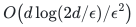
original blocks in randomized polynomial time. The new Gaussian proof gives the smaller <code class="math">O(d\log q/\epsilon^2)</code> support bound with a construction polynomial in an explicitly listed <code class="math">q^d</code>-row query table. These are different algorithmic guarantees.

## 4. Sources and attribution

- Richard M. Karp, **Reducibility Among Combinatorial Problems** (1972), supplies the standard NP-completeness baseline for weighted Max-Cut. Primary publication: <https://doi.org/10.1007/978-1-4684-2001-2_9>. A scan of the original chapter is available at <https://www.cs.mun.ca/~kol/courses/6743-w15/papers/karp.pdf>.
- Reis--Rothvoss, **Vector Balancing in Lebesgue Spaces**, supplies the general partial-coloring framework used by the companion argument: <https://arxiv.org/abs/2007.05634>.
- Brakensiek--Guruswami--Putterman, **Multiplicative error set system sparsification: A simpler proof via chain length contraction** (May 2026), Theorem 1.2 gives the stronger general set-system existence baseline with overhead <code class="math">\log^2(d/\epsilon)(\log\log(d/\epsilon))^2</code>, and explicitly does not claim an efficient implementation for arbitrary implicit set systems: <https://arxiv.org/abs/2605.01508>.
- Kent Quanrud, **Quotient sparsification for submodular functions**, SODA 2024, is the classical compact algorithmic backend: <https://kentq.s3.amazonaws.com/submodular-sparsification.pdf>.
- Companion proofs: 30_optimal_whole_subgroup_constraints.md, 27_adaptive_quotient_resparsification.md, and 23_arbitrary_locality_stabilizer_block_sparsification.md.

The reduction above records the precise obstruction relevant to this checkpoint. No priority claim for hardness of Max-Cut separation in related convex bodies is intended.
