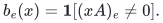
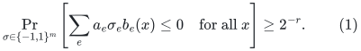
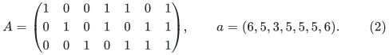
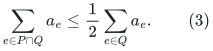
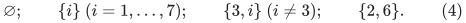
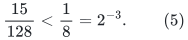
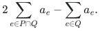
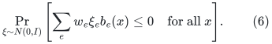

# A seven-element obstruction to an exact conditional-sign cone bound

**Abstract.** We give a rank-three, seven-column representation over <code class="math">\mathbb F_3</code> and a positive amplitude vector for which the probability of satisfying every one-sided query inequality under independent uniform signs is exactly <code class="math">15/128</code>. The example refutes the proposed universal fixed-amplitude lower bound <code class="math">2^{-r}</code>. Its proof enumerates all query supports and all minimal invalid positive supports. The result concerns conditional signs and does not assert a sparsification lower bound or a failure of Gaussian cone bounds.

## 1. Fixed-amplitude sign-cone inequality

For a rank-<code class="math">r</code> matrix <code class="math">A</code> over a finite field, consider its binary query supports
<!-- math-display: bcfc51236ef497d3eb230ea1
b_e(x)=\mathbf1[(xA)_e\ne0].
-->

One might hope that for every fixed positive amplitude vector <code class="math">a</code>,
<!-- math-display: d99ca7f552dec203149607e2
\Pr_{\sigma\in\{-1,1\}^m}
 \left[\sum_e a_e\sigma_e b_e(x)\le0
       \quad\text{for all }x\right]\ge 2^{-r}.
 \tag{1}
-->

The probability is over independent uniform signs only. In a Gaussian proof, this would be the stronger assertion obtained by conditioning on every coordinate's absolute value.

Equation (1) is false for <code class="math">r=3</code>, <code class="math">m=7</code>, over <code class="math">\mathbb F_3</code>.

## 2. Exact counterexample

Take
<!-- math-display: 82ccbbc2315a3fe0508bc2a4
A=
 \begin{pmatrix}
 1&0&0&1&1&0&1\\
 0&1&0&1&0&1&1\\
 0&0&1&0&1&1&1
 \end{pmatrix},
 \qquad
 a=(6,5,3,5,5,5,6).
 \tag{2}
-->

The first three columns form a basis. The represented rank-three matroid is the usual non-Fano configuration.

For a sign vector, let <code class="math">P=\{e:\sigma_e=1\}</code>. The inequality for a query support <code class="math">Q</code> is equivalent to
<!-- math-display: 48dea2a608f06d16b98b12dd
\sum_{e\in P\cap Q}a_e
 \le \frac12\sum_{e\in Q}a_e.
 \tag{3}
-->

The nonempty supports of the ternary row space are exactly the following thirteen sets. Each nonzero scalar multiple has the same support, so these account for all <code class="math">26</code> nonzero queries.

| <code class="math">Q</code> | <code class="math">\sum_{e\in Q}a_e</code> |
|---|---:|
| <code class="math">3567</code> | <code class="math">19</code> |
| <code class="math">2467</code> | <code class="math">21</code> |
| <code class="math">2345</code> | <code class="math">18</code> |
| <code class="math">1457</code> | <code class="math">22</code> |
| <code class="math">1346</code> | <code class="math">19</code> |
| <code class="math">1256</code> | <code class="math">21</code> |
| <code class="math">12367</code> | <code class="math">25</code> |
| <code class="math">12357</code> | <code class="math">25</code> |
| <code class="math">12347</code> | <code class="math">25</code> |
| <code class="math">234567</code> | <code class="math">29</code> |
| <code class="math">134567</code> | <code class="math">30</code> |
| <code class="math">124567</code> | <code class="math">32</code> |
| <code class="math">123456</code> | <code class="math">29</code> |

Here <code class="math">3567</code>, for example, denotes <code class="math">\{3,5,6,7\}</code>.

**Proposition 1.** Exactly fifteen positive supports <code class="math">P</code> satisfy (3) for every row of the table:
<!-- math-display: 9deba909d8916046eab2cd72
\varnothing;\qquad
 \{i\}\ (i=1,\ldots,7);\qquad
 \{3,i\}\ (i\ne3);\qquad
 \{2,6\}.
 \tag{4}
-->

Consequently, the probability in (1) is
<!-- math-display: a3d9a2e30940dc00ee4ededf
\frac{15}{128}<\frac18=2^{-3}.
 \tag{5}
-->

**Proof.** The empty set and all singletons satisfy (3). For a pair containing <code class="math">3</code>, its positive weight is at most <code class="math">3+6=9</code>. Every support containing <code class="math">3</code> has total weight at least <code class="math">18</code>; a support omitting <code class="math">3</code> meets the pair in at most one element, of weight at most <code class="math">6</code>. Thus all six such pairs are valid. The pair <code class="math">26</code> has positive weight <code class="math">10</code>; the smallest supports containing both elements have total weight <code class="math">21</code>, and supports meeting the pair only once cause no problem. This proves validity of all fifteen sets in (4).

Every other pair is invalid. The following witnesses list <code class="math">Q</code> and the strictly positive quantity
<!-- math-display: cae1fdc13cb640130c197739
2\sum_{e\in P\cap Q}a_e-\sum_{e\in Q}a_e.
-->

| Invalid pair <code class="math">P</code> | Witness <code class="math">Q</code> | Violation |
|---|---|---:|
| <code class="math">12</code> | <code class="math">1256</code> | <code class="math">1</code> |
| <code class="math">14</code> | <code class="math">1346</code> | <code class="math">3</code> |
| <code class="math">15</code> | <code class="math">1256</code> | <code class="math">1</code> |
| <code class="math">16</code> | <code class="math">1346</code> | <code class="math">3</code> |
| <code class="math">17</code> | <code class="math">1457</code> | <code class="math">2</code> |
| <code class="math">24</code> | <code class="math">2345</code> | <code class="math">2</code> |
| <code class="math">25</code> | <code class="math">2345</code> | <code class="math">2</code> |
| <code class="math">27</code> | <code class="math">2467</code> | <code class="math">1</code> |
| <code class="math">45</code> | <code class="math">2345</code> | <code class="math">2</code> |
| <code class="math">46</code> | <code class="math">1346</code> | <code class="math">1</code> |
| <code class="math">47</code> | <code class="math">2467</code> | <code class="math">1</code> |
| <code class="math">56</code> | <code class="math">3567</code> | <code class="math">1</code> |
| <code class="math">57</code> | <code class="math">3567</code> | <code class="math">3</code> |
| <code class="math">67</code> | <code class="math">3567</code> | <code class="math">3</code> |

Because every amplitude is positive, any set containing one of these invalid pairs is also invalid. The graph of valid pairs is the star centered at <code class="math">3</code>, with the additional edge <code class="math">26</code>. Its only triangle is <code class="math">236</code>. That triangle is invalid as well: for <code class="math">Q=12367</code>, its positive weight is <code class="math">5+3+5=13&gt;25/2</code>. No larger clique exists. This excludes every remaining positive support and proves the proposition. <code class="math">\square</code>

## 3. Direct sums and Gaussian scope

The union-closure chain length of this query-support family is exactly three. Indeed, the union of the supports of a set of queries depends only on their linear span, so a strict union chain can be generated by at most three linearly independent queries. The three coordinate queries attain three strict increases. Thus (5) also refutes the corresponding exact <code class="math">2^{-d}</code> fixed-amplitude assertion for general binary set systems of union-closure chain length <code class="math">d</code>.

Taking direct sums of <code class="math">k</code> independent copies gives rank <code class="math">3k</code> and a conditional-sign probability exactly <code class="math">(15/128)^k</code>. This rules out the constant <code class="math">1</code> in the exponent <code class="math">2^{-r}</code> for that stronger formulation. It remains an exponential function of rank, so it does not refute the weaker type of estimate needed by the Gaussian-section sparsification method.

In particular, no claim about the following Gaussian probability follows merely from this example:
<!-- math-display: 2f68e7c5e1eab5ac524a5cf4
\Pr_{\xi\sim N(0,I)}
 \left[\sum_e w_e\xi_e b_e(x)\le0
       \quad\text{for all }x\right].
 \tag{6}
-->

Gaussian averaging changes the amplitude distribution. A field-independent hereditary lower bound <code class="math">\exp(-Cr)</code> for (6) would still be sufficient for an <code class="math">O(r/\epsilon^2)</code> support theorem through the companion Gaussian symmetrizer. The counterexample therefore establishes precisely the failure of the fixed-amplitude constant in (1).
