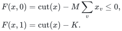
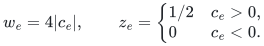
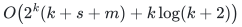

# Exact realization of the compact membership obstruction

[Reference API](../reference/README.md) · [Independent finite checks](../verify/check_compact_body.py)

## Source and threshold direction

The classical input is weighted Max-Cut in Karp's *Reducibility Among
Combinatorial Problems*: Problem 21 on original page 97 uses the threshold
condition that some cut has weight at least the supplied positive integer.
Appendix I on original page 103 defines its integer symbol to mean positive
integers. These exact pages were checked in the
[primary chapter reprint](https://www.cs.umd.edu/~gasarch/BLOGPAPERS/Karp.pdf).
Thus the nonnegative integer edge-weight restriction used here already
contains the source's hard positive-weight instances.

If the source decision threshold is <code class="math">B</code>, pass <code class="math">K=B-1</code> to the constructor.
Integrality makes a cut of weight at least <code class="math">B</code> equivalent to one of weight
strictly greater than <code class="math">K</code>. Consequently **membership** of the constructed
point represents the complement of the source decision language, precisely
the direction needed for coNP-hardness. No equality case is discarded.
The [canonical reduction proof](exact-separation-for-compact-codes.md)
establishes the complete hardness statement; the code realizes its map.

## Construction and exceptional inputs

Let <code class="math">M</code> be the maximum weighted degree of the original graph, or zero when
there are no vertices. Use one additional original binary coordinate <code class="math">t</code>.
Keep every edge term, every vertex penalty and the final threshold term as
a separate signed parity-check item, omitting only zero coefficients.
Parallel original edges remain distinct items. The implementation computes
half-integer penalties with exact fractions, never by floating point.

The sum of the signed item values satisfies

<!-- math-display: bcf3a7101d2fd3cd534f07cf
\begin{aligned}
F(x,0)&=\mathrm{cut}(x)-M\sum_v x_v\le0,\\
F(x,1)&=\mathrm{cut}(x)-K.
\end{aligned}
-->

The first inequality follows by charging each cut edge to its selected
endpoint and bounding each selected vertex degree by <code class="math">M</code>. The second uses
<code class="math">x_v+(x_v\mathbin{\oplus}1)=1</code>. Both statements remain valid for zero-degree
graphs and negative implementation thresholds, even though those cases are
unnecessary for the source hardness reduction.

For each nonzero signed coefficient <code class="math">c_e</code>, the constructed input uses

<!-- math-display: d867c7c0f71c493d4f6f41d6
w_e=4|c_e|,\qquad
z_e=\begin{cases}1/2&c_e>0,\\0&c_e<0.\end{cases}
-->

Then the upper body excess equals <code class="math">F</code> exactly, item by item. The lower
inequality is automatic because the constructed perturbed sum is
nonnegative. The cube constraints hold. Therefore a violation of the
constructed point must have <code class="math">t=1</code> and yields an original cut of weight
strictly greater than <code class="math">K</code>. Conversely every such cut gives a violating
query. This proves the constructor and `recover_cut` contracts for all
accepted inputs, not only the finite tested graphs.

There are at most <code class="math">m+2n+1</code> output checks, each on at most two variables,
with dimension <code class="math">n+1</code>. For integer edge weights and threshold, every output
weight is a positive integer even though intermediate coefficients may be
half integers. If input magnitudes have at most <code class="math">L</code> bits, degrees, penalties
and output weights have <code class="math">O(L+\log(n+m+2))</code> bits. Construction uses
<code class="math">O(n+m)</code> exact arithmetic operations and records, with vertex count charged
explicitly including isolated vertices. No count depends linearly on the
numerical magnitude of a weight.

## Search-free nonmembership verification

A generic body input specifies all parity rows, positive exact rational
weights, a rational point and rational accuracy. The constructor validates
these data and copies its tuples. A cube witness is accepted only when its
specified coordinate has absolute value strictly greater than one. A dense query
witness gives exactly the declared number of binary coordinates. A sparse
witness lists distinct valid original IDs assigned one and gives all omitted
coordinates value zero. Either form is accepted only when its exact weighted
sum violates one of the two relative-error inequalities strictly.

Each accepted witness names one of the body's defining inequalities and
proves nonmembership. If a point is not a member, either a cube inequality
fails or one defining query inequality fails, so one of these witness forms
exists. If the dimension is itself binary encoded and rows are sparse,
only the coordinates appearing in some row affect a predicate. Restricting
a violating assignment to these coordinates preserves every parity and
requires at most the total row length many original IDs. Thus a polynomial
sparse nonmembership certificate exists without expanding unused coordinates.
The query form also covers lower-side violations for generic
negative point coordinates; it is not restricted to the Max-Cut image.
This is the complete verifier argument. It does not call a cut solver or
an exact separator.

If total row length is <code class="math">s</code>, dense query verification uses <code class="math">O(d+s+m)</code> elementary
and exact rational operations for dimension <code class="math">d</code>, plus actual rational bit
costs. A cube witness needs only the named coordinate after input validation.
The output assignment and its encoding are explicitly charged. A sparse query instead uses work linear in its listed IDs plus row/item
length, and charges each ID at its actual binary bit length. In particular,
it does not allocate the declared dimension. These bounds do not give a
polynomial membership-decision algorithm.

## Exhaustive reference separator

After checking cube coordinates, the reference forms the sorted set of
coordinates appearing in a row and streams every binary assignment on just
that set. All other coordinates are zero. Every full query has the same
predicate values as one of these restricted queries, so this is complete.
The first violating assignment is returned in sparse original-ID form. If enumeration ends without
one, all defining inequalities hold, proving membership. An all-empty-row
body is recognized before allocating a query vector because every parity
predicate is identically zero.

Let `k` be the number of used coordinates; it is at most both the declared
dimension and total row length. In the general case the routine uses

<!-- math-display: 44754ede3e636542efcb317a
O\!\left(2^k(k+s+m)+k\log(k+2)\right)
-->

exact operations and <code class="math">O(k+s+m)</code> stored records, besides input and arithmetic
bit costs. No exponential query list is retained. This realizes an exact
oracle for finite inputs with its enumeration cost charged explicitly;
it is not the compact polynomial-time separation interface ruled out by
the hardness theorem under the usual complexity assumption.

## Fixed-amplitude companion audit

The [non-Fano companion](non-fano-obstruction-to-fixed-amplitude-bound.md)
has been checked independently at its finite proof steps: the thirteen
ternary row supports and weights, all valid pairs, the listed fourteen
invalid-pair witnesses, the unique remaining triangle and the direct-sum
necessity/sufficiency argument. The already registered checker enumerates
all original row queries and signs. This establishes the precise
fixed-amplitude counterexample and its product construction. It does not
supply a counterexample to the different Gaussian-amplitude statement.

The review covers both canonical obstruction proofs and the new executable
reduction/verification interface. Sampling, compact sparsifier construction
and approximate-separation hardness remain outside these claims.

**Attribution:** icekylinx and GPT-6 Astra Pro.
