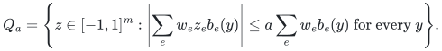
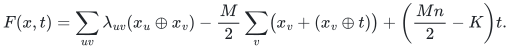
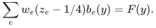
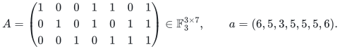
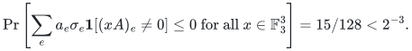

# Exact membership and conditional-sign proofs

## 1. Exact compact-code membership

For homogeneous binary checks <code class="math">b_e(y)=\mathbf1[a_e\cdot y\ne0]</code>, positive rational weights <code class="math">w_e</code>, and <code class="math">a=1/4</code>, define

<!-- math-display: 1cc50a1609a9270eb9dcc7ec
Q_a=\left\{z\in[-1,1]^m:
\left|\sum_ew_ez_eb_e(y)\right|\le a\sum_ew_eb_e(y)
\text{ for every }y\right\}.
-->

**Theorem 1.** Deciding membership in <code class="math">Q_{1/4}</code> is coNP-complete even when every check has arity at most two and the supplied vector is in <code class="math">\{0,1/2\}^m</code>.

**Proof.** Start with a weighted Max-Cut instance with nonnegative integer edge weights <code class="math">\lambda_{uv}</code>, threshold <code class="math">K</code>, and maximum weighted degree <code class="math">M&gt;0</code>. On binary variables <code class="math">x_1,\ldots,x_n,t</code>, put

<!-- math-display: 383e2043762348420c5e7558
F(x,t)=\sum_{uv}\lambda_{uv}(x_u\oplus x_v)
-\frac M2\sum_v\bigl(x_v+(x_v\oplus t)\bigr)
+\left(\frac{Mn}{2}-K\right)t.
-->

For <code class="math">t=0</code>, <code class="math">F(x,0)=\mathrm{cut}(x)-M&#124;\{v:x_v=1\}&#124;\le0</code>. For <code class="math">t=1</code>, it equals <code class="math">\mathrm{cut}(x)-K</code>. Therefore <code class="math">F\le0</code> on every assignment if and only if the maximum cut is at most <code class="math">K</code>.

Write the displayed signed sum as <code class="math">\sum_ec_eb_e</code>, retain separate item identities, and omit zero coefficients. Set <code class="math">w_e=4&#124;c_e&#124;</code> and <code class="math">z_e=(1+\mathrm{sign}c_e)/4</code>. Then

<!-- math-display: 4b36c55c94e3561753213385
\sum_ew_e(z_e-1/4)b_e(y)=F(y).
-->

Thus the upper inequality defining <code class="math">Q_{1/4}</code> is exactly <code class="math">F(y)\le0</code>; the lower inequality is automatic because <code class="math">z_e,w_e,b_e</code> are nonnegative. All checks have arity at most two, all data have polynomial bit length, and <code class="math">z_e\in\{0,1/2\}</code>. This proves coNP-hardness. Nonmembership has a polynomially checkable violating assignment or cube coordinate, proving membership in coNP. <code class="math">\square</code>

The [complete reduction](manuscripts/exact-separation-for-compact-codes.md) identifies the classical Max-Cut source. This theorem concerns exact membership/separation for this body. It is compatible with efficient graph sparsification methods that do not solve that oracle problem.

## 2. Exact non-Fano probability

Let

<!-- math-display: e9f3fa9b987be3515239dc05
A=\begin{pmatrix}
1&0&0&1&1&0&1\\
0&1&0&1&0&1&1\\
0&0&1&0&1&1&1
\end{pmatrix}\in\mathbb F_3^{3\times7},
\qquad a=(6,5,3,5,5,5,6).
-->

**Theorem 2.** For independent uniform signs <code class="math">\sigma_e</code>,

<!-- math-display: b320b6aca351ccd1532b31bd
\Pr\left[\sum_ea_e\sigma_e\mathbf1[(xA)_e\ne0]\le0
\text{ for all }x\in\mathbb F_3^3\right]
=15/128<2^{-3}.
-->

**Proof.** The first three columns show that the rank is three. The 26 nonzero row-space queries give thirteen distinct nonempty supports. They are listed with exact total amplitudes in [the source proof](manuscripts/non-fano-obstruction-to-fixed-amplitude-bound.md).

For a positive-sign set <code class="math">P</code>, a query support <code class="math">Q</code> is accepted exactly when <code class="math">2\sum_{e\in P\cap Q}a_e\le\sum_{e\in Q}a_e</code>. The empty set, seven singleton sets, six pairs <code class="math">\{3,i\}</code> with <code class="math">i\ne3</code>, and the pair <code class="math">\{2,6\}</code> satisfy every inequality. Every other pair has an explicitly listed violating query. Positivity makes every superset of an invalid pair invalid. The graph of valid pairs is a star centered at 3 plus edge <code class="math">26</code>; its only triangle is <code class="math">236</code>. That triangle violates query support <code class="math">12367</code>, with positive weight 13 and total weight 25. No larger clique exists. These observations exclude every other positive-sign set, leaving exactly fifteen out of 128. <code class="math">\square</code>

A direct sum of <code class="math">k</code> copies has rank <code class="math">3k</code>. Its complete sign event is the intersection of the <code class="math">k</code> independent copy events: restricting queries to one block proves necessity, and summing the nonpositive block inequalities proves sufficiency. Its probability is therefore exactly <code class="math">(15/128)^k</code>.

This disproves the exact fixed-amplitude lower bound <code class="math">2^{-r}</code>. It does not disprove a lower bound with a different exponential constant or a Gaussian bound in which the amplitudes themselves are random.

**Attribution:** icekylinx and GPT-6 Astra Pro.

## Executable realization and source convention

The [implementation proof](manuscripts/reference-compact-membership.md)
identifies Karp's threshold direction and positive-integer convention, makes
zero-degree and equality cases explicit, and proves the exact constructor,
nonmembership verifier and original-cut decoder. Its exhaustive membership
routine has a separately charged exponential bound.
