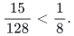

# Verification and scope

[Main proof](../proof.md) · [Source dependencies](../sources.md)

## Exact non-Fano replay

Run the [non-Fano checker](../../../tools/verify_non_fano.py) from the repository root:

~~~sh
python3 tools/verify_non_fano.py
~~~

The checker enumerates all 27 row queries in <code class="math">\mathbb F_3^3</code>, obtains 13 distinct nonempty supports, and tests all 128 independent sign vectors for the displayed positive amplitudes. Exactly 15 satisfy every inequality, giving
<!-- math-display: ef5ebe1ad81a080897d86cd5
\frac{15}{128}<\frac18.
-->

The written proof additionally supplies a violating query for every invalid pair and excludes the only triangle whose pairs are all individually valid. The finite argument is therefore readable independently of the program.

The replay concerns exactly this seven-element, rank-three ternary example. It does not establish a Gaussian probability bound or test all matroids.

## Exact-membership reduction

At homogenizing bit zero, the maximum weighted degree bounds the cut by the degree sum of the selected vertices. At bit one, the reduction's expression is the cut value minus the target. The conversion from signed coefficients uses <code class="math">w_e=4&#124;c_e&#124;</code> and <code class="math">z_e\in\{0,1/2\}</code>; the lower inequality of the body is automatic.

The complexity result is coNP-completeness of exact membership. A polynomially checkable violating assignment certifies nonmembership. A compact polynomial-time exact separation oracle for the same body would decide membership and imply <code class="math">P=NP</code>. The finite non-Fano executable does not certify this reduction.

## Fixed-amplitude boundary

The sign assertion fixes positive amplitudes and chooses independent uniform signs. The [Gaussian subgroup theorem](../../group-metric-constraints/manuscripts/optimal-whole-subgroup-constraints.md) integrates over amplitudes and has a different premise.

Direct sums give the exact probability <code class="math">(15/128)^k</code>, refuting the proposed coefficient one in <code class="math">2^{-r}</code>. They do not refute unrestricted arbitrary-matroid sparsification or every Gaussian bound of the form <code class="math">\exp(-Cr)</code>. The compact membership obstruction likewise leaves explicit-table algorithms and model-specific rank-oracle methods available.

**Attribution:** Yilin Liu and GPT-6 Astra Pro.
