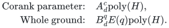

# One-value allocation with exact quotas and setup costs

**Guarantee**

Returns at least <code class="math">\lceil K_\star/2\rceil</code> units to every player of an actual selected basis, preserving the exact combined setup and assignment budget. More generally, fixed integer <code class="math">d\ge2</code> gives <code class="math">\lceil K_\star/d\rceil</code>.

**Objective and output**

Maximize the common minimum count of equal-value units; output a selected basis and integral resource counts.

**Randomness**

Deterministic corank branching and exact-budget recovery; the whole-ground alternative uses deterministic inclusion covers.

**Time**

For fixed integer <code class="math">d\ge2</code> set <code class="math">R_d=(d+1)/(d-1)</code>, <code class="math">A_d=\Gamma(R_d)</code>, and <code class="math">B_d=2-1/A_d</code>. The two time bounds are:

<!-- math-display: 4c9147db2a6ced63ddbbd118
\begin{aligned}
\text{Corank parameter:}\quad &A_d^c\mathrm{poly}(H),\\
\text{Whole ground:}\quad &B_d^q E(q)\mathrm{poly}(H).
\end{aligned}
-->

Exact factor two has <code class="math">A_2=27/4</code> and <code class="math">B_2=50/27</code>; factor three has <code class="math">A_3=4</code> and <code class="math">B_3=7/4</code>.

**Space**

Polynomial in the complete binary input and paid oracle workspace; numerical resource multiplicities are not expanded into individual units.

**Parameters**

<code class="math">q</code> is the nonloop player count; <code class="math">r\ge1</code> is its matroid rank; <code class="math">c=q-r</code>; <code class="math">K_\star</code> is the integer optimum count; each unit has value <code class="math">v&gt;0</code>. <code class="math">\Gamma(R)=R^R/(R-1)^{R-1}</code> and <code class="math">E(q)=2^{O(q\log\log(q+2)/\log(q+2))}</code>. <code class="math">H</code> includes the explicit ground, all rational and integer encodings, and paid rank, submodular-minimization, LP, intersection, and decomposition work.

**Model and representation**

Arbitrary integral recipient polymatroids, an original player-matroid basis, nonnegative setup and assignment costs, one shared exact budget, and unused resources allowed.

**Lower-bound scope**

The [strict-below-two oracle barrier](../allocation-lower-bounds/proof.md) applies to an included zero-cost subclass; it does not prove these exponential bases optimal.

**Review status**

The [verification note](verify/README.md) records the proof scope, executable evidence and remaining conditions. No proof-assistant verification or external peer review is claimed.

**Source**

[Manuscript and proof](proof.md), with [dependencies and verification sources](sources.md).

The [base proof](proof.md) treats assignment costs; the [setup and full quota tradeoff](setup-tradeoffs.md) proves the stronger shared-budget statement. With <code class="math">c=0</code>, exact count optimization is polynomial after subtracting the fixed setup cost.

**Attribution.** Yilin Liu · GPT-6 Astra Pro
