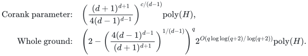

# One-value allocation with exact quotas and setup costs

**Guarantee**

Returns at least <code class="math">\lceil K_\star/2\rceil</code> units to every player of an actual selected basis, preserving the exact combined setup and assignment budget. More generally, fixed integer <code class="math">d\ge2</code> gives <code class="math">\lceil K_\star/d\rceil</code>.

**Objective and output**

Maximize the common minimum count of equal-value units; output a selected basis and integral resource counts.

**Randomness**

Deterministic corank branching and exact-budget recovery; the whole-ground alternative uses deterministic inclusion covers.

**Time**

For fixed integer <code class="math">d\ge2</code>, the two time bounds are:

<!-- math-display: 114a0af1b69ee8e6edcafab2
\begin{aligned}
\text{Corank parameter:}\quad &\left(\frac{(d+1)^{d+1}}{4(d-1)^{d-1}}\right)^{c/(d-1)}\mathrm{poly}(H),\\
\text{Whole ground:}\quad &\left(2-\left(\frac{4(d-1)^{d-1}}{(d+1)^{d+1}}\right)^{1/(d-1)}\right)^q 2^{O(q\log\log(q+2)/\log(q+2))}\mathrm{poly}(H).
\end{aligned}
-->

Exact factor two has corank base <code class="math">27/4</code> and whole-ground base <code class="math">50/27</code>; factor three has the respective bases <code class="math">4</code> and <code class="math">7/4</code>.

**Space**

Polynomial in the complete binary input and paid oracle workspace; numerical resource multiplicities are not expanded into individual units.

**Parameters**

<code class="math">q</code> is the nonloop player count; <code class="math">r\ge1</code> is its matroid rank; <code class="math">c=q-r</code>; <code class="math">K_\star</code> is the integer optimum count; each unit has value <code class="math">v&gt;0</code>. <code class="math">\Gamma(R)=R^R/(R-1)^{R-1}</code>. <code class="math">H</code> includes the explicit ground, all rational and integer encodings, and paid rank, submodular-minimization, LP, intersection, and decomposition work.

**Model and representation**

Arbitrary integral recipient polymatroids, an original player-matroid basis, nonnegative setup and assignment costs, one shared exact budget, and unused resources allowed.

**Lower-bound scope**

The [strict-below-two oracle barrier](../allocation-lower-bounds/proof.md) applies to an included zero-cost subclass; it does not prove these exponential bases optimal.

**Review status**

**Ready for review.** The full one-value allocation family: the main exact factor-two theorem with arbitrary nonnegative assignment costs, the shared setup-and-assignment budget companion, every fixed integer approximation factor `d>=2`, corank weighted omission and streamed whole-ground conversion, exact prescribed-original-basis optimization, the direct Boolean-cap/assignment-pair one-unit gate and the inherited strict-below-two recipient-value-oracle boundary. The audit covers original loop deletion and free disposal, nonnegative projected separation, attained minimum-setup restriction and protected original full witness under adaptive residual budgets, exact maximum-total cost-minimizing quota recovery and nonmonotone one-sided integer optimization. The native complete-table client implements actual original-basis allocation through a direct capped-service primal/dual separator, exact dominant scalar recovery, canonical weighted pair intersection, omission and rational containment covers.

**Dependencies and scope.** There is one common positive value, one original player matroid, optional original-basis selection, arbitrary integral recipient polymatroids with unused capacity allowed, nonnegative setup and assignment costs, and one exact combined scalar budget. An unaffordable setup basis is zero-service infeasibility, distinct from zero optimum; the rank-zero output has no finite minimum utility. Prescribed-basis optimization remains an exact polynomial-oracle endpoint rather than an approximation claim. The sharp corank and fixed-integer whole-ground bounds charge the stated polynomial exact rank/SFM, rational LP and weighted matroid/polymatroid-intersection primitives. The native backend reuses exact Bland simplex with a separately charged potentially exponential finite basis bound and polynomial explicit-table/binary workspace. Its rational covers attain the sharp `d=2` and `d=3` endpoints; for other or varying binary d they use the certified rational envelope `3*(d+1)/(d-1)`, distinct from the proved sharp fixed-d algebraic comparison construction. No numerical capacity, quota or setup/assignment budget is expanded into unit copies. The strict-below-two obstruction is a deterministic recipient-value-oracle approximation boundary for the included zero-cost optional-basis subclass. It does not prove exponential bases optimal, apply to prescribed-basis exact optimization, or establish explicit-recipient-list hardness. Finite original-input checks support the complete manuscript arguments; proof-assistant formalization, external peer review and exhaustive publication-priority claims are not made.

The [verification note](verify/README.md) identifies executable coverage. This status does not claim external peer review or proof-assistant verification.

**Source**

[Manuscript and proof](proof.md), with [dependencies and verification sources](sources.md).

The [base proof](proof.md) treats assignment costs; the [setup and full quota tradeoff](setup-tradeoffs.md) proves the stronger shared-budget statement. With <code class="math">c=0</code>, exact count optimization is polynomial after subtracting the fixed setup cost.

**Attribution.** icekylinx · GPT-6 Astra Pro
